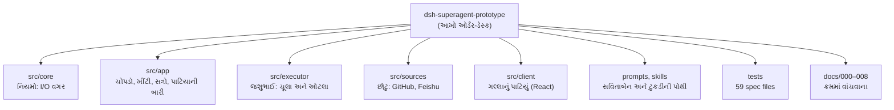

# પ્રકરણ 0 — પાયો: ફોન વાગ્યા કરે છે

> **Level 0 · વાર્તાનો દિવસ 1.**
> આ પ્રકરણમાં આપણે repository ને ઓળખીએ છીએ: તે શું છે, તેમાં ક્યાં શું છે, અને તેને કેવી રીતે ચલાવીને ચકાસવું.
> આખો નકશો: [સમગ્ર નકશો](overview-samagra-naksho.md).

**વાંચવાની રીત.** દરેક દૃશ્ય ચાર પગથિયાંમાં ચાલે છે: 🎬 ઘટના, ❓ આરવનો પ્રશ્ન, 💻 code માં, 🔬 expert નજર.

## 🎯 આ પ્રકરણ પછી તમે શું કરી શકશો

- project નો હેતુ અને તેનું "research prototype" હોવું એક વાક્યમાં સમજાવી શકશો.
- દરેક top-level folder નું કામ કહી શકશો.
- `pnpm check` ચલાવી શકશો અને તેનું output વાંચી શકશો.
- આ repository માં વારંવાર આવતી TypeScript (`interface`, union, `Pick`, `zod`) વાંચી શકશો.
- પહેલી file `src/index.ts` line-by-line સમજાવી શકશો.

**પૂર્વજરૂરિયાત:** કોઈ પણ ભાષામાં functions અને objects; terminal માં `cd`, `ls`; Git માં `clone`, `checkout`. [પહેલું પુસ્તક](https://github.com/vrajkher/DeepSeekHarnessBookNEW) વાંચ્યું હોય તો ઉત્તમ, પણ ફરજિયાત નથી.

## 🗺️ નકશો: ભોજનાલય અને repository



દરેક ખાનું એક folder છે, અને નીચેની લીટી ભોજનાલયમાં તેનું કામ કહે છે. તીર "આ folder આની અંદર છે" બતાવે છે.

---

## દૃશ્ય 1 — ફોન વાગ્યા કરે છે

🎬 દિવાળીની રજાનો પહેલો દિવસ. આરવ ઘરે આવે છે અને જુએ છે કે પપ્પા ગલ્લા પર બેઠા છે, એક હાથમાં ફોન અને બીજા હાથમાં પેન. અડધા કલાકમાં અગિયાર ફોન: "મારા ટિફિનનું શું થયું?", "ગુરુવારની થાળીમાં કઢી રાખજો", "તમારો માણસ પહોંચ્યો?". રમેશભાઈ પણ દર પાંચ મિનિટે પૂછવા આવે છે. પપ્પા થાકીને કહે છે: "રાંધવામાં વાર નથી લાગતી. **જવાબ આપવામાં** દિવસ જાય છે."

❓ "દીદી, મહારાજ તો ઝડપી છે, રમેશભાઈ પણ. તો અટકે છે શું?"

મીરાદીદી: "પપ્પાનું **ધ્યાન**. દરેક ફોન, દરેક પ્રશ્ન, દરેક 'થઈ ગયું' ની જાણ પપ્પાની એક મિનિટ ખાય છે. એવો મદદનીશ જોઈએ જે ત્યારે જ બોલે જ્યારે પપ્પાએ કંઈક કરવાનું હોય."

💻 `dsh-superagent-prototype` બરાબર આ સમસ્યા માટે બન્યું છે. README તેને આમ વર્ણવે છે: એક GitHub repository માટેનો **proactive coding agent**, જે **DeepSeek Harness (DSH) ના bundle** તરીકે ચાલે છે ([README][readme]). ✅ તે GitHub (અને વૈકલ્પિક રીતે Feishu) સાંભળે છે. Allowed વ્યક્તિ કામ માગે ત્યારે work item ખોલે છે, તેને અલગ agent session અને અલગ directory માં કરે છે, અને મૂળ વાતચીતમાં જવાબ આપે છે.

તેની ફિલસૂફી એક વાક્યમાં ([docs/000][doc-philosophy]): ✅

> "Take as little human attention as possible, and give as much value as possible."

આ વાક્યમાંથી agent ના નિયમો નીકળે છે: પૂછવામાં આવે ત્યારે જ કામ કરે; પરિણામ તૈયાર હોય કે નિર્ણય જોઈતો હોય ત્યારે જ બોલે; એક સમયે એક જ સ્પષ્ટ પ્રશ્ન પૂછે; અને પ્રામાણિક report આપે.

> ⚠️ **Research prototype.** README ની પહેલી જ લીટી: "Research prototype for reference only, not an official DeepSeek product." તેમાં bugs હોઈ શકે છે, અને લેખ *Exploring Super-agent Design* ની કેટલીક designs અહીં implement નથી ([પ્રકરણ 0A](00a-lekh-ane-prototype.md)).

> 📦 **External boundary.** dsh-superagent એકલું ચાલતું program નથી. Sessions, LLM calls, tools અને plugin system (**Cordis**) DeepSeek Harness પૂરાં પાડે છે. આ પુસ્તક DSH ને "બહારની સીમા" ગણે છે: આ repository તેના કયા interfaces બોલાવે છે તે બતાવીએ છીએ, તેનો અંદરનો code નહીં.

🔬 **Expert નજર.** શિખાઉ agent ને તેની ક્ષમતાથી માપે છે: "તે કેટલું કરી શકે?" Expert તેને **ધ્યાનના ખર્ચ** થી માપે છે: "તે દર કલાકે કેટલી વાર માણસને રોકે છે, અને દરેક વખતે કેટલું મૂલ્ય આપે છે?" આ repository ની દરેક design, દરેક setting અને panel નું દરેક ખાનું આ એક માપથી તપાસાયું છે. જે તત્વ ધ્યાન ખાય છે પણ એટલું મૂલ્ય આપતું નથી, તે કાઢી નખાયું છે.

## દૃશ્ય 2 — ભોજનાલયનો નકશો: ક્યાં શું છે

🎬 દીદી આરવને ભોજનાલયમાં ફેરવે છે, જાણે તે પહેલી વાર આવ્યો હોય. "રસોડું અહીં, કોઠાર ત્યાં, ગલ્લો આગળ. નવી જગ્યાએ પહેલાં **નકશો** જોવાય, પછી કામ."

❓ "Repository માં 216 files છે. ક્યાંથી શરૂ કરું?"

💻 Pinned commit ([`8c32a9d`](https://github.com/deepseek-ai/dsh-superagent-prototype/tree/8c32a9dc5d72c033816c6a8110b37f40cf94fba4)) માં 216 tracked files છે. ✅ Folders:

| Folder | ભોજનાલયમાં | કામ | પહેલી file |
|---|---|---|---|
| `src/core/` | નિયમોની પોથી | Domain logic: I/O વગર, synchronous | `engine.ts` |
| `src/app/` | ચોપડો, ખીંટી, ડેસ્ક | Runtime, SQLite Store, Effects, Sessions, tools, HTTP | `runtime.ts` |
| `src/executor/` | જશુભાઈ | Ticket ને DSH worker session માં ચલાવવું | `dsh.ts` |
| `src/sources/` | છોટુ | GitHub/Feishu events ને Triggers માં બદલવા | `github.ts` |
| `src/infra/` | ફોન અને ચાવીઓ | `gh`/`lark-cli`/`git` ચલાવવા, environment, health | `commands.ts` |
| `src/client/` | પાટિયું | Browser માં ચાલતી React panel | `app.tsx` |
| `prompts/`, `skills/` | સૂચના-પોથી | Models વાંચે તે text | `worker.md` |
| `docs/` | — | Design docs, ક્રમમાં વાંચવાના | `001-domain.md` |
| `tests/` | — | 59 vitest spec files + fixtures | `core-engine.spec.ts` |

Architecture doc ([docs/007][doc-arch]) આ બધાને બે જૂથમાં વહેંચે છે: **core classes** (domain concepts અને સીમાઓના માલિક) અને **glue** (tool arguments, HTTP requests અને Source payloads ને તે classes ના calls માં ફેરવનાર).

🔬 **Expert નજર.** `src/core` સૌથી નાનું folder છે, પણ સૌથી મહત્વનું. તે `node:crypto` સિવાય બહારનું કશું import કરતું નથી, અને કોઈ I/O કરતું નથી (🧪 [પ્રકરણ 13](13-advanced-engineering.md) માં grep થી ચકાસ્યું). એટલે આખું domain memory માં, fakes સાથે, milliseconds માં test થાય છે. Expert કોઈ પણ નવા codebase માં પહેલાં આ શોધે છે: "નિયમો ક્યાં છે, અને તે બહારની દુનિયાથી કેટલા અલગ છે?"

## દૃશ્ય 3 — ચાર ઘંટડી: બધું બરાબર છે તેની ખાતરી

🎬 રોજ સવારે કાંતિકાકા ચાર વસ્તુ તપાસે છે: ગેસ, પાણી, ફ્રિજ, ગલ્લો. ચારેય "બરાબર" હોય ત્યારે જ દરવાજો ખૂલે. એક પણ અટકે, તો આગળ વધતા નથી.

❓ "Code માં 'બધું બરાબર' એક command થી કેવી રીતે જાણું?"

💻 **Repository code** ([package.json][pkg-scripts]): ✅

```json
"scripts": {
  "build": "tsdown",
  "typecheck": "tsc --noEmit",
  "test": "vitest run",
  "check": "pnpm typecheck && pnpm test && pnpm build"
}
```

| Script | શું કરે | Tool |
|---|---|---|
| `pnpm typecheck` | Types તપાસે; file લખતું નથી | TypeScript 6.0.3 |
| `pnpm test` | `tests/*.spec.ts(x)` ચલાવે | vitest 4.1.8 |
| `pnpm build` | `lib/` માં bundles બનાવે | tsdown |
| `pnpm check` | ત્રણેય ક્રમમાં; `&&` એટલે એક fail થાય તો ત્યાં અટકે | — |

Runtime dependencies ફક્ત બે છે: `zod` અને `proper-lockfile`. બાકીના `@deepseek-ai/*` packages **peer dependencies** છે, જે DSH host પૂરા પાડે છે. `engines` માં Node `^22.19.0 || >=24.0.0` અને DSH `^0.2.1-alpha.2` જોઈએ ([package.json][pkg-engines]). ✅

🧪 આ પુસ્તક માટે pinned commit પર ચલાવ્યું:

```text
$ tsc --noEmit
$ vitest run
 Test Files  59 passed (59)
      Tests  1197 passed (1197)
✔ Build complete
```

> ⚠️ પછીના runs માં upstream નો એક Feishu test આ environment માં સતત fail થયો (1196/1197). કારણ timing race છે, આપણો code નહીં. વિગત અને એક-શબ્દનો fix: [પ્રકરણ 12, દૃશ્ય 6](12-customization.md).

🔬 **Expert નજર.** `pnpm check` એ "કરાર" છે: આ ત્રણ પાસ થાય તો ફેરફાર રજૂ કરવા લાયક છે. Expert કોઈ પણ ફેરફાર પહેલાં **baseline** લે છે, એટલે કે ફેરફાર વગર check ચલાવે છે. નહીં તો પોતાના ફેરફાર પછી fail થયેલો test પોતાનો છે કે પહેલેથી તૂટેલો હતો, તે કહી શકાતું નથી. ઉપરના ⚠️ માં આપણે બરાબર આ જ શીખ્યા.

## દૃશ્ય 4 — ફોર્મનાં ખાનાં: ડેસ્કની ભાષા

🎬 સવિતાબેનના ડેસ્ક પર ઓર્ડરનું છાપેલું ફોર્મ છે: નામ, તારીખ, થાળીની સંખ્યા, અને "ખાસ સૂચના (હોય તો)". દરવાજે ગોવિંદકાકા ખાલી ખાનાંવાળું ફોર્મ પાછું આપે છે. સવિતાબેન કહે છે: "ફોર્મ બરાબર ભરેલું હોય તો મારે ફરી પૂછવું ન પડે."

❓ "TypeScript માં આ 'ફોર્મ' કેવું દેખાય?"

💻 ચાર રચનાઓ આખા repository માં વારંવાર આવે છે.

**(a) `interface` = ફોર્મનો આકાર.** Repository code ([`Trigger`][model-trigger], shortened): ✅

```ts
export interface Trigger {
  id: string
  source: string
  threads: ThreadRef[]
  actor: ActorRef
  human: boolean
  addressed?: 'mention' | 'direct'
  at: string
  text: string
  channel?: ChannelRef
  meta: Record<string, unknown>
}
```

`addressed?` માં `?` એટલે "હોય તો". `'mention' | 'direct'` એ **union**: આ બે સિવાય બીજું કશું ચાલતું નથી. `Record<string, unknown>` એટલે ગમે તે keys, જેની value વાપરતાં પહેલાં તપાસવી પડે.

**(b) Discriminated union = "હા/ના" ખાના પ્રમાણે બાકીનું ફોર્મ.** ([`GateResult`][ports-gate]) ✅

```ts
export type GateResult = { admissible: false; reason: string } | { admissible: true; strength: Strength; basis: MandateBasis }
```

`if (!gate.admissible)` પછી TypeScript જાણે છે કે `gate.reason` છે; બીજી શાખામાં `gate.strength` છે.

**(c) `Pick` = દરેકને તેના કામ જેટલી જ ચાવીઓ.** ([role types][engine-roles]) ✅

```ts
export type EngineForSources = Pick<Engine, 'receive' | 'bindThread' | 'threadClosed'>
```

છોટુ (Source) પાસે ત્રણ જ ચાવી છે. `stopTicket` તેના type માં નથી, એટલે તે તેને બોલાવી શકતો જ નથી.

**(d) `zod` = દરવાજે ફોર્મની તપાસ.** TypeScript ના types compile પછી અદૃશ્ય થઈ જાય છે. બહારથી આવતો data (settings, GitHub JSON, model ના tool arguments) runtime પર તપાસવો પડે. ([`EvalConfigSchema`][policy-evalcfg]) ✅

```ts
export const EvalConfigSchema = z.object({
  mode: z.enum(['off', 'observe', 'auto']).default('observe'),
  timeoutSeconds: z.number().int().min(LIMITS.evalTimeoutSeconds.min).max(LIMITS.evalTimeoutSeconds.max).default(120),
  model: RoleModelSchema.nullable().default(null),
}).strict()
```

`.default()` ખાલી ખાનું ભરે છે; `.strict()` અજાણ્યાં ખાનાં નકારે છે.

🔬 **Expert નજર.** `Pick` વાળી રીત આ repository નો મુખ્ય architecture નિયમ છે: "Explicit, narrow dependencies" ([docs/007][doc-arch]). દરેક class ને ફક્ત એ interface મળે છે જેમાં તેને જોઈતી methods હોય. ફાયદો: કોઈ class શું કરી **શકે** તે તેના constructor ના type માં વંચાય છે, આખો code વાંચ્યા વગર.

## દૃશ્ય 5 — તાળું ખોલનાર: `src/index.ts`

🎬 સવારે ભોજનાલયનું તાળું એક જ વ્યક્તિ ખોલે છે: કાંતિકાકા. તે પહેલાં જુએ છે કે જરૂરી સ્ટાફ આવી ગયો છે, પછી તાળું ખોલે છે, અને સાંજે બંધ કરવાની જવાબદારી પણ તે જ લે છે.

❓ "dsh-superagent નું તાળું કઈ file ખોલે છે?"

💻 **Repository code** ([`src/index.ts`][index-apply], shortened): ✅

```ts
export const name = 'dsh-superagent'
export const inject = ['agents', 'sessionController', 'sessionPersistence', 'workspaceRegistry', 'permissionPresets', 'tools', 'systemPrompt', 'skills', 'webServer', 'llm', 'subprocess']
export { Config }
export async function apply(ctx: Context, config: DeploymentConfig): Promise<void> {
  const machine = machineOf(config)
  ctx.inject(['settings'], child => { child.effect(() => child.settings.configure({ auto: false }, ctx.fiber)) })
  const restart = (): void => { ctx.fiber.restart().then(…).catch(…) }
  const runtime = new Runtime(ctx, machine, restart)
  ctx.effect(() => async () => { await runtime.stop() })
  await runtime.ready
  ctx.logger.info(runtime.configured() ? 'dsh-superagent ready; …' : `dsh-superagent is waiting for setup: …`)
}
```

| Line | ભોજનાલયમાં | અર્થ |
|---|---|---|
| `name` | દુકાનનું પાટિયું | Cordis plugin નું નામ |
| `inject` | "આ 11 જણ હાજર હોય તો જ ખોલું" | DSH host ની 11 services; એક પણ ન હોય તો `apply` ચાલતું નથી |
| `Config` | ભાડાકરાર | Plugin configuration નો schema; `stateDir` ફરજિયાત ([`deployment.ts`][deploy-config]) |
| `new Runtime(…)` | આખો ડેસ્ક ગોઠવવો | **Composition root** ([પ્રકરણ 3](03-startup.md)) |
| `ctx.effect(() => async () => …stop())` | સાંજે તાળું મારવાની જવાબદારી | Plugin unload થાય ત્યારે cleanup ચાલે |
| `await runtime.ready` | "ખૂલી ગયું" | Startup પૂરું, અથવા setup બાકી છે તે નક્કી |

`ctx.effect` માં બે arrow functions છે. બહારનું અત્યારે ચાલે છે. તે જે function પાછું આપે છે તે **cleanup** છે, અને plugin બંધ થાય ત્યારે ચાલે છે.

🔬 **Expert નજર.** આ file માં business logic શૂન્ય છે. તે ફક્ત "કોણ, ક્યારે, કયા ક્રમમાં" નક્કી કરે છે. Entry point આટલો પાતળો હોય, તો બે ફાયદા થાય: આખી application test માં simulated host ([`tests/fixtures/host.ts`][test-host-fixture]) પર ઊભી કરી શકાય, અને restart એક જ line (`ctx.fiber.restart()`) બને.

---

## Source map

| ક્રમ | File | શું જોવું |
|---|---|---|
| 1 | [README][readme] | હેતુ, prototype ચેતવણી, docs નો ક્રમ |
| 2 | [docs/000][doc-philosophy] | ફિલસૂફી અને operator ની જવાબદારી |
| 3 | [package.json][pkg-scripts] | scripts, engines, peerDependencies |
| 4 | [`src/index.ts`][index-apply] | `inject`, `apply` |
| 5 | [`src/deployment.ts`][deploy-config] | `Config` |

## 🧪 Lab: build અને tests

Network જોઈએ, કારણ કે `pnpm install` npm registry માંથી packages લાવે છે.

```bash
git clone https://github.com/deepseek-ai/dsh-superagent-prototype.git && cd dsh-superagent-prototype
```

```bash
git checkout 8c32a9dc5d72c033816c6a8110b37f40cf94fba4 && pnpm install --frozen-lockfile
```

```bash
pnpm check
```

**અપેક્ષિત અવલોકન:** `Test Files 59 passed`, `Tests 1197 passed`, `Build complete`. દરેક test process `ExperimentalWarning: SQLite is an experimental feature` છાપે છે. તે Node ના built-in `node:sqlite` ની ચેતવણી છે, error નથી.

પછી એક જ test, નામથી:

```bash
pnpm vitest run tests/core-engine.spec.ts -t "stores a trigger once"
```

## 🔮 આગાહી કસોટી

ચલાવતાં પહેલાં ધારો: `pnpm test` fail થાય, તો `pnpm check` build ચલાવશે? (જવાબ: ના. `&&` પહેલી નિષ્ફળતા પર અટકે છે. 🧪 [પરિશિષ્ટ G](../appendix/G-verification-log.md) ની row 2 માં આ જ દેખાયું: test fail થયો, અને build ચાલ્યું નહીં.)

## 🩺 નિષ્ફળતા: "Cannot find module node:sqlite"

**લક્ષણ:** tests તરત fail થાય છે. **નિદાન:** `node -v`. Node 22.19 કરતાં જૂનું હોય તો built-in SQLite નથી. **સુધારો:** Node ને `engines` ની range માં લાવો. ⚠️ જૂના Node પર અમે ચલાવ્યું નથી; આ `engines` field અને `node:sqlite` import પરથી કરેલું અનુમાન છે.

<a id="saar"></a>

## ✅ સાર

| 🎬 ઘટના | 💻 નિયમ |
|---|---|
| ફોન વાગ્યા કરે છે | ધ્યાન સૌથી મોંઘું: "as little human attention as possible" |
| ભોજનાલયનો નકશો | `core` (નિયમો) અને glue અલગ; core I/O વગર |
| ચાર ઘંટડી | `pnpm check` = typecheck && test && build; પહેલાં baseline |
| ફોર્મનાં ખાનાં | `interface`, union, `Pick`, `zod` |
| તાળું ખોલનાર | `src/index.ts`: `inject` → `Runtime` → `ready` |

**યાદ-ચાવી:** "59-1197" (test files અને tests), અને "11 જણ હાજર" (`inject`).

<details><summary>કાર્ડ 1: `peerDependencies` અહીં કેમ મહત્વની છે?</summary>

`@deepseek-ai/*` packages DSH host પૂરા પાડે છે, જેથી host અને plugin એક જ Cordis/DSH instance વાપરે. Plugin પોતાની copy લાવે તો services નું injection તૂટે.
</details>

<details><summary>કાર્ડ 2: `zod` વગર ફક્ત types કેમ પૂરતા નથી?</summary>

Types compile પછી અદૃશ્ય થાય છે. Saved JSON, HTTP body અને model ના tool arguments runtime પર આવે છે, એટલે તપાસ પણ runtime પર જોઈએ.
</details>

**મિત્રને સમજાવો:** પહેલાં ભોજનાલયથી ("ફોન વાગ્યા કરે છે, એટલે ડેસ્ક જોઈએ"), પછી વાર્તા વગર ("DSH bundle જે GitHub events ને authorized Tickets માં ફેરવે છે").

## 🧠 Mastery check

1. આ project ને "research prototype" કહેવાથી તમારા ઉપયોગ પર શું અસર પડે?
2. `EngineForSources` type, Source plugin ને Ticket stop કરતાં કેવી રીતે રોકે છે?
3. `ctx.effect(() => async () => runtime.stop())` માં બે arrow functions કેમ છે?
4. Baseline `pnpm check` પોતાના ફેરફાર પહેલાં કેમ ચલાવવો?

જવાબો: [પરિશિષ્ટ D](../appendix/D-lab-solutions.md#પ્રકરણ-0).

## 🎬 આગળ શું

સાંજે આરવ પૂછે છે: "દીદી, આ ડેસ્કનો વિચાર તમારો છે?" દીદી હસીને phone પર એક લેખ ખોલે છે: "ના. જેમણે આ code લખ્યો, તેમણે જ વિચાર પણ લખ્યો છે. કાલે ડેસ્ક ગોઠવતાં પહેલાં આજે રાત્રે આ વાંચીએ." → [પ્રકરણ 0A](00a-lekh-ane-prototype.md)

<!-- citations:begin (generated by tools/refdefs.py) -->
[deploy-config]: https://github.com/deepseek-ai/dsh-superagent-prototype/blob/8c32a9dc5d72c033816c6a8110b37f40cf94fba4/src/deployment.ts#L15-L17
[doc-arch]: https://github.com/deepseek-ai/dsh-superagent-prototype/blob/8c32a9dc5d72c033816c6a8110b37f40cf94fba4/docs/007-architecture.md#L1-L10
[doc-philosophy]: https://github.com/deepseek-ai/dsh-superagent-prototype/blob/8c32a9dc5d72c033816c6a8110b37f40cf94fba4/docs/000-philosophy.md#L1-L10
[engine-roles]: https://github.com/deepseek-ai/dsh-superagent-prototype/blob/8c32a9dc5d72c033816c6a8110b37f40cf94fba4/src/core/engine.ts#L261-L270
[index-apply]: https://github.com/deepseek-ai/dsh-superagent-prototype/blob/8c32a9dc5d72c033816c6a8110b37f40cf94fba4/src/index.ts#L7-L25
[model-trigger]: https://github.com/deepseek-ai/dsh-superagent-prototype/blob/8c32a9dc5d72c033816c6a8110b37f40cf94fba4/src/core/model.ts#L23-L39
[pkg-engines]: https://github.com/deepseek-ai/dsh-superagent-prototype/blob/8c32a9dc5d72c033816c6a8110b37f40cf94fba4/package.json#L52-L56
[pkg-scripts]: https://github.com/deepseek-ai/dsh-superagent-prototype/blob/8c32a9dc5d72c033816c6a8110b37f40cf94fba4/package.json#L46-L51
[policy-evalcfg]: https://github.com/deepseek-ai/dsh-superagent-prototype/blob/8c32a9dc5d72c033816c6a8110b37f40cf94fba4/src/policy.ts#L83-L87
[ports-gate]: https://github.com/deepseek-ai/dsh-superagent-prototype/blob/8c32a9dc5d72c033816c6a8110b37f40cf94fba4/src/core/ports.ts#L7
[readme]: https://github.com/deepseek-ai/dsh-superagent-prototype/blob/8c32a9dc5d72c033816c6a8110b37f40cf94fba4/README.md#L1-L10
[test-host-fixture]: https://github.com/deepseek-ai/dsh-superagent-prototype/blob/8c32a9dc5d72c033816c6a8110b37f40cf94fba4/tests/fixtures/host.ts#L1-L20
<!-- citations:end -->
