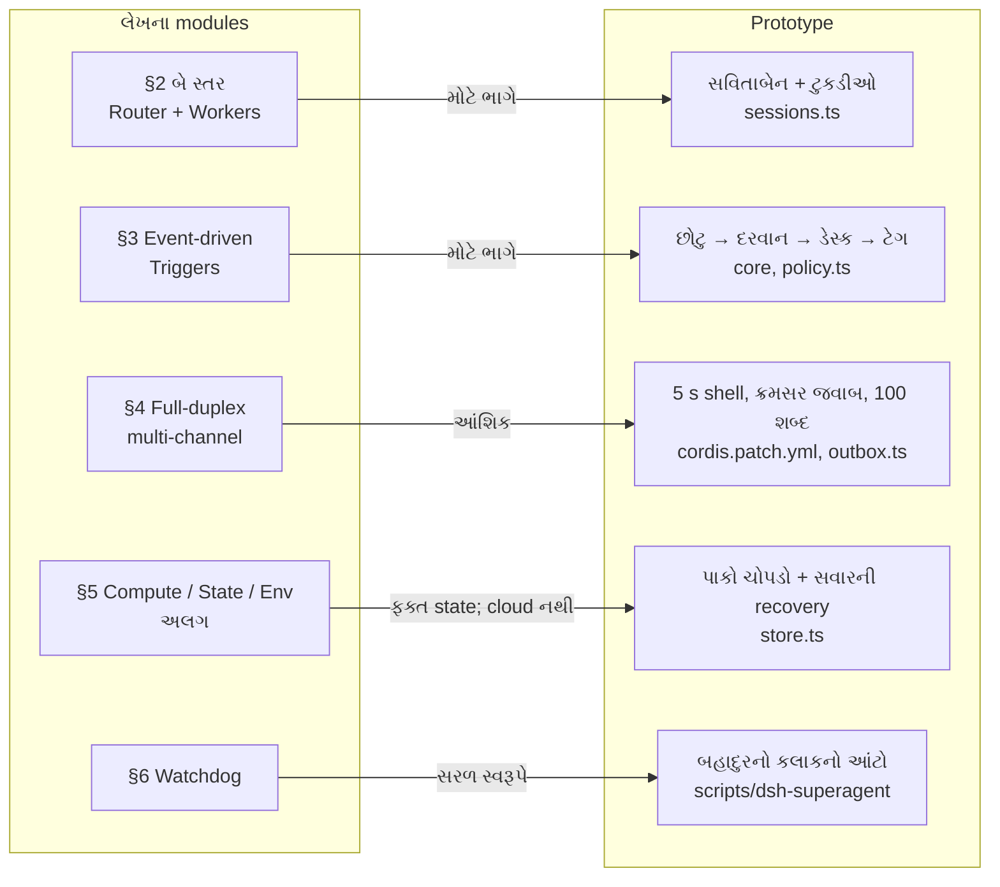

# પ્રકરણ 0A — લેખ અને prototype: વિચાર ક્યાંથી આવ્યો

> **વાર્તાનો દિવસ 1, રાત.**
> DeepSeek Harness team નો લેખ *Exploring Super-agent Design: Towards a More Autonomous Agent System* આ prototype પાછળનો વિચાર સમજાવે છે. આ પ્રકરણ લેખના દરેક વિચારને ભોજનાલયની એક ઘટના અને code ની એક જગ્યા સાથે જોડે છે, અને કહે છે કે તે કેટલો implement થયો છે.
> પહેલાં: [પ્રકરણ 0](00-paayo.md).

> **Sources અને સીમા.** લેખ: [X post, @DeepSeekHarness, 1 Nov 2026](https://x.com/DeepSeekHarness/status/2116857257245987236). મૂળ ચીની ભાષામાં છે; અહીં વપરાયેલું લખાણ X પરનું machine translation છે. લેખ પોતે કહે છે: "Parts of the design in this article are implemented in dsh-superagent-prototype." README પણ ચેતવે છે કે prototype લેખના implementation જેવો નથી ([README][readme]). ⚠️ લેખના experiments (§7) ના આંકડા લેખના છે; અમે તે ફરી ચલાવ્યા નથી.

## 🎯 આ પ્રકરણ પછી તમે શું કરી શકશો

- Super-agent ના ચાર ગુણો અને પાંચ modules સમજાવી શકશો.
- દરેક module માટે કહી શકશો: prototype માં **ક્યાં** છે, અને **કેટલો**.
- લેખ અને code વચ્ચેના ત્રણ મોટા તફાવત બતાવી શકશો.

## 🗺️ નકશો: લેખના modules અને code



ડાબે લેખનો module, જમણે તેને સૌથી નજીકનો code. તીર પરનું લખાણ implementation કેટલું પૂરું છે તે કહે છે.

---

## દૃશ્ય 1 — રમેશભાઈ પાંચ ટેબલ વચ્ચે ગૂંચવાયા

🎬 રાત્રે જમ્યા પછી પપ્પા આજનો કિસ્સો કહે છે. બપોરે પાંચ ટેબલ એક સાથે ભરાયા. રમેશભાઈએ ટેબલ 2 નો "કઢી વધારે" ટેબલ 4 ને પીરસ્યો. "એક માણસ પાંચ વાત મગજમાં રાખે, એટલે ભળી જ જાય."

❓ "તો પાંચ રમેશભાઈ રાખીએ?"

દીદી: "તો પાંચેય પપ્પાને અલગ-અલગ પૂછવા આવશે. ગ્રાહકને પણ ખબર નહીં પડે કે કોની સાથે વાત કરવી."

💻 લેખ આ જ ગાંઠથી શરૂ થાય છે. આજના agents **એક session** ને કામનો એકમ ગણે છે, અને sessions એકબીજાથી અલગ છે. વપરાશકર્તાએ જાતે sessions વચ્ચે ફરવું પડે છે: "a person can usually follow only 3 to 5 active sessions at once… multi-tasking is limited by human attention."

ઉકેલ તરીકે લેખ **Super-agent** ના ચાર ગુણો માગે છે:

| ગુણ | અર્થ | ભોજનાલયમાં | Prototype માં |
|---|---|---|---|
| Continuous | હંમેશાં એક જ agent લાગે | ગ્રાહક હંમેશાં "અન્નપૂર્ણા" સાથે વાત કરે | એક main Session; Thread subscriptions; resume |
| Productive | ઘણાં કામ સમાંતરે | દરેક ઓર્ડરની અલગ ટુકડી | Ticket દીઠ worker Session; slots |
| Proactive | ઘટનાઓ જુએ, કામ લાયક હોય તો કરે | "કઢી ખૂટશે" જોઈને પહેલેથી બનાવે | admission table, accept mode, rules |
| Persistent | હંમેશાં ચાલુ; જાતે સાજું થાય | રાતે પણ ઓર્ડર નોંધાય | SQLite Store; restart recovery; hourly check |

🔬 **Expert નજર.** લેખનું મુખ્ય વાક્ય: "Sessions should be an implementation detail of the system, not a mental burden on its users." Session બે કામ કરતું હતું: model નો context સાચવવો, અને વપરાશકર્તાનો project-management એકમ બનવું. Super-agent આ બેને અલગ પાડે છે. Prototype માં વપરાશકર્તાનો એકમ **Ticket** છે, session નહીં. `docs/001` "Ticket state that follows the DSH Session" ને સ્પષ્ટ રીતે નકારે છે ([docs/001][doc-domain]). ✅

## દૃશ્ય 2 — સવિતાબેન ચૂલાને હાથ નથી લગાડતાં

🎬 દીદી કાગળ પર બે ખાનાં દોરે છે. ઉપર: **સવિતાબેન**, ઓર્ડર-ડેસ્ક. નીચે: રસોઈ-ટુકડીઓ. "સવિતાબેન બધા ગ્રાહકો સાથે વાત કરશે અને કામ વહેંચશે. પણ એક નિયમ: તે ચૂલાને હાથ નહીં લગાડે."

❓ "સવિતાબેન તો રસોઈ જાણે છે. એક રોટલી વણી આપે તો શું વાંધો?"

"તે રોટલી વણતાં હોય ત્યારે આવેલો ફોન કોણ ઉપાડે? ડેસ્ક ક્યારેય વ્યસ્ત ન હોવો જોઈએ."

💻 લેખ §2: **Router layer** લાંબું જીવે છે, બધી માનવ interaction સંભાળે છે, અને પોતે task execute કરતું નથી. **Worker layer** માં દરેક task માટે અલગ context વાળું session છે.

Prototype માં:

- Router = **main Session**. Id `orchestrator-<hash(stateDir)>` ([`runtime.ts`][rt-master]), preset `dsh-superagent-router` ([`sessions.ts`][sessions-presets], [patch][patch-router]). ✅
- Worker = દરેક Ticket માટે `worker-<ticketId>` ([`workerSessionId`][dsh-session-id]), preset `dsh-superagent-worker` ([patch][patch-worker]). ✅

> ⚠️ **લેખથી ત્રણ તફાવત.**
> 1. લેખ: Router "can run without a Bash tool at all". Prototype ના router preset માં bash **છે**, પણ foreground command 5 seconds પછી background માં જાય છે, file writes બંધ છે ([patch][patch-router-fs]), અને `noWait` guard `sleep`, 30 s થી લાંબો timeout અને 5 s થી લાંબો job wait નકારે છે ([`noWait`][sessions-nowait]). ✅
> 2. લેખ: "Workers never interact with humans directly." Prototype માં worker `orchestrator_ack` વડે પહોંચ લખી શકે છે ([tool][tools-ack]), અને `gh` વડે PR પર લખે છે. પરિણામ, જવાબ અને પ્રશ્નો main Session માંથી જાય છે.
> 3. લેખનો Router batching DSH inbox ના `steer` delivery થી આવે છે: `relay` effect main Session ને `steer` mode માં message આપે છે ([handler][sessions-relay-handler]). ઉપરાંત domain માં પણ batching છે: એક પાના પર Eval ચાલતું હોય ત્યારે આવેલી ચિઠ્ઠીઓ ભેગી થાય છે ([`Evals.start`][evals-start]). ✅

🔬 **Expert નજર.** લેખ Router ને **Agent Team ના Team Lead** થી અલગ પાડે છે. Team Lead એક મોટા કામને પગથિયાંમાં તોડે છે અને ઊંડી સમજ માગે છે. Router ફક્ત સ્વતંત્ર કામો વહેંચે છે, એટલે તેનું કામ હલકું છે અને હલકું model ચાલે. Prototype આને prompt ના નિયમથી પકડે છે: routing note વધુમાં વધુ 30 શબ્દો (`NOTE_WORDS`, [`text.ts`][text-limits]), અને "makes no technical decisions" ([docs/004][doc-prompts]). ✅

## દૃશ્ય 3 — દરવાન પહેલાં, સવિતાબેન પછી

🎬 આરવ ગણે છે: આજે રજિસ્ટર અને WhatsApp ગ્રુપમાં 140 લખાણ આવ્યાં. તેમાંથી ઓર્ડર ફક્ત 9. બાકીના "શુભ દિવાળી", ફોટા અને ગપસપ. "140 વાર સવિતાબેનને પૂછીએ તો તે બીજું કશું ન કરી શકે."

❓ "ગપસપ અને ઓર્ડર કોણ અલગ પાડે?"

દીદી: "બે ચાળણી. પહેલી ગોવિંદકાકાની: યાદી જોઈને, વિચાર્યા વગર. બીજી સવિતાબેનની: સમજીને. અને ટેગવાળા પાનાની ચિઠ્ઠી તો સીધી ટુકડી પાસે જાય, ડેસ્કને અડ્યા વગર."

💻 લેખ §3.1 આને **Fast Path / Slow Path** કહે છે: stable, વારંવાર આવતા નિર્ણયો code માં (ઝડપી, સસ્તા); અર્થ સમજવાના નિર્ણયો model પાસે (ધીમા, મોંઘા). §3.2 એ જ વિચાર routing પર લગાડે છે: **subscription and pass-through**.

| લેખ | Prototype | Status |
|---|---|---|
| Programmatic policy: "respond only to explicit requests / treat as candidate / ignore" | Gate + admission table cells `explicit` / `inferred` / `ignore` ([`gate`][policy-gate]) | ✅ |
| Semantic policy (prompt માં લખેલા નિયમો) | Rules + [`prompts/admission.md`][admission-prompt] + [`assessmentOutcome`][policy-outcome] | ✅ |
| Subscribed fast path | [`Intake.receive`][intake-fanout] નો fan-out; follow-up નો માલિક worker ([`followupOwners`][model-owners]) | ✅ |
| Worker "hand the event back" | `orchestrator_trigger_handback` ([tool][tools-handback]) | ✅ |
| Router "can still see every event" | Main Session ને `follow_up` relay મળે; પણ તે ફક્ત stop કરી શકે | ✅ (વધારાના નિયમ સાથે) |
| §3.4 Acting ahead ("silently reproduce and fix") | Mechanism છે (rules + `auto` mode); default rules ફક્ત `copy` અને `visual` ([rules][policy-rules]); default mode `observe` | ⚠️ આંશિક |

🔬 **Expert નજર.** લેખના experiment (§7.1) મુજબ pass-through કાઢી નાખવાથી કામ પૂરું થવાનો સમય લગભગ સરખો રહ્યો, પણ Router ના decisions આશરે 30% અને cache-read tokens આશરે 37% વધ્યા (⚠️ લેખના આંકડા). એટલે pass-through ઝડપ માટે નથી; તે **Router ના ધ્યાન** ની બચત છે. એ જ ફિલસૂફી, માણસને બદલે model પર.

## દૃશ્ય 4 — ચિઠ્ઠી પર ટૂંકું, વિગત ફાઇલમાં

🎬 સવિતાબેનને દરેક ચિઠ્ઠી સાથે આખી ફાઇલ આપો, તો ટેબલ કાગળથી ભરાઈ જાય. છોટુ ચિઠ્ઠી પર આટલું જ લખે છે: કોણે, ક્યારે, પહેલી બે લીટી, અને "વધુ માટે: ફાઇલ 7, પાનું 2".

❓ "પણ સવિતાબેનને જૂનો ઓર્ડર યાદ કરવો હોય તો?"

"ચિઠ્ઠી પર ફાઇલ નંબર છે. ફાઇલમાં જોબ-કાર્ડ નંબર છે. કાર્ડ પર ટુકડીનું નામ છે. એક કડી પકડો, આગલી મળે."

💻 લેખ §3.3: context window ને **cache** ગણો. **Inline** = હમણાં જોઈતું સીધું અંદર. **Spill** = વધારાનું બહાર, અંદર ફક્ત pointer. અને **Chain of Recall** = દરેક object માં next-hop ids, જેથી model કડી-કડી યાદ કરી શકે.

Prototype માં આ આંકડા code માં છે:

| ક્યાં | Inline મર્યાદા | Spill pointer |
|---|---|---|
| Worker નો assignment text | 1500 chars | `ticket/<id>/assignment` ([`capped`][dsh-capped]) ✅ |
| Worker ને મળતો Trigger | 600 chars | `trigger/<id>` ✅ |
| Assessment window | Trigger 4000; બે પડોશી 1200; બાકી 400; stubs 50 chars ([limits][assess-limits]) | `orchestrator_eval_read` ✅ |
| Text page | 4000 UTF-16 units ([`resources.ts`][resources-text]) | `next_offset` ✅ |

Chain of Recall = `orchestrator_read` ના resources: `ticket/<id>`, `thread/<key>`, `trigger/<id>`, `decision/<id>` ([પ્રકરણ 9](09-tools-prompts-skills.md)).

🔬 **Expert નજર.** લેખનું વાક્ય: "Wasting the context window is wasting the model's intelligence." Prototype આને test થી જાળવે છે: `tests/model-surface.spec.ts` દરેક role ના instructions નું **size budget** તપાસે છે. 🧪 [પ્રકરણ 9](09-tools-prompts-skills.md) માં એક વાક્ય ઉમેરતાં worker નું budget (1000 chars) તૂટ્યું: 1028.

## દૃશ્ય 5 — ચૂલા પર મૂકીને બીજું કામ

🎬 દાળ ઊકળતાં 20 મિનિટ લાગે. સારો રસોઇયો તપેલી ચૂલા પર મૂકી, ઘંટડી ગોઠવી, બીજું કામ કરે. ખરાબ રસોઇયો તપેલી સામે ઊભો રહે, અને કોઈ બોલાવે તો સાંભળે નહીં.

❓ "Agent `pnpm test` ચલાવે અને 3 મિનિટ લાગે, ત્યારે તેને 'lint પણ ચલાવજો' કહું તો?"

💻 લેખ §4.1: classic ReAct loop માં tool call પૂરો થાય ત્યાં સુધી session કશું સાંભળતું નથી (half-duplex). ઉકેલ: async `start()`/`stop()`, એટલે **full-duplex**. લેખ નોંધે છે કે DSH માં આ mechanism "is not yet enabled by default".

Prototype તેને presets થી ચાલુ કરે છે: bash sandbox `timeoutMs: 5000, maxTimeoutMs: 5000` ([patch][patch-worker-shell]). 5 seconds પછી command background job બને છે, અને job પૂરો થાય ત્યારે worker ને જગાડે છે ([પ્રકરણ 7](07-worker-execution.md)). ✅

§4.2 **Multi-channel:** chat માં ટૂંકું, GitHub પર વિગતવાર. લેખનો "cap of 100 words per reply" code માં `IM_WORDS = 100` છે ([`text.ts`][text-limits]), અને Outbox Feishu replies પર તે લાગુ કરે છે ([`send`][outbox-send]). ✅

🔬 **Expert નજર.** 5-second મર્યાદા "ઝડપ" માટે નથી; તે **સાંભળવાની ક્ષમતા** માટે છે. Worker નો દરેક step ટૂંકો હોય, તો માણસનો નવો message આગલા step માં જ પહોંચે. Router માટે આ વધારે મહત્વનું છે: અટકેલું Router એટલે અટકેલો આખો ડેસ્ક.

## દૃશ્ય 6 — તિજોરી અને રાતનો ચોકીદાર

🎬 પપ્પા પૂછે છે: "રાતે લાઈટ જાય તો? અને ડેસ્ક ચાલે છે કે નહીં તે કોણ જુએ?" દીદી: "હિસાબ સવિતાબેનના મગજમાં નહીં, **તિજોરીના ચોપડામાં** રહેશે. અને **બહાદુર** દર કલાકે આંટો મારશે. બહાદુર ડેસ્કનો માણસ નથી, બહારનો છે: ડેસ્ક બેભાન હોય તો પણ તે જાગતો હોય."

❓ "લેખ તો cloud અને 'તમારું પોતાનું machine જોડો' ની વાત કરે છે. તે અહીં છે?"

💻 પ્રામાણિક જવાબ: **મોટા ભાગનું નથી.**

| લેખ | Prototype | Status |
|---|---|---|
| §5.1 Compute અને state અલગ; state database માં | Domain state SQLite `<stateDir>/orchestrator.sqlite` માં ([`Store`][store-open]); restart પછી recovery ([`interrupted`][assign-interrupted]) | ✅ local રીતે |
| §5.1 Agent loop cloud ના stateless containers માં | એક machine, એક DSH profile | ❌ |
| §5.2 Endpoint daemons, BYOM, intermittent devices | નથી. Worker operator ના OS user તરીકે ચાલે ([docs/006][doc-deploy]) | ❌ |
| §6 સ્વતંત્ર Watchdog Session, model વડે પ્રગતિની તપાસ | બીજી profile માં hourly `scripts/dsh-superagent status` ([script][script-service]); exit codes 0/1/2/3 | ⚠️ સરળ સ્વરૂપ |
| §6 "Worker drift થયો?" નો model judgment | નથી. નજીકની વસ્તુ: background work ની 30-minute મર્યાદા ([limits][dsh-limits]) | ❌ |
| §8.4 Credentials model ને ન દેખાય | Token env vars હટાવાય ([env][env-token]); પણ wrappers "do not isolate the process" | ⚠️ આંશિક |

🔬 **Expert નજર.** લેખનો §8 (Open Problems) પ્રામાણિક છે: Router ક્યારે shard કરવો, sessions વગર interaction કેવું, agent-to-agent વાતચીત, અને security. Expert કોઈ design વાંચે ત્યારે "શું ઉકેલ્યું" જેટલું જ ધ્યાન "શું ખુલ્લું રાખ્યું" પર આપે છે. આ prototype production માં મૂકતાં પહેલાં §8.4 અને ઉપરની ❌ rows તમારી પોતાની જવાબદારી બને છે.

---

## Source map

| ક્રમ | ક્યાં | શું જોવું |
|---|---|---|
| 1 | લેખ §1–§2 | ચાર ગુણો; Router/Worker |
| 2 | [`sessions.ts`][sessions-presets], [patch][patch-router] | બે presets |
| 3 | [`policy.ts` gate][policy-gate], [`intake.ts`][intake-fanout] | બે ચાળણી અને pass-through |
| 4 | [`dsh.ts` capped][dsh-capped], [`assessment.ts`][assess-limits] | Inline & Spill ના આંકડા |
| 5 | [docs/006][doc-deploy] | isolation ની મર્યાદા; hourly check |

## 🧪 Lab: લેખ → code trace

1. લેખનું વાક્ય: "Code passes follow-up events in the Thread straight through to the subscribed Worker." [`intake.ts`][intake-receive] માં તે કઈ lines કરે છે?
2. લેખ: Router "can still see every event". Main Session ને follow-up ની જાણ કોણ કરે છે? (સંકેત: [`runtime.ts` emit][rt-emit].)
3. ચલાવો, અને બતાવો કે Router follow-up ને accept કરી શકતું નથી:

```bash
pnpm vitest run tests/core-engine.spec.ts -t "follow-up"
```

🧪 **અવલોકન:** `Tests 27 passed | 86 skipped`.

## 🔮 આગાહી કસોટી

Router preset માંથી bash કાઢી નાખો, તો main Session નું કયું કામ અટકે? (ધારો, પછી `docs/007` "Main Session tools" જુઓ. Routing ના બધા tools `orchestrator_*` છે, shell નહીં; એટલે મુખ્ય કામ અટકતું નથી. લેખનો દાવો આ જ છે.)

## 🩺 નિષ્ફળતા: "લેખમાં છે, તો code માં હશે જ"

**લક્ષણ:** કોઈ કહે: "આ prototype cloud માં ચાલે છે અને મારું laptop જોડી શકાય છે." **નિદાન:** દૃશ્ય 6 ની table. **સુધારો:** દરેક દાવા માટે code ની જગ્યા માગો. લેખ વિચાર છે; code હકીકત છે.

<a id="saar"></a>

## ✅ સાર

| 🎬 ઘટના | 💻 નિયમ |
|---|---|
| રમેશભાઈ પાંચ ટેબલ વચ્ચે ગૂંચવાયા | Session implementation detail બને; વપરાશકર્તાનો એકમ Ticket |
| સવિતાબેન ચૂલાને હાથ નથી લગાડતાં | Router ફક્ત વહેંચે; Workers ફક્ત કરે |
| દરવાન પહેલાં, સવિતાબેન પછી | Fast path code, slow path model; pass-through |
| ચિઠ્ઠી પર ટૂંકું | Inline & Spill; Chain of Recall |
| ચૂલા પર મૂકીને બીજું કામ | 5 s પછી background; chat માં 100 શબ્દ |
| તિજોરી અને ચોકીદાર | State ચોપડામાં; બહારનો hourly check; cloud/BYOM નથી |

**યાદ-ચાવી "4-5":** ચાર ગુણો (Continuous, Productive, Proactive, Persistent), પાંચ modules (બે સ્તર, event-driven, full-duplex, separation, watchdog).

<details><summary>કાર્ડ: લેખ અને prototype વચ્ચેના ત્રણ મોટા તફાવત?</summary>

(1) Router પાસે bash છે, પણ 5 s મર્યાદા અને `noWait` guard સાથે. (2) Worker માણસોને સીધું લખી શકે છે (ack, PR). (3) Cloud execution, BYOM અને model-based Watchdog નથી.
</details>

## 🧠 Mastery check

1. Prototype bash રાખીને પણ Router ને અટકતું કયાં બે સાધનોથી બચાવે છે?
2. Pass-through દૂર કરીએ તો લેખ મુજબ શું વધે? Prototype માં pass-through કઈ line કરે છે?
3. §5 નો કયો ભાગ prototype માં નથી?

જવાબો: [પરિશિષ્ટ D](../appendix/D-lab-solutions.md#પ્રકરણ-0a).

## 🎬 આગળ શું

આરવ લેખ બંધ કરે છે. "દીદી, Trigger, Thread, Mandate, Ticket… આટલા બધા શબ્દો?" દીદી: "ઓગણીસ છે. કાલે સવારે ડેસ્ક પર બેસીને એક-એક ઓળખીશું. દરેક શબ્દ ડેસ્કની એક વસ્તુ છે." → [પ્રકરણ 1](01-domain-model.md)

<!-- citations:begin (generated by tools/refdefs.py) -->
[admission-prompt]: https://github.com/deepseek-ai/dsh-superagent-prototype/blob/8c32a9dc5d72c033816c6a8110b37f40cf94fba4/prompts/admission.md#L1-L12
[assess-limits]: https://github.com/deepseek-ai/dsh-superagent-prototype/blob/8c32a9dc5d72c033816c6a8110b37f40cf94fba4/src/app/assessment.ts#L37
[assign-interrupted]: https://github.com/deepseek-ai/dsh-superagent-prototype/blob/8c32a9dc5d72c033816c6a8110b37f40cf94fba4/src/core/assignments.ts#L83-L92
[doc-deploy]: https://github.com/deepseek-ai/dsh-superagent-prototype/blob/8c32a9dc5d72c033816c6a8110b37f40cf94fba4/docs/006-deployment.md#L1-L12
[doc-domain]: https://github.com/deepseek-ai/dsh-superagent-prototype/blob/8c32a9dc5d72c033816c6a8110b37f40cf94fba4/docs/001-domain.md#L1-L12
[doc-prompts]: https://github.com/deepseek-ai/dsh-superagent-prototype/blob/8c32a9dc5d72c033816c6a8110b37f40cf94fba4/docs/004-prompts.md#L1-L12
[dsh-capped]: https://github.com/deepseek-ai/dsh-superagent-prototype/blob/8c32a9dc5d72c033816c6a8110b37f40cf94fba4/src/executor/dsh.ts#L113-L116
[dsh-limits]: https://github.com/deepseek-ai/dsh-superagent-prototype/blob/8c32a9dc5d72c033816c6a8110b37f40cf94fba4/src/executor/dsh.ts#L28-L36
[dsh-session-id]: https://github.com/deepseek-ai/dsh-superagent-prototype/blob/8c32a9dc5d72c033816c6a8110b37f40cf94fba4/src/executor/dsh.ts#L24
[env-token]: https://github.com/deepseek-ai/dsh-superagent-prototype/blob/8c32a9dc5d72c033816c6a8110b37f40cf94fba4/src/infra/environment.ts#L45-L48
[evals-start]: https://github.com/deepseek-ai/dsh-superagent-prototype/blob/8c32a9dc5d72c033816c6a8110b37f40cf94fba4/src/core/evals.ts#L71-L119
[intake-fanout]: https://github.com/deepseek-ai/dsh-superagent-prototype/blob/8c32a9dc5d72c033816c6a8110b37f40cf94fba4/src/core/intake.ts#L38-L46
[intake-receive]: https://github.com/deepseek-ai/dsh-superagent-prototype/blob/8c32a9dc5d72c033816c6a8110b37f40cf94fba4/src/core/intake.ts#L19-L62
[model-owners]: https://github.com/deepseek-ai/dsh-superagent-prototype/blob/8c32a9dc5d72c033816c6a8110b37f40cf94fba4/src/core/model.ts#L75-L88
[outbox-send]: https://github.com/deepseek-ai/dsh-superagent-prototype/blob/8c32a9dc5d72c033816c6a8110b37f40cf94fba4/src/app/outbox.ts#L27-L32
[patch-router]: https://github.com/deepseek-ai/dsh-superagent-prototype/blob/8c32a9dc5d72c033816c6a8110b37f40cf94fba4/cordis.patch.yml#L125-L135
[patch-router-fs]: https://github.com/deepseek-ai/dsh-superagent-prototype/blob/8c32a9dc5d72c033816c6a8110b37f40cf94fba4/cordis.patch.yml#L163-L167
[patch-worker]: https://github.com/deepseek-ai/dsh-superagent-prototype/blob/8c32a9dc5d72c033816c6a8110b37f40cf94fba4/cordis.patch.yml#L20-L30
[patch-worker-shell]: https://github.com/deepseek-ai/dsh-superagent-prototype/blob/8c32a9dc5d72c033816c6a8110b37f40cf94fba4/cordis.patch.yml#L39-L50
[policy-gate]: https://github.com/deepseek-ai/dsh-superagent-prototype/blob/8c32a9dc5d72c033816c6a8110b37f40cf94fba4/src/policy.ts#L191-L211
[policy-outcome]: https://github.com/deepseek-ai/dsh-superagent-prototype/blob/8c32a9dc5d72c033816c6a8110b37f40cf94fba4/src/policy.ts#L40-L61
[policy-rules]: https://github.com/deepseek-ai/dsh-superagent-prototype/blob/8c32a9dc5d72c033816c6a8110b37f40cf94fba4/src/policy.ts#L62-L65
[readme]: https://github.com/deepseek-ai/dsh-superagent-prototype/blob/8c32a9dc5d72c033816c6a8110b37f40cf94fba4/README.md#L1-L10
[resources-text]: https://github.com/deepseek-ai/dsh-superagent-prototype/blob/8c32a9dc5d72c033816c6a8110b37f40cf94fba4/src/app/resources.ts#L87
[rt-emit]: https://github.com/deepseek-ai/dsh-superagent-prototype/blob/8c32a9dc5d72c033816c6a8110b37f40cf94fba4/src/app/runtime.ts#L138-L153
[rt-master]: https://github.com/deepseek-ai/dsh-superagent-prototype/blob/8c32a9dc5d72c033816c6a8110b37f40cf94fba4/src/app/runtime.ts#L104-L105
[script-service]: https://github.com/deepseek-ai/dsh-superagent-prototype/blob/8c32a9dc5d72c033816c6a8110b37f40cf94fba4/scripts/dsh-superagent#L1-L8
[sessions-nowait]: https://github.com/deepseek-ai/dsh-superagent-prototype/blob/8c32a9dc5d72c033816c6a8110b37f40cf94fba4/src/app/sessions.ts#L77-L86
[sessions-presets]: https://github.com/deepseek-ai/dsh-superagent-prototype/blob/8c32a9dc5d72c033816c6a8110b37f40cf94fba4/src/app/sessions.ts#L48
[sessions-relay-handler]: https://github.com/deepseek-ai/dsh-superagent-prototype/blob/8c32a9dc5d72c033816c6a8110b37f40cf94fba4/src/app/sessions.ts#L104-L105
[store-open]: https://github.com/deepseek-ai/dsh-superagent-prototype/blob/8c32a9dc5d72c033816c6a8110b37f40cf94fba4/src/app/store.ts#L58-L101
[text-limits]: https://github.com/deepseek-ai/dsh-superagent-prototype/blob/8c32a9dc5d72c033816c6a8110b37f40cf94fba4/src/infra/text.ts#L3-L4
[tools-ack]: https://github.com/deepseek-ai/dsh-superagent-prototype/blob/8c32a9dc5d72c033816c6a8110b37f40cf94fba4/src/app/tools/executor.ts#L28-L40
[tools-handback]: https://github.com/deepseek-ai/dsh-superagent-prototype/blob/8c32a9dc5d72c033816c6a8110b37f40cf94fba4/src/app/tools/executor.ts#L65-L73
<!-- citations:end -->
