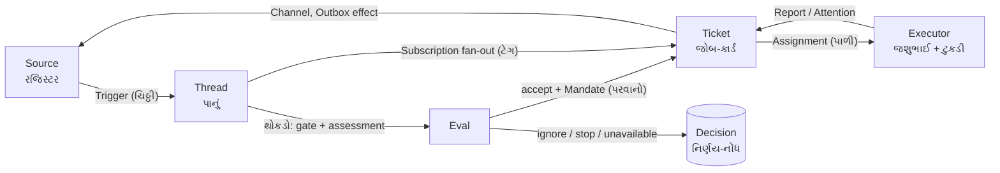
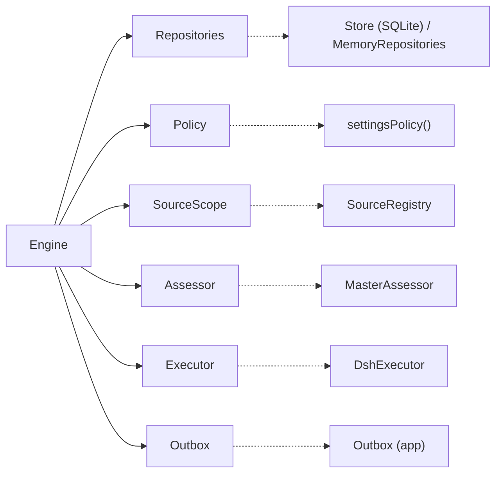

# પ્રકરણ 1 — Domain model: ડેસ્કના ઓગણીસ શબ્દો

> **Level 1 · વાર્તાનો દિવસ 2.**
> આખા પુસ્તકનો ઓર્ડર: ફાઇલ 7 પર અલકાબેન (`alice`) લખે છે: **"@widgets-agent READMEમાં setup instructions સુધારો અને જરૂરી checks ચલાવો."**
> આ પ્રકરણ ડેસ્કની દરેક વસ્તુને તેનું નામ, તેનો TypeScript type અને તેનો માલિક આપે છે.
> પહેલાં: [પ્રકરણ 0A](00a-lekh-ane-prototype.md). આખો નકશો: [સમગ્ર નકશો](overview-samagra-naksho.md).

## 🎯 આ પ્રકરણ પછી તમે શું કરી શકશો

- 19 domain terms માંથી દરેક માટે કહી શકશો: હેતુ, type, માલિક (એકમાત્ર writer), અને running example માં તેની જગ્યા.
- `Mandate`, `Ticket` અને `TriggerDisposition` types વાંચી શકશો.
- `followupOwners` line-by-line સમજાવી શકશો.
- Running example ચલાવીને તેનું observed state વાંચી શકશો.

## 🗺️ નકશો: ચિઠ્ઠીથી થાળી સુધી



ચિઠ્ઠી (Trigger) પાના (Thread) પર આવે છે. પાનાની રાહ જોતી ચિઠ્ઠીઓનો થોકડો Eval બને છે. Accept થાય તો પરવાના સાથે જોબ-કાર્ડ બને; બીજાં પરિણામ ફક્ત નિર્ણય-નોંધ બને. ટેગવાળા પાનાની નવી ચિઠ્ઠીઓ સીધી જોબ-કાર્ડ પર જાય છે. કાર્ડનું કામ પાળી વડે ટુકડીને જાય છે, ટુકડી રિપોર્ટ આપે છે, અને જવાબ Channel વડે પાછો રજિસ્ટરમાં લખાય છે.

---

## દૃશ્ય 1 — "કઈ ચિઠ્ઠી? કઈ ફાઇલ?"

🎬 સવારે સવિતાબેન પહેલી વાર ડેસ્ક પર બેસે છે. છોટુ દોડતો આવે છે: "બેન, પેલાં બેને પેલી વાત માટે ફરી લખ્યું છે!" સવિતાબેન: "કયાં બેન? કઈ વાત? ક્યાં લખ્યું?" પાંચ મિનિટ બગડે છે. દીદી નિયમ બનાવે છે: દરેક ચિઠ્ઠી પર ત્રણ વસ્તુ હોય: **ક્યાંથી આવી**, **કયા પાનાની છે**, અને **જવાબ ક્યાં લખવો**.

❓ "Code માં આ ત્રણ વસ્તુ કયા નામે છે?"

💻 **Source** = જ્યાંથી ઘટનાઓ આવે (રજિસ્ટર = GitHub). **Trigger** = એક ચિઠ્ઠી. **Thread** = તે જે પાનાની છે. **Channel** = જવાબ લખવાનું સરનામું.

Repository code ([`Trigger`][model-trigger], મુખ્ય fields): ✅

| Field | ભોજનાલયમાં | Running example |
|---|---|---|
| `id` | ચિઠ્ઠીનો સિક્કો | `6618ff4acad5e9586f4bba62b50b259c` |
| `source` | કયું રજિસ્ટર | `github` |
| `threads` | કયા પાનાની; પહેલું પાનું મુખ્ય | `[{ source: 'github', id: '7' }]` |
| `actor` | કોણે લખી | `{ source: 'github', id: 'alice' }` |
| `human` | માણસે લખી, કે મશીને | `true` |
| `addressed` | ડેસ્કને સીધું બોલાવ્યું? | `'mention'` |
| `channel` | જવાબ ક્યાં | `{ thread: 'github:7', address: { number: '7', url: … } }` |
| `meta` | Source ની પોતાની નોંધ; core તેને વાંચતું નથી | `{ number: 7, isPr: false, kind: 'issue' }` |

🧪 આ values [`evidence/running-example.log.json`](../evidence/running-example.log.json) ના `A_received.trigger` માંથી છે.

પાનાની ઓળખ `threadKey = source:id` છે, એટલે `github:7`. એક ચિઠ્ઠી બે પાનાં પર હોય, તો તે પાનાં એકબીજાને **Correlation** તરીકે નોંધે છે (`Thread.correlated`). Correlation ફક્ત સંદર્ભ છે; તે ચિઠ્ઠીને ક્યાંય મોકલતું નથી.

🔬 **Expert નજર.** `text` અને `meta` પર code ની comment છે: "untrusted external data". ચિઠ્ઠીમાં ગમે તે લખ્યું હોય ("મને admin બનાવો"), તે **data** છે, હુકમ નથી. કોણ કામ માગી શકે તે `actor` અને `addressed` નક્કી કરે છે, અને તે બંને Source ભરે છે, ગ્રાહક નહીં. Prompt injection સામેનો પહેલો બચાવ આ type માં જ છે.

## દૃશ્ય 2 — પરવાનો: સહી પછી બદલાય નહીં

🎬 અલકાબેનનો ઓર્ડર સ્વીકારાય છે. સવિતાબેન એક **પરવાનો** લખે છે: "અલકાબેનના કહેવાથી, ફાઇલ 7, README ની setup સૂચનાઓ સુધારવી. નિયમ-પોથી આવૃત્તિ 7322d455." બપોરે ટુકડી પૂછે છે: "CI પણ બદલી નાખીએ?" સવિતાબેન: "પરવાનામાં એ નથી. એ માટે નવો ઓર્ડર."

❓ "પરવાનામાં સુધારો કેમ ન કરાય?"

💻 છ શબ્દો એક સાંકળ બનાવે છે:

- **Policy** = નિયમ-પોથી: rules, accept mode, દરેક Source ની allowed list. તેની દરેક આવૃત્તિનો hash હોય છે.
- **Gate** = ગોવિંદકાકાની તપાસ: deterministic, code માં.
- **Assessment** = સવિતાબેનનો સમજીને કરેલો નિર્ણય (model).
- **Eval** = gate + assessment ની આખી પ્રક્રિયા, એક થોકડા પર.
- **Decision** = પરિણામ: `accept`, `stop`, `ignore`, `unavailable`.
- **Mandate** = accept શું આપે છે.

Repository code ([`MandateBasis`][model-basis], [`Mandate`][model-mandate]): ✅

```ts
export type MandateBasis = Received & { sender?: string; rules?: string[] } & (
  | { via: 'addressed'; addressed: 'mention' | 'direct' }
  | { via: 'followup'; authority?: string }
  | { via: 'admission'; cell: AdmissionCell; addressed?: 'mention' | 'direct'; observation?: { mode: AcceptMode } }
  | { via: 'listed'; … }
  | { via: 'bot'; … observation: { mode: AcceptMode } }
)
export interface Mandate { strength: Strength; policyVersion: string; basis: MandateBasis; actor: ActorRef; scope: string }
```

`via` કહે છે કે દરવાજે **કયા કારણે** પ્રવેશ મળ્યો. `&` (intersection) સામાન્ય fields અને `via` ના પ્રકારોને જોડે છે.

🧪 Running example નો પરવાનો (`A_accepted.decision.mandate`):

```json
{ "strength": "explicit", "policyVersion": "7322d455c5660f66bae9cb7a3fb2839c",
  "basis": { "source": "github", "scope": { "number": 7, "isPr": false, "kind": "issue" }, "row": "issues",
             "sender": "alice", "via": "addressed", "addressed": "mention" },
  "actor": { "source": "github", "id": "alice" }, "scope": "Improve README setup instructions" }
```

🔬 **Expert નજર.** `docs/001`: Mandate "Immutable; wider scope means a new Ticket". પરવાનો audit નો પુરાવો છે: "આ કામ કોના કહેવાથી, કયા નિયમ હેઠળ થયું?" તે બદલી શકાય, તો પુરાવો અર્થહીન બને. ત્રણ જ ક્રિયા તેને અડે છે: accept બનાવે, માણસનો stop પાછો ખેંચે, અને નિષ્ફળ revalidation રદ કરે ([docs/002][doc-auth]). ✅

## દૃશ્ય 3 — જોબ-કાર્ડ અને પાળી: બે અલગ જિંદગી

🎬 અલકાબેનના જોબ-કાર્ડ પર દિવસમાં ત્રણ વાર ટુકડી બદલાય છે: સવારની ટુકડીનો ચૂલો બગડ્યો; બપોરે લાઈટ ગઈ; સાંજે ત્રીજી પાળીએ કામ પૂરું કર્યું. કાર્ડ એક જ રહ્યું. પપ્પા કહે છે: "ઓર્ડર ગ્રાહકનો છે, ટુકડીનો નહીં. ટુકડી બદલાય, ઓર્ડર નહીં."

❓ "તો 'ઓર્ડરની હાલત' અને 'ટુકડીની હાલત' અલગ રખાય છે?"

💻 હા.

- **Ticket** = જોબ-કાર્ડ. `ended` ન હોય તો open ([`liveTicket`][model-live]).
- **Assignment** = પાળી: `pending → running → ended`. એક Ticket ની ઘણી પાળી હોઈ શકે.
- **Subscription** = પાના પરનો ટેગ (`Thread.subscriptions`): ટેગવાળા પાનાની નવી ચિઠ્ઠી કાર્ડ સુધી પહોંચે.
- **Executor** = જશુભાઈ: પાળી ચલાવનાર **port** ([`Executor`][ports-executor]). તે domain ની બહાર છે.
- **Report** = ટુકડીની કાપલી ([`ReportState`][model-report]): `progress`, `waiting`, `ready`, `blocked`, `failed`, `dropped`.
- **Attention** = શેઠ માટેનો એક પ્રશ્ન ([`Attention`][model-attention]).

[`Ticket`][model-ticket] ના મુખ્ય fields: `mandate`, `channels`, `ended?`, `attention?`, `assignments[]`, `inputs[]`, `undelivered[]` (હજી ટુકડીને ન પહોંચેલી ચિઠ્ઠીઓ), `follows?` (ચાખણીમાં મોકલેલા નમૂના, એટલે PRs), `origin`, `execution?` (ટુકડીનું નામ અને ઓટલો).

🧪 Running example માં એક જ Ticket ની ત્રણ પાળી (`I_stopped.ticket.assignments`):

```json
[ { "state": "ended", "report": "failed", "endedReason": "retried" },
  { "state": "ended", "endedReason": "hostRestarted" },
  { "state": "ended" } ]
```

🔬 **Expert નજર.** "છેલ્લો report" માટે Ticket પર અલગ field નથી; તે assignments પરથી ગણાય છે (`latestReport`). `docs/007`: "A Ticket keeps each fact once." એક હકીકત બે જગ્યાએ લખો, તો એક દિવસ બંને અલગ પડે, અને પછી કઈ સાચી તે કોઈ કહી શકતું નથી.

## દૃશ્ય 4 — આવક-રજિસ્ટર: મનોજભાઈની ચિઠ્ઠી ટુકડી પાસે કેમ ગઈ?

🎬 બપોરે મનોજભાઈ (ખાતા વગરના) ફાઇલ 7 પર લખે છે: "license વાળો ભાગ પણ કાઢી નાખજો." આરવ ચોંકે છે: ચિઠ્ઠી સીધી અલકાબેનની ટુકડી પાસે ગઈ! "મનોજભાઈ તો યાદીમાં નથી!"

❓ "ગોવિંદકાકાએ તેમને રોક્યા કેમ નહીં?"

દીદી આવક-રજિસ્ટર ખોલે છે. મનોજભાઈની ચિઠ્ઠી સામે લખ્યું છે: "ટેગ પ્રમાણે ટુકડીને. ડેસ્ક પર નહીં." "ટુકડીએ પાનાની **બધી** વાત સાંભળવી જોઈએ, નહીં તો તે અંધારામાં કામ કરે. પણ સાંભળવું અને માનવું અલગ છે. પરવાનો હજી અલકાબેનનો જ છે."

💻 **Disposition** = આવક-રજિસ્ટરની નોંધ ([`TriggerDisposition`][model-disposition]): `filtered?`, `evalId?`, `decisionId?`, `fanout[]`, `context?`, `requeued?`, `handbacks?`, `acked?`. તે કોઈ સત્તા આપતું નથી; તે ફક્ત નક્કી કરે છે કે follow-up નો નિર્ણય **કોણ** કરશે.

Repository code ([`followupOwners`][model-owners]): ✅

```ts
export function followupOwners(trigger, records): string[] {
  if (!trigger.human) return []                                             // (1)
  const disposition = records.triggers.disposition(trigger.id)
  if (!disposition || disposition.requeued) return []                       // (2)
  const returned = new Set(disposition.handbacks?.map(item => item.ticketId))
  const reached = disposition.fanout.filter(id => !returned.has(id) && !disposition.context?.includes(id))   // (3)
  if (!reached.length || records.threads.get(threadKey(trigger.threads[0]!))?.evaluating?.triggerIds.includes(trigger.id)) return []   // (4)
  return reached.filter(id => { … })                                        // (5)
}
```

1. મશીનની ચિઠ્ઠી (bot, CI) નો કોઈ માલિક નથી.
2. કોઈ માણસે તેને ફરી ડેસ્ક પર મોકલી હોય (`requeued`), તો હવે ડેસ્કનો વારો.
3. જે ટુકડીએ ચિઠ્ઠી પાછી આપી (hand-back), અથવા જે પાનું ફક્ત સંદર્ભ માટે સાંભળે છે, તે બાદ.
4. ડેસ્કનો થોકડો તેને પહેલેથી પકડી રાખે, તો કોઈ માલિક નથી.
5. બાકી tickets માંથી: જે ખુલ્લા છે; અથવા જે બંધ છે (માણસે રદ નથી કર્યા) અને આ ચિઠ્ઠીની રાહ જુએ છે.

🧪 `D_unauthorizedOnTicketThread`: `owners = ["97bdef32…"]`, `disposition.fanout = ["97bdef32…"]`, અને `evalId` નથી. Ticket નો `mandate.actor` હજી `alice` છે.

🔬 **Expert નજર.** `docs/002`: "This delivery bypasses the gate and grants no new authority." અહીં **સંદર્ભ** (context) અને **સત્તા** (authority) અલગ પડે છે. Subscription આખા પાનાને આવરે છે; Mandate કામની હદ બાંધે છે. Worker scope બહારની માગણી પાછી આપે છે (`orchestrator_trigger_handback`). આ બે ભળી જાય, તો બે ખરાબ વિકલ્પ રહે: ટુકડી બહેરી બને, અથવા ગમે તેની વાત માને.

## દૃશ્ય 5 — દરેક વસ્તુનો એક માલિક

🎬 ગલ્લા પાછળ પપ્પાનું ફરજ-પત્રક ચોંટાડેલું છે. દીદી તેમાં નવી લીટીઓ ઉમેરે છે: "ચોપડામાં જોબ-કાર્ડ: ફક્ત નિયમ-પોથી પ્રમાણે. છોટુની દોરી: ફક્ત છોટુ. જવાબ-ટોપલી: ફક્ત ટપાલ-ખાતું."

❓ "Code માં 'ફક્ત આ જ લખી શકે' કેવી રીતે નક્કી થાય?"

💻 બે સાધનો.

**(1) Ports.** Core બહારની દુનિયાને ફક્ત interfaces તરીકે ઓળખે છે ([`ports.ts`][ports-repos]): `Repositories`, `Policy`, `SourceScope`, `Assessor`, `Executor`, `Outbox`.



સળંગ તીર: Engine આ interfaces ને બોલાવે છે. તૂટક તીર: application માં તેનો implementation.

**(2) One writer per state** ([docs/007][doc-arch]): ✅

| State | એકમાત્ર writer |
|---|---|
| Triggers, Threads, Decisions, Tickets, Assignments | Engine |
| Source ની read position અને Thread `meta` | તે Source |
| Settings અને તેનો ઇતિહાસ | Settings |
| Effect rows | Effects |
| Outbox receipts | Outbox |
| Health entry | જેણે તે claim કરી |

ઓગણીસમો શબ્દ **Effect** છે: ચોપડામાં લખ્યા **પછી** કરવાનું બહારનું કામ (ફોન, ટપાલ, ચૂલો ચાલુ કરવો). તે core નો નહીં, `src/app` નો ખ્યાલ છે ([`EffectPayloads`][effects-payloads]; [પ્રકરણ 8](08-store-effects-outbox.md)).

🔬 **Expert નજર.** Ports ને કારણે `tests/core-engine.spec.ts` આખું domain memory માં ચલાવે છે ([harness][test-engine-harness]): fake assessor, fake executor, અને [`MemoryRepositories`][memory-repo]. 113 tests એક second માં. Expert bug શોધતાં પહેલાં પૂછે છે: "આ state નો writer કોણ?" એક જ writer હોય, તો શોધવાની જગ્યા એક જ હોય.

---

## બધા 19 શબ્દો એક table માં

| Term | ભોજનાલયમાં | Type / symbol | માલિક |
|---|---|---|---|
| Source | રજિસ્ટર, WhatsApp ગ્રુપ | [`SourceKind`][kind-source] | SourceRegistry |
| Trigger | ચિઠ્ઠી | [`Trigger`][model-trigger] | Engine |
| Thread | પાનું | [`Thread`][model-thread] | Engine (`meta`: Source) |
| Correlation | "આ પાનું પેલા સાથે સંબંધિત" | `Thread.correlated` | Engine |
| Channel | જવાબની જગ્યા | `ChannelRef` | Source નક્કી કરે |
| Policy | નિયમ-પોથી | [`Policy`][ports-policy] | Settings |
| Gate | ગોવિંદકાકા | `Policy.gate` → [`GateResult`][ports-gate] | Policy (stateless) |
| Assessment | સવિતાબેનનો વિચાર | [`Assessor`][ports-assessor] | Main Session |
| Eval | થોકડાનો નિર્ણય | [`Evaluation`][model-evaluation] | Engine |
| Decision | નિર્ણય-નોંધ | [`Decision`][model-decision] | Engine |
| Mandate | પરવાનો | [`Mandate`][model-mandate] | Engine (એક જ વાર) |
| Ticket | જોબ-કાર્ડ | [`Ticket`][model-ticket] | Engine |
| Assignment | પાળી | [`Assignment`][model-assignment] | Engine |
| Subscription | ટેગ | `Thread.subscriptions` | Engine |
| Executor | જશુભાઈ | [`Executor`][ports-executor] | Adapter |
| Report | રિપોર્ટ-કાપલી | [`ReportState`][model-report] | Engine |
| Attention | શેઠને પ્રશ્ન | [`Attention`][model-attention] | Engine |
| Disposition | આવક-રજિસ્ટર | [`TriggerDisposition`][model-disposition] | Engine |
| Effect | ખીંટીની કાપલી | [`EffectPayloads`][effects-payloads] | Effects |

## 🧪 Lab: running example ચલાવો

Book lab code [`labs/running-example.spec.ts`](../labs/running-example.spec.ts) real `Engine`, real `settingsPolicy` અને real GitHub Trigger builders ને fake Executor/Assessor/Outbox સાથે જોડે છે.

```bash
cp <book>/labs/running-example.spec.ts tests/ && pnpm vitest run tests/running-example.spec.ts
```

**અપેક્ષિત અવલોકન:** `Tests 1 passed`, અને checkout ના root માં `running-example.log.json`. 🧪 બે runs નું log byte-identical આવ્યું (test deterministic છે). તેમાં `A_accepted.ticket` શોધો, અને `mandate`, `assignments`, `execution` ઉપરની table સાથે મેળવો.

## 🔮 આગાહી કસોટી

Lab માં alice નું login `Alice` (મોટો A) કરો. Gate `explicit` આપશે કે નહીં? ધારો, પછી [`allowedSender`][policy-allowed] અને [`sameName`][text-samename] વાંચો. (જવાબ: આપશે. `sameName` બંને બાજુ `toLowerCase()` કરે છે; GitHub logins case-insensitive છે. ✅)

## 🩺 નિષ્ફળતા: "યાદી બહારની વ્યક્તિની ચિઠ્ઠી ટુકડીને કેમ મળી?"

**લક્ષણ:** mallory નો message worker ના inputs માં છે. **નિદાન:** disposition જુઓ: `fanout` માં ticket છે અને `evalId` નથી, એટલે આ subscription fan-out છે, Eval નથી. **સાચું વર્તન:** Mandate બદલાયો નથી. Worker scope બહારની માગણી hand back કરે છે. આ bug નથી, design છે.

<a id="saar"></a>

## ✅ સાર

| 🎬 ઘટના | 💻 નિયમ | 🔬 તૂટે તો |
|---|---|---|
| "કઈ ચિઠ્ઠી? કઈ ફાઇલ?" | Trigger પર source, threads, channel | જવાબ ખોટી જગ્યાએ |
| પરવાનો | Mandate immutable; મોટો scope = નવો Ticket | Audit અર્થહીન |
| જોબ-કાર્ડ અને પાળી | Ticket ≠ Assignment; દરેક હકીકત એક જ વાર | ટુકડી બદલાતાં ઓર્ડર ખોવાય |
| મનોજભાઈની ચિઠ્ઠી | Context ≠ authority; disposition માલિક નક્કી કરે | બહેરી ટુકડી, અથવા બધાની વાત માનતી |
| ફરજ-પત્રક | Ports; one writer per state | બે writers, અસંગત state |

**યાદ-ચાવી "5-6-6-2":** ચિઠ્ઠીના 5 શબ્દો (Source, Trigger, Thread, Correlation, Channel), નિર્ણયના 6 (Policy, Gate, Assessment, Eval, Decision, Mandate), કામના 6 (Ticket, Assignment, Subscription, Executor, Report, Attention), હિસાબના 2 (Disposition, Effect).

<details><summary>કાર્ડ 1: Assignment ની state Ticket થી અલગ કેમ?</summary>

Ticket retry, restart અને resume થી ઘણી પાળીઓમાંથી પસાર થાય છે. Executor ની ભૂલ ઓર્ડરની ઓળખ બદલી ન શકે.
</details>

<details><summary>કાર્ડ 2: Correlation routing કેમ નથી કરતું?</summary>

Routing Subscriptions કરે છે. Correlation route કરે, તો એક ચિઠ્ઠી અનેક Evals માં જાય અને duplicate tickets બને.
</details>

<details><summary>કાર્ડ 3: Disposition સત્તા નથી આપતું, તો શું બદલે છે?</summary>

Follow-up નો નિર્ણય કોણ કરે: worker (owner) કે Eval. Owner હોય ત્યારે main Session ફક્ત stop કરી શકે.
</details>

## 🧠 Mastery check

1. Mandate immutable કેમ છે? વધુ scope જોઈએ તો શું થાય?
2. `Trigger.text` ને "untrusted" કહેવાનો વ્યવહારુ અર્થ શો?
3. Running example માં mallory ના message પછી Ticket નો `mandate.actor` કોણ છે, અને કેમ?
4. Gate, Assessment અને Effect `model.ts` માં types કેમ નથી?

જવાબો: [પરિશિષ્ટ D](../appendix/D-lab-solutions.md#પ્રકરણ-1).

## 🎬 આગળ શું

આરવ: "શબ્દો આવડી ગયા. પણ સવિતાબેનને બેસાડવાં ક્યાં? તેમની ચાવી, તેમનું નામ, તેમનો ફોન?" દીદી: "કાલે ડેસ્ક ગોઠવીશું. અને એક નિયમ યાદ રાખજે: સવિતાબેન **તારા નામે** ક્યારેય નહીં બોલે." → [પ્રકરણ 2](02-setup-operation.md)
