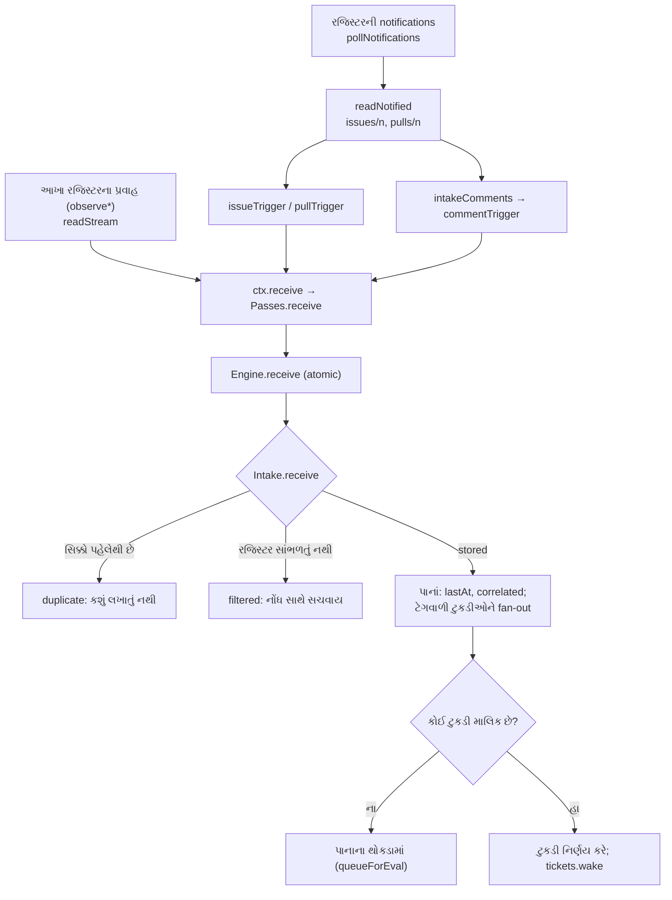

# પ્રકરણ 4 — Sources અને intake: છોટુ અને ચિઠ્ઠીઓ

> **Level 4 · વાર્તાનો દિવસ 5.**
> ચિઠ્ઠી રજિસ્ટરમાંથી ડેસ્ક સુધી કેવી રીતે પહોંચે છે: છોટુનો આંટો, તેની દોરી, ચિઠ્ઠીનો સિક્કો, અને આવક-રજિસ્ટરની નોંધ.
> પહેલાં: [પ્રકરણ 3](03-startup.md).

## 🎯 આ પ્રકરણ પછી તમે શું કરી શકશો

- GitHub Source ને notification થી `Engine.receive` સુધી trace કરી શકશો.
- Cursor, overlap અને content-derived id વડે duplicate કેવી રીતે અટકે છે તે સમજાવી શકશો.
- `Intake.receive` ના ત્રણ પરિણામ (`stored`, `duplicate`, `filtered`) અને fan-out line-by-line સમજાવી શકશો.
- Feishu Source નું માળખું કહી શકશો.

**નવા શબ્દો:** **polling** (થોડી-થોડી વારે પૂછવું "નવું શું છે?"), **cursor** (ક્યાં સુધી વાંચ્યું તેની નિશાની), **idempotent** (બે વાર કરો તો પણ પરિણામ એક વાર જેવું).

## 🗺️ નકશો: ચિઠ્ઠીનો રસ્તો



ઉપરથી નીચે ચિઠ્ઠીનો પ્રવાહ છે. છોટુ notifications અને (ચાલુ હોય તો) આખા રજિસ્ટરના પ્રવાહ વાંચે છે, ચિઠ્ઠી બનાવે છે, અને ડેસ્કને આપે છે. હીરા-આકારનાં ખાનાં નિર્ણય છે: ચિઠ્ઠી નવી છે? રજિસ્ટર સાંભળે છે? કોઈ ટુકડી તેની માલિક છે?

---

## દૃશ્ય 1 — છોટુનો આંટો: ચાર કામ, એક બગડે તો બાકી ચાલે

🎬 છોટુ દર મિનિટે એક આંટો મારે છે. દરેક આંટામાં ચાર કામ: (1) ડેસ્કના નામે આવેલી નવી નોંધો, (2) આખું રજિસ્ટર, જો શેઠે કહ્યું હોય, (3) ચાખણીમાં ગયેલા નમૂના, (4) ટેગવાળાં પાનાં. એક દિવસ રજિસ્ટરનું એક પાનું ચોંટી ગયું હતું. છોટુ આખો આંટો છોડીને પાછો આવ્યો, અને બાકીની ત્રણ જગ્યાની ચિઠ્ઠીઓ રહી ગઈ. દીદીએ નિયમ બદલ્યો: "એક જગ્યા અટકે તો નોંધ કર, અને બાકીની ત્રણ પૂરી કર."

❓ "Code માં છોટુ ક્યાંથી શરૂ થાય, અને એક read નિષ્ફળ જાય તો?"

💻 Plugin entry ([`apply`][gh-apply]): ✅

```ts
export function apply(ctx: Context): void {
  ctx.effect(() => ctx.orchestrator.sources.register(githubKind), 'github: source kind')
  ctx.effect(() => {
    const source = sourceContext(ctx.orchestrator, githubKind)
    const controller = new AbortController()
    const running = watch(source, controller.signal)
      .catch((error: unknown) => { source.report('github', { state: 'error', detail: String(error) }) })
    return async () => { controller.abort(); await running }
  })
}
```

પહેલો effect kind ને `SourceRegistry` માં નોંધે છે ([`register`][registry-register]). બીજો polling loop શરૂ કરે છે; loop ની error health માં જાય છે, કારણ કે unhandled rejection આખી DSH process બંધ કરી દે.

[`watch`][gh-watch]: `await ctx.ready` → setup બાકી હોય તો `paused` report કરીને બહાર → નહીં તો `pollRound`, પછી `max(GitHub નો X-Poll-Interval, pollSeconds)` seconds ની રાહ. સળંગ `failuresBeforeError` (default 3) નિષ્ફળ rounds પછી જ health error બને ([config][gh-config]).

[`pollRound`][gh-round] ના ચાર સ્વતંત્ર પગલાં: `pollNotifications` → `pollRepository` → `pollTicketPulls` → `pollThreads`. એક નિષ્ફળ જાય તો પણ બાકીનાં ચાલે; round છેલ્લે નિષ્ફળ ગણાય.

> ⚠️ **વાર્તાથી ફરક.** છોટુ રજિસ્ટરનાં બધાં પાનાં નથી ફેરવતો. મુખ્ય રસ્તો agent account ની **notifications** છે. આખા રજિસ્ટરના પ્રવાહ (`observeIssues`, `observePulls`, `observeComments`, `observeCi`) default રૂપે બંધ છે.

🔬 **Expert નજર.** "એક નેટવર્ક ઝટકો" અને "સતત નિષ્ફળતા" અલગ છે. પહેલાની જાણ માણસને કરવી એ ઘોંઘાટ છે: આગલો આંટો તેને આપોઆપ સુધારે છે. ત્રણ સળંગ નિષ્ફળતા પછી જ error, અને એક સફળ આંટો ગણતરી શૂન્ય કરે. Panel નો નિયમ પણ એ જ છે: "Problems must be actionable; a one-off network error is not enough" ([docs/005][doc-panel]).

## દૃશ્ય 2 — એ જ ચિઠ્ઠી બે વાર: દોરી અને સિક્કો

🎬 છોટુ રજિસ્ટરમાં **દોરી** રાખે છે: "અહીં સુધી વાંચ્યું." પણ એક વાર કોઈએ બરાબર એ જ ક્ષણે લખ્યું જ્યારે છોટુ દોરી ખસેડતો હતો, અને તે લીટી કાયમ માટે ચૂકી ગઈ. હવે છોટુ દોરી **બે લીટી પાછળ** મૂકે છે. એટલે દરેક આંટે છેલ્લી બે લીટી ફરી વંચાય છે, અને તે એ જ ચિઠ્ઠી ફરી લાવે છે. સવિતાબેન ચિઠ્ઠી પરનો **સિક્કો** જુએ છે: "આ તો નોંધાઈ ગઈ છે," અને તેને બાજુ પર મૂકે છે.

❓ "ફરી વાંચવાથી duplicate જોબ-કાર્ડ નહીં બને?"

💻 **દોરી** = cursor. બે સ્તર: આખા રજિસ્ટર માટે `KV.github.since`, અને દરેક પાના માટે `KV.github.cursor(number)`. બંને જાણીજોઈને પાછળ રખાય છે ([`cursorAt`][poll-cursor]): ✅

```ts
export const cursorAt = (started: string): string => new Date(Date.parse(started) - 5000).toISOString()
```

**સિક્કો** = content-derived id. [`key()`][ids-key] એ SHA-256 hash ના પહેલા 32 hex અક્ષર છે: સરખા input માટે હંમેશાં સરખું id.

| ચિઠ્ઠી | Id | Source |
|---|---|---|
| Issue નું body | `key('github-issue', String(number))` | [`issueTrigger`][ght-issue] |
| Comment / review | `key('github-comment', html_url, String(id), updated_at)` | [`commentTrigger`][ght-comment] |

અને ડેસ્ક પર પહેલી જ તપાસ ([`Intake.receive`][intake-dup]):

```ts
if (this.repo.triggers.get(trigger.id)) return 'duplicate'
```

`duplicate` હોય તો **કશું લખાતું નથી**. 🧪 Running example: `B_duplicate.result = "duplicate"`; Ticket, પાનું અને નિર્ણયો જરા પણ બદલાયાં નથી.

Cursor ત્યારે જ આગળ વધે છે જ્યારે ચિઠ્ઠી ચોપડામાં લખાઈ ગઈ હોય. Host interface કહે છે: "callers should await completion before advancing read cursors" ([`SourceContext.receive`][host-receive]). ✅

🔬 **Expert નજર.** અહીં બે ભૂલોની અદલાબદલી થઈ છે: "ચિઠ્ઠી ચૂકી જવી" (સુધારી ન શકાય) ને બદલે "ચિઠ્ઠી બે વાર આવવી" (સસ્તામાં નિષ્ક્રિય કરી શકાય). આ **at-least-once + idempotent** નો નમૂનો છે, અને આખા prototype માં વારંવાર આવે છે. એક સૂક્ષ્મ પરિણામ: comment ના id માં `updated_at` છે, એટલે **edit કરેલો comment નવી ચિઠ્ઠી** છે. 🧪 Edit કરેલો comment `stored` થયો, અને ફરી મોકલતાં `duplicate` ([પરિશિષ્ટ D](../appendix/D-lab-solutions.md#પ્રકરણ-4)). પણ Issue body નું id ફક્ત number પરથી બને છે, એટલે body edit નવી ચિઠ્ઠી નથી બનતી.

## દૃશ્ય 3 — ચિઠ્ઠી લખવાની રીત: કોણ, કોને, ક્યાં

🎬 છોટુ રજિસ્ટરમાંથી નકલ કરતી વખતે ત્રણ નિયમ પાળે છે. ડેસ્કે પોતે લખેલી લીટી નકલ નથી કરતો ("નહીં તો સવિતાબેન પોતાને જ જવાબ આપ્યા કરે"). લખનાર માણસ છે કે મશીન તે નોંધે છે. અને "@અન્નપૂર્ણા" લખ્યું હોય તો ખૂણે નિશાની કરે છે: **સીધું બોલાવ્યાં**.

❓ "Code માં આ ત્રણ નિયમ ક્યાં છે?"

💻

| નિયમ | Code | Source |
|---|---|---|
| ડેસ્કની પોતાની લીટી છોડવી | `if (sameName(comment.user.login, login)) continue` | [`intakeComments`][gh-self] ✅ |
| માણસ કે મશીન | `isHumanLogin`: `[bot]` suffix નહીં, અને `type === 'User'` | [code][ght-human] ✅ |
| સીધું બોલાવ્યાં | `mentions(body, agent)`: `@login`, શબ્દ-સીમા સાથે | [code][ght-mentions] ✅ |
| પાનું | `threads: [{ source: 'github', id: String(number) }]` → `github:7` | [`commentTrigger`][ght-comment] |
| જવાબની જગ્યા | `githubChannel(number, url)` | [code][ght-channel] |
| Receiving scope | `meta.kind` → row `issues` / `pulls` / `comments` / `ci`; `observed` switch પરથી | [`scope`][gh-scope] |

એક ખાસ કિસ્સો: body વગરની review. ખાલી text વાળી ચિઠ્ઠી નથી બનતી, પણ approval ("APPROVED review of commit …") text બને છે, કારણ કે ટુકડી એ મંજૂરીની રાહ જોતી હોઈ શકે ([`intakeComments`][gh-comments]).

🔬 **Expert નજર.** `human` અને `addressed` ચિઠ્ઠી લખનાર નથી ભરતો; **Source ભરે છે**, GitHub ના પોતાના data (`user.type`, body) પરથી. [docs/002][doc-auth]: "The Source records whether a message addresses the agent." એટલે gate ને ભરોસાપાત્ર હકીકતો મળે છે. નબળાઈ પણ અહીં જ છે: `mentions` આખું body તપાસે છે, એટલે **ટાંકેલા** (quoted) જૂના mention ને પણ "સીધું બોલાવ્યાં" ગણે છે. [પ્રકરણ 12, દૃશ્ય 5](12-customization.md) માં આપણે આ સુધારીશું.

## દૃશ્ય 4 — ડેસ્ક પર: આવક-રજિસ્ટરની એક નોંધ

🎬 ચિઠ્ઠી ડેસ્ક પર પહોંચે છે. સવિતાબેન એક જ ઝાટકે પાંચ કામ કરે છે: સિક્કો જુએ, રજિસ્ટર સાંભળવાની યાદીમાં છે કે નહીં તે જુએ, પાનામાં ચિઠ્ઠી મૂકે, ટેગવાળી ટુકડીઓને નકલ આપે, અને કોઈ ટુકડી માલિક ન હોય તો પાનાના થોકડામાં મૂકે. અધવચ્ચે કોઈ બોલાવે, તો તે કાં તો પાંચેય પૂરાં કરે, કાં તો એક પણ નહીં.

❓ "'એક જ ઝાટકે' code માં કેવી રીતે?"

💻 [`Engine.receive`][engine-receive] આખું કામ `repo.atomic(…)` માં લપેટે છે. અંદર [`Intake.receive`][intake-receive] (shortened): ✅

```ts
receive(received: Trigger): ReceiveResult {
  const trigger = { ...received, at: isoTime(received.at) }                     // (1)
  if (this.repo.triggers.get(trigger.id)) return 'duplicate'                     // (2)
  const filter = this.options.scope.scope(trigger)                               // (3)
  if (!filter.listened) { …save trigger + disposition { filtered }…; return 'filtered' }
  this.repo.triggers.save(trigger)
  for (const ref of trigger.threads) {                                           // (4)
    const thread = this.thread(ref)
    …lastAt, correlated…
    for (const ticketId of thread.subscriptions) {                               // (5)
      const followed = !!thread.context?.includes(ticketId)
      const resumes = trigger.human && ticket?.ended?.by !== 'human' && !followed
      if (!ticket || (!liveTicket(ticket) && !resumes)) continue
      reached.set(ticketId, …)
    }
  }
  for (…reached) this.tickets.addInput(ticket, { id: key('input', ticketId, 'trigger', trigger.id), kind: 'trigger', … })   // (6)
  this.repo.triggers.saveDisposition(trigger.id, { fanout, context?, at })
  if (!this.owners(trigger).length) this.queueForEval(trigger)                   // (7)
  for (const ticketId of fanout) this.tickets.wake(ticketId)                     // (8)
  return 'stored'
}
```

1. **સમય** `toISOString` સ્વરૂપમાં, જેથી string સરખામણી સાચી પડે.
2. **Duplicate:** કશું નહીં.
3. **Filtered:** [`SourceRegistry.scope`][registry-scope] કહે કે રજિસ્ટર સાંભળતું નથી (`source_disabled`, `source_not_installed`, Feishu માં `chat_not_allowed`). ચિઠ્ઠી **સચવાય છે**, કારણ સાથે.
4. દરેક પાનું: છેલ્લો સમય, અને Correlation.
5. **ટેગ:** ખુલ્લા જોબ-કાર્ડને બધું મળે. બંધ કાર્ડને ફક્ત **માણસની** ચિઠ્ઠી, અને તે પણ ત્યારે જ જ્યારે કાર્ડ માણસે રદ ન કર્યું હોય અને પાનું ફક્ત સંદર્ભ માટે ન હોય.
6. **Input**, idempotent id સાથે.
7. **થોકડો:** કોઈ ટુકડી માલિક ન હોય ત્યારે જ ([`queueForEval`][part-queue]).
8. **Wake:** બંધ કાર્ડને ફરી ખોલવાનો પ્રયાસ ([પ્રકરણ 6](06-tickets-assignments.md)).

🧪 Running example નાં પરિણામો:

| Scenario | `receive` | Disposition | થોકડામાં? | Evidence |
|---|---|---|---|---|
| alice ની Issue #7 | stored | `fanout: []` | હા → explicit Eval | `A_received.thread7.pending = 1` |
| ફરી poll | duplicate | — | — | `B_duplicate` |
| mallory, #8 (કોઈ કાર્ડ નથી) | stored | `fanout: []` | હા → `not_a_member` | `C_unauthorized` |
| mallory, #7 (ટેગવાળું પાનું) | stored | `fanout: [ticket]` | **ના** | `D_…` |
| alice નો follow-up, #7 | stored | `fanout: [ticket]` | ના | `E_followup` |
| `github-actions[bot]`, #7 | stored | `fanout: [ticket]` | **હા** (મશીનનો કોઈ માલિક નથી) → `not_human` | `F_failed.decisions7[1]` |
| stop પછી "Thanks!" | stored | `fanout: []` | હા | `J_afterStop` |

🔬 **Expert નજર.** Filtered ચિઠ્ઠી ફેંકી કેમ નથી દેવાતી? કારણ કે "કંઈ થયું નહીં" અને "થયું, પણ અમે જાણીજોઈને ન લીધું" અલગ છે. બીજો કિસ્સો panel માં "Filtered Triggers" તરીકે દેખાય છે, અને operator settings સુધારીને **Evaluate again** દબાવી શકે છે. Expert "ના" ને પણ નોંધે છે; નહીં તો "મારો message કેમ ન લેવાયો?" નો જવાબ કોઈ પાસે નથી હોતો.

## દૃશ્ય 5 — WhatsApp ગ્રુપ: બીજો રસ્તો, એ જ નિયમો

🎬 સોસાયટીના WhatsApp ગ્રુપમાંથી પણ ઓર્ડર આવે છે. ત્યાં રીત જુદી છે: ચિઠ્ઠીઓ જીવંત આવે છે (કોઈ બોલે કે તરત), અને લાઈટ જાય તો વચ્ચેની વાત પાછળથી ઇતિહાસમાંથી વાંચવી પડે. પણ ડેસ્ક પર પહોંચ્યા પછી ચિઠ્ઠી સરખી જ દેખાય છે.

❓ "બે રસ્તા (જીવંત અને ઇતિહાસ) એક જ સંદેશ બે વાર નહીં લાવે?"

💻 Feishu Source વૈકલ્પિક છે (`cordis.patch.yml` માં `disabled: true`). ✅

- **ચિઠ્ઠી:** [`feishuTrigger`][feishu-trigger]. Bot ના પોતાના messages છોડે. `p2p` chat → `addressed: 'direct'`; bot નો mention → `'mention'`. પાનું = chat + root message, એટલે એક topic એક Thread.
- **Scope rows:** દરેક configured chat (`listen: mentions | all`), `other`, અને `direct` ([`scope`][feishu-scope]).
- **Loops:** [`watch`][feishu-watch] → [`consume`][feishu-consume] (જીવંત events, `lark-cli` વડે), history recovery, અને subscribed topics નું polling.

જીવંત અને ઇતિહાસ બંને રસ્તા **એક જ id** બનાવે છે (message id પરથી), એટલે ડેસ્ક પર બીજી નકલ `duplicate` છે. Test: "translates a polled topic reply as the event consumer translates the live event".

> ⚠️ WhatsApp ઉપમા છે; ખરો Source Feishu છે, અને અમે તેને live ચલાવ્યો નથી.

🔬 **Expert નજર.** Core ને ખબર જ નથી કે ચિઠ્ઠી GitHub માંથી આવી કે Feishu માંથી. તે ફક્ત `SourceScope` અને `Trigger.meta` જુએ છે. એટલે ત્રીજો Source (email, ERP) ઉમેરવા core બદલવું પડતું નથી: 🧪 [પ્રકરણ 12, દૃશ્ય 3](12-customization.md) માં આપણે "demo" Source 30 lines માં ઉમેરીશું.

---

## Source map

| ક્રમ | File | Symbols |
|---|---|---|
| 1 | `src/sources/kind.ts` | [`SourceKind`][kind-source] |
| 2 | `src/sources/github.ts` | [`apply`][gh-apply], [`watch`][gh-watch], [`pollRound`][gh-round], [`pollNotifications`][gh-notifications], [`readNotified`][gh-notified], [`intakeComments`][gh-comments] |
| 3 | `src/sources/github-trigger.ts` | [`issueTrigger`][ght-issue], [`commentTrigger`][ght-comment], [`mentions`][ght-mentions] |
| 4 | `src/sources/poll.ts` | [`cursorAt`][poll-cursor], [`POLL_HORIZON_MS`][poll-horizon] |
| 5 | `src/sources/registry.ts` | [`scope`][registry-scope] |
| 6 | `src/core/intake.ts` | [`Intake.receive`][intake-receive] |

## 🧪 Lab

```bash
pnpm vitest run tests/core-engine.spec.ts -t "intake"
```

```bash
pnpm vitest run tests/sources.spec.ts -t "keeps one body Trigger for an Issue that a later poll reads again"
```

🧪 **અવલોકન:** `2 passed`, અને `1 passed`. પહેલો test ([code][test-intake-once]) ત્રણેય પરિણામ બતાવે છે; બીજો GitHub બાજુનો duplicate guard.

## 🔮 આગાહી કસોટી

`github-actions[bot]` ટેગવાળા પાના (#7) પર comment કરે છે. ચિઠ્ઠી ટુકડીને જશે, થોકડામાં જશે, કે બંને? (ધારો. જવાબ: **બંને**. ટુકડીને સંદર્ભ તરીકે મળે છે, પણ મશીનની ચિઠ્ઠીનો કોઈ માલિક નથી (`followupOwners` → `[]`), એટલે તે થોકડામાં પણ જાય છે, જ્યાં gate તેને `not_human` કહે છે. 🧪 `F_failed.decisions7`.)

## 🩺 નિષ્ફળતા: "ટુકડીને એક જ comment બે વાર દેખાય છે"

**નિદાન:** (1) Panel → Trigger tab → બંને ચિઠ્ઠીના સિક્કા સરખાવો. અલગ હોય તો comment **edit** થઈ હતી. (2) સરખા હોય તો Intake એ બીજી વાર stored કર્યું જ ન હોય; delivery બાજુ જુઓ ([પ્રકરણ 7](07-worker-execution.md)). **Regression test:** "stores a trigger once and records source filtering".

<a id="saar"></a>

## ✅ સાર

| 🎬 ઘટના | 💻 નિયમ | 🔬 તૂટે તો |
|---|---|---|
| છોટુના ચાર કામ | Round ના પગલાં સ્વતંત્ર; 3 સળંગ નિષ્ફળતા પછી error | એક ચોંટેલું પાનું બધું રોકે |
| દોરી બે લીટી પાછળ | Cursor 5 s પાછળ; overlap જાણીજોઈને | મોડી ચિઠ્ઠી ખોવાય |
| સિક્કો | Content-derived id; duplicate કશું લખતું નથી | બે જોબ-કાર્ડ |
| કોણ, કોને, ક્યાં | `human`, `addressed` Source ભરે | ગ્રાહક પોતે "હું શેઠ છું" લખે |
| એક ઝાટકે પાંચ કામ | `Engine.receive` atomic; filtered પણ સચવાય | અડધી નોંધ |
| WhatsApp ગ્રુપ | Core Source-agnostic; બંને રસ્તા એક id | નવા Source માટે core બદલવું પડે |

**યાદ-ચાવી "3-5-14":** ત્રણ પરિણામ (stored, duplicate, filtered), 5 seconds પાછળ cursor, 14 દિવસ સુધી subscribed પાનાંનું polling.

<details><summary>કાર્ડ 1: Cursor પાછળ રાખવાનું જોખમ, અને તેનો ઉપાય?</summary>

Overlap થી એક જ item બે વાર વંચાય. Content-derived ids ને કારણે બીજી વાર `duplicate`, અને કશું લખાતું નથી.
</details>

<details><summary>કાર્ડ 2: `threads[0]` મુખ્ય કેમ?</summary>

Eval એક જ જગ્યાએ (primary Thread) ચાલે, તો duplicate Decisions થતા નથી. બાકીનાં પાનાં Correlation તરીકે ફક્ત સંદર્ભ આપે.
</details>

## 🧠 Mastery check

1. Issue body edit કરીને ઉમેરેલો mention કેમ વંચાતો નથી, જ્યારે edit કરેલો comment નવી ચિઠ્ઠી બને છે?
2. Filtered Trigger ને drop કરવાને બદલે store કેમ કરવો?
3. Ended Ticket ને bot નો message કેમ નથી પહોંચતો?
4. HTTP 404 retry થાય છે, પણ 410 નહીં. કેમ?

જવાબો: [પરિશિષ્ટ D](../appendix/D-lab-solutions.md#પ્રકરણ-4).

## 🎬 આગળ શું

બપોરે મનોજભાઈ રજિસ્ટરના નવા પાને લખે છે: "@અન્નપૂર્ણા મારો પણ 100 થાળીનો ઓર્ડર લો, અને પૈસા પછી." ચિઠ્ઠી થોકડામાં પડી છે. આરવ: "હવે કોણ નક્કી કરશે કે આ લેવી કે નહીં?" → [પ્રકરણ 5](05-policy-eval.md)

<!-- citations:begin (generated by tools/refdefs.py) -->
[doc-auth]: https://github.com/deepseek-ai/dsh-superagent-prototype/blob/8c32a9dc5d72c033816c6a8110b37f40cf94fba4/docs/002-authorization.md#L1-L12
[doc-panel]: https://github.com/deepseek-ai/dsh-superagent-prototype/blob/8c32a9dc5d72c033816c6a8110b37f40cf94fba4/docs/005-panel.md#L1-L12
[engine-receive]: https://github.com/deepseek-ai/dsh-superagent-prototype/blob/8c32a9dc5d72c033816c6a8110b37f40cf94fba4/src/core/engine.ts#L48
[feishu-consume]: https://github.com/deepseek-ai/dsh-superagent-prototype/blob/8c32a9dc5d72c033816c6a8110b37f40cf94fba4/src/sources/feishu-loops.ts#L70-L103
[feishu-scope]: https://github.com/deepseek-ai/dsh-superagent-prototype/blob/8c32a9dc5d72c033816c6a8110b37f40cf94fba4/src/sources/feishu.ts#L54-L59
[feishu-trigger]: https://github.com/deepseek-ai/dsh-superagent-prototype/blob/8c32a9dc5d72c033816c6a8110b37f40cf94fba4/src/sources/feishu-trigger.ts#L31-L44
[feishu-watch]: https://github.com/deepseek-ai/dsh-superagent-prototype/blob/8c32a9dc5d72c033816c6a8110b37f40cf94fba4/src/sources/feishu-loops.ts#L43-L66
[gh-apply]: https://github.com/deepseek-ai/dsh-superagent-prototype/blob/8c32a9dc5d72c033816c6a8110b37f40cf94fba4/src/sources/github.ts#L110-L122
[gh-comments]: https://github.com/deepseek-ai/dsh-superagent-prototype/blob/8c32a9dc5d72c033816c6a8110b37f40cf94fba4/src/sources/github.ts#L384-L403
[gh-config]: https://github.com/deepseek-ai/dsh-superagent-prototype/blob/8c32a9dc5d72c033816c6a8110b37f40cf94fba4/src/sources/github.ts#L25-L28
[gh-notifications]: https://github.com/deepseek-ai/dsh-superagent-prototype/blob/8c32a9dc5d72c033816c6a8110b37f40cf94fba4/src/sources/github.ts#L298-L343
[gh-notified]: https://github.com/deepseek-ai/dsh-superagent-prototype/blob/8c32a9dc5d72c033816c6a8110b37f40cf94fba4/src/sources/github.ts#L344-L374
[gh-round]: https://github.com/deepseek-ai/dsh-superagent-prototype/blob/8c32a9dc5d72c033816c6a8110b37f40cf94fba4/src/sources/github.ts#L280-L296
[gh-scope]: https://github.com/deepseek-ai/dsh-superagent-prototype/blob/8c32a9dc5d72c033816c6a8110b37f40cf94fba4/src/sources/github.ts#L59-L62
[gh-self]: https://github.com/deepseek-ai/dsh-superagent-prototype/blob/8c32a9dc5d72c033816c6a8110b37f40cf94fba4/src/sources/github.ts#L397
[gh-watch]: https://github.com/deepseek-ai/dsh-superagent-prototype/blob/8c32a9dc5d72c033816c6a8110b37f40cf94fba4/src/sources/github.ts#L127-L146
[ght-channel]: https://github.com/deepseek-ai/dsh-superagent-prototype/blob/8c32a9dc5d72c033816c6a8110b37f40cf94fba4/src/sources/github-trigger.ts#L8-L9
[ght-comment]: https://github.com/deepseek-ai/dsh-superagent-prototype/blob/8c32a9dc5d72c033816c6a8110b37f40cf94fba4/src/sources/github-trigger.ts#L65-L77
[ght-human]: https://github.com/deepseek-ai/dsh-superagent-prototype/blob/8c32a9dc5d72c033816c6a8110b37f40cf94fba4/src/sources/github-trigger.ts#L46-L47
[ght-issue]: https://github.com/deepseek-ai/dsh-superagent-prototype/blob/8c32a9dc5d72c033816c6a8110b37f40cf94fba4/src/sources/github-trigger.ts#L82-L89
[ght-mentions]: https://github.com/deepseek-ai/dsh-superagent-prototype/blob/8c32a9dc5d72c033816c6a8110b37f40cf94fba4/src/sources/github-trigger.ts#L60-L61
[host-receive]: https://github.com/deepseek-ai/dsh-superagent-prototype/blob/8c32a9dc5d72c033816c6a8110b37f40cf94fba4/src/sources/host.ts#L41-L42
[ids-key]: https://github.com/deepseek-ai/dsh-superagent-prototype/blob/8c32a9dc5d72c033816c6a8110b37f40cf94fba4/src/core/ids.ts#L3-L5
[intake-dup]: https://github.com/deepseek-ai/dsh-superagent-prototype/blob/8c32a9dc5d72c033816c6a8110b37f40cf94fba4/src/core/intake.ts#L23
[intake-receive]: https://github.com/deepseek-ai/dsh-superagent-prototype/blob/8c32a9dc5d72c033816c6a8110b37f40cf94fba4/src/core/intake.ts#L19-L62
[kind-source]: https://github.com/deepseek-ai/dsh-superagent-prototype/blob/8c32a9dc5d72c033816c6a8110b37f40cf94fba4/src/sources/kind.ts#L85-L113
[part-queue]: https://github.com/deepseek-ai/dsh-superagent-prototype/blob/8c32a9dc5d72c033816c6a8110b37f40cf94fba4/src/core/part.ts#L57-L63
[poll-cursor]: https://github.com/deepseek-ai/dsh-superagent-prototype/blob/8c32a9dc5d72c033816c6a8110b37f40cf94fba4/src/sources/poll.ts#L16
[poll-horizon]: https://github.com/deepseek-ai/dsh-superagent-prototype/blob/8c32a9dc5d72c033816c6a8110b37f40cf94fba4/src/sources/poll.ts#L6
[registry-register]: https://github.com/deepseek-ai/dsh-superagent-prototype/blob/8c32a9dc5d72c033816c6a8110b37f40cf94fba4/src/sources/registry.ts#L20-L35
[registry-scope]: https://github.com/deepseek-ai/dsh-superagent-prototype/blob/8c32a9dc5d72c033816c6a8110b37f40cf94fba4/src/sources/registry.ts#L124-L132
[test-intake-once]: https://github.com/deepseek-ai/dsh-superagent-prototype/blob/8c32a9dc5d72c033816c6a8110b37f40cf94fba4/tests/core-engine.spec.ts#L75-L82
<!-- citations:end -->
