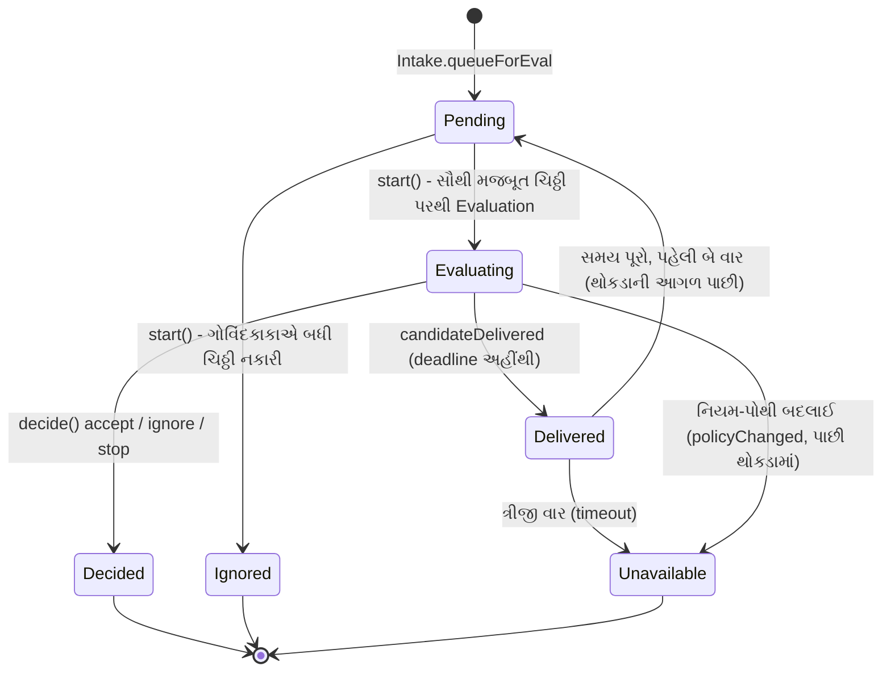
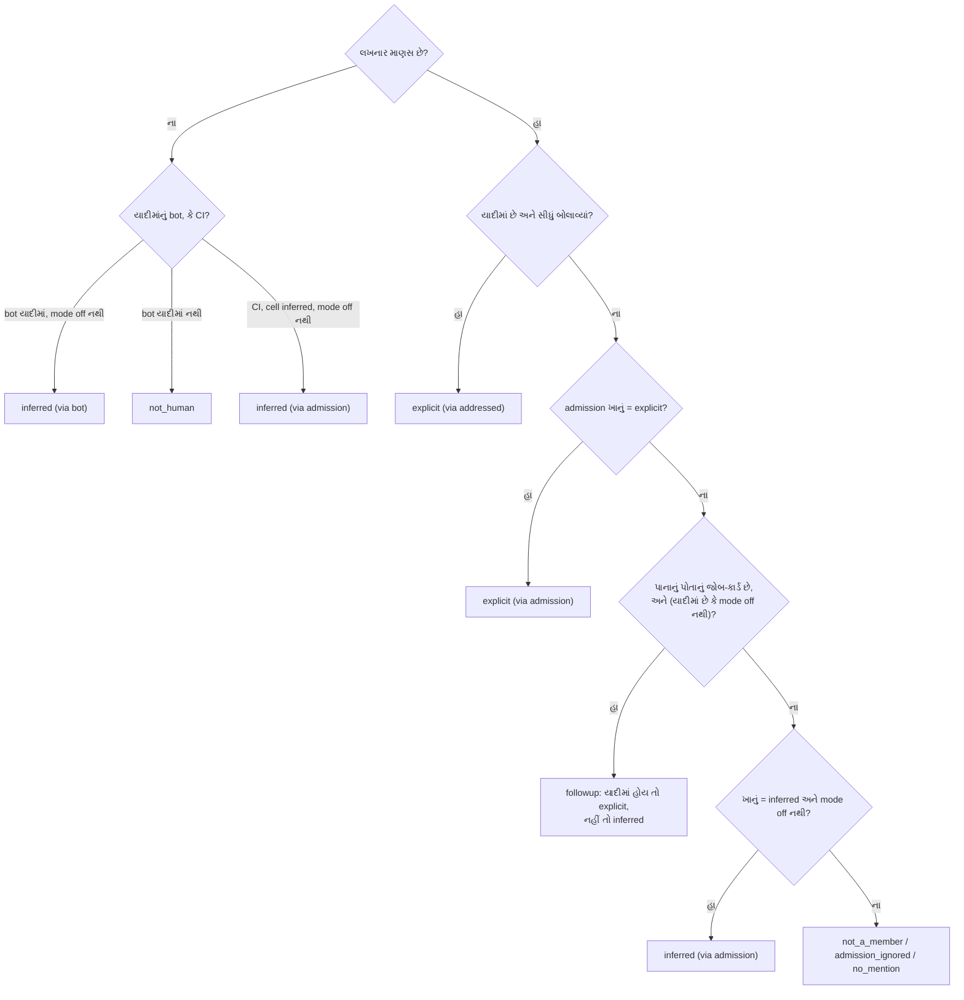

# પ્રકરણ 5 — Policy અને evaluation: ગોવિંદકાકાની યાદી

> **Level 5 · વાર્તાનો દિવસ 6.**
> ચિઠ્ઠી થોકડામાં પડી છે. હવે બે જણ નિર્ણય કરે છે: દરવાજે ગોવિંદકાકા (યાદી જોઈને), અને ડેસ્ક પર સવિતાબેન (વાત સમજીને).
> પહેલાં: [પ્રકરણ 4](04-sources-intake.md).

## 🎯 આ પ્રકરણ પછી તમે શું કરી શકશો

- નિયમ-આધારિત **gate** અને model ના **assessment** ને અલગ પાડી શકશો.
- `explicit` અને `inferred` strength, admission table અને accept modes (`off`, `observe`, `auto`) સમજાવી શકશો.
- `Evals.start` નું batching, deadline, requeue અને `unavailable` trace કરી શકશો.
- Policy નું version બદલાય ત્યારે ચાલુ Evals અને Tickets નું શું થાય છે તે code અને tests વડે બતાવી શકશો.

**નવા શબ્દો:** **deterministic** (એ જ input માટે હંમેશાં એ જ જવાબ; model નહીં, સાદો code), **batch** (ભેગી કરેલી ચિઠ્ઠીઓનો એક થોકડો), **deadline** (છેલ્લી સમયમર્યાદા).

## 🗺️ નકશો: થોકડાથી નિર્ણય સુધી



દરેક તીર એક method call છે, અને તીર પરનું લખાણ તે ફેરફાર કરનાર function છે. `Pending` અને `Evaluating` એ પાના (`Thread`) નાં બે ખાનાં છે: `pending` (થોકડો) અને `evaluating` (અત્યારે વિચારાઈ રહેલો થોકડો).

---

## દૃશ્ય 1 — ગોવિંદકાકાની યાદી: નામ અને "સીધું બોલાવ્યાં?"

🎬 મનોજભાઈની ચિઠ્ઠી થોકડામાં છે: "@અન્નપૂર્ણા મારો પણ 100 થાળીનો ઓર્ડર લો, અને પૈસા પછી." આરવ ધારે છે કે સવિતાબેન હવે તેને વાંચીને વિચારશે. પણ ચિઠ્ઠી તેમના સુધી પહોંચતી જ નથી. દરવાજે ગોવિંદકાકા યાદી કાઢે છે: "મનોજભાઈ? નામ નથી." ચિઠ્ઠી પર લખાય છે **not_a_member**, અને વાત પૂરી. થોડી વાર પછી અલકાબેન લખે છે: "@અન્નપૂર્ણા રવિવારે 40 થાળી." કાકા: "નામ છે, અને સીધું બોલાવ્યાં છે. **પાકો ઓર્ડર**." સવિતાબેનને વિચારવાની જરૂર પણ નથી પડતી.

❓ "તો model ક્યારે વિચારે છે? અને કાકા કયા ક્રમમાં તપાસે છે?"

💻 ગોવિંદકાકા = [`settingsPolicy().gate`][policy-gate]. મશીન (bots, CI) માટે અલગ શાખા: [`machineGate`][policy-machinegate]. ✅



દરેક હીરો એક પ્રશ્ન છે, તીર તેનો જવાબ, અને છેડાનાં ખાનાં gate નું પરિણામ (`GateResult`). ધ્યાન આપો: explicit ખાનાની તપાસ follow-up ની તપાસ **પહેલાં** આવે છે. Code comment કહે છે: "so a thread's tickets never weaken an explicit request to a follow-up".

**Admission table** (ત્રણ ખાનાં, [docs/002][doc-auth]):

| ખાનું | અર્થ | વિકલ્પો | Default |
|---|---|---|---|
| `listedUnaddressed` | યાદીમાં છે, બોલાવ્યાં નથી | inferred, ignore | inferred |
| `unlistedAddressed` | યાદીમાં નથી, બોલાવ્યાં છે | explicit, inferred, ignore | **ignore** |
| `unlistedUnaddressed` | બેમાંથી એકેય નહીં | inferred, ignore | ignore |

"બોલાવ્યાં નથી" વાળાં ખાનાં ત્યારે જ લાગુ પડે જ્યારે Source તે scope ની **બધી** વાત સાંભળતો હોય (`scope.observed`). યાદી પોતે [`allowed`][policy-allowed] માં છે.

🧪 Running example: અલકાબેન (`alice`) → `{ admissible: true, strength: 'explicit', basis: { via: 'addressed', addressed: 'mention', sender: 'alice', row: 'issues' } }`. મનોજભાઈ (`mallory`), પાના #8 → `not_a_member` ([log](../evidence/running-example.log.json), `C_unauthorized`).

🔬 **Expert નજર.** Model ને prompt injection વડે છેતરી શકાય; `if` statement ને નહીં. એટલે "કોણ માગી શકે" એ પ્રશ્ન model ને પૂછાતો જ નથી. Model ફક્ત બાકી રહેલો, નરમ પ્રશ્ન સંભાળે છે: "આ વાતમાં કામ છુપાયેલું છે?" અને તે પણ ફક્ત `inferred` ચિઠ્ઠીઓ માટે. આ વિભાજન આખા prototype ની સુરક્ષાનો પાયો છે: **સત્તાનો નિર્ણય code કરે, સમજનો નિર્ણય model કરે**.

## દૃશ્ય 2 — મનોજભાઈ "બંધ કરો" લખે છે

🎬 અલકાબેનના ઓર્ડરની રસોઈ ચાલુ છે. મનોજભાઈ એ જ પાના પર આવીને લખે છે: "@અન્નપૂર્ણા બંધ કરો આ ઓર્ડર." આરવ ગભરાય છે: "પાના પર તો જોબ-કાર્ડ છે. કાકા તેને follow-up ગણીને અંદર આવવા દેશે?" કાકા આવવા દે છે, પણ ચિઠ્ઠી પર **"અનુમાન"** નો સિક્કો મારીને. અને સવિતાબેનની પોથીમાં લખ્યું છે: "ઓર્ડર રદ કરવા **પાકી** ચિઠ્ઠી જોઈએ." રસોઈ ચાલુ રહે છે.

❓ "એક જ ચિઠ્ઠી, ત્રણ mode. ત્રણેયમાં શું અલગ પડે?"

💻 🧪 અમે ત્રણેય mode માં gate ચલાવ્યો (પાનું `github:7`, જેના પર Ticket છે; લખનાર `mallory`):

| Mode | Gate નું પરિણામ |
|---|---|
| `off` | `{ admissible: false, reason: 'not_a_member' }` |
| `observe` (default) | `{ admissible: true, strength: 'inferred', basis: { via: 'followup', row: 'comments' } }` |
| `auto` | `observe` જેવું જ |

Stop નો નિયમ [`Evals` ના stop ભાગ][evals-stop] માં છે: stop માટે `explicit` strength ફરજિયાત. 🧪 Running example: `H_stopRefused.decision = { kind: 'ignore', strength: 'inferred', reason: [{ code: 'stopNotExplicit' }] }`.

એક વધુ કિસ્સો, જે આરવને ચોંકાવે છે. 🧪 અલકાબેનને યાદીમાંથી કાઢી નાખો, પછી તે પોતે stop લખે: પરિણામ ફરી `ignore / stopNotExplicit`. સત્તા **અત્યારની** યાદી પરથી નક્કી થાય છે, ઓર્ડર કોણે આપ્યો હતો તેના પરથી નહીં.

> 💡 `off` mode માં આ ચિઠ્ઠી gate પર જ અટકે છે, એટલે main Session `orchestrator_route` વડે stop કરવા જાય તો [`directEval`][evals-direct] `notAdmissible` error ફેંકે છે.

🔬 **Expert નજર.** "કામ શરૂ કરવું" અને "કામ રોકવું" બંને સત્તાનાં કામ છે, અને રોકવું વધારે જોખમી હોઈ શકે: કોઈ પણ રાહદારી ચાલુ deployment રોકી શકે તો તે હુમલો છે. Prototype એટલે stop ને સૌથી કડક વર્ગમાં મૂકે છે. નોંધો કે `followup` શાખા અનલિસ્ટેડ માણસને અંદર આવવા દે છે પણ `inferred` તરીકે: તે ટુકડીને **માહિતી** આપી શકે, **હુકમ** નહીં.

## દૃશ્ય 3 — થોકડો, ઘડિયાળ, અને "ફરી પ્રયત્ન"

🎬 બપોરે ત્રણ ચિઠ્ઠી સાથે આવે છે, અને સવિતાબેન ફોન પર વ્યસ્ત છે. છોટુ ત્રણેયને એક થોકડો બનાવીને તેમની સામે મૂકે છે અને રેતઘડી ઊંધી કરે છે. આરવ: "પણ બેન તો ફોન પર છે, ઘડિયાળ ચાલુ થઈ ગઈ?" દીદી: "ના. ઘડિયાળ ત્યારે જ ચાલુ થાય જ્યારે થોકડો **તેમના હાથમાં** પહોંચે. અને સમય પૂરો થાય તો થોકડો લાઈનમાં **સૌથી આગળ** પાછો જાય. બે વાર. ત્રીજી વાર આપણે લખી દઈએ: 'નિર્ણય ન થઈ શક્યો'."

❓ "Batch કેવી રીતે બને? Deadline ક્યાંથી ગણાય? ત્રણ વાર પછી શું?"

💻 [`Evals.start`][evals-start] નાં પગલાં: ✅

1. જે ચિઠ્ઠીએ પહેલાં જોબ-કાર્ડ શરૂ કરાવ્યું હતું તે `startedTicket` કારણ સાથે ignore. આથી replay બીજું કાર્ડ નથી બનાવતું.
2. દરેક ચિઠ્ઠી પર gate. **સૌથી મજબૂત** admissible ચિઠ્ઠી થોકડાની strength, actor અને basis આપે; સરખી હોય તો છેલ્લી.
3. `evalId = key('eval', thread.key, policy.version, at, ...pending)`. નિયમ-પોથીનું version id નો ભાગ છે.
4. આખો `pending` એક batch બને, અને `pending = []`. વિચાર ચાલતો હોય ત્યારે આવતી ચિઠ્ઠીઓ **આગલા** થોકડાની રાહ જુએ ([test][test-debounce]).
5. `assessor.request(candidate)`: [`MasterAssessor.request`][assess-request] ફક્ત ખીંટી પર એક `assessment` કાપલી ટાંગે છે.

Deadline: [handler][assess-handler] candidate ને main Session માં મૂકે, પછી `engine.candidateDelivered(evalId)`. [`Evals.delivered`][evals-delivered] deadline ને **તે ક્ષણથી** ફરી ગણે (default 120 s, [`EvalConfigSchema`][policy-evalcfg]). [`due()`][evals-due] ફક્ત delivered Evals ને expire કરે.

```ts
const REQUEUES = 2
```

[આ અચળાંક][evals-requeues] "બે વાર" છે: [`expire`][evals-expire] પહેલી બે વાર ચિઠ્ઠીઓને થોકડાની **આગળ** મૂકે, ત્રીજી વાર `unavailable` + `timeout` નોંધે.

🧪 Test "counts an Eval's deadline from its delivery, queues its Triggers again twice when it expires, then records it unavailable" ([code][test-deadline]) પાસ થાય છે.

🔬 **Expert નજર.** Deadline શરૂઆતથી ગણાય તો વ્યસ્ત main Session નો સમય ચિઠ્ઠીના ખાતે કપાય, અને ભારે દિવસે બધી ચિઠ્ઠીઓ "timeout" થઈ જાય: બરાબર ત્યારે જ્યારે system ની સૌથી વધુ જરૂર હોય. Delivery થી ગણવાથી ઘડિયાળ ફક્ત **model ના વિચારવાના સમય** ને માપે છે. અને batching એક debounce છે: ચર્ચામાં પાંચ ઝડપી comments પાંચ Evals નથી બનાવતા, એક બનાવે છે.

## દૃશ્ય 4 — સવિતાબેન વિચારે છે, પણ હાથ નથી લગાડતાં

🎬 સોસાયટીના ગ્રુપમાં અલકાબેન કોઈને કહે છે: "આ વખતે મેનુ-કાર્ડમાં 'કઢી' ની જોડણી ખોટી છપાઈ છે." કોઈએ ડેસ્કને બોલાવી નથી. કાકા: "નામ યાદીમાં, બોલાવ્યાં નથી: **અનુમાન**." હવે સવિતાબેન ખરેખર વિચારે છે: "વાત આપણા ઘરની છે? કોઈ ઈચ્છે છે કે સુધારાય? શું સુધારવું તે નક્કી છે?" ત્રણેયનો જવાબ હા. પણ તે જોબ-કાર્ડ નથી બનાવતાં. નોંધપોથીમાં લખે છે: "**લીધું હોત**." આરવ: "કેમ?" દીદી: "પપ્પાએ કહ્યું છે, પહેલા મહિને ફક્ત જુઓ."

❓ "'લીધું હોત' code માં શું છે? અને model નો જવાબ નિર્ણય કેવી રીતે બને?"

💻 [`assessmentOutcome`][policy-outcome] model ના structured જવાબને Engine outcome માં ફેરવે છે: ✅

1. દરેક ચાલુ નિયમ માટે બરાબર એક `rule_assessment` જોઈએ; નહીં તો throw.
2. `decision !== 'accept'` → એ જ kind.
3. દિશા નક્કી ન હોય (કામ માગ્યું નથી, target નક્કી નથી, design નિર્ણય બાકી) → `ignore` + `directionUnsettled`.
4. કોઈ નિયમ લાગુ ન પડે → `ignore` + `noRuleMatched`.
5. Accept માટે `intent_evidence` ફરજિયાત.
6. **Inferred, અને mode `auto` નથી** → `ignore`, audit માં `would_accept: true`, કારણ `observed`.

છઠ્ઠું પગલું "લીધું હોત" છે. [`admitsInferred`][policy-admits] ફક્ત `auto` mode અને ચાલુ નિયમો હોય ત્યારે true આપે. Default નિયમો બે છે, `copy` અને `visual` ([`DEFAULT_RULES`][policy-rules]). સવિતાબેનની સૂચનાઓ [`prompts/admission.md`][admission-prompt] માં છે: "Before matching rules, establish three independent facts…".

પાકી ચિઠ્ઠી (explicit) માટે આ આખો રસ્તો છોડી દેવાય છે: main Session [`orchestrator_route`][tools-route] બોલાવે, જે `engine.decide(triggerId, { kind: 'accept', … reason: { code: 'explicitRouted' } })` છે. [`Evals.decide`][evals-decide] ની તપાસો:

| તપાસ | નિષ્ફળ જાય તો |
|---|---|
| ચિઠ્ઠી અસ્તિત્વમાં છે | `unknownTrigger` |
| `evalId` હજી ચાલુ થોકડાનું છે | `evalFinished` |
| આ ચિઠ્ઠી પહેલાં સ્વીકારાઈ હતી | જૂનો નિર્ણય પાછો (બીજું કાર્ડ નહીં) |
| Follow-up ની માલિક ટુકડી છે | `workerDecides` |
| Inferred accept, પણ `admitsInferred` false | `notExplicit` |
| નિયમ-પોથીનું version બદલાયું | `unavailable` + `policyChanged` |

🧪 Running example: `A_accepted.decisions7 = [{ kind: 'accept', reason: ['explicitRouted'] }]`. બધા reason codes એક જ ટેબલમાં છે: [`REASONS`][reasons-table].

> ⚠️ **અચકાસાયેલું.** અમે ખરા model સાથે assessment ચલાવ્યું નથી (DSH, model key અને agent account નથી). ઉપરનું બધું source વાંચન અને upstream tests પરથી છે.

🔬 **Expert નજર.** `observe` એ **shadow mode** છે: system production data પર નિર્ણય કરે છે, પણ તેનો અમલ નથી કરતી. Operator થોડાં અઠવાડિયાં "લીધું હોત" ની યાદી વાંચે, ખોટા નિર્ણયો પરથી નિયમો સુધારે, અને ભરોસો બેસે પછી જ `auto` કરે. સ્વાયત્તતા એક switch નથી; તે **કમાવાની** વસ્તુ છે, અને આ mode તેને કમાવાનું સાધન છે.

## દૃશ્ય 5 — નિયમ-પોથીની નવી આવૃત્તિ

🎬 સાંજે પપ્પા નિયમ-પોથીમાં એક લીટી બદલે છે: "'visual' પ્રકારનાં કામ હવે નહીં." તે જ ક્ષણે સવિતાબેન એક થોકડો વિચારી રહ્યાં છે, અને ચૂલા પર બે ઓર્ડર ચાલુ છે. આરવ: "ચાલુ ઓર્ડર ફેંકી દેવાના?" પપ્પા: "ના. જે રંધાય છે તે પૂરું થશે, પણ ટુકડીને **જાણ** કરો. અને બેન જે વિચારે છે તે નવી પોથીથી **ફરી** વિચારે."

❓ "'નવી આવૃત્તિ' code કેવી રીતે જાણે? અને ત્રણ જગ્યાએ (વિચારાતો થોકડો, ચાલુ કાર્ડ, બંધ કાર્ડ) શું થાય?"

💻 [`policyVersion`][policy-version]: ✅

```ts
export function policyVersion(settings: Settings): string {
  return key(POLICY_REVISION, JSON.stringify({ rules: settings.policy.rules, mode: settings.eval.mode, sources: settings.policy.sources }))
}
```

Version માં ફક્ત **નિયમો, mode અને Sources ના policy ભાગ** છે. Models, ચૂલાની સંખ્યા, pause અને Source ની ગોઠવણ તેમાં નથી. 🧪 Running example નું version: `7322d455c5660f66bae9cb7a3fb2839c`.

[`Settings.save`][settings-save] → `engine.policyChanged`:

| જગ્યા | શું થાય | Code |
|---|---|---|
| વિચારાતો થોકડો | `unavailable` + `policyChanged`; ચિઠ્ઠીઓ થોકડાની આગળ પાછી | [`reassess`][evals-reassess] |
| ચાલુ જોબ-કાર્ડ | ફક્ત **અસર પામેલાં** કાર્ડને `policy-changed` Input | [`policyEffects`][policy-effects] |
| બંધ જોબ-કાર્ડ | ફરી ખોલતાં પહેલાં પરવાનાની ફેરતપાસ | [`revalidate`][policy-revalidate] |

અસર ત્રણ પ્રકારની: નિયમ બદલાયો કે બંધ થયો, માગનાર હવે યાદીમાં નથી, અથવા અનુમાનિત કામ હવે લેવાતું નથી. ટુકડીને મળતો સંદેશ [`policyMessage`][dsh-policy-msg] બનાવે છે, જેમ કે: "may no longer start work here: finish the assignment within its scope".

પરવાનો (Mandate) **રદ થતો નથી**. [docs/001][doc-domain] માં નકારેલા વિકલ્પોમાં લખ્યું છે: "Cancelling running Tickets on a Policy change".

🔬 **Expert નજર.** Version ને `evalId` માં ગૂંથવાથી એક આખો race વર્ગ ગાયબ થાય છે: જૂની પોથી પર શરૂ થયેલો વિચાર નવી પોથી પર નિર્ણય બની શકતો નથી, કારણ કે `decide` version સરખાવે છે. અને ચાલુ કામ રદ ન કરવું એ વ્યવહારુ નિર્ણય છે: અડધું રંધાયેલું ફેંકવું એ પૂરું કરવા કરતાં ઘણી વાર વધુ નુકસાન કરે (અડધો PR, અડધું migration). એટલે નિયમ એ છે: **નવા નિયમો નવા નિર્ણયો પર લાગુ પડે; જૂના કામને જાણ થાય.**

---

## Source map

| ક્રમ | File | Symbols |
|---|---|---|
| 1 | `docs/002-authorization.md` | [admission, modes][doc-auth] |
| 2 | `src/policy.ts` | [`gate`][policy-gate], [`machineGate`][policy-machinegate], [`assessmentOutcome`][policy-outcome], [`policyVersion`][policy-version], [`policyEffects`][policy-effects], [`revalidate`][policy-revalidate] |
| 3 | `src/core/evals.ts` | [`start`][evals-start], [`delivered`][evals-delivered], [`expire`][evals-expire], [`decide`][evals-decide], [`decideEval`][evals-decideeval], [`accept`][evals-accept] |
| 4 | `src/app/assessment.ts` | [`MasterAssessor`][assess-request], [handler][assess-handler], [limits][assess-limits] |
| 5 | `prompts/admission.md` | [સૂચનાઓ][admission-prompt] |

## 🧪 Lab

```bash
pnpm vitest run tests/policy.spec.ts
```

```bash
pnpm vitest run tests/core-engine.spec.ts -t "counts an Eval's deadline from its delivery"
```

પછી એક અચળાંક બદલો અને જુઓ કે tests તેને પકડે છે:

```diff
-const REQUEUES = 2
+const REQUEUES = 3
```

```bash
pnpm vitest run tests/core-engine.spec.ts
```

🧪 **અવલોકન:** `Tests 1 failed | 112 passed (113)`. નિષ્ફળ test ઉપરનો deadline test, `AssertionError: expected [] to deeply equal [ ObjectContaining{…} ]`. પછી `git checkout src/core/evals.ts`.

**શીખ:** "બે વાર ફરી પ્રયત્ન" docs, code અને test ત્રણેયમાં લખેલું વર્તન છે. તેને બદલવું હોય તો ત્રણેય સાથે બદલવાં પડે.

## 🔮 આગાહી કસોટી

Mode `observe` છે. યાદીમાંના અલકાબેન ડેસ્કને **બોલાવ્યા વગર** લખે છે, અને model કહે છે "accept". જોબ-કાર્ડ બનશે? (ધારો. જવાબ: **ના**. Gate → `inferred`; `assessmentOutcome` પગલું 6 → `ignore` + `observed`, `would_accept: true`.)

## 🩺 નિષ્ફળતા: "મારી request નો જવાબ જ નથી આવતો"

**નિદાન:** પાટિયું → Eval tab → નિર્ણયનું કારણ.

| કારણ | અર્થ | ઉપાય |
|---|---|---|
| `not_a_member` | નામ યાદીમાં નથી | Policy → Source ની allowed યાદી |
| `no_mention` | યાદીમાં છે, પણ બોલાવ્યાં નથી અને scope observed નથી | `@agent` લખો, અથવા observe switch |
| `admission_ignored` | ખાનું `ignore` છે | Admission table |
| `timeout` (unavailable) | ત્રણ વાર સમય પૂરો | main Session ચાલે છે? `models` health? `eval.timeoutSeconds`? |

**Regression test:** ઉપરનો deadline test.

<a id="saar"></a>

## ✅ સાર

| 🎬 ઘટના | 💻 નિયમ | 🔬 તૂટે તો |
|---|---|---|
| કાકાની યાદી | Gate deterministic; explicit = યાદી + સીધું બોલાવ્યાં | Model ને છેતરીને કામ શરૂ કરાવાય |
| મનોજભાઈનો "બંધ કરો" | Stop માટે explicit; followup અનલિસ્ટેડ માટે inferred | રાહદારી કામ રોકી દે |
| થોકડો અને ઘડિયાળ | Batch per Thread; deadline delivery થી; 2 requeue | ભારે દિવસે બધું timeout |
| "લીધું હોત" | `observe`: inferred accept → ignore + `observed` | ભરોસા વગરની સ્વાયત્તતા |
| નવી આવૃત્તિ | Version = rules + mode + sources; Evals ફરી, Tickets ને જાણ | જૂના નિયમ પર નવો નિર્ણય |

**યાદ-ચાવી "2-3-120":** બે strength (explicit, inferred), ત્રણ mode (off, observe, auto), 120 seconds deadline, અને બે requeue.

<details><summary>કાર્ડ 1: Explicit request માં assessment કેમ નથી?</summary>

સત્તા (યાદી) અને ઈરાદો (સીધું બોલાવ્યાં) બંને code થી સાબિત છે. Model ને પૂછવાથી ફક્ત વિલંબ અને ભૂલની શક્યતા ઉમેરાય. Main Session `orchestrator_route` વડે સીધું `explicitRouted` accept નોંધે છે.
</details>

<details><summary>કાર્ડ 2: Policy version માં models કેમ નથી?</summary>

Version "કોણ શું માગી શકે" ને ઓળખે છે. Model બદલવાથી તે બદલાતું નથી, એટલે ચાલુ Evals ફરી કરવાની જરૂર નથી.
</details>

**મિત્રને સમજાવો:** "દરવાજે ચોકીદાર યાદી જુએ છે, અંદર મેનેજર વાત સમજે છે. યાદીવાળો સીધું કહે તો મેનેજરને પૂછવાનું નથી."

## 🧠 Mastery check

1. Explicit request માટે assessment કેમ છોડી દેવાય છે, અને accept કયા reason code સાથે નોંધાય?
2. `observe` mode માં positive assessment નો Decision શું હોય?
3. Deadline શરૂઆતથી નહીં પણ delivery થી કેમ?
4. Policy version બદલાય ત્યારે ચાલુ Ticket રદ કેમ નથી થતો?
5. `mallory` Ticket ના પાના પર stop લખે: `off` અને `observe` માં શું અલગ?

જવાબો: [પરિશિષ્ટ D](../appendix/D-lab-solutions.md#પ્રકરણ-5). Rubric: [પરિશિષ્ટ E](../appendix/E-mastery-rubric.md).

## 🎬 આગળ શું

અલકાબેનની ચિઠ્ઠી સ્વીકારાઈ ગઈ. સવિતાબેન એક નવું પીળું કાર્ડ કાઢે છે અને ઉપર લખે છે: `readme-setup-97bdef320703`. આરવ: "આ કાર્ડમાં શું-શું લખાય? અને રસોઈ બગડે તો એ જ કાર્ડ ફરી વપરાય કે નવું?" → [પ્રકરણ 6](06-tickets-assignments.md).

<!-- citations:begin (generated by tools/refdefs.py) -->
[admission-prompt]: https://github.com/deepseek-ai/dsh-superagent-prototype/blob/8c32a9dc5d72c033816c6a8110b37f40cf94fba4/prompts/admission.md#L1-L12
[assess-handler]: https://github.com/deepseek-ai/dsh-superagent-prototype/blob/8c32a9dc5d72c033816c6a8110b37f40cf94fba4/src/app/assessment.ts#L96-L101
[assess-limits]: https://github.com/deepseek-ai/dsh-superagent-prototype/blob/8c32a9dc5d72c033816c6a8110b37f40cf94fba4/src/app/assessment.ts#L37
[assess-request]: https://github.com/deepseek-ai/dsh-superagent-prototype/blob/8c32a9dc5d72c033816c6a8110b37f40cf94fba4/src/app/assessment.ts#L104
[doc-auth]: https://github.com/deepseek-ai/dsh-superagent-prototype/blob/8c32a9dc5d72c033816c6a8110b37f40cf94fba4/docs/002-authorization.md#L1-L12
[doc-domain]: https://github.com/deepseek-ai/dsh-superagent-prototype/blob/8c32a9dc5d72c033816c6a8110b37f40cf94fba4/docs/001-domain.md#L1-L12
[dsh-policy-msg]: https://github.com/deepseek-ai/dsh-superagent-prototype/blob/8c32a9dc5d72c033816c6a8110b37f40cf94fba4/src/executor/dsh.ts#L138-L148
[evals-accept]: https://github.com/deepseek-ai/dsh-superagent-prototype/blob/8c32a9dc5d72c033816c6a8110b37f40cf94fba4/src/core/evals.ts#L306-L316
[evals-decide]: https://github.com/deepseek-ai/dsh-superagent-prototype/blob/8c32a9dc5d72c033816c6a8110b37f40cf94fba4/src/core/evals.ts#L131-L156
[evals-decideeval]: https://github.com/deepseek-ai/dsh-superagent-prototype/blob/8c32a9dc5d72c033816c6a8110b37f40cf94fba4/src/core/evals.ts#L282-L304
[evals-delivered]: https://github.com/deepseek-ai/dsh-superagent-prototype/blob/8c32a9dc5d72c033816c6a8110b37f40cf94fba4/src/core/evals.ts#L48-L55
[evals-direct]: https://github.com/deepseek-ai/dsh-superagent-prototype/blob/8c32a9dc5d72c033816c6a8110b37f40cf94fba4/src/core/evals.ts#L271-L280
[evals-due]: https://github.com/deepseek-ai/dsh-superagent-prototype/blob/8c32a9dc5d72c033816c6a8110b37f40cf94fba4/src/core/evals.ts#L35-L46
[evals-expire]: https://github.com/deepseek-ai/dsh-superagent-prototype/blob/8c32a9dc5d72c033816c6a8110b37f40cf94fba4/src/core/evals.ts#L60-L69
[evals-reassess]: https://github.com/deepseek-ai/dsh-superagent-prototype/blob/8c32a9dc5d72c033816c6a8110b37f40cf94fba4/src/core/evals.ts#L223-L230
[evals-requeues]: https://github.com/deepseek-ai/dsh-superagent-prototype/blob/8c32a9dc5d72c033816c6a8110b37f40cf94fba4/src/core/evals.ts#L19
[evals-start]: https://github.com/deepseek-ai/dsh-superagent-prototype/blob/8c32a9dc5d72c033816c6a8110b37f40cf94fba4/src/core/evals.ts#L71-L119
[evals-stop]: https://github.com/deepseek-ai/dsh-superagent-prototype/blob/8c32a9dc5d72c033816c6a8110b37f40cf94fba4/src/core/evals.ts#L293-L302
[policy-admits]: https://github.com/deepseek-ai/dsh-superagent-prototype/blob/8c32a9dc5d72c033816c6a8110b37f40cf94fba4/src/policy.ts#L212
[policy-allowed]: https://github.com/deepseek-ai/dsh-superagent-prototype/blob/8c32a9dc5d72c033816c6a8110b37f40cf94fba4/src/policy.ts#L119-L121
[policy-effects]: https://github.com/deepseek-ai/dsh-superagent-prototype/blob/8c32a9dc5d72c033816c6a8110b37f40cf94fba4/src/policy.ts#L144-L165
[policy-evalcfg]: https://github.com/deepseek-ai/dsh-superagent-prototype/blob/8c32a9dc5d72c033816c6a8110b37f40cf94fba4/src/policy.ts#L83-L87
[policy-gate]: https://github.com/deepseek-ai/dsh-superagent-prototype/blob/8c32a9dc5d72c033816c6a8110b37f40cf94fba4/src/policy.ts#L191-L211
[policy-machinegate]: https://github.com/deepseek-ai/dsh-superagent-prototype/blob/8c32a9dc5d72c033816c6a8110b37f40cf94fba4/src/policy.ts#L171-L188
[policy-outcome]: https://github.com/deepseek-ai/dsh-superagent-prototype/blob/8c32a9dc5d72c033816c6a8110b37f40cf94fba4/src/policy.ts#L40-L61
[policy-revalidate]: https://github.com/deepseek-ai/dsh-superagent-prototype/blob/8c32a9dc5d72c033816c6a8110b37f40cf94fba4/src/policy.ts#L213-L240
[policy-rules]: https://github.com/deepseek-ai/dsh-superagent-prototype/blob/8c32a9dc5d72c033816c6a8110b37f40cf94fba4/src/policy.ts#L62-L65
[policy-version]: https://github.com/deepseek-ai/dsh-superagent-prototype/blob/8c32a9dc5d72c033816c6a8110b37f40cf94fba4/src/policy.ts#L116-L118
[reasons-table]: https://github.com/deepseek-ai/dsh-superagent-prototype/blob/8c32a9dc5d72c033816c6a8110b37f40cf94fba4/src/core/reasons.ts#L5-L26
[settings-save]: https://github.com/deepseek-ai/dsh-superagent-prototype/blob/8c32a9dc5d72c033816c6a8110b37f40cf94fba4/src/app/settings.ts#L148-L196
[test-deadline]: https://github.com/deepseek-ai/dsh-superagent-prototype/blob/8c32a9dc5d72c033816c6a8110b37f40cf94fba4/tests/core-engine.spec.ts#L161-L185
[test-debounce]: https://github.com/deepseek-ai/dsh-superagent-prototype/blob/8c32a9dc5d72c033816c6a8110b37f40cf94fba4/tests/core-engine.spec.ts#L104-L114
[tools-route]: https://github.com/deepseek-ai/dsh-superagent-prototype/blob/8c32a9dc5d72c033816c6a8110b37f40cf94fba4/src/app/tools/main.ts#L88-L120
<!-- citations:end -->
