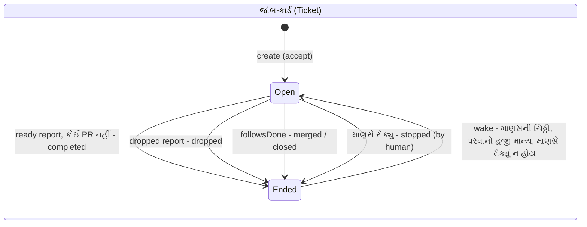
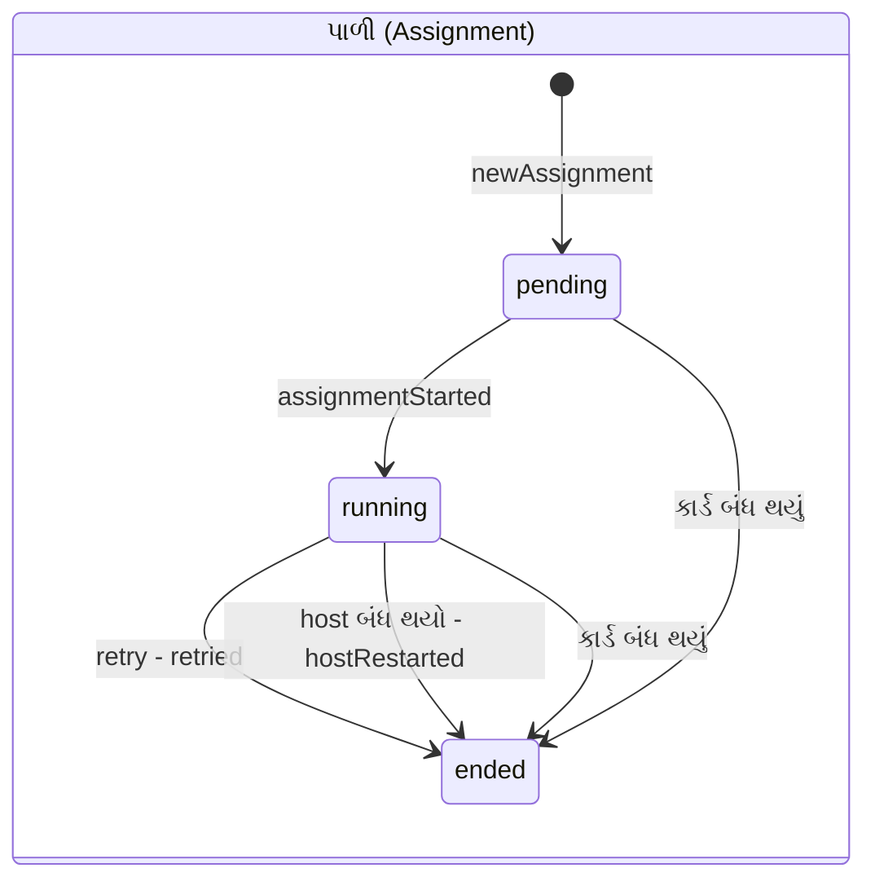
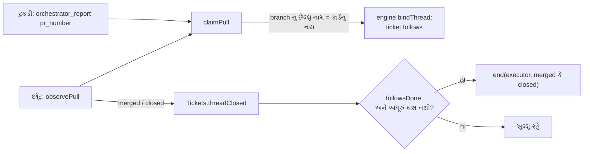

# પ્રકરણ 6 — Tickets અને assignments: જોબ-કાર્ડ અને પાળી

> **Level 6 · વાર્તાનો દિવસ 7.**
> સ્વીકારેલી ચિઠ્ઠી જોબ-કાર્ડ બને છે. કાર્ડ એક જ રહે છે; રસોઈની પાળી (Assignment) બદલાયા કરે છે.
> પહેલાં: [પ્રકરણ 5](05-policy-eval.md).

## 🎯 આ પ્રકરણ પછી તમે શું કરી શકશો

- Accept ને પરવાનો, જોબ-કાર્ડ, ટેગ, સ્વીકૃતિ-જવાબ અને પાળી સુધી **એક transaction** માં trace કરી શકશો.
- Ticket અને Assignment ના અલગ-અલગ જીવનચક્ર દોરી શકશો.
- Stop, resume, retry, hand-back, context-only ટેગ અને PR બંધ થવાના નિયમો સમજાવી શકશો.
- Running example માં stop પછી થોકડામાં 3 ચિઠ્ઠી કેમ પાછી આવી તે કારણ સાથે કહી શકશો.

**નવા શબ્દો:** **transaction** (ફેરફારોનો સમૂહ, જે કાં તો બધો લખાય કાં તો બિલકુલ નહીં), **lifecycle** (જન્મથી અંત સુધીની અવસ્થાઓ), **hand back** (કામ પાછું સોંપવું).

## 🗺️ નકશો: બે જીવનચક્ર





દરેક તીર Engine નો એક method છે; તીર પરનું લખાણ outcome અથવા `endedReason` છે. જોબ-કાર્ડ `Ended` માંથી પાછું `Open` થઈ શકે (ફક્ત `Tickets.wake` વડે, અને નવા નિર્ણય વગર). પાળી કદી પાછી નથી ફરતી: retry અને restart **નવી** પાળી બનાવે છે.

---

## દૃશ્ય 1 — એક ઝાટકે પાંચ વસ્તુ: કાર્ડ, ટેગ, જવાબ, પાળી, ચૂલાની કાપલી

🎬 સવિતાબેન અલકાબેનનો ઓર્ડર સ્વીકારે છે. એક જ શ્વાસમાં: પીળું જોબ-કાર્ડ લખે, રજિસ્ટરના પાના પર ટેગ બાંધે, "ઓર્ડર મળ્યો" ની જવાબ-કાપલી ટોપલીમાં મૂકે, પહેલી પાળી નોંધે, અને જશુભાઈ માટે "ચૂલો સળગાવો" ની કાપલી ખીંટી પર ટાંગે. ગયા વર્ષે લાઈટ ગઈ ત્યારે કાર્ડ લખાઈ ગયું હતું પણ ટેગ બંધાયો નહોતો. ગ્રાહકે બીજે દિવસે પૂછ્યું, અને કોઈને ખબર નહોતી કે તે કયા કાર્ડની વાત છે.

❓ "પાંચેય સાથે લખાય તે code કેવી રીતે પાકું કરે છે?"

💻 Call chain: `orchestrator_route` → `engine.decide` → `repo.atomic` → [`Evals.decide`][evals-decide] → [`accept`][evals-accept] → [`Tickets.create`][tickets-create] (shortened): ✅

```ts
create(id, decisionId, mandate, evaluation, outcome, at) {
  …
  let ticket: Ticket = { id, title: outcome.title, decisionId, mandate, channels: [], assignments: [], inputs: [], undelivered: [], createdAt: at, updatedAt: at, origin }
  ticket = this.options.prepareTicket?.(ticket, outcome) ?? ticket          // (a) ઓટલાનું નામ
  const assignment = this.newAssignment(ticket)                              // (b) પહેલી પાળી, pending
  this.repo.tickets.save(ticket)
  for (…) this.subscribe(id, ref)                                            // (c) ટેગ
  if (outcome.acknowledgement && primary) this.replies.acknowledgeAccepted(id, primary, outcome.acknowledgement)  // (d) જવાબ-કાપલી
  this.options.executor.start(this.require(id), assignment)                  // (e) ચૂલાની કાપલી
  this.emit('ticket.created', …)
}
```

(a) `prepareTicket` = [`DshExecutor.prepare`][dsh-prepare] → [`ticketExecution`][dsh-execution]: નામ `<name>-<ticket id ના પહેલા 12 અક્ષર>`. (d) અને (e) કામ **કરતાં નથી**, ફક્ત કાપલી મૂકે છે: Outbox receipt + `reply` effect, અને `launch` effect. બધું એક જ SQLite transaction માં.

જોબ-કાર્ડનું id પણ સિક્કો છે: `key('ticket', evaluation.id)`. 🧪 Running example: `ticketId = 97bdef3207031d61e10165dee53441b3`, ઓટલો `/srv/state/work/readme-setup-97bdef320703`.

🧪 Test "records an accept with its ticket, subscriptions and acknowledgement together, or none of them" ([code][test-accept-atomic]) પાસ.

🔬 **Expert નજર.** અહીં બે તરકીબ ભેગી છે. પહેલી, **atomicity**: અડધી સ્થિતિ (કાર્ડ છે, ટેગ નથી) અસ્તિત્વમાં આવી જ શકતી નથી. બીજી, **transactional outbox**: બહારની દુનિયાનું કામ (GitHub પર comment, worker શરૂ કરવો) transaction ની અંદર થઈ શકતું નથી, કારણ કે તેને rollback ન કરી શકાય. એટલે transaction ફક્ત "આ કરવાનું છે" ની નોંધ લખે છે, અને અમલ પછી થાય છે ([પ્રકરણ 8](08-store-effects-outbox.md)).

## દૃશ્ય 2 — પાટિયા પરનો એક શબ્દ: કાર્ડ કઈ અવસ્થામાં છે

🎬 પપ્પા પાટિયા સામે ઊભા છે. દરેક કાર્ડ સામે એક જ શબ્દ: "રંધાય છે", "તમારી રાહ", "લાઈનમાં", "પૂરું". આરવ પૂછે છે: "કાર્ડમાં તો દસ વિગત છે (પાળી, રિપોર્ટ, પ્રશ્ન, ડિલિવરી). એક શબ્દ કેવી રીતે નક્કી થાય?" દીદી: "ઉપરથી નીચે વાંચ. જે પહેલું સાચું પડે તે."

❓ "એ ક્રમ ક્યાં લખ્યો છે?"

💻 [`ticketStage`][stage-fn]: પહેલો match જીતે. ✅

| ક્રમ | શરત | Stage |
|---|---|---|
| 1 | `ticket.ended` | ended |
| 2 | `ticket.delivery` (ચિઠ્ઠી ટુકડીને પહોંચાડી ન શકાઈ) | person / delivery |
| 3 | `ticket.attention` (ટુકડીનો પ્રશ્ન) | person / answer |
| 4 | છેલ્લો રિપોર્ટ `ready` | person / review |
| 5 | blocked / failed, અને [`waitsForPerson`][model-waits] | person / blocked · failed |
| 6 | પાળી નથી, અથવા pending | working / queued |
| 7 | રિપોર્ટ `waiting`, અથવા પાળી ended | idle |
| 8 | બાકી બધું | working |

🧪 Running example માં ક્રમ: accept પછી `working` → `failed` રિપોર્ટ પછી `person/failed` → retry પછી `working` → restart પછી `working/queued` → stop પછી `ended`.

🔬 **Expert નજર.** Stage **store થતો નથી**; તે દર વખતે બાકીની હકીકતો પરથી ગણાય છે (derived state). Store કર્યો હોત તો બે સત્ય હોત (stage અને હકીકતો), અને તે કોઈ દિવસ અલગ પડત. "પહેલો match જીતે" વાળો ક્રમ પ્રાથમિકતા પણ કહે છે: માણસની જરૂર હોય તેવી અવસ્થાઓ (2–5) "કામ ચાલે છે" (6–8) થી ઉપર છે, કારણ કે પાટિયું માણસના ધ્યાન માટે છે.

## દૃશ્ય 3 — રસોઈ બગડી: "ફરીથી" ક્યારે દબાવી શકાય

🎬 ટુકડી રિપોર્ટ-કાપલી મોકલે છે: "**failed**: ગેસ ખૂટ્યો." પાટિયે "તમારી રાહ" દેખાય છે, અને બાજુમાં "ફરીથી" નું બટન. એ દરમિયાન બહાદુર (મશીન) પાના પર નોંધ મૂકે છે: "ચેક નિષ્ફળ." આરવ: "આ નોંધ ટુકડીને જગાડશે?" નથી જગાડતી. પપ્પા "ફરીથી" દબાવે છે: જૂની પાળી બંધ, નવી પાળી શરૂ, કાર્ડ એ જ.

પછી આરવ એક પ્રયોગ કરે છે: failed પછી **પહેલાં** અલકાબેન લખે "ફરી પ્રયત્ન કરો ને", અને પછી તે "ફરીથી" દબાવે છે. બટન ના પાડે છે.

❓ "મશીનની નોંધ કેમ ન જગાડે? અને માણસની ચિઠ્ઠી પછી retry કેમ નહીં?"

💻 [`Tickets.retry`][tickets-retry] ફક્ત [`canRetry`][stage-retry] હોય ત્યારે: કાર્ડ ખુલ્લું, અને (`waitsForPerson` અથવા delivery નિષ્ફળ). છેલ્લી પાળી `retried` કારણ સાથે બંધ; ન વંચાયેલી ચિઠ્ઠીઓ ફરી queue; નવી પાળી; `executor.stop`, પછી `executor.start`.

🧪 `F_retried.assignments = [ended/failed/retried, running]`, `stops = ['retried']`.

મશીનની નોંધ: [`addInput`][tickets-addinput] માં `held = automatic(input) && waitsForPerson(ticket)`. નોંધ કાર્ડના `inputs` માં જાય છે, પણ `undelivered` માં **નહીં**. 🧪 `F_failed.botHeldBack = true`.

આરવનો પ્રયોગ: 🧪 `comment(90, 'alice', 'try again please')` પછી `engine.retryTicket` → `notRetryable` ("Only an open ticket can be retried…"). માણસની ચિઠ્ઠી પહોંચતાં `waitsForPerson` false થઈ જાય છે: ટુકડી પાસે હવે નવી માહિતી છે, અને તે પોતે જાગશે. ([પરિશિષ્ટ D](../appendix/D-lab-solutions.md#પ્રકરણ-6))

🔬 **Expert નજર.** failed worker ને CI ની નોંધો જગાડે તો એક **loop** બને: worker નિષ્ફળ જાય → CI લાલ → નોંધ → worker જાગે → ફરી નિષ્ફળ… અને દરેક ફેરો tokens બાળે. "માણસની રાહ" એટલે ખરેખર માણસની રાહ. અને retry બટન માણસની ચિઠ્ઠી પછી ગાયબ થાય છે, કારણ કે બે રસ્તા (retry અને follow-up) એક સાથે ખુલ્લા હોય તો બે workers એક જ ઓટલા પર કામ કરવા લાગે.

## દૃશ્ય 4 — "બંધ કરો", "આભાર", અને પાછી આવેલી ત્રણ ચિઠ્ઠી

🎬 અલકાબેન લખે છે: "@અન્નપૂર્ણા બંધ કરો." આ પાકી ચિઠ્ઠી છે. સવિતાબેન કાર્ડ પર "રદ, ગ્રાહકે" લખે છે, અને જશુભાઈ ચૂલો ઓલવે છે. આરવ થોકડા તરફ જુએ છે: ખાલી હોવો જોઈએ. પણ તેમાં **ત્રણ** ચિઠ્ઠી છે. "આ ક્યાંથી આવી?" પછી અલકાબેન લખે છે: "આભાર!" આરવને બીક લાગે છે કે આ ચિઠ્ઠી રદ થયેલું કાર્ડ ફરી ખોલશે. નથી ખોલતી.

❓ "ત્રણ ચિઠ્ઠી કઈ? અને બંધ કાર્ડ ક્યારે ફરી ખૂલે, ક્યારે નહીં?"

💻 Stop ના બે રસ્તા: ✅

- **પાના પર લખીને:** સામાન્ય ચિઠ્ઠી → main Session `orchestrator_route` stop → [`decideEval`][evals-decideeval], explicit જોઈએ ([પ્રકરણ 5](05-policy-eval.md)).
- **પાટિયાના બટનથી:** [`Engine.stopTicket`][engine-stop] → `Tickets.end(…, 'human', 'stopped')`, Eval વગર.

[`Tickets.end`][tickets-end]: `ended` લખે, `undelivered` ખાલી કરે, attention અને delivery હટાવે, બધી ખુલ્લી પાળી બંધ કરે, [`letGo`][tickets-letgo] બોલાવે, અને `executor.stop`.

**ત્રણ ચિઠ્ઠી = `letGo`.** કાર્ડ બંધ થાય ત્યારે જે follow-ups ટુકડીએ **વાંચ્યા નથી** અને સ્વીકાર્યા, જવાબ્યા કે પાછા સોંપ્યા નથી, તે થોકડામાં પાછા જાય. 🧪 `I_stopped.thread7.pending = 3`:

| ચિઠ્ઠી | કેમ પાછી આવી |
|---|---|
| મનોજભાઈનો "license" સવાલ | ટુકડીએ વાંચ્યો નહોતો |
| અલકાબેનનો lint follow-up | ટુકડીએ વાંચ્યો નહોતો |
| મનોજભાઈનો નકારાયેલો stop | `stopNotExplicit` "પતી ગયેલું" નથી ગણાતું |
| અલકાબેનનો stop | **પાછી નથી આવી**: આ જ કાર્ડ રોકનાર ચિઠ્ઠી ફરી નથી વિચારાતી |

> ⚠️ આ સંખ્યા અમારા simulation ની છે, જેમાં નકલી Executor કશું deliver કે read કરતો નથી. ખરી system માં ટુકડીએ વાંચેલી ચિઠ્ઠીઓ પાછી નહીં આવે.

**ફરી ખૂલવું** ([`wake`][tickets-wake]): કાર્ડ બંધ હોય, **માણસે રોક્યું ન હોય**, રાહ જોતી ચિઠ્ઠી હોય, processing paused ન હોય, અને [`revalidate(mandate)`][policy-revalidate] સાચું આપે. ત્યારે `ended` હટે, નવી પાળી બને, `resumed` input સૌથી આગળ મુકાય. **નવો નિર્ણય બનતો નથી.**

🧪 "આભાર!": `J_afterStop.disposition.fanout = []`; ચિઠ્ઠી થોકડામાં ગઈ, કાર્ડ `ended.by = 'human'` જ રહ્યું.

🔬 **Expert નજર.** `letGo` પાછળનો સિદ્ધાંત: **કોઈ ચિઠ્ઠી ચૂપચાપ ગુમ ન થવી જોઈએ**. ટુકડી ચિઠ્ઠીની માલિક હતી; ટુકડી ગઈ, તો માલિકી ડેસ્કને પાછી મળે. અને resume માં નિર્ણય નથી બનતો કારણ કે પરવાનો (Mandate) પહેલેથી છે: એ જ કામ, એ જ સત્તા, ફક્ત ફેરતપાસ. પણ માણસે રોકેલું કાર્ડ કદી આપોઆપ ન ખૂલે: "બંધ કરો" નો અર્થ "આભાર" થી ઊલટો ન થવો જોઈએ.

## દૃશ્ય 5 — ટુકડી કહે છે "આ મારું કામ નથી"

🎬 README ના ઓર્ડરની રસોઈ દરમિયાન અલકાબેન એ જ પાના પર પૂછે છે: "અને હા, આવતા મહિનાના મેનુનું શું?" ચિઠ્ઠી ટુકડીને મળે છે (પાના પર તેનો ટેગ છે). ટુકડીનો મુખ્ય રસોઇયો તેને વાંચીને પાછી મોકલે છે: "આ અમારા ઓર્ડરની બહાર છે." ચિઠ્ઠી સવિતાબેનના થોકડામાં જાય છે, નવા ઓર્ડર તરીકે વિચારાવા.

❓ "ટુકડી કઈ-કઈ રીતે ચિઠ્ઠીનો નિકાલ કરી શકે?"

💻

| ઘટના | Tool → code | પરિણામ |
|---|---|---|
| માણસની ચિઠ્ઠી ટેગવાળા પાના પર | `Intake` fan-out; [`followupOwners`][model-owners] | ટુકડી નિર્ણય કરે; main Session ફક્ત stop કરી શકે ([`leftToWorkers`][part-leftworkers]) |
| "કામની બહાર છે" | [`orchestrator_trigger_handback`][tools-handback] → [`Evals.handback`][evals-handback] → [`handBack`][part-handback] | બીજો માલિક ન હોય તો થોકડામાં. એક ચિઠ્ઠી એક કાર્ડમાંથી એક જ વાર પાછી સોંપાય |
| "મળી, કરું છું" | [`orchestrator_trigger_ack`][tools-ack] → [`acknowledge`][replies-ack] | માણસને ટૂંકો જવાબ |
| main Session ચિઠ્ઠી જોડે | [`Engine.attach`][engine-attach] | કાર્ડ પાનાને ટેગ કરે; પાછી સોંપેલી ચિઠ્ઠી એ જ કાર્ડ પર ફરી ન જોડાય |
| સંબંધિત પાનું, ફક્ત સંદર્ભ | `orchestrator_thread_follow` | `Thread.context` માં કાર્ડ: ચિઠ્ઠીઓ મળે, સત્તા કે માલિકી નહીં, અને બંધ કાર્ડ ન ખૂલે |

જવાબ ક્યારે આપી શકાય તે [`Replies`][replies-answer] નક્કી કરે છે; ના પાડવાનાં કારણો નિશ્ચિત [`UserError`][errors-class] codes છે ([ટેબલ][errors-table]), જેમ કે `notReady`: "Ticket is not ready for delivery. Keep progress internal…".

બે કાર્ડ એક જ પાના પર હોય તો? Follow-up બંનેને પહોંચે. એક પાછી સોંપે તો બીજાની રહે; **બંને** સોંપે ત્યારે જ થોકડામાં. Test: "keeps a follow-up two tickets reached with the one that did not hand it back, and queues it once neither decides it".

🔬 **Expert નજર.** Follow-up કોણ સંભાળે, router કે worker? Prototype નો જવાબ: **જેની પાસે સંદર્ભ છે તે**. Worker કલાકથી એ કામમાં છે; router ને ફરી બધું સમજાવવું મોંઘું છે. Router ફક્ત બે વસ્તુ રાખે છે: stop કરવાની સત્તા, અને worker જેને ના પાડે તે. [લેખ](00a-lekh-ane-prototype.md) આને "pass-through" કહે છે.

## દૃશ્ય 6 — નમૂનાની થાળી ચખાઈ ગઈ: કાર્ડ ક્યારે પૂરું

🎬 ટુકડી નમૂનાની થાળી (PR) મોકલે છે, અને રિપોર્ટ-કાપલીમાં તેનો નંબર લખે છે. કાર્ડ હજી ખુલ્લું છે: થાળી ચખાય ત્યાં સુધી ગ્રાહક ફેરફાર માગી શકે. બે દિવસ પછી અલકાબેન થાળી મંજૂર કરે છે. છોટુ ખબર લાવે છે: "થાળી સ્વીકારાઈ." કાર્ડ પર આપોઆપ લખાય છે: "પૂરું, merged."

❓ "કાર્ડને કેવી રીતે ખબર પડે કે કઈ થાળી તેની છે, અને ક્યારે પૂરું?"

💻



ડાબેથી જમણે: થાળી કાર્ડ સાથે બે રીતે જોડાય છે (ટુકડી પોતે કહે, અથવા છોટુ branch ના નામ પરથી ઓળખે). થાળી બંધ થાય ત્યારે છોટુ હકીકત આપે છે, અને નિર્ણય core કરે છે.

- **Branch નિયમ:** [`ticketBranch`][ghp-branch]. Running example: `agent/readme-setup-97bdef320703`. જોડાણ: [`claimPull`][ghp-claim], [`observePull`][ghp-observe].
- [`followsDone`][tickets-followsdone]: કાર્ડે ખોલેલી (`own`) બધી થાળીઓ બંધ. એક પણ ન ખોલી હોય તો તે જેને follow કરે તે બધી બંધ. Outcome છેલ્લી બંધ થનારી પરથી ([`closed`][tickets-closed]).
- [`unfinished`][tickets-unfinished]: બંધ થયા પછી શરૂ થયેલું કામ હજી ready નથી, અથવા ટુકડીએ follow-up લીધો છે પણ રિપોર્ટ નથી આપ્યો → કાર્ડ ખુલ્લું રહે.
- [`pullEndNotices`][ghp-notices]: chat (Feishu) ને એક અંતિમ જાણ; GitHub ને નહીં, કારણ કે merge ત્યાં પોતે દેખાય છે.

🔬 **Expert નજર.** "કામ પૂરું" કોણ કહે? Worker નહીં (તે તો PR ખોલીને કહેશે "થઈ ગયું"), અને router પણ નહીં. **દુનિયા** કહે છે: PR merge થયો કે બંધ થયો. આ **external ground truth** પર આધારિત completion છે, અને LLM ના "મને લાગે છે પૂરું થયું" કરતાં ઘણું વધુ ભરોસાપાત્ર છે.

---

## Source map

| ક્રમ | File | Symbols |
|---|---|---|
| 1 | `docs/003-execution.md` | [execution નિયમો][doc-exec] |
| 2 | `src/core/tickets.ts` | [`create`][tickets-create], [`retry`][tickets-retry], [`addInput`][tickets-addinput], [`wake`][tickets-wake], [`letGo`][tickets-letgo], [`end`][tickets-end], [`restart`][tickets-restart] |
| 3 | `src/core/assignments.ts` | [`started`][assign-started], [`delivered`][assign-delivered], [`inputsRead`][assign-read], [`interrupted`][assign-interrupted], [`report`][assign-report] |
| 4 | `src/core/replies.ts` | [`acknowledge`][replies-ack], [`answer`][replies-answer] |
| 5 | `src/core/stage.ts` | [`ticketStage`][stage-fn], [`canRetry`][stage-retry] |
| 6 | `src/sources/github-pull.ts` | [`ticketBranch`][ghp-branch], [`claimPull`][ghp-claim] |

## 🧪 Lab

```bash
pnpm vitest run tests/core-engine.spec.ts -t "resume and stop"
```

```bash
pnpm vitest run tests/sources.spec.ts -t "binds a PR to the unique live ticket on its branch"
```

પછી આખું running example ચલાવો (ફાઇલ [`labs/running-example.spec.ts`](../labs/running-example.spec.ts) ને upstream `tests/` માં નકલ કરીને; રીત [labs/README](../labs/README.md) માં):

```bash
pnpm vitest run tests/running-example.spec.ts
```

🧪 **અવલોકન:** 1 test પાસ, અને log [`evidence/running-example.log.json`](../evidence/running-example.log.json) જેવો.

## 🔮 આગાહી કસોટી

કાર્ડ `completed` તરીકે બંધ છે (માણસે રોક્યું નથી). `github-actions[bot]` તેના પાના પર comment કરે છે. કાર્ડ ફરી ખૂલશે? (ધારો. જવાબ: **ના**. [પ્રકરણ 4](04-sources-intake.md) ના fan-out નિયમ મુજબ બંધ કાર્ડને ફક્ત **માણસની** ચિઠ્ઠી પહોંચે છે.)

## 🩺 નિષ્ફળતા: "Ticket પૂરો થયો, પણ PR હજી ખુલ્લો છે" / "PR merge થયો, પણ Ticket ખુલ્લો છે"

**નિદાન:** પાટિયું → Ticket → `follows`. (1) PR યાદીમાં ન હોય તો branch નું છેલ્લું નામ કાર્ડના નામ સાથે મળતું નથી, અથવા worker એ `pr_number` રિપોર્ટ નથી કર્યો. (2) યાદીમાં હોય અને બંધ હોય, તો `unfinished` જુઓ: ટુકડીએ merge પછી follow-up લીધો છે? **Regression test:** "keeps a ticket open after its pull request merged while its worker is on a person's message it took up after its last report".

<a id="saar"></a>

## ✅ સાર

| 🎬 ઘટના | 💻 નિયમ | 🔬 તૂટે તો |
|---|---|---|
| એક ઝાટકે પાંચ વસ્તુ | `Tickets.create` એક transaction; જવાબ અને launch ફક્ત queue | કાર્ડ છે પણ ટેગ નથી |
| પાટિયાનો એક શબ્દ | `ticketStage` derived; પહેલો match જીતે | બે સત્ય અલગ પડે |
| "ફરીથી" | Retry ફક્ત `waitsForPerson` કે delivery નિષ્ફળ; bot input held | CI-worker loop |
| પાછી આવેલી 3 ચિઠ્ઠી | `letGo`: ન વંચાયેલા follow-ups થોકડામાં | ચિઠ્ઠી ગુમ |
| "આભાર!" | માણસે રોકેલું કાર્ડ ન ખૂલે; resume માં Decision નહીં | Stop નિરર્થક |
| "મારું કામ નથી" | Hand back એક વાર; બંને ના પાડે ત્યારે Eval | ચિઠ્ઠી બે વચ્ચે લટકે |
| થાળી ચખાઈ | `followsDone` અને `unfinished` | Worker પોતે "પૂરું" જાહેર કરે |

**યાદ-ચાવી "1-કાર્ડ, ઘણી-પાળી":** Ticket ટકે છે, Assignment બદલાય છે, Mandate કદી બદલાતો નથી.

<details><summary>કાર્ડ 1: Resume માં Decision કેમ નથી બનતો?</summary>

Mandate પહેલેથી છે; resume એ જ કામનું ચાલુ રહેવું છે. નવું Decision નવો Mandate સૂચવે. તેને બદલે `revalidate` જૂના Mandate ને આજની Policy સામે ફરી તપાસે છે.
</details>

<details><summary>કાર્ડ 2: Stop કરનાર ચિઠ્ઠી `letGo` માં કેમ નથી?</summary>

તે ચિઠ્ઠીનો નિર્ણય થઈ ગયો છે: તેણે આ જ કાર્ડ રોક્યું. તેને ફરી વિચારવાથી "stop" એક નવા ઓર્ડર તરીકે વંચાય.
</details>

**મિત્રને સમજાવો:** "ઓર્ડરનું કાર્ડ એક. રસોઇયાની પાળી બદલાય, ગેસ ખૂટે, લાઈટ જાય, પણ કાર્ડ એ જ રહે. અને ગ્રાહક 'રદ' કહે પછી તે આપમેળે કદી ન ખૂલે."

## 🧠 Mastery check

1. સ્વીકૃતિ-જવાબ, Ticket, Subscription અને launch effect એક transaction માં કેમ?
2. Ticket resume થાય ત્યારે Decision કેમ નથી બનતો?
3. Stop ની ચિઠ્ઠી Ticket બંધ થયા પછી ફરી Eval માં કેમ નથી જતી?
4. `failed` Ticket ને CI comment કેમ નથી જગાડતો?
5. PR merge થયા પછી પણ Ticket ક્યારે ખુલ્લો રહે?

જવાબો: [પરિશિષ્ટ D](../appendix/D-lab-solutions.md#પ્રકરણ-6).

## 🎬 આગળ શું

ખીંટી પર "ચૂલો સળગાવો" ની કાપલી ટાંગેલી છે. જશુભાઈ તેને ઉતારે છે, અને જુએ છે કે ત્રણેય ચૂલા રોકાયેલા છે. આરવ: "હવે? અને ટુકડી કામ કરતી હોય ત્યારે નવી ચિઠ્ઠી તેને કેવી રીતે પહોંચે?" → [પ્રકરણ 7](07-worker-execution.md).

<!-- citations:begin (generated by tools/refdefs.py) -->
[assign-delivered]: https://github.com/deepseek-ai/dsh-superagent-prototype/blob/8c32a9dc5d72c033816c6a8110b37f40cf94fba4/src/core/assignments.ts#L48-L58
[assign-interrupted]: https://github.com/deepseek-ai/dsh-superagent-prototype/blob/8c32a9dc5d72c033816c6a8110b37f40cf94fba4/src/core/assignments.ts#L83-L92
[assign-read]: https://github.com/deepseek-ai/dsh-superagent-prototype/blob/8c32a9dc5d72c033816c6a8110b37f40cf94fba4/src/core/assignments.ts#L60-L65
[assign-report]: https://github.com/deepseek-ai/dsh-superagent-prototype/blob/8c32a9dc5d72c033816c6a8110b37f40cf94fba4/src/core/assignments.ts#L99-L134
[assign-started]: https://github.com/deepseek-ai/dsh-superagent-prototype/blob/8c32a9dc5d72c033816c6a8110b37f40cf94fba4/src/core/assignments.ts#L34-L43
[doc-exec]: https://github.com/deepseek-ai/dsh-superagent-prototype/blob/8c32a9dc5d72c033816c6a8110b37f40cf94fba4/docs/003-execution.md#L1-L12
[dsh-execution]: https://github.com/deepseek-ai/dsh-superagent-prototype/blob/8c32a9dc5d72c033816c6a8110b37f40cf94fba4/src/executor/dsh.ts#L97-L111
[dsh-prepare]: https://github.com/deepseek-ai/dsh-superagent-prototype/blob/8c32a9dc5d72c033816c6a8110b37f40cf94fba4/src/executor/dsh.ts#L247-L262
[engine-attach]: https://github.com/deepseek-ai/dsh-superagent-prototype/blob/8c32a9dc5d72c033816c6a8110b37f40cf94fba4/src/core/engine.ts#L109-L121
[engine-stop]: https://github.com/deepseek-ai/dsh-superagent-prototype/blob/8c32a9dc5d72c033816c6a8110b37f40cf94fba4/src/core/engine.ts#L160
[errors-class]: https://github.com/deepseek-ai/dsh-superagent-prototype/blob/8c32a9dc5d72c033816c6a8110b37f40cf94fba4/src/core/errors.ts#L54-L61
[errors-table]: https://github.com/deepseek-ai/dsh-superagent-prototype/blob/8c32a9dc5d72c033816c6a8110b37f40cf94fba4/src/core/errors.ts#L2-L47
[evals-accept]: https://github.com/deepseek-ai/dsh-superagent-prototype/blob/8c32a9dc5d72c033816c6a8110b37f40cf94fba4/src/core/evals.ts#L306-L316
[evals-decide]: https://github.com/deepseek-ai/dsh-superagent-prototype/blob/8c32a9dc5d72c033816c6a8110b37f40cf94fba4/src/core/evals.ts#L131-L156
[evals-decideeval]: https://github.com/deepseek-ai/dsh-superagent-prototype/blob/8c32a9dc5d72c033816c6a8110b37f40cf94fba4/src/core/evals.ts#L282-L304
[evals-handback]: https://github.com/deepseek-ai/dsh-superagent-prototype/blob/8c32a9dc5d72c033816c6a8110b37f40cf94fba4/src/core/evals.ts#L183-L188
[ghp-branch]: https://github.com/deepseek-ai/dsh-superagent-prototype/blob/8c32a9dc5d72c033816c6a8110b37f40cf94fba4/src/sources/github-pull.ts#L27-L28
[ghp-claim]: https://github.com/deepseek-ai/dsh-superagent-prototype/blob/8c32a9dc5d72c033816c6a8110b37f40cf94fba4/src/sources/github-pull.ts#L35-L50
[ghp-notices]: https://github.com/deepseek-ai/dsh-superagent-prototype/blob/8c32a9dc5d72c033816c6a8110b37f40cf94fba4/src/sources/github-pull.ts#L90-L105
[ghp-observe]: https://github.com/deepseek-ai/dsh-superagent-prototype/blob/8c32a9dc5d72c033816c6a8110b37f40cf94fba4/src/sources/github-pull.ts#L57-L69
[model-owners]: https://github.com/deepseek-ai/dsh-superagent-prototype/blob/8c32a9dc5d72c033816c6a8110b37f40cf94fba4/src/core/model.ts#L75-L88
[model-waits]: https://github.com/deepseek-ai/dsh-superagent-prototype/blob/8c32a9dc5d72c033816c6a8110b37f40cf94fba4/src/core/model.ts#L349-L353
[part-handback]: https://github.com/deepseek-ai/dsh-superagent-prototype/blob/8c32a9dc5d72c033816c6a8110b37f40cf94fba4/src/core/part.ts#L42-L48
[part-leftworkers]: https://github.com/deepseek-ai/dsh-superagent-prototype/blob/8c32a9dc5d72c033816c6a8110b37f40cf94fba4/src/core/part.ts#L32-L35
[policy-revalidate]: https://github.com/deepseek-ai/dsh-superagent-prototype/blob/8c32a9dc5d72c033816c6a8110b37f40cf94fba4/src/policy.ts#L213-L240
[replies-ack]: https://github.com/deepseek-ai/dsh-superagent-prototype/blob/8c32a9dc5d72c033816c6a8110b37f40cf94fba4/src/core/replies.ts#L48-L63
[replies-answer]: https://github.com/deepseek-ai/dsh-superagent-prototype/blob/8c32a9dc5d72c033816c6a8110b37f40cf94fba4/src/core/replies.ts#L64-L92
[stage-fn]: https://github.com/deepseek-ai/dsh-superagent-prototype/blob/8c32a9dc5d72c033816c6a8110b37f40cf94fba4/src/core/stage.ts#L9-L21
[stage-retry]: https://github.com/deepseek-ai/dsh-superagent-prototype/blob/8c32a9dc5d72c033816c6a8110b37f40cf94fba4/src/core/stage.ts#L24-L26
[test-accept-atomic]: https://github.com/deepseek-ai/dsh-superagent-prototype/blob/8c32a9dc5d72c033816c6a8110b37f40cf94fba4/tests/core-engine.spec.ts#L136-L145
[tickets-addinput]: https://github.com/deepseek-ai/dsh-superagent-prototype/blob/8c32a9dc5d72c033816c6a8110b37f40cf94fba4/src/core/tickets.ts#L234-L245
[tickets-closed]: https://github.com/deepseek-ai/dsh-superagent-prototype/blob/8c32a9dc5d72c033816c6a8110b37f40cf94fba4/src/core/tickets.ts#L77-L90
[tickets-create]: https://github.com/deepseek-ai/dsh-superagent-prototype/blob/8c32a9dc5d72c033816c6a8110b37f40cf94fba4/src/core/tickets.ts#L37-L56
[tickets-end]: https://github.com/deepseek-ai/dsh-superagent-prototype/blob/8c32a9dc5d72c033816c6a8110b37f40cf94fba4/src/core/tickets.ts#L345-L363
[tickets-followsdone]: https://github.com/deepseek-ai/dsh-superagent-prototype/blob/8c32a9dc5d72c033816c6a8110b37f40cf94fba4/src/core/tickets.ts#L95-L101
[tickets-letgo]: https://github.com/deepseek-ai/dsh-superagent-prototype/blob/8c32a9dc5d72c033816c6a8110b37f40cf94fba4/src/core/tickets.ts#L294-L309
[tickets-restart]: https://github.com/deepseek-ai/dsh-superagent-prototype/blob/8c32a9dc5d72c033816c6a8110b37f40cf94fba4/src/core/tickets.ts#L318-L327
[tickets-retry]: https://github.com/deepseek-ai/dsh-superagent-prototype/blob/8c32a9dc5d72c033816c6a8110b37f40cf94fba4/src/core/tickets.ts#L168-L180
[tickets-unfinished]: https://github.com/deepseek-ai/dsh-superagent-prototype/blob/8c32a9dc5d72c033816c6a8110b37f40cf94fba4/src/core/tickets.ts#L370-L379
[tickets-wake]: https://github.com/deepseek-ai/dsh-superagent-prototype/blob/8c32a9dc5d72c033816c6a8110b37f40cf94fba4/src/core/tickets.ts#L252-L270
[tools-ack]: https://github.com/deepseek-ai/dsh-superagent-prototype/blob/8c32a9dc5d72c033816c6a8110b37f40cf94fba4/src/app/tools/executor.ts#L28-L40
[tools-handback]: https://github.com/deepseek-ai/dsh-superagent-prototype/blob/8c32a9dc5d72c033816c6a8110b37f40cf94fba4/src/app/tools/executor.ts#L65-L73
<!-- citations:end -->
