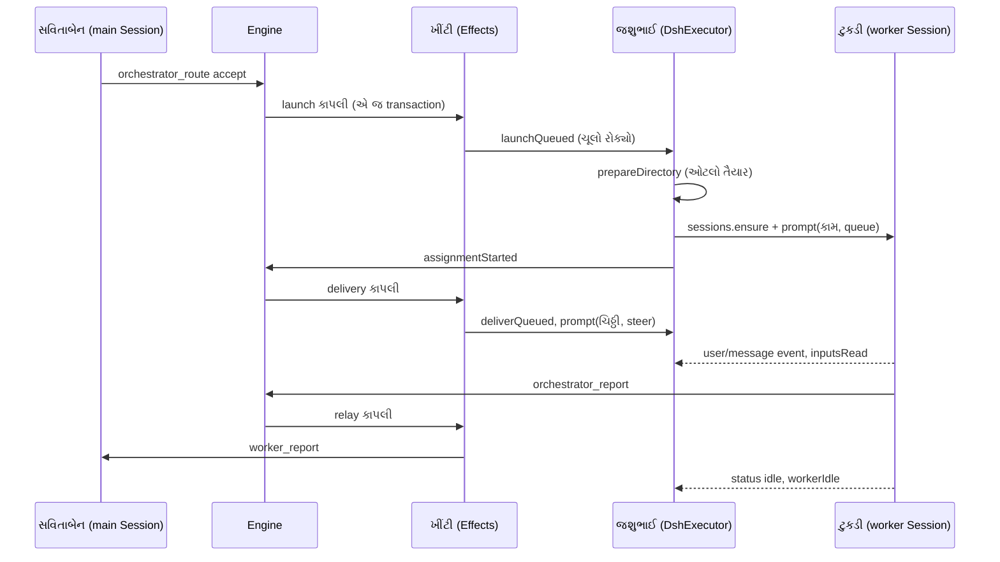

# પ્રકરણ 7 — Worker execution: જશુભાઈ અને ચૂલા

> **Level 7 · વાર્તાનો દિવસ 8.**
> ખીંટી પરની "ચૂલો સળગાવો" કાપલીથી રસોઈ-ટુકડીના રિપોર્ટ સુધી: ઓટલો, ચૂલા, ચિઠ્ઠી પહોંચાડવી, અને લાઈટ જાય પછીની શરૂઆત.
> પહેલાં: [પ્રકરણ 6](06-tickets-assignments.md).

## 🎯 આ પ્રકરણ પછી તમે શું કરી શકશો

- `DshExecutor` ને `Executor` port થી DSH Session સુધી trace કરી શકશો.
- Worker નું નામ, ઓટલો (directory) અને environment variables કેવી રીતે બને તે કહી શકશો.
- "પહોંચાડી" (delivered) અને "વંચાઈ" (read) વચ્ચેનો ફરક, અને તે કેમ મહત્વનો છે, સમજાવી શકશો.
- ચૂલા (slots), રદ કરવું, ક્ષણિક ભૂલ પછી ફરી પ્રયત્ન, અને restart પછીની recovery સમજાવી શકશો.
- આ repository **ક્યાં** DSH (Harness) ને કામ સોંપે છે તે ઓળખી શકશો.

**નવા શબ્દો:** **subprocess** (એક program માંથી શરૂ થયેલો બીજો program), **git worktree** (એક જ repository ની અલગ directory માં અલગ branch), **race condition** (બે કામ એક જ વસ્તુ માટે દોડે અને પરિણામ ક્રમ પર આધાર રાખે), **backoff** (દરેક નિષ્ફળતા પછી વધુ રાહ જોવી).

## 🗺️ નકશો: ડેસ્ક અને ટુકડી કદી સીધી વાત નથી કરતાં



સળંગ તીર call છે; ટપકાંવાળું તીર DSH ની event છે, જેને જશુભાઈ સાંભળે છે. સવિતાબેન અને ટુકડી વચ્ચે કોઈ સીધું તીર નથી: બધું Engine અને ખીંટી મારફતે જાય છે. [લેખ](00a-lekh-ane-prototype.md) ની ભાષામાં: "Workers report to the Router."

---

## દૃશ્ય 1 — જશુભાઈનું વચન: "હું ફક્ત કાપલી ટાંગું છું"

🎬 આરવ ધારે છે કે સવિતાબેન ઓર્ડર સ્વીકારે કે તરત જશુભાઈને બૂમ પાડે: "ચૂલો સળગાવો!" અને જશુભાઈ દોડે. પણ ડેસ્ક પર કોઈ બૂમ પાડતું નથી. સવિતાબેન ખીંટી પર કાપલી ટાંગે છે અને પોતાના કામે વળગે છે. જશુભાઈ પોતાની ઝડપે ખીંટી તપાસે છે. દીદી: "ગયા વર્ષે બેન બૂમ પાડતાં હતાં. એક વાર જશુભાઈ બજાર ગયા હતા. બૂમ હવામાં ગઈ, અને ઓર્ડર ભુલાઈ ગયો."

❓ "Engine Executor ને કેવી રીતે બોલાવે છે, અને Executor તરત શું કરે?"

💻 [`Executor` port][ports-executor]: ✅

```ts
export interface Executor {
  start(ticket: Ticket, assignment: Assignment): void
  deliver(ticket: Ticket, assignment: Assignment): void
  stop(ticket: Ticket, assignment: Assignment, reason: string): void
}
```

ત્રણેય `void` આપે છે: કોઈ `Promise` નહીં. Doc comment: "The Engine calls it inside its commands, so each method only queues work, which reports back through the Engine's callbacks." [`DshExecutor.start`][dsh-start] = `effects.enqueue('launch', assignment.id, …)`; `deliver` = `enqueue('delivery', ticket.id, …)`. બંને Engine ના transaction ની **અંદર** SQLite માં લખાય છે.

Worker Session નું નામ પણ સિક્કો છે: [`workerSessionId`][dsh-session-id] = `'worker-' + ticketId`. Restart, retry અને resume પછી એ જ Session મળે છે. [docs/003][doc-exec]: "A retry ends the current Assignment and starts a new one in the same Executor Session, directory, branch and pull request".

🔬 **Expert નજર.** `void` એ અહીં એક ડિઝાઇન નિવેદન છે. Engine ની command transaction માં ચાલે છે; જો Executor ત્યાં જ worker શરૂ કરે અને પછી transaction rollback થાય, તો **worker ચાલે છે પણ ચોપડામાં Ticket નથી**. કાપલી transaction સાથે જ લખાય કે ભૂંસાય, એટલે એ સ્થિતિ અશક્ય છે. Type signature જ ખોટો ઉપયોગ અટકાવે છે: `await` કરવા જેવું કશું પાછું મળતું જ નથી.

## દૃશ્ય 2 — ઓટલો તૈયાર કરવો, અને અડધો બનેલો ઓટલો

🎬 જશુભાઈ કાપલી ઉતારે છે. પહેલું કામ: ટુકડી માટે અલગ ઓટલો. તે નિયમ-પોથીમાં લખેલી એક લીટીની રીત મુજબ વાસણ ગોઠવે છે, અને ઓટલા પર ચોકથી લખે છે: ઓર્ડરનું નામ, કાર્ડ નંબર, રજિસ્ટરનું પાનું. એક દિવસ વાસણ ગોઠવતાં અડધેથી પાણી ખૂટ્યું. આરવ: "ફરી પ્રયત્ન કરો ને." જશુભાઈ માથું ધુણાવે છે: "ના. અડધો ઓટલો જોઈને હું કાલે માની લઈશ કે તૈયાર છે. શેઠને બોલાવો."

❓ "'ઓટલો તૈયાર' code માં શું છે, અને નિષ્ફળ જાય તો આપોઆપ retry કેમ નહીં?"

💻 [`prepareDirectory`][dsh-prepare]: directory **ન હોય** ત્યારે જ prepare. `sh -c <prepare command>` worker જેવા environment માં, 10 minutes ની મર્યાદા સાથે ([limits][dsh-limits]). નિષ્ફળ જાય તો **ખાલી** directory દૂર થાય, અને [`PrepareFailed`][dsh-prepare-failed] throw થાય. Code comment: "an existing directory counts as prepared, and an automatic retry would treat whatever a failed prepare command left behind in the directory as a prepared workspace". ✅

ચોકથી લખેલી વિગતો = environment variables ([docs/003][doc-exec]):

| Variable | Running example | કોણ ભરે |
|---|---|---|
| `DSH_SUPERAGENT_DIR` | `/srv/state/work/readme-setup-97bdef320703` | Executor |
| `DSH_SUPERAGENT_NAME` | `readme-setup-97bdef320703` | Executor |
| `DSH_SUPERAGENT_TICKET` | `97bdef3207031d61e10165dee53441b3` | Executor |
| `DSH_SUPERAGENT_GITHUB_REPOSITORY` | `demo-org/widgets` | GitHub kind ([code][gh-env]) |
| `DSH_SUPERAGENT_GITHUB_NUMBER` | `7` | GitHub kind |
| `DSH_SUPERAGENT_GITHUB_PR_HEAD` | `''` (Issue છે, PR નહીં) | GitHub kind |

નામોમાં `KEY`, `PASSWORD`, `SECRET` કે `TOKEN` નથી, કારણ કે DSH એવાં નામવાળાં variables ને child process માંથી કાઢી નાખે છે ([code][env-token]).

Session બનાવવું [`Sessions.ensure`][sessions-ensure] નું કામ છે, અને તે **DSH ને સોંપે છે**: agent, workspace, role મુજબનું model, prompts અને tools ([presets][sessions-presets], [worker tools][sessions-worktools]).

🧪 Test "fails a ticket whose prepare command fails, without a retry" ([code][test-prepare]) પાસ.

> ⚠️ **અચકાસાયેલું.** અમે ખરો prepare command (git worktree) ખરા DSH સાથે ચલાવ્યો નથી.

🔬 **Expert નજર.** "Directory છે = તૈયાર છે" એક સસ્તો idempotency check છે, પણ તેની કિંમત છે: અડધી સ્થિતિને તે પૂરી માની લે છે. લેખક આ જાણે છે, એટલે બે રક્ષણ મૂક્યાં છે: નિષ્ફળતા પછી ખાલી directory કાઢી નાખવી, અને prepare ને **કદી** આપોઆપ retry ન કરવું. આ નમૂનો યાદ રાખો: **જ્યાં idempotency સાબિત ન કરી શકો, ત્યાં માણસને બોલાવો.**

## દૃશ્ય 3 — ત્રણ ચૂલા, અને એક વધારાનો

🎬 લગ્નસરાની સવાર. ત્રણેય ચૂલા ચાલુ છે, અને ખીંટી પર ચાર નવી કાપલી. જશુભાઈ તેમને રહેવા દે છે: "ચૂલો ખાલી થશે ત્યારે." ત્યાં અલકાબેન પોતાના ચાલુ ઓર્ડરમાં ફેરફાર લખે છે, અને તે ટુકડી અત્યારે આરામમાં છે (ચૂલો છોડી દીધો છે). આરવ: "એને પણ રાહ જોવી પડશે?" જશુભાઈ ખૂણામાંથી ચોથો, નાનો ચૂલો કાઢે છે: "આ ફક્ત ગ્રાહકની વાત માટે. નવો ઓર્ડર જૂના ગ્રાહકને રોકી ન શકે."

❓ "ચૂલાની ગણતરી code માં કેવી રીતે થાય, અને બે કાપલી છેલ્લો ચૂલો એક સાથે કેમ ન લઈ શકે?"

💻 [`WorkerSlots`][dsh-slots]: ✅

- `used()` = ચાલુ workers + શરૂ થઈ રહેલાં reservations.
- `reserve(ticketId, 'launch' | 'wake' | 'person')`: જગ્યા ન હોય તો `Later` throw ([`Later`][effects-later]: "પછી પ્રયત્ન કરો, આ નિષ્ફળતા નથી").
- **`person` ને `maxWorkers + 1` સુધી** જગ્યા. Default `maxWorkers` 3 ([`ExecutionConfigSchema`][policy-execcfg]).
- Reservation **synchronously**, કોઈ `await` પહેલાં થાય છે.

🧪 Test "wakes an idle worker for a person's message at once, in the slot kept beyond the limit" પાસ (`pnpm vitest run tests/runtime-concurrency.spec.ts`).

🔬 **Expert નજર.** JavaScript એક thread પર ચાલે છે, એટલે બે `await` વચ્ચેનો code અવિભાજ્ય છે. "પહેલાં તપાસો, પછી `await`, પછી રોકો" લખો તો બે launch બંને તપાસ પાસ કરે અને ચાર workers ચાલે. "તપાસો અને રોકો, પછી `await`" લખો તો race અશક્ય. અને +1 ચૂલો એક **priority inversion** નો ઉપાય છે: backlog માં પડેલું નવું કામ માણસના જીવંત સંવાદને ભૂખે ન મારવું જોઈએ.

## દૃશ્ય 4 — કામ સોંપવું: દરેક વિરામ પછી ફરી પૂછો "હજી જરૂર છે?"

🎬 જશુભાઈ ઓટલો તૈયાર કરવા જાય છે (દસ મિનિટ લાગે). પાછા આવે ત્યારે સીધી ટુકડીને કાર્ડ આપવાને બદલે પહેલાં ડેસ્ક તરફ જુએ છે: "આ ઓર્ડર હજી ચાલુ છે? પાળી એ જ છે?" આરવ હસે છે: "દસ મિનિટમાં શું બદલાય?" એ જ વખતે ખબર પડે છે કે અલકાબેને ઓર્ડર રદ કર્યો હતો, પાંચ મિનિટ પહેલાં.

❓ "Launch માં આ 'ફરી પૂછવું' ક્યાં છે?"

💻 [`launch`][dsh-launch] ની અંદર: ✅

```ts
const current = () => {
  if (this.host.closing()) throw new Error('dsh-superagent is stopping')
  if (this.host.paused()) throw new Later('Processing is paused')
  const stored = this.host.store.tickets.get(ticket.id)
  return !!stored && liveTicket(stored) && latestAssignment(stored)?.id === assignment.id
}
```

**દરેક `await` પછી `current()` ફરી બોલાવાય છે.** પગલાં: (1) ઓટલો, (2) `sessions.ensure`, (3) જૂની પાળીનું background કામ બંધ થાય તેની રાહ, (4) Session ના inbox માંથી ન પહોંચેલી ચિઠ્ઠીઓની જૂની નકલો દૂર ([code][dsh-inbox-remove]), (5) કામનો સંદેશ, (6) [`sessions.prompt`][sessions-prompt] → [`assignmentStarted`][assign-started].

પહેલી પાળીને આખો JSON સંદેશ મળે (`ticket_id`, `title`, `assignment`, મૂળ ચિઠ્ઠી). પછીની પાળીને ફક્ત `{ticket_id, assignment: n, note?}`, જો Session પાસે પહેલો સંદેશ હજી હોય ([`note`][assign-note]).

ભૂલ સંભાળવી ([`launchQueued`][dsh-launch-queued]):

| ભૂલ | શું થાય |
|---|---|
| બંધ થઈ રહ્યું છે, અથવા `Later` | throw; કાપલી પછી ફરી, નિષ્ફળતા ગણ્યા વગર |
| ક્ષણિક ([`transient`][dsh-transient]), 3 થી ઓછા પ્રયત્ન | throw; backoff 5 s → 300 s |
| બાકી બધું (`PrepareFailed` સહિત) | `failed` રિપોર્ટ + main Session ને relay |

🔬 **Expert નજર.** `await` એ સમયની ખાઈ છે: પેલી બાજુ પહોંચો ત્યારે દુનિયા બદલાઈ ગઈ હોઈ શકે. Async code ની મોટા ભાગની bugs એ ધારણામાંથી આવે છે કે "મેં ઉપર તપાસ્યું હતું". અહીંનો નમૂનો, **દરેક ખાઈ પછી ફરી માન્ય કરો**, એ distributed systems ના "fencing" જેવો છે: `latestAssignment(stored)?.id === assignment.id` જૂની પાળીના launch ને નવી પાળી પર પગ મૂકતાં અટકાવે છે.

## દૃશ્ય 5 — ચિઠ્ઠી "આપી" અને ચિઠ્ઠી "વાંચી"

🎬 અલકાબેનનો follow-up આવે છે. જશુભાઈ તેને ટુકડીના ઓટલા પર મૂકે છે અને ડેસ્કને કહે છે: "**આપી દીધી.**" થોડી વાર પછી મુખ્ય રસોઇયો તેને ઉપાડીને વાંચે છે; જશુભાઈ ફરી કહે છે: "**વાંચી લીધી.**" આરવ: "બે વાર કેમ? આપી એટલે વાંચી જ ને." તે જ સાંજે એક ઓર્ડર રદ થાય છે, અને ઓટલા પર બે ન વંચાયેલી ચિઠ્ઠી પડી છે. દીદી: "હવે સમજાયું? આ બે પાછી બેનના થોકડામાં જશે. જે વંચાઈ ગઈ છે તે નહીં."

❓ "બે અવસ્થા code માં ક્યાં અલગ પડે?"

💻 [`deliverQueued`][dsh-deliver-queued]: ચિઠ્ઠીઓ **એક પછી એક**, ક્રમમાં. દરેક પહેલાં Ticket ફરી વાંચે. આરામ કરતી ટુકડીને જગાડવા ચૂલો રોકે. [`inputMessage`][dsh-input-msg] વડે સંદેશ બનાવી `steer` mode માં મોકલે (ચાલુ turn ના આગલા પગલે પહોંચે). સફળ → [`inputsDelivered`][assign-delivered]; નિષ્ફળ → `deliveryFailed`, અને stage `person/delivery`. ✅

"વાંચી" અલગ રસ્તે આવે છે. [`install()`][dsh-install] DSH ની `session/event` સાંભળે છે: `user/message` event, જેનો `source.kind === 'dsh-superagent'` ([code][dsh-read-event]). સંદેશ Session ના **ઇતિહાસ** માં ગયો ત્યારે જ [`inputsRead`][assign-read].

🧪 Running example માં નકલી Executor કશું read કરતો નથી, એટલે stop પછી `pending = 3` ([પ્રકરણ 6, દૃશ્ય 4](06-tickets-assignments.md)).

🔬 **Expert નજર.** Network ની દુનિયામાં આ જૂનો પાઠ છે: "મોકલ્યું" એ "મળ્યું" નથી, અને "મળ્યું" એ "પ્રક્રિયા થઈ" નથી. અહીં ત્રીજી અવસ્થા (read) એક ખરી event પરથી આવે છે, અનુમાન પરથી નહીં: જે turn રદ થયો કે નિષ્ફળ ગયો તેણે ઉપાડેલો સંદેશ "વંચાયેલો" નથી ગણાતો. આ ચોકસાઈ વગર `letGo` કાં તો ચિઠ્ઠીઓ ગુમાવે (વધુ આશાવાદી), કાં તો બમણી કરે (વધુ નિરાશાવાદી).

## દૃશ્ય 6 — ટુકડી શાંત પડી: રિપોર્ટ, અને ધીમા તાપે મૂકેલી દાળ

🎬 ટુકડીનો મુખ્ય રસોઇયો હાથ ધોઈને બેસી જાય છે. પણ ચૂલા પર દાળ ધીમા તાપે છે, અને બે મદદનીશ હજી શાક સમારે છે. આરવ: "ટુકડી નવરી છે, ચૂલો બીજાને આપી દો." જશુભાઈ: "દાળ પૂરી થાય ત્યાં સુધી ચૂલો તેમનો. પણ અડધા કલાકથી વધારે નહીં. પછી હું તાપ બંધ કરીશ અને તેમને કહીશ." રસોઇયાએ રિપોર્ટ-કાપલી લખી નથી, એટલે જશુભાઈ તેની છેલ્લી વાત કાપલી પર ઉતારે છે: "**waiting**."

❓ "Worker શાંત પડે ત્યારે code શું નક્કી કરે છે?"

💻 `agent/status` `idle` થાય ત્યારે [`workerIdle`][dsh-idle]: ✅

1. ક્ષણિક retry ચાલુ હોય → કશું નહીં.
2. **કામ સોંપાઈ ગયું છે** (`ready` કે attention પછી નવી ચિઠ્ઠી નથી, અથવા `waitsForPerson`) → ચૂલો મુક્ત; મદદનીશો (subagents) બંધ.
3. નહીં તો background jobs અને subagents પૂરાં થાય ત્યાં સુધી ચૂલો રાખે, વધુમાં વધુ 30 minutes ([`BACKGROUND_LIMIT_MS`][dsh-limits]). પછી jobs બંધ, અને worker ને જાણ.
4. છેલ્લે `report(waiting, summary = છેલ્લું assistant text)` + main Session ને relay ([`Assignments.report`][assign-report]). મર્યાદા બહારનું લખાણ કપાય ([`capped`][dsh-capped]).

Worker પોતે રિપોર્ટ આપે તે વધુ સારું: [`orchestrator_report`][tools-report] વડે, `ready` / `blocked` / `failed` / `dropped` સાથે ([`Report`][model-report]).

> 📦 **Harness ની હદ.** `ctx.jobs`, `ctx.subagents`, `agent.whenIdle()`, `agent.cancel()`, `agent.inbox`, અને "5 seconds પછી foreground command background job બને" એ બધું **DSH નું** છે ([`cordis.patch.yml`][patch-worker-shell]). આ repository તે APIs ને બોલાવે છે; તેમનું implementation અહીં નથી.

🔬 **Expert નજર.** "Worker નવરો છે" ત્રણ અલગ વસ્તુ હોઈ શકે: કામ પૂરું, માણસની રાહ, અથવા background કામની રાહ. ત્રણેયમાં ચૂલાનો નિર્ણય અલગ છે. 30-minute મર્યાદા એક **liveness** ખાતરી છે: ભૂલાઈ ગયેલો `sleep infinity` ચૂલાને કાયમ રોકી ન શકે. 🧪 આ મર્યાદા 60 કરો તો 3 tests તૂટે છે ([પરિશિષ્ટ D](../appendix/D-lab-solutions.md#પ્રકરણ-7)): તે documented વર્તન છે.

## દૃશ્ય 7 — લાઈટ ગઈ: પાછા આવીને ક્યાંથી શરૂ કરવું

🎬 બપોરે આખા વિસ્તારની લાઈટ જાય છે. અડધા કલાક પછી પાછી આવે ત્યારે જશુભાઈ પાકો ચોપડો ખોલે છે અને ખુલ્લાં કાર્ડ **સૌથી જૂનાથી** વાંચે છે. જે ટુકડીએ છેલ્લે "waiting" કે "ready" કહ્યું હતું અને પછી કોઈ ચિઠ્ઠી નથી મળી, તેને તે છંછેડતા નથી. જે ટુકડી કામની વચ્ચે હતી, તેની પાળી બંધ કરીને નવી શરૂ કરે છે, એક નોંધ સાથે: "લાઈટ ગઈ હતી. પહેલાં ઓટલો અને રજિસ્ટર જુઓ. જે મોકલાઈ ગયું છે તે ફરી ન મોકલતા."

❓ "Restart પછી કોની પાળી ફરી શરૂ થાય, અને કોની નહીં?"

💻 [`resume()`][dsh-resume], `initialize()` માંથી ([પ્રકરણ 3](03-startup.md)). ચાલુ પાળી હોય તો બચેલો turn રદ, background બંધ, અને `engine.assignmentInterrupted`. [`Assignments.interrupted`][assign-interrupted]: ✅

```ts
const busy = !!running.deliveredAt && !!report && running.deliveredAt >= report.at
const settled = !!report && ['waiting', 'ready', 'blocked', 'failed'].includes(report.state) && !busy
if (!settled) this.tickets.restart(ticket, running, 'hostRestarted', RECOVERY_NOTE)
else if (ticket.undelivered.length) this.options.executor.deliver(ticket, running)
```

`settled` = રિપોર્ટ છે, અને રિપોર્ટ **પછી** કશું પહોંચાડાયું નથી. નહીં તો [`Tickets.restart`][tickets-restart]: નવી પાળી, અને `RECOVERY_NOTE`: "The host restarted during this ticket. Inspect the current worktree, git history and GitHub state before continuing. Do not repeat an already completed external operation…".

🧪 Running example: `G_restart.assignments = [ended/failed/retried, ended/hostRestarted, pending]`, `undelivered = 3` (બે follow-ups + નોંધ), stage `working/queued`. Tests: [resume][test-resume], [interrupted][test-interrupted].

ક્ષણિક ભૂલ અલગ છે: worker નો turn `agent/error` આપે અને ભૂલ [`transient`][dsh-transient] હોય (HTTP 408/429/5xx, `ECONNRESET`, `rate limit`…), તો [`resumeAfter`][dsh-resume-after] 15 s, 30 s, 60 s પછી કહે છે: "Your last turn failed for a passing reason (…). Continue the assignment where it stopped." ત્રણ વાર પછી `failed`.

રદ કરવું ([`stop`][dsh-stop]) પણ `store.afterCommit` માં થાય છે: "so a rollback leaves the worker working". 🧪 Test "stops a ticket once when stop is called twice" ([code][test-double-stop]).

🔬 **Expert નજર.** Restart પછી worker ને ફરી ચલાવવો એ **at-least-once execution** છે: git push કે PR comment બે વાર થઈ શકે. Core આને રોકી શકતું નથી (worker ના shell commands તેના કાબૂ બહાર છે), એટલે ઉપાય **prompt ના સ્તરે** છે: recovery note worker ને પહેલાં દુનિયાની સ્થિતિ તપાસવા કહે છે. આ પ્રામાણિક ડિઝાઇન છે: જે ખાતરી code આપી શકે તે code આપે, અને બાકીની model ને સ્પષ્ટ શબ્દોમાં સોંપાય, તેની મર્યાદા સ્વીકારીને.

---

## Source map

| ક્રમ | File | Symbols |
|---|---|---|
| 1 | `src/core/ports.ts` | [`Executor`][ports-executor] |
| 2 | `src/executor/dsh.ts` | [`WorkerSlots`][dsh-slots], [`start`][dsh-start], [`launchQueued`][dsh-launch-queued], [`launch`][dsh-launch], [`deliverQueued`][dsh-deliver-queued], [`stop`][dsh-stop], [`resume`][dsh-resume], [`workerIdle`][dsh-idle] |
| 3 | `src/app/sessions.ts` | [`ensure`][sessions-ensure], [`prompt`][sessions-prompt], [presets][sessions-presets] |
| 4 | `src/core/assignments.ts` | [`interrupted`][assign-interrupted], [`report`][assign-report] |
| 5 | `cordis.patch.yml` | [worker preset][patch-worker], [shell][patch-worker-shell] |

## 🧪 Lab

```bash
pnpm vitest run tests/runtime-concurrency.spec.ts
```

```bash
pnpm vitest run tests/core-engine.spec.ts -t "interrupted assignments"
```

પછી `src/executor/dsh.ts` માં `BACKGROUND_LIMIT_MS` ને 30 થી 60 minutes કરો, અને:

```bash
pnpm vitest run tests/runtime-concurrency.spec.ts tests/background.spec.ts tests/model-surface.spec.ts
```

🧪 **અવલોકન:** `Tests 3 failed | 65 passed (68)`. ત્રણેય નિષ્ફળ tests fake timers થી બરાબર 30 minutes આગળ જાય છે. પછી `git checkout src/executor/dsh.ts`.

## 🔮 આગાહી કસોટી

Worker એ `waiting` રિપોર્ટ આપ્યો. પછી અલકાબેનનો follow-up **પહોંચાડાયો** (delivered), અને તરત host restart થયો. Restart પછી પાળી ફરી શરૂ થશે? (ધારો. જવાબ: **હા**. `deliveredAt >= report.at` → `busy` → `settled` false → `restart`.)

## 🩺 નિષ્ફળતા: "The prepare command failed: … exited with code 128"

**નિદાન:** (1) Ticket ના પાને environment variables જુઓ. (2) Operator user તરીકે એ જ `sh -c` command, એ જ variables સાથે, હાથે ચલાવો ([docs/006][doc-deploy]: "run the named program by hand"). (3) સામાન્ય કારણો: clone path ખોટો, અથવા branch `agent/<name>` પહેલેથી છે. **ઉપાય:** command સુધારો, પછી પાટિયે **Retry**. ⚠️ Directory ખાલી ન હોય (worktree અડધું બન્યું હોય) તો તે તૈયાર ગણાશે: હાથે સાફ કરો (`git worktree remove`). **Regression test:** [prepare test][test-prepare].

<a id="saar"></a>

## ✅ સાર

| 🎬 ઘટના | 💻 નિયમ | 🔬 તૂટે તો |
|---|---|---|
| "હું ફક્ત કાપલી ટાંગું છું" | Executor methods `void`; ફક્ત effects enqueue | Worker ચાલે, Ticket નથી |
| અડધો ઓટલો | Directory છે = તૈયાર; `PrepareFailed` retry નહીં | બગડેલા workspace માં કામ |
| ચોથો ચૂલો | Slots synchronous reserve; `person` ને max+1 | ચાર workers, અથવા માણસ ભૂખ્યો |
| "હજી જરૂર છે?" | દરેક `await` પછી `current()` | રદ થયેલો ઓર્ડર રંધાય |
| આપી / વાંચી | `inputsDelivered` અને `inputsRead` (event પરથી) | ચિઠ્ઠી ગુમ કે બમણી |
| ધીમા તાપની દાળ | Idle પછી background 30 min સુધી; `waiting` રિપોર્ટ | ચૂલો કાયમ રોકાય |
| લાઈટ ગઈ | `settled` હોય તો ન છંછેડો; નહીં તો નવી પાળી + recovery note | Push બે વાર |

**યાદ-ચાવી "3+1, 10, 30, 3":** 3 ચૂલા + 1 માણસ માટે; prepare 10 minutes; background 30 minutes; ક્ષણિક ભૂલ પર 3 પ્રયત્ન.

<details><summary>કાર્ડ 1: `stop` `afterCommit` માં કેમ?</summary>

Transaction rollback થાય તો Ticket ચોપડામાં હજી ચાલુ છે. Worker ને પહેલેથી રદ કરી દીધો હોય તો ચોપડો અને હકીકત અલગ પડે. Commit પછી જ રદ કરવાથી rollback "worker ને કામ કરતો છોડે" છે.
</details>

<details><summary>કાર્ડ 2: Worker Session id deterministic કેમ?</summary>

Restart પછી Executor ને કોઈ mapping વાંચવું પડતું નથી: Ticket id પરથી Session મળી જાય. અને retry / resume એ જ Session માં ચાલે છે, એટલે worker નો સંદર્ભ (ઇતિહાસ, directory, branch) સચવાય છે.
</details>

**મિત્રને સમજાવો:** "મેનેજર રસોઇયાને બૂમ નથી પાડતો, કાપલી ટાંગે છે. રસોઇયો દરેક વિરામ પછી પૂછે છે 'હજી જરૂર છે?' અને લાઈટ જાય પછી પહેલાં જુએ છે કે શું મોકલાઈ ચૂક્યું છે."

## 🧠 Mastery check

1. Executor ના methods ફક્ત effects queue કેમ કરે છે, સીધું DSH ને કેમ નથી બોલાવતા?
2. `launch` માં દરેક `await` પછી `current()` કેમ?
3. "Delivered" અને "read" નો ફરક Ticket ના અંતે કેમ મહત્વનો છે?
4. માણસના message માટે `maxWorkers + 1` slot કેમ?
5. Restart પછી `waiting` રિપોર્ટવાળી પાળી કેમ ફરી શરૂ નથી થતી, પણ રિપોર્ટ પછી input પહોંચ્યું હોય તો કેમ થાય છે?

જવાબો: [પરિશિષ્ટ D](../appendix/D-lab-solutions.md#પ્રકરણ-7).

## 🎬 આગળ શું

લાઈટ પાછી આવી, અને એક પણ ઓર્ડર ખોવાયો નહીં. આરવ પાકા ચોપડા તરફ જુએ છે: "આ ચોપડો એવું શું કરે છે કે અડધી લખેલી લીટી કદી નથી રહેતી? અને ખીંટી પરની કાપલી બે વાર ઉતરે તો?" મુનીમજી ચશ્માં સરખાં કરે છે. → [પ્રકરણ 8](08-store-effects-outbox.md).

<!-- citations:begin (generated by tools/refdefs.py) -->
[assign-delivered]: https://github.com/deepseek-ai/dsh-superagent-prototype/blob/8c32a9dc5d72c033816c6a8110b37f40cf94fba4/src/core/assignments.ts#L48-L58
[assign-interrupted]: https://github.com/deepseek-ai/dsh-superagent-prototype/blob/8c32a9dc5d72c033816c6a8110b37f40cf94fba4/src/core/assignments.ts#L83-L92
[assign-note]: https://github.com/deepseek-ai/dsh-superagent-prototype/blob/8c32a9dc5d72c033816c6a8110b37f40cf94fba4/src/core/assignments.ts#L21
[assign-read]: https://github.com/deepseek-ai/dsh-superagent-prototype/blob/8c32a9dc5d72c033816c6a8110b37f40cf94fba4/src/core/assignments.ts#L60-L65
[assign-report]: https://github.com/deepseek-ai/dsh-superagent-prototype/blob/8c32a9dc5d72c033816c6a8110b37f40cf94fba4/src/core/assignments.ts#L99-L134
[assign-started]: https://github.com/deepseek-ai/dsh-superagent-prototype/blob/8c32a9dc5d72c033816c6a8110b37f40cf94fba4/src/core/assignments.ts#L34-L43
[doc-deploy]: https://github.com/deepseek-ai/dsh-superagent-prototype/blob/8c32a9dc5d72c033816c6a8110b37f40cf94fba4/docs/006-deployment.md#L1-L12
[doc-exec]: https://github.com/deepseek-ai/dsh-superagent-prototype/blob/8c32a9dc5d72c033816c6a8110b37f40cf94fba4/docs/003-execution.md#L1-L12
[dsh-capped]: https://github.com/deepseek-ai/dsh-superagent-prototype/blob/8c32a9dc5d72c033816c6a8110b37f40cf94fba4/src/executor/dsh.ts#L113-L116
[dsh-deliver-queued]: https://github.com/deepseek-ai/dsh-superagent-prototype/blob/8c32a9dc5d72c033816c6a8110b37f40cf94fba4/src/executor/dsh.ts#L290-L328
[dsh-idle]: https://github.com/deepseek-ai/dsh-superagent-prototype/blob/8c32a9dc5d72c033816c6a8110b37f40cf94fba4/src/executor/dsh.ts#L601-L672
[dsh-inbox-remove]: https://github.com/deepseek-ai/dsh-superagent-prototype/blob/8c32a9dc5d72c033816c6a8110b37f40cf94fba4/src/executor/dsh.ts#L446-L448
[dsh-input-msg]: https://github.com/deepseek-ai/dsh-superagent-prototype/blob/8c32a9dc5d72c033816c6a8110b37f40cf94fba4/src/executor/dsh.ts#L156-L164
[dsh-install]: https://github.com/deepseek-ai/dsh-superagent-prototype/blob/8c32a9dc5d72c033816c6a8110b37f40cf94fba4/src/executor/dsh.ts#L477-L512
[dsh-launch]: https://github.com/deepseek-ai/dsh-superagent-prototype/blob/8c32a9dc5d72c033816c6a8110b37f40cf94fba4/src/executor/dsh.ts#L424-L470
[dsh-launch-queued]: https://github.com/deepseek-ai/dsh-superagent-prototype/blob/8c32a9dc5d72c033816c6a8110b37f40cf94fba4/src/executor/dsh.ts#L270-L285
[dsh-limits]: https://github.com/deepseek-ai/dsh-superagent-prototype/blob/8c32a9dc5d72c033816c6a8110b37f40cf94fba4/src/executor/dsh.ts#L28-L36
[dsh-prepare]: https://github.com/deepseek-ai/dsh-superagent-prototype/blob/8c32a9dc5d72c033816c6a8110b37f40cf94fba4/src/executor/dsh.ts#L247-L262
[dsh-prepare-failed]: https://github.com/deepseek-ai/dsh-superagent-prototype/blob/8c32a9dc5d72c033816c6a8110b37f40cf94fba4/src/executor/dsh.ts#L39-L43
[dsh-read-event]: https://github.com/deepseek-ai/dsh-superagent-prototype/blob/8c32a9dc5d72c033816c6a8110b37f40cf94fba4/src/executor/dsh.ts#L495-L504
[dsh-resume]: https://github.com/deepseek-ai/dsh-superagent-prototype/blob/8c32a9dc5d72c033816c6a8110b37f40cf94fba4/src/executor/dsh.ts#L524-L537
[dsh-resume-after]: https://github.com/deepseek-ai/dsh-superagent-prototype/blob/8c32a9dc5d72c033816c6a8110b37f40cf94fba4/src/executor/dsh.ts#L555-L576
[dsh-session-id]: https://github.com/deepseek-ai/dsh-superagent-prototype/blob/8c32a9dc5d72c033816c6a8110b37f40cf94fba4/src/executor/dsh.ts#L24
[dsh-slots]: https://github.com/deepseek-ai/dsh-superagent-prototype/blob/8c32a9dc5d72c033816c6a8110b37f40cf94fba4/src/executor/dsh.ts#L171-L199
[dsh-start]: https://github.com/deepseek-ai/dsh-superagent-prototype/blob/8c32a9dc5d72c033816c6a8110b37f40cf94fba4/src/executor/dsh.ts#L264-L268
[dsh-stop]: https://github.com/deepseek-ai/dsh-superagent-prototype/blob/8c32a9dc5d72c033816c6a8110b37f40cf94fba4/src/executor/dsh.ts#L357-L370
[dsh-transient]: https://github.com/deepseek-ai/dsh-superagent-prototype/blob/8c32a9dc5d72c033816c6a8110b37f40cf94fba4/src/executor/dsh.ts#L44-L55
[effects-later]: https://github.com/deepseek-ai/dsh-superagent-prototype/blob/8c32a9dc5d72c033816c6a8110b37f40cf94fba4/src/app/effects.ts#L5-L7
[env-token]: https://github.com/deepseek-ai/dsh-superagent-prototype/blob/8c32a9dc5d72c033816c6a8110b37f40cf94fba4/src/infra/environment.ts#L45-L48
[gh-env]: https://github.com/deepseek-ai/dsh-superagent-prototype/blob/8c32a9dc5d72c033816c6a8110b37f40cf94fba4/src/sources/github.ts#L92-L105
[model-report]: https://github.com/deepseek-ai/dsh-superagent-prototype/blob/8c32a9dc5d72c033816c6a8110b37f40cf94fba4/src/core/model.ts#L216
[patch-worker]: https://github.com/deepseek-ai/dsh-superagent-prototype/blob/8c32a9dc5d72c033816c6a8110b37f40cf94fba4/cordis.patch.yml#L20-L30
[patch-worker-shell]: https://github.com/deepseek-ai/dsh-superagent-prototype/blob/8c32a9dc5d72c033816c6a8110b37f40cf94fba4/cordis.patch.yml#L39-L50
[policy-execcfg]: https://github.com/deepseek-ai/dsh-superagent-prototype/blob/8c32a9dc5d72c033816c6a8110b37f40cf94fba4/src/policy.ts#L91-L97
[ports-executor]: https://github.com/deepseek-ai/dsh-superagent-prototype/blob/8c32a9dc5d72c033816c6a8110b37f40cf94fba4/src/core/ports.ts#L59-L69
[sessions-ensure]: https://github.com/deepseek-ai/dsh-superagent-prototype/blob/8c32a9dc5d72c033816c6a8110b37f40cf94fba4/src/app/sessions.ts#L138-L155
[sessions-presets]: https://github.com/deepseek-ai/dsh-superagent-prototype/blob/8c32a9dc5d72c033816c6a8110b37f40cf94fba4/src/app/sessions.ts#L48
[sessions-prompt]: https://github.com/deepseek-ai/dsh-superagent-prototype/blob/8c32a9dc5d72c033816c6a8110b37f40cf94fba4/src/app/sessions.ts#L162-L167
[sessions-worktools]: https://github.com/deepseek-ai/dsh-superagent-prototype/blob/8c32a9dc5d72c033816c6a8110b37f40cf94fba4/src/app/sessions.ts#L61-L62
[test-double-stop]: https://github.com/deepseek-ai/dsh-superagent-prototype/blob/8c32a9dc5d72c033816c6a8110b37f40cf94fba4/tests/panel-execution.spec.tsx#L217
[test-interrupted]: https://github.com/deepseek-ai/dsh-superagent-prototype/blob/8c32a9dc5d72c033816c6a8110b37f40cf94fba4/tests/core-engine.spec.ts#L702-L722
[test-prepare]: https://github.com/deepseek-ai/dsh-superagent-prototype/blob/8c32a9dc5d72c033816c6a8110b37f40cf94fba4/tests/runtime.spec.ts#L1079-L1097
[test-resume]: https://github.com/deepseek-ai/dsh-superagent-prototype/blob/8c32a9dc5d72c033816c6a8110b37f40cf94fba4/tests/core-engine.spec.ts#L296-L311
[tickets-restart]: https://github.com/deepseek-ai/dsh-superagent-prototype/blob/8c32a9dc5d72c033816c6a8110b37f40cf94fba4/src/core/tickets.ts#L318-L327
[tools-report]: https://github.com/deepseek-ai/dsh-superagent-prototype/blob/8c32a9dc5d72c033816c6a8110b37f40cf94fba4/src/app/tools/executor.ts#L74-L103
<!-- citations:end -->
