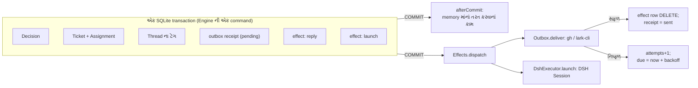

# પ્રકરણ 8 — Store, Effects અને Outbox: પાકો ચોપડો, ખીંટી અને જવાબ-ટોપલી

> **Level 8 · વાર્તાનો દિવસ 9.**
> લાઈટ ગઈ, છતાં એક પણ ઓર્ડર ન ખોવાયો અને એક પણ જવાબ બે વાર ન ગયો. મુનીમજી સમજાવે છે કે તે નસીબ નહોતું.
> પહેલાં: [પ્રકરણ 7](07-worker-execution.md).

## 🎯 આ પ્રકરણ પછી તમે શું કરી શકશો

- SQLite Store, savepoint-આધારિત `atomic` અને `afterCommit` line-by-line સમજાવી શકશો.
- Effects queue નું scheduling, coalescing, retry અને `generation` trace કરી શકશો.
- Outbox ની receipts અને વાતચીત-દીઠ ક્રમ સમજાવી શકશો.
- **Crash windows** નું વિશ્લેષણ કરીને કહી શકશો કે implementation ખરેખર કઈ ખાતરી આપે છે, અને કઈ નથી આપતું.
- Migrations, settings/prompt versions અને storage ની મર્યાદાઓ કહી શકશો.

**નવા શબ્દો:** **WAL** (write-ahead log: ફેરફાર પહેલાં અલગ log માં લખાય), **SAVEPOINT** (transaction ની અંદરનું નાનું transaction), **at-least-once** (ઓછામાં ઓછું એક વાર, કદાચ વધારે), **idempotency key** (એવી ઓળખ જેના પરથી સામેની system બીજી નકલ ઓળખી કાઢે).

## 🗺️ નકશો: એક commit, પછી દુનિયા



ખોખાની અંદરનું બધું એક જ commit માં લખાય છે. Commit **પછી** જ handlers બહારની દુનિયાને અડે છે. Handler સફળ થાય તો કાપલી ફાટે; નિષ્ફળ જાય તો કાપલી ખીંટી પર રહે, વધુ રાહ સાથે.

---

## દૃશ્ય 1 — મુનીમજીનો પાકો ચોપડો

🎬 મુનીમજી પાસે બે ચોપડા છે. કાચા ચોપડામાં તે પેન્સિલથી લખે છે; હિસાબ મળે ત્યારે જ એક ઝાટકે પાકા ચોપડામાં શાહીથી ઉતારે છે. આરવ: "સીધું પાકામાં લખો ને." મુનીમજી: "અધવચ્ચે લાઈટ જાય તો? અડધો હિસાબ શાહીમાં રહી જાય. અને બીજું: આ ચોપડાને તાળું છે. ચાવી એક જ. બે મુનીમ સાથે લખે તો ચોપડો ગયો સમજો."

❓ "પાકો ચોપડો કઈ file છે, અને તેમાં કોષ્ટકો કેવાં છે?"

💻 `<stateDir>/orchestrator.sqlite`, Node ના built-in `node:sqlite` વડે. [Constructor][store-open]: ✅

- File mode `0o600`; `PRAGMA journal_mode=WAL; PRAGMA synchronous=FULL`.
- Schema નવું હોય (> 11) તો ખોલવાની ના ([`newer`][store-newer]); બહુ જૂનું (< 10) હોય તો `tooOld` ([versions][migration-versions]).
- Tables: `trigger`, `disposition`, `thread`, `ticket`, `decision`, `outbox`, `trigger_thread`, `effect`, `kv`. દરેક aggregate એક **JSON** column માં.
- **Working sets** ([`SETS`][store-sets]): JSON પરથી ગણાતી generated columns (`thread.active`, `ticket.open`, `ticket.active`) અને તેના પર partial indexes. એટલે `evaluateDue` ફક્ત સક્રિય rows વાંચે, આખું table નહીં.

તાળું = directory lock ([`rt-lock`][rt-lock], [પ્રકરણ 3](03-startup.md)): `proper-lockfile`, 30 s stale.

`Store` core ના [`Repositories` port][ports-repos] ને implement કરે છે; tests એ જ port નું in-memory રૂપ [`MemoryRepositories`][memory-repo] વાપરે છે. 🧪 Test "lists in the same order in SQLite and in memory, and undoes a failed nested transaction alone in both" (`pnpm vitest run tests/store.spec.ts`) બંનેનું વર્તન સરખું છે તે સાબિત કરે છે.

🔬 **Expert નજર.** Aggregate ને JSON તરીકે સાચવવું એ જાણીજોઈને કરેલી પસંદગી છે: domain model બદલાય ત્યારે SQL schema ભાગ્યે જ બદલવું પડે, અને એક Ticket એક row છે, એટલે તેને લખવું સ્વાભાવિક રીતે atomic છે. કિંમત: SQL વડે અંદરના fields પર query ન કરી શકાય. Generated columns એ બરાબર એટલા જ fields બહાર કાઢે છે જેટલા hot path ને જોઈએ. અને `synchronous=FULL` એટલે દરેક commit disk સુધી પહોંચે: ધીમું, પણ "await receive પછી જ cursor ખસે" એ વચન તેના પર ઊભું છે ([પ્રકરણ 13](13-advanced-engineering.md) માં માપ).

## દૃશ્ય 2 — કાચા ચોપડામાં કાચો ચોપડો: `atomic` અને `afterCommit`

🎬 મુનીમજી એક મોટો હિસાબ કરી રહ્યા છે, અને તેની અંદર એક નાનો પેટા-હિસાબ ખોટો પડે છે. તે આખું પાનું નથી ફાડતા; ફક્ત પેટા-હિસાબ ભૂંસે છે. અને હિસાબ દરમિયાન તેમને યાદ આવે છે: "જશુભાઈને કહેવાનું છે કે ચૂલો ઓલવે." તે તરત બૂમ નથી પાડતા. પાનાના હાંસિયામાં નોંધે છે, અને શાહીથી ઉતાર્યા **પછી** જ બૂમ પાડે છે.

❓ "'ફક્ત પેટા-હિસાબ ભૂંસવો' અને 'ઉતાર્યા પછી બૂમ' code માં કેવી રીતે?"

💻 [`Store.atomic`][store-atomic]: ✅

```ts
atomic<T>(operation: () => T): T {
  const level = this.depth++
  const name = `orchestrator_atomic_${level}`
  this.committed[level] = []
  this.db.exec(`SAVEPOINT ${name}`)
  let value: T
  try { value = operation(); this.db.exec(`RELEASE ${name}`) }
  catch (error) { this.db.exec(`ROLLBACK TO ${name}`); this.db.exec(`RELEASE ${name}`); throw error }
  finally { this.depth-- }
  const actions = this.committed.splice(level)[0]!
  if (level) this.committed[level - 1]!.push(...actions)
  else for (const action of actions) { try { action() } catch (error) { this.report(error) } }
  return value
}
```

1. દરેક `atomic` એક **SAVEPOINT**. અંદરનાં calls અંદરનાં savepoints.
2. Error → `ROLLBACK TO` ફક્ત **આ સ્તરનું** ભૂંસે, પછી error ફરી throw.
3. [`afterCommit`][store-aftercommit] ની નોંધો સ્તર પ્રમાણે ભેગી થાય. અંદરનું સ્તર commit થાય તો તેની નોંધો બહારના સ્તરને સોંપાય; **સૌથી બહારનું** commit થાય ત્યારે જ ચાલે. Rollback થયેલા સ્તરની નોંધો ફેંકાઈ જાય.
4. નોંધ ચલાવતાં ભૂલ આવે તો commit થયેલો data અકબંધ; ભૂલ ફક્ત log થાય.

`operation` **synchronous** છે (`() => T`, `Promise` નહીં). `node:sqlite` નું `DatabaseSync` પણ synchronous છે.

🔬 **Expert નજર.** Synchronous transaction એ અહીં છુપાયેલો હીરો છે. Transaction ની અંદર `await` શક્ય જ નથી, એટલે બે commands કદી એકબીજામાં ગૂંથાઈ શકતા નથી: આખું Engine અસરકારક રીતે **serializable** છે, કોઈ lock વગર. અને `afterCommit` vs Effects નો નિયમ સાદો છે: **memory માંનું તરત કરવાનું કામ** (turn રદ કરવો, health તાજી કરવી) `afterCommit`; **restart પછી પણ ટકવું જોઈએ તેવું કામ** Effects.

## દૃશ્ય 3 — ખીંટી: એક કામ, એક કાપલી

🎬 ખીંટી પર છ હૂક છે, દરેક પ્રકારના કામ માટે એક. એક ટુકડી માટે પાંચ મિનિટમાં ત્રણ ચિઠ્ઠી આવે છે. આરવ ધારે છે કે "ચિઠ્ઠી પહોંચાડો" ની ત્રણ કાપલી ટંગાશે. એક જ છે. છોટુ: "નવી આવે તો જૂની પર જ સુધારો લખું છું, લાઈનમાં તેની જગ્યા એ જ રહે." એટલામાં જશુભાઈ એક કાપલી ઉતારીને કામ કરતા હોય છે, અને છોટુ તે જ કાપલી પર નવી વિગત લખી જાય છે. જશુભાઈ કામ પૂરું કરીને કાપલી ફાડવા જાય છે, પણ ખૂણાનો આંકડો જોઈને અટકે છે: "મેં ઉતારી ત્યારે 4 હતો, હવે 5 છે. ફાડાય નહીં. ફરી કરવું પડશે."

❓ "એક કાપલી, તેની જગ્યા, અને ખૂણાનો આંકડો: code માં?"

💻 [`Effects`][effects-enqueue]: ✅

- [`enqueue(kind, key, payload)`][effects-enqueue]: `INSERT … ON CONFLICT(kind,key) DO UPDATE SET value, generation+1, attempts=0, due`. Primary key `(kind, key)` → **coalescing**. `seq` (લાઈનમાં જગ્યા) સચવાય.
- [`dispatch`][effects-dispatch]: દરેક kind માટે, due rows `seq` ક્રમમાં, `limit()` જેટલાં સાથે. `ordered` kinds સૌથી જૂની row પર અટકે, ભલે તે હજી due ન હોય.
- [`attempt`][effects-attempt]: સફળ → `DELETE … WHERE seq=? AND generation=?`. ચાલતી વખતે નવો payload આવ્યો હોય તો generation બદલાયું છે, row delete નથી થતી, અને ફરી ચાલે. [`Later`][effects-later] → નિષ્ફળતા નથી ગણાતી, ફક્ત `due` ખસે. બીજી ભૂલ → `attempts+1`, `delay = min(max, initial × 2^attempts)`.

છ હૂક ([payloads][effects-payloads]):

| Kind | કોણ ઉતારે | સાથે કેટલાં | Retry |
|---|---|---|---|
| `assessment` | MasterAssessor | 4; paused હોય તો 0 | 2 s → 60 s |
| `launch` | DshExecutor | ખાલી ચૂલા જેટલાં; paused → 0 | 5 s → 300 s |
| `delivery` | DshExecutor | 4; paused → 0; quiet | 2 s → 60 s |
| `relay` | Sessions | 1, ordered | 2 s → 60 s |
| `notice` | Sessions | 1, ordered | 2 s → 60 s |
| `reply` | Outbox | 1; paused → 0 | 5 s → 300 s |

🧪 `pnpm vitest run tests/effects.spec.ts`: "runs an effect queued inside a transaction once it commits, and none from a transaction that rolled back"; "keeps an effect's place in its queue when it is queued again with a new payload"; "starts nothing once drained, keeps what waits and what shutdown cut short, and runs it after the next start".

🔬 **Expert નજર.** `generation` એક **optimistic concurrency token** છે. તેના વગર આ race થાય: handler payload v4 વાંચે → v5 આવે → handler v4 પૂરું કરીને row delete કરે → v5 કાયમ માટે ગુમ. Coalescing બીજો ફાયદો આપે છે: queue નું કદ **કામની સંખ્યા** જેટલું વધે, **ઘટનાઓની સંખ્યા** જેટલું નહીં. અને `ordered` (relay, notice) એ head-of-line blocking જાણીજોઈને સ્વીકારે છે: main Session ને સંદેશા ક્રમમાં મળવા જોઈએ, ભલે એક અટકે તો પાછળના રાહ જુએ.

## દૃશ્ય 4 — જવાબ-ટોપલી: દરેક જવાબની પાવતી

🎬 સવિતાબેન "ઓર્ડર મળ્યો" નો જવાબ ટોપલીમાં મૂકે છે. મુનીમજી તરત પાવતી-બુકમાં નોંધે છે: નંબર, કોને, **બાકી**. છોટુ જવાબ પહોંચાડી આવે ત્યારે નોંધ "ગયો" થાય. આરવ એક જ જવાબ ભૂલથી બે વાર ટોપલીમાં મૂકે છે; મુનીમજી બીજી વાર નોંધતા જ નથી: "આ નંબર પાવતી-બુકમાં છે." પછી એક ગૂંચ: "થાળી તૈયાર" નો જવાબ તૈયાર છે, પણ "ઓર્ડર મળ્યો" હજી પહોંચ્યો નથી (રજિસ્ટર બંધ હતું). છોટુ બીજો જવાબ લઈ જવાની ના પાડે છે: "પહેલાં પહેલો."

❓ "પાવતી, બે વાર ન નોંધવું, અને ક્રમ: code માં?"

💻 [`Outbox`][outbox-class]: ✅

```ts
send(message: OutboundMessage): void {
  if (message.kind === 'reply' && message.channel.source === 'feishu') checkedImText(message.text)
  store.atomic(() => { if (store.receipts.add(message)) effects.enqueue('reply', message.id, {}) })
}
```

[`send`][outbox-send]: `receipts.add` = `INSERT OR IGNORE`. એક id કદી બે વાર queue ન થાય, અને receipts કાયમ રહે ([`receipts`][store-receipts]).

[`deliver`][outbox-deliver] ની તપાસો, ક્રમમાં:

| તપાસ | પરિણામ |
|---|---|
| Receipt `pending` નથી | કશું નહીં |
| Source બંધ કે install નથી | `Later` |
| એ જ Ticket + વાતચીતનો વહેલો જવાબ હજી બાકી છે ([`behind`][store-behind]) | `Later` |
| Source હવે એ વાતચીત સાંભળતો નથી | settle `channelIgnored` |
| Source કહે વાતચીત કાયમ માટે ગઈ | settle `channelGone` |
| મોકલાયો | settle `sent` |

Port: [`Outbox`][ports-outbox]. લખાણની લંબાઈની મર્યાદા: [`text-limits`][text-limits].

🔬 **Expert નજર.** Receipt કાયમ રાખવી એ **dedup window = અનંત** છે: એક જવાબ id એક વર્ષ પછી પણ ફરી ન જાય. જવાબના ids પણ સિક્કા છે (`key('ack', triggerId)` વગેરે, [પ્રકરણ 6](06-tickets-assignments.md)), એટલે Engine ની command replay થાય તો પણ એ જ id બને અને `INSERT OR IGNORE` તેને ગળી જાય. `behind` ની 3-નિષ્ફળતા મર્યાદા એક સમાધાન છે: ક્રમ જાળવો, પણ એક કાયમ નિષ્ફળ જતો જવાબ આખી વાતચીતને કાયમ ન રોકે.

## દૃશ્ય 5 — છોટુ દરવાજે હતો ત્યારે લાઈટ ગઈ

🎬 આરવ મુનીમજીને ફસાવવા માગે છે: "ધારો કે છોટુએ રજિસ્ટરમાં જવાબ લખી દીધો, અને પાછો આવીને પાવતીમાં 'ગયો' નોંધે તે **પહેલાં** લાઈટ ગઈ. લાઈટ આવે ત્યારે પાવતી 'બાકી' કહે છે. છોટુ ફરી લખશે. ગ્રાહકને બે જવાબ!" મુનીમજી હસે છે: "છોટુ દરેક જવાબના ખૂણે, ઝીણા અક્ષરે, પાવતી નંબર લખે છે. ફરી જાય ત્યારે પહેલાં પાનું વાંચે: 'આ નંબર અહીં છે?' હોય તો ચૂપચાપ પાછો આવીને 'ગયો' નોંધે."

❓ "દરેક crash window માં શું થાય? અને ખાતરી ક્યાં પૂરી થાય છે?"

💻 ઝીણા અક્ષરનો નંબર = [GitHub marker][gh-marker]: `<!-- dsh-superagent:<id> -->`. [`sendGithub`][gh-channel] પહેલાં comments માં marker શોધે; મળે તો POST નથી કરતું, `'sent'` આપે છે. Feishu માં `--idempotency-key message.id` ([code][feishu-idem]). ✅

| Crash ક્યાં | પરિણામ | આધાર |
|---|---|---|
| Engine command ની વચ્ચે, commit પહેલાં | કશું નહીં: rollback. Source ની દોરી ખસી નથી, એટલે ચિઠ્ઠી ફરી વંચાશે | `atomic`; [`host-receive`][host-receive] |
| Commit પછી, effect ચાલે તે પહેલાં | Effect row ટકે; restart પછી ચાલે | `effect` table |
| `reply`: GitHub POST થયો, `settle` પહેલાં crash | Handler ફરી ચાલે; marker મળે, POST નહીં | [marker][gh-marker] |
| `launch`: સંદેશ worker ને પહોંચ્યો, `assignmentStarted` પહેલાં crash | Pending પાળી ફરી launch; request id દીઠ એક જ delivery, અને `inbox.remove` જૂની નકલ કાઢે | [`sessions.prompt`][sessions-prompt], [`inbox.remove`][dsh-inbox-remove] |
| Worker એ `git push` કર્યું, પછી crash | Domain ને push ની ખબર નથી. નવી પાળી + recovery note | **ફક્ત prompt-સ્તરની** ખાતરી |

**Implementation ખરેખર શું આપે છે:**

1. **Domain state:** દરેક Engine command atomic. Decisions, Tickets, effects કદી અડધાં નથી લખાતાં. ✅
2. **Side effects:** effects **at-least-once**. Channel ના જવાબો marker અને idempotency key વડે વ્યવહારમાં **effectively-once**. ✅
3. **Worker નાં બહારનાં કામ** (git, gh): ફક્ત worker ની સમજ અને recovery note. ✅ આ prototype ની સ્પષ્ટ મર્યાદા છે.

> ⚠️ **ધારણા, અચકાસાયેલી.** Marker શોધ comments વાંચવા પર આધાર રાખે છે. Marker વાળો comment કોઈ હાથે delete કરે, અને તે પહેલાં receipt settle ન થઈ હોય, તો જવાબ ફરી post થઈ શકે. અમે આ ખરા GitHub સામે ચકાસ્યું નથી.

🔬 **Expert નજર.** "Exactly-once delivery" બે systems વચ્ચે અશક્ય છે (Two Generals). જે શક્ય છે તે **at-least-once + સામેની બાજુ idempotency**: મોકલનાર ફરી-ફરી પ્રયત્ન કરે, અને મેળવનાર (અથવા મોકલનાર પોતે, મોકલતાં પહેલાં વાંચીને) બીજી નકલ ઓળખી કાઢે. GitHub પાસે idempotency key નથી, એટલે prototype **પોતાની ઓળખ સંદેશમાં જ છુપાવે છે**. આ તરકીબ કોઈ પણ API સાથે કામ લાગે જે તમારું લખાણ પાછું વાંચવા દે.

## દૃશ્ય 6 — ચોપડો કદી પાતળો નથી થતો

🎬 આરવ પાકા ચોપડાનાં પાનાં ગણે છે: બે વર્ષમાં ત્રણ જાડા ચોપડા. "જૂનાં પાનાં ફાડતા નથી?" મુનીમજી: "ના. દરેક ચિઠ્ઠી, દરેક નિર્ણય, દરેક પાવતી, નિયમ-પોથીની દરેક જૂની આવૃત્તિ. બધું છે." આરવ: "તો દસ વર્ષ પછી?" મુનીમજી થોડી વાર ચૂપ રહે છે. "એ પ્રશ્નનો જવાબ આ ઘર પાસે હજી નથી."

❓ "Schema બદલાય ત્યારે શું? અને storage ની મર્યાદાઓ કઈ?"

💻 ✅

- **Migrations:** [`SCHEMA_VERSION = 11`, `OLDEST_SCHEMA = 10`][migration-versions]. 10 → 11 એક transaction માં; નિષ્ફળ જાય તો database બદલાયા વગર રહે ("The orchestrator database is unchanged at schema 10…"). Version ફક્ત વધે.
- **Settings versions:** દરેક save એક અપરિવર્તનશીલ snapshot (`settings-version:<n>`), અને pointer (`settings-revision`). Block-દીઠ revisions optimistic concurrency માટે: જૂનો save → `SettingsConflict` → HTTP 409 ([`settings-save`][settings-save], [પ્રકરણ 10](10-panel.md)).
- **Prompt versions:** એ જ નમૂનો. Session એ કઈ આવૃત્તિઓ વાપરી તે `session-prompts:<id>` માં.

**મર્યાદાઓ** ([docs/007][doc-arch], "Persistence"):

- **કશું delete થતું નથી:** triggers, dispositions, decisions, બંધ Tickets, receipts, versions અમર્યાદિત વધે. Retention policy નથી.
- Memory માંના caches restart પછી જાય.
- એક જ લખનાર process. Horizontal scaling નથી.

🔬 **Expert નજર.** "કશું delete ન કરવું" prototype માટે સાચો નિર્ણય છે: દરેક નિર્ણયનો audit trail મફતમાં મળે, અને deletion ની bugs (ખોટી વસ્તુ કાઢી નાખવી) અશક્ય બને. Production માટે તે દેવું છે. પ્રામાણિક documentation તે દેવું છુપાવતું નથી: `docs/007` તેને મર્યાદા તરીકે લખે છે. તમે આ system અપનાવો તો retention પહેલું કામ છે જે તમારે ઉમેરવું પડે ([પ્રકરણ 15](15-aagal-no-rasto.md)).

---

## Source map

| ક્રમ | File | Symbols |
|---|---|---|
| 1 | `src/app/store.ts` | [constructor][store-open], [`SETS`][store-sets], [`atomic`][store-atomic], [`afterCommit`][store-aftercommit], [`receipts`][store-receipts], [`behind`][store-behind] |
| 2 | `src/core/memory.ts` | [`MemoryRepositories`][memory-repo] |
| 3 | `src/app/effects.ts` | [`enqueue`][effects-enqueue], [`dispatch`][effects-dispatch], [`attempt`][effects-attempt], [`Later`][effects-later] |
| 4 | `src/app/outbox.ts` | [`send`][outbox-send], [`deliver`][outbox-deliver] |
| 5 | `src/sources/github-channel.ts` | [`sendGithub`][gh-channel], [marker][gh-marker] |
| 6 | `src/app/migration.ts` | [versions][migration-versions] |

## 🧪 Lab

```bash
pnpm vitest run tests/effects.spec.ts tests/store.spec.ts tests/outbox.spec.ts
```

🧪 **અવલોકન:** બધા પાસ. દરેક test નું નામ વાંચો અને તેને આ પ્રકરણના એક દૃશ્ય સાથે જોડો.

**વિચાર-પ્રયોગ (ચલાવવાનો નથી):** `synchronous=FULL` ને `NORMAL` કરો તો receive લગભગ બમણું ઝડપી થાય (🧪 માપ [પ્રકરણ 13](13-advanced-engineering.md) માં). છતાં તે **ન** કરો: WAL + `NORMAL` માં વીજળી જાય તો છેલ્લા commits ખોવાઈ શકે, જ્યારે Source ની દોરી પહેલેથી આગળ ખસી ગઈ હોય.

## 🔮 આગાહી કસોટી

એક Ticket માટે `delivery` effect ચાલી રહી છે. તે જ ક્ષણે એ Ticket માટે નવી ચિઠ્ઠી આવે છે અને `enqueue('delivery', ticketId, …)` ફરી બોલાવાય છે. ચાલતો handler સફળ થાય ત્યારે row delete થશે? (ધારો. જવાબ: **ના**. `generation` વધી ગયું છે; `DELETE … AND generation=?` કશું નથી કાઢતું, અને row ફરી ચાલે છે.)

## 🩺 નિષ્ફળતા: overview પર "reply: 1 waiting since …; the last failure: CliError 422"

**નિદાન:** (1) `GET /orchestrator/api/sources` → dropped અને નિષ્ફળ જતા જવાબો. (2) State directory ની **નકલ** પર `sqlite3`: `effect` table માં `kind='reply'` ની `error` અને `attempts`. (3) સ્વીકૃતિ-જવાબ નિષ્ફળ ગયો હોય તો એ જ Ticket ના પછીના જવાબો `behind` ને કારણે 3 નિષ્ફળતા સુધી અટકે. **ઉપાય:** કારણ સુધારો (જેમ કે agent account ની પરવાનગી). Effect આપોઆપ ફરી પ્રયત્ન કરશે, વધુમાં વધુ 300 s ના અંતરે. **Regression test:** `tests/outbox.spec.ts`.

<a id="saar"></a>

## ✅ સાર

| 🎬 ઘટના | 💻 નિયમ | 🔬 તૂટે તો |
|---|---|---|
| પાકો ચોપડો, એક ચાવી | SQLite, WAL, `synchronous=FULL`, directory lock | અડધો હિસાબ; બે લખનાર |
| પેટા-હિસાબ ભૂંસવો | `atomic` = nested SAVEPOINT; `afterCommit` સૌથી બહારના commit પછી | Rollback થયેલા કામની બૂમ |
| એક કામ, એક કાપલી | `(kind,key)` coalescing; `seq` સચવાય; `generation` | નવો payload ગુમ |
| પાવતી | `INSERT OR IGNORE`; `behind` વડે ક્રમ | જવાબ બે વાર, કે ઊંધા ક્રમે |
| ઝીણા અક્ષરનો નંબર | GitHub marker; Feishu idempotency key | Crash પછી duplicate જવાબ |
| ચોપડો પાતળો નથી થતો | કશું delete નહીં; migration એક transaction | (મર્યાદા) અમર્યાદિત વૃદ્ધિ |

**યાદ-ચાવી "6 હૂક, 3 ખાતરી":** છ effect kinds; ત્રણ સ્તરની ખાતરી (state atomic, side effects at-least-once + idempotent, worker નાં કામ prompt-સ્તરે).

<details><summary>કાર્ડ 1: `afterCommit` ક્યારે, Effects ક્યારે?</summary>

`afterCommit`: memory માંનું, તરત કરવાનું, અને restart પછી જેની જરૂર નથી (turn રદ કરવો, health refresh). Effects: જે restart પછી પણ થવું જ જોઈએ (જવાબ મોકલવો, worker શરૂ કરવો).
</details>

<details><summary>કાર્ડ 2: Newer schema જૂનું build કેમ નથી ખોલતું?</summary>

જૂનો code નવા fields ને સમજતો નથી અને તેમને ચૂપચાપ બગાડી શકે. ના પાડવી એ સલામત છે. Rollback માટે upgrade પહેલાંની state directory ની નકલ પાછી મૂકો.
</details>

**મિત્રને સમજાવો:** "હિસાબ પેન્સિલથી, પછી એક ઝાટકે શાહીથી. બહારનું કામ કદી હિસાબની વચ્ચે નહીં, કાપલી પર. અને દરેક જવાબ પર છૂપો નંબર, જેથી બે વાર ન જાય."

## 🧠 Mastery check

1. `afterCommit` અને Effects ક્યારે ક્યાં વાપરવાં?
2. Effect row નું `generation` કઈ race અટકાવે છે?
3. GitHub જવાબ crash પછી duplicate કેમ નથી થતો? કઈ સ્થિતિમાં થઈ શકે?
4. Worker ના `git push` માટે domain કઈ ખાતરી **નથી** આપી શકતું?
5. Database નું newer schema જૂનું build કેમ નથી ખોલતું, અને rollback કેવી રીતે?

જવાબો: [પરિશિષ્ટ D](../appendix/D-lab-solutions.md#પ્રકરણ-8).

## 🎬 આગળ શું

આરવ સવિતાબેનના ડેસ્કના ખાનામાં ડોકિયું કરે છે: ચૌદ ઓજાર, દરેક પર નામ. ટુકડીના ઓટલા પર છ જ છે. "બેન પાસે ચૌદ અને ટુકડી પાસે છ કેમ? અને બેનને કોણ કહે છે કે કયું ક્યારે વાપરવું?" → [પ્રકરણ 9](09-tools-prompts-skills.md).

<!-- citations:begin (generated by tools/refdefs.py) -->
[doc-arch]: https://github.com/deepseek-ai/dsh-superagent-prototype/blob/8c32a9dc5d72c033816c6a8110b37f40cf94fba4/docs/007-architecture.md#L1-L10
[dsh-inbox-remove]: https://github.com/deepseek-ai/dsh-superagent-prototype/blob/8c32a9dc5d72c033816c6a8110b37f40cf94fba4/src/executor/dsh.ts#L446-L448
[effects-attempt]: https://github.com/deepseek-ai/dsh-superagent-prototype/blob/8c32a9dc5d72c033816c6a8110b37f40cf94fba4/src/app/effects.ts#L130-L146
[effects-dispatch]: https://github.com/deepseek-ai/dsh-superagent-prototype/blob/8c32a9dc5d72c033816c6a8110b37f40cf94fba4/src/app/effects.ts#L103-L122
[effects-enqueue]: https://github.com/deepseek-ai/dsh-superagent-prototype/blob/8c32a9dc5d72c033816c6a8110b37f40cf94fba4/src/app/effects.ts#L61-L66
[effects-later]: https://github.com/deepseek-ai/dsh-superagent-prototype/blob/8c32a9dc5d72c033816c6a8110b37f40cf94fba4/src/app/effects.ts#L5-L7
[effects-payloads]: https://github.com/deepseek-ai/dsh-superagent-prototype/blob/8c32a9dc5d72c033816c6a8110b37f40cf94fba4/src/app/effects.ts#L11-L24
[feishu-idem]: https://github.com/deepseek-ai/dsh-superagent-prototype/blob/8c32a9dc5d72c033816c6a8110b37f40cf94fba4/src/sources/feishu-channel.ts#L18-L24
[gh-channel]: https://github.com/deepseek-ai/dsh-superagent-prototype/blob/8c32a9dc5d72c033816c6a8110b37f40cf94fba4/src/sources/github-channel.ts#L18-L45
[gh-marker]: https://github.com/deepseek-ai/dsh-superagent-prototype/blob/8c32a9dc5d72c033816c6a8110b37f40cf94fba4/src/sources/github-channel.ts#L34-L40
[host-receive]: https://github.com/deepseek-ai/dsh-superagent-prototype/blob/8c32a9dc5d72c033816c6a8110b37f40cf94fba4/src/sources/host.ts#L41-L42
[memory-repo]: https://github.com/deepseek-ai/dsh-superagent-prototype/blob/8c32a9dc5d72c033816c6a8110b37f40cf94fba4/src/core/memory.ts#L10-L24
[migration-versions]: https://github.com/deepseek-ai/dsh-superagent-prototype/blob/8c32a9dc5d72c033816c6a8110b37f40cf94fba4/src/app/migration.ts#L20-L22
[outbox-class]: https://github.com/deepseek-ai/dsh-superagent-prototype/blob/8c32a9dc5d72c033816c6a8110b37f40cf94fba4/src/app/outbox.ts#L22-L25
[outbox-deliver]: https://github.com/deepseek-ai/dsh-superagent-prototype/blob/8c32a9dc5d72c033816c6a8110b37f40cf94fba4/src/app/outbox.ts#L39-L51
[outbox-send]: https://github.com/deepseek-ai/dsh-superagent-prototype/blob/8c32a9dc5d72c033816c6a8110b37f40cf94fba4/src/app/outbox.ts#L27-L32
[ports-outbox]: https://github.com/deepseek-ai/dsh-superagent-prototype/blob/8c32a9dc5d72c033816c6a8110b37f40cf94fba4/src/core/ports.ts#L76-L83
[ports-repos]: https://github.com/deepseek-ai/dsh-superagent-prototype/blob/8c32a9dc5d72c033816c6a8110b37f40cf94fba4/src/core/ports.ts#L106-L134
[rt-lock]: https://github.com/deepseek-ai/dsh-superagent-prototype/blob/8c32a9dc5d72c033816c6a8110b37f40cf94fba4/src/app/runtime.ts#L90-L98
[sessions-prompt]: https://github.com/deepseek-ai/dsh-superagent-prototype/blob/8c32a9dc5d72c033816c6a8110b37f40cf94fba4/src/app/sessions.ts#L162-L167
[settings-save]: https://github.com/deepseek-ai/dsh-superagent-prototype/blob/8c32a9dc5d72c033816c6a8110b37f40cf94fba4/src/app/settings.ts#L148-L196
[store-aftercommit]: https://github.com/deepseek-ai/dsh-superagent-prototype/blob/8c32a9dc5d72c033816c6a8110b37f40cf94fba4/src/app/store.ts#L159-L162
[store-atomic]: https://github.com/deepseek-ai/dsh-superagent-prototype/blob/8c32a9dc5d72c033816c6a8110b37f40cf94fba4/src/app/store.ts#L140-L153
[store-behind]: https://github.com/deepseek-ai/dsh-superagent-prototype/blob/8c32a9dc5d72c033816c6a8110b37f40cf94fba4/src/app/store.ts#L259-L261
[store-newer]: https://github.com/deepseek-ai/dsh-superagent-prototype/blob/8c32a9dc5d72c033816c6a8110b37f40cf94fba4/src/app/store.ts#L66-L67
[store-open]: https://github.com/deepseek-ai/dsh-superagent-prototype/blob/8c32a9dc5d72c033816c6a8110b37f40cf94fba4/src/app/store.ts#L58-L101
[store-receipts]: https://github.com/deepseek-ai/dsh-superagent-prototype/blob/8c32a9dc5d72c033816c6a8110b37f40cf94fba4/src/app/store.ts#L254-L288
[store-sets]: https://github.com/deepseek-ai/dsh-superagent-prototype/blob/8c32a9dc5d72c033816c6a8110b37f40cf94fba4/src/app/store.ts#L30-L44
[text-limits]: https://github.com/deepseek-ai/dsh-superagent-prototype/blob/8c32a9dc5d72c033816c6a8110b37f40cf94fba4/src/infra/text.ts#L3-L4
<!-- citations:end -->
