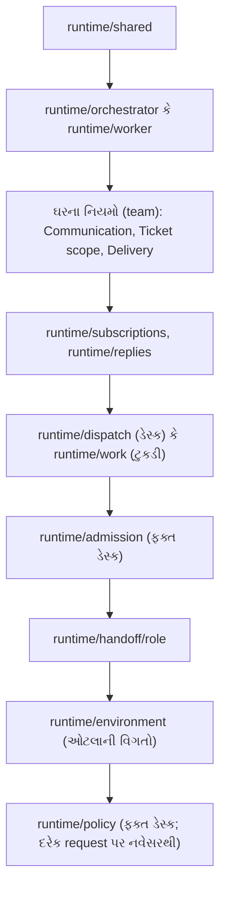

# પ્રકરણ 9 — Tools, prompts અને skills: ઓજારનું ખાનું અને સૂચના-પત્ર

> **Level 9 · વાર્તાનો દિવસ 10.**
> સવિતાબેન અને રસોઈ-ટુકડી બંને "મહારાજ" (model) વડે વિચારે છે. પણ તેમના હાથમાં કયાં ઓજાર છે, અને તેમને કોણ શું કહે છે, તે code નક્કી કરે છે.
> પહેલાં: [પ્રકરણ 8](08-store-effects-outbox.md).

## 🎯 આ પ્રકરણ પછી તમે શું કરી શકશો

- Main Session ના 14 અને worker ના 6 tools ના schemas, તપાસો અને પરિણામો સમજાવી શકશો.
- `orchestrator_read` ના resources અને role ની હદ કહી શકશો.
- System prompt કયા ક્રમમાં, કયા ટુકડાઓમાંથી બને છે, અને કયા ટુકડા બદલી શકાય છે, તે trace કરી શકશો.
- Structured reports, attention પ્રશ્નો અને Source skills સમજાવી શકશો.
- Tools, prompts અને docs વચ્ચેનો **drift** કયા tests પકડે છે તે કહી શકશો.

**નવા શબ્દો:** **tool** (એક function, જેનું નામ, વર્ણન અને JSON schema model ને બતાવાય; model arguments આપે, host function ચલાવે), **schema** (input નો માન્ય આકાર), **closure** (function જે પોતાની આસપાસનાં variables યાદ રાખે), **prompt cache** (model provider પાસે સચવાયેલો prompt નો શરૂઆતનો ભાગ, જે ફરી મોકલવો સસ્તો પડે), **drift** (બે વસ્તુઓ જે સરખી રહેવી જોઈએ તે ધીમે-ધીમે અલગ પડે).

## 🗺️ નકશો: સૂચના-પત્રના થર



ઉપરથી નીચે system prompt ના ભાગોનો ક્રમ છે. સૌથી સ્થિર ભાગ ઉપર, સૌથી વધુ બદલાતો (Policy) છેલ્લે.

---

## દૃશ્ય 1 — ચૌદ અને છ: ટુકડીના ઓજાર પર કાર્ડ નંબર કોતરેલો છે

🎬 આરવ સવિતાબેનના ખાનામાંથી એક ઓજાર લઈને ટુકડીના ઓટલે જાય છે: "આનાથી તમે બીજી ટુકડીનો રિપોર્ટ પણ લખી શકો?" રસોઇયો પોતાનું રિપોર્ટ-ઓજાર બતાવે છે. તેના હાથા પર કાર્ડ નંબર **કોતરેલો** છે: 97bdef… "આ ઓજાર ફક્ત આ કાર્ડ માટે બન્યું છે. બીજો નંબર લખવાની જગ્યા જ નથી."

❓ "Tools કેવી રીતે નોંધાય છે, અને 'કોતરેલો નંબર' code માં શું છે?"

💻 [`Sessions.registerTool`][sessions-register] દરેક tool ને DSH ની tool registry માં ઉમેરે છે: `parameters: z.toJSONSchema(schema)`, અને ચલાવતી વખતે `schema.parse(args)`. Model નો input runtime પર **ફરી** validate થાય છે. ✅

Worker ના tools [`executorTools(ticket)`][tools-executor] બનાવે છે: દરેક tool ના closure માં `ticketId` બંધાયેલું છે. Schema માં `ticket_id` field **છે જ નહીં**.

| Worker tool (6) | Schema | અસર |
|---|---|---|
| `orchestrator_read` | `resource, offset, limit` | ફક્ત પોતાના Ticket ના resources |
| [`orchestrator_ack`][tools-ack] | `trigger_id`, `text` ≤ 100 શબ્દ | સ્વીકૃતિ-જવાબ; ફરી કરે તો `reused: true` |
| [`orchestrator_report`][tools-report] | `state`, `summary`, `human_action?`, `question_for_trigger_id?`, `pr_number?`, `reply_to_trigger_id?` | PR claim + report + relay, એક `atomic` માં |
| `orchestrator_thread_unrelated` | `thread`, `reason` | આ કાર્ડનો ટેગ કાઢે |
| `orchestrator_thread_follow` | `thread`, `reason` | ફક્ત સંદર્ભ માટે ટેગ |
| [`orchestrator_trigger_handback`][tools-handback] | `trigger_id`, `reason` | ચિઠ્ઠી પાછી સોંપે |

Main Session ના [14 tools][tools-main]: `orchestrator_read`, `orchestrator_route`, `orchestrator_ticket_retry`, `orchestrator_ticket_request_status`, `orchestrator_ticket_note`, [`orchestrator_trigger_requeue`][tools-requeue], `orchestrator_eval`, `orchestrator_eval_read`, `orchestrator_eval_decide`, `orchestrator_reply`, `orchestrator_thread_unsubscribe`, `orchestrator_settings_save`, `orchestrator_policy_sync`, `orchestrator_prompts_save`.

Main Session નો preset `dsh-superagent-router` ([`cordis.patch.yml`][patch-router]): file write/edit નથી ([code][patch-router-fs]), subagents, web કે todo નથી. `sleep` પણ નકારાય છે ([`noWait`][sessions-nowait]).

🔬 **Expert નજર.** સત્તાની હદ લાગુ કરવાની ત્રણ રીત છે: prompt માં કહેવું ("બીજા Ticket ને ન અડતા"), runtime પર તપાસવું (`if (args.ticket_id !== mine) throw`), અથવા **ખોટો input વ્યક્ત કરવો જ અશક્ય બનાવવો**. ત્રીજી સૌથી મજબૂત છે, અને અહીં તે જ વપરાઈ છે. આને "capability-based security" કહે છે: ઓજાર પોતે જ પરવાનગી છે. Model ને છેતરીને બીજા Ticket નું નામ બોલાવો તો પણ તે નામ મૂકવાની જગ્યા નથી.

## દૃશ્ય 2 — એક કાપલી પર વીસ નિર્ણય

🎬 સવિતાબેન એક સાથે ચાર ચિઠ્ઠીનો નિકાલ કરે છે: બે સ્વીકાર, એક જોડાણ, એક અવગણના. ચારેય એક જ કાપલી પર લખે છે. ત્રીજી લીટીમાં ભૂલ છે (કાર્ડનું શીર્ષક લખવાનું રહી ગયું). આરવ ધારે છે કે આખી કાપલી પાછી આવશે. પણ ત્રણ લીટી સ્વીકારાય છે, અને ત્રીજી સામે લખાઈને આવે છે: "**નકાર્યું**: શીર્ષક જોઈએ."

❓ "`orchestrator_route` એક ખરાબ item ને બાકીનાંથી કેવી રીતે અલગ રાખે છે?"

💻 [`orchestrator_route`][tools-route]: 1–20 items, દરેક accept / attach / stop / ignore. [Item schema][tools-route-schema] ફક્ત **આકાર** તપાસે છે. Kind પ્રમાણે ફરજિયાત fields ([`FIELDS`][tools-route-fields]) item ચાલે ત્યારે તપાસાય, અને **દરેક item અલગ transaction** છે. ✅

Running example નો call (🧪 આ arguments વડે test માં `engine.decide` ચલાવ્યું; model નો ખરો tool call ⚠️ અચકાસાયેલો):

```json
{ "decisions": [{ "kind": "accept", "trigger_id": "6618ff4acad5e9586f4bba62b50b259c",
  "title": "Improve README setup instructions", "worktree_name": "readme-setup",
  "acknowledgement": "I will update the README setup section and run the checks." }] }
```

પરિણામનો આકાર: `{ results: [{ trigger_id, kind, decision: 'accept', reason: '…', ticket: {…} }] }`. નકારાય તો `{ trigger_id, kind, refused: '<UserError નું લખાણ>' }`.

મર્યાદાઓ: `title` ≤ 200 અક્ષર, `acknowledgement` ≤ 100 શબ્દ, `note` ≤ 30 શબ્દ ([`text-limits`][text-limits]).

🔬 **Expert નજર.** Model માટે error message એ **prompt** છે. `refused` માં કાચો stack trace નહીં, પણ એક વાક્ય આવે છે જે કહે છે કે શું ખોટું છે અને શું કરવું ("Ticket is not ready for delivery. Keep progress internal…"). [`UserError`][errors-class] નું આખું [ટેબલ][errors-table] આ વિચારથી લખાયું છે. અને batch માં આંશિક સફળતા model ને એક ભૂલ માટે આખું કામ ફરી કરતાં બચાવે છે: ઓછા tokens, ઓછી ફરી-ભૂલની તક.

## દૃશ્ય 3 — રિપોર્ટ-કાપલી: પાંચ શબ્દ, અને એક સવાલ

🎬 ટુકડી રિપોર્ટ-કાપલી ભરે છે. સૌથી ઉપર એક શબ્દ પર ગોળ: progress / ready / blocked / failed / dropped. રસોઇયો "ready" પર ગોળ કરે છે, અને નીચે લખે છે: "નમૂનાની થાળી નં. 12." એ જ વખતે તે એક સવાલ પણ લખવા જાય છે: "મીઠું ઓછું રાખવું?" ઓજાર અટકી જાય છે: "**તૈયાર** અને **સવાલ** એક કાપલી પર નહીં."

❓ "રિપોર્ટ code માં કયા ક્રમમાં નોંધાય, અને સવાલના નિયમો કયા?"

💻 [`orchestrator_report`][tools-report], ક્રમમાં: ✅

1. Ticket બંધ હોય તો error: "Ticket ended (PR was closed or work finished); do not resume it".
2. `pr_number` હોય તો PR વાંચે. આ network read transaction ની **બહાર**, પહેલાં.
3. `atomic`: `claimPull` (નકારાય તો throw, અને આખું rollback) → `engine.report` → relay. Comment: "a rejected PR claim or invalid report leaves no partial state, and a recorded report always reaches the main Session".
4. પરિણામ: `{ reported: true, notification: 'orchestrator' | 'internal_only', attention? }`. સામાન્ય `progress` main Session ને **નથી** જતો.

Running example, ટુકડીની બાજુ (⚠️ pseudocode; અમે ખરો worker ચલાવ્યો નથી):

```json
{ "state": "ready", "summary": "README setup steps updated; pnpm check passes.", "pr_number": 12 }
```

**સવાલ** ([`Attention`][model-attention]): `human_action` એક ચોક્કસ પ્રશ્ન; `question_for_trigger_id` તે માણસની ચિઠ્ઠી જેને પૂછવાનું છે. નિયમો: સવાલ `ready` કે જવાબ સાથે ન આવે (`questionWithResult`); પૂછાતી ચિઠ્ઠી માણસની હોવી જોઈએ અને આ કાર્ડ સુધી પહોંચેલી (`notAsker`). Main Session સવાલને `orchestrator_reply purpose=attention` વડે **બદલ્યા વગર** આગળ મોકલે (`notAttention` તપાસ).

🔬 **Expert નજર.** Free-text રિપોર્ટ ("મને લાગે છે લગભગ થઈ ગયું") પરથી system નિર્ણય ન લઈ શકે. પાંચ શબ્દોનો enum model ને **પ્રતિબદ્ધ** થવા મજબૂર કરે છે, અને દરેક શબ્દ પર code માં અલગ વર્તન લટકે છે (stage, slot, relay, completion). Network call transaction ની બહાર રાખવો એ બીજો પાઠ છે: transaction ટૂંકો અને synchronous રહેવો જોઈએ ([પ્રકરણ 8](08-store-effects-outbox.md)); ધીમું I/O અંદર હોય તો તે આખા Engine ને રોકે.

## દૃશ્ય 4 — જૂના ચોપડા વાંચવા: પણ ફક્ત પોતાના

🎬 સવિતાબેનને ગયા અઠવાડિયાનો એક ઓર્ડર યાદ નથી. તે `orchestrator_read` ઓજારથી ચોપડો ખોલે છે: પહેલાં યાદી, પછી એક કાર્ડ, પછી તેની ત્રીજી પાળીનો રિપોર્ટ. દરેક પાનું નાનું છે, અને નીચે લખ્યું છે: "આગળનું પાનું: 20." ટુકડીનો રસોઇયો એ જ ઓજારથી બીજી ટુકડીનું કાર્ડ ખોલવા જાય છે. પાનું ખાલી આવે છે.

❓ "કયાં resources છે, અને ટુકડીની હદ ક્યાં લાગુ પડે?"

💻 Resources ([`resources.ts`][resources-text]): `tickets`, `triggers`, `threads`, `decisions`, `decision/<id>`, `thread/<key>`, `trigger/<id>`, `ticket/<id>` (+ `/assignments`, `/inputs`, `/result`, `/report/<id>`, `/transcript`, `/message/<n>`), `settings`, `prompts…`, `models`, `github/…`, `feishu/…`. Text નાં પાનાં 4000 UTF-16 units (મહત્તમ 8000); યાદીઓ 20 items (મહત્તમ 50); `next_offset` વડે આગળ. ✅

ટુકડીની હદ ([docs/007][doc-arch]): પોતાનું Ticket, તેનાં પાનાં, તેના સુધી પહોંચેલી ચિઠ્ઠીઓ, અને પોતે જે prompt આવૃત્તિઓ હેઠળ કામ કર્યું તે. પાનાં પરથી બીજી વસ્તુઓના ids **કાઢી નાખવામાં** આવે છે.

🧪 `pnpm vitest run tests/tools.spec.ts` પાસ.

🔬 **Expert નજર.** આ [લેખ](00a-lekh-ane-prototype.md) નો "Inline & Spill" અને "Chain of Recall" છે. Router ના context માં દરેક Ticket નો ટૂંકો **કાર્ડ** જ રહે છે (inline); વિગત જોઈએ ત્યારે તે સંદર્ભ પરથી ખેંચે છે (spill → recall). Context window એક મર્યાદિત સંસાધન છે, અને 24×7 ચાલતા router માટે સૌથી કિંમતી. Pagination એ તેનું રક્ષણ છે: કોઈ એક tool result આખું context ન ભરી શકે.

## દૃશ્ય 5 — સૂચના-પત્ર: કોણે કયો ફકરો લખ્યો

🎬 દરેક સવારે સવિતાબેન અને દરેક ટુકડીને એક સૂચના-પત્ર મળે છે. આરવ તેને ધ્યાનથી વાંચે છે: ઉપરના ફકરા છાપેલા છે (ઘરના કાયમી નિયમો). વચ્ચે પપ્પાના હાથના ત્રણ ફકરા ("ગ્રાહક સાથે કેવી રીતે બોલવું", "ઓર્ડરની હદ", "થાળી કેવી મોકલવી"). સૌથી છેલ્લે આજની નિયમ-પોથીનો સાર. પપ્પા એક છાપેલો ફકરો બદલીને લખે છે: "મનોજભાઈનું પણ સાંભળો." બીજે દિવસે મનોજભાઈ આવે છે, અને ગોવિંદકાકા તેમને હજી રોકે છે. પપ્પા: "મેં તો લખ્યું હતું!" દીદી: "પત્ર બેન વાંચે છે. કાકા યાદી વાંચે છે."

❓ "Prompt કયા ક્રમમાં બને, શું બદલી શકાય, અને બદલવાથી શું **નથી** બદલાતું?"

💻 [Assembly][prompts-parts] (shortened): ✅

```ts
fixed('runtime/shared'), fixed(`runtime/${role}`),
...TEAM_SECTIONS.map(team),                                  // communication, scope, delivery
...['subscriptions', 'replies', role === 'orchestrator' ? 'dispatch' : 'work'].map(name => fixed(`runtime/${name}`)),
...role === 'orchestrator' ? [fixed('runtime/admission')] : [],
fixed('runtime/handoff', `runtime/handoff/${role}`),
...environment ? [{ name: 'runtime/environment', … }] : [],
...role === 'orchestrator' && policy ? [{ name: 'runtime/policy', … }] : [],
```

**બદલી શકાય:**

- **Team sections** ([`TEAM_SECTIONS`][prompts-teams]): communication, scope, delivery. અને team skills.
- **Overrides:** 15 built-in ભાગ ([`PART_KEYS`][prompts-keys]). Template ભાગોએ placeholders રાખવા પડે; નહીં તો `promptPlaceholders` error ([schema][prompts-schema]).

**નથી બદલાતું** ([docs/004][doc-prompts]): "Editing a part changes the instructions the model receives. It does not change the gate, Mandates, tool checks or account wrappers."

**પ્રાધાન્ય, મજબૂતથી નબળું:** tool અને host ની તપાસો → built-in ભાગો → લાગુ પડેલા નિયમની સૂચનાઓ (ફક્ત તે Ticket માટે) → team sections અને skills → બહારનું લખાણ (**data, કદી સૂચના નહીં**).

Prompt files `prompts/*.md` માં છે, એક લીટી = એક વાક્ય. [`prompts/worker.md`][worker-prompt]: "Use gh for ALL GitHub operations…", "Finish with orchestrator_report and distinguish completed work from an incomplete draft."

**Skills:** `skills/dsh-superagent-github/SKILL.md` અને `skills/dsh-superagent-feishu/SKILL.md` agents ને મૂળ વાતચીત વાંચતાં અને CLI વાપરતાં શીખવે છે. Feishu skill ફક્ત Feishu bot હોય ત્યારે.

🔬 **Expert નજર.** Policy છેલ્લે કેમ? Model providers prompt ના **શરૂઆતના સરખા ભાગ** ને cache કરે છે. Policy વારંવાર બદલાય છે; તે ઉપર હોય તો દરેક ફેરફાર આખો cache તોડે. નીચે હોવાથી ફક્ત છેલ્લો ટુકડો નવો ગણાય. આ નાની વિગત 24×7 ચાલતા router નો ખર્ચ નોંધપાત્ર ઘટાડે છે. અને પપ્પાનો પાઠ: **prompt સલાહ છે, code કાયદો છે.** જે નિયમ તૂટવો ન જોઈએ તે prompt માં ન મૂકો.

## દૃશ્ય 6 — આરવ સૂચના-પત્રમાં એક લીટી ઉમેરે છે, અને ઘંટડી વાગે છે

🎬 આરવને લાગે છે કે ટુકડીના સૂચના-પત્રમાં એક લીટી ખૂટે છે. તે લખે છે: "કામ પૂરું થાય ત્યારે `orchestrator_finish` વાપરો." સાચવવા જાય છે, અને બે ઘંટડી વાગે છે. પહેલી: "આ નામનું કોઈ ઓજાર ખાનામાં નથી." બીજી, જે તેણે ધારી નહોતી: "પત્ર બહુ લાંબો થયો: 1028 અક્ષર, મર્યાદા 1000."

❓ "કયા tests આ પકડે છે?"

💻 🧪 `prompts/worker.md` માં "Use orchestrator_finish when done." ઉમેરીને:

```bash
pnpm vitest run tests/model-surface.spec.ts tests/cards.spec.ts tests/prompts.spec.ts
```

**અવલોકન:** `Tests 2 failed | 78 passed (80)`.

1. "names only registered tools, schema options, environment variables and glossary words…": `orchestrator_finish` નોંધાયેલું નથી.
2. "keeps each role's own instructions short": `expected 1028 to be less than 1000`.

| Test file | શું પકડે |
|---|---|
| `tests/model-surface.spec.ts` | Model જે વાંચે (tools, prompts, skills, inputs) તે ફક્ત ખરાં tools, schema options, variables અને glossary શબ્દોનો ઉલ્લેખ કરે; લખેલી શબ્દ-મર્યાદાઓ ખરેખર લાગુ છે; દરેક role નું કદ |
| `tests/cards.spec.ts` | Built-in લખાણ જરૂરી નિયમો કહે છે |
| `tests/prompts.spec.ts` | Validation, ક્રમ, versions, overrides |
| `tests/tools.spec.ts` | `orchestrator_read` ની role હદ; tool આકાર |
| `tests/docs.spec.ts` | Docs ની links, અને `docs/007` નાં module/test કોષ્ટકો પૂર્ણ |

પછી `git checkout prompts/worker.md`.

🔬 **Expert નજર.** LLM system માં સૌથી છૂપી bug એ **prompt અને code નો drift** છે: prompt એવા tool નું નામ લે જે rename થઈ ગયું, અથવા "100 શબ્દ" કહે જ્યારે code 50 લાગુ કરે. Model ફરિયાદ નથી કરતો; તે અનુમાન કરે છે, અને ખોટું કરે છે. અહીં prompt ને **code ની જેમ test** કરાય છે. 1000-અક્ષરનું બજેટ પણ એક સંકેત આપે છે: built-in prompt લગભગ ભરેલો છે, એટલે તમારા ઘરના નિયમો **team sections** માં જાય ([પ્રકરણ 12](12-customization.md)).

---

## Source map

| ક્રમ | File | Symbols |
|---|---|---|
| 1 | `src/app/tools/main.ts` | [`mainTools`][tools-main], [`orchestrator_route`][tools-route], [`FIELDS`][tools-route-fields] |
| 2 | `src/app/tools/executor.ts` | [`executorTools`][tools-executor], [`orchestrator_report`][tools-report] |
| 3 | `src/app/resources.ts` | [resources][resources-text] |
| 4 | `src/app/prompts.ts` | [assembly][prompts-parts], [`PART_KEYS`][prompts-keys], [`TEAM_SECTIONS`][prompts-teams] |
| 5 | `prompts/` | [`worker.md`][worker-prompt], [`admission.md`][admission-prompt] |
| 6 | `docs/004-prompts.md` | [prompt નિયમો][doc-prompts] |

## 🧪 Lab

```bash
pnpm vitest run tests/model-surface.spec.ts tests/prompts.spec.ts tests/tools.spec.ts
```

પછી દૃશ્ય 6 નો પ્રયોગ જાતે કરો, અને બંને નિષ્ફળતાના સંદેશા વાંચો.

## 🔮 આગાહી કસોટી

Main Session ટેગવાળા પાના પરની માણસની ચિઠ્ઠીને `orchestrator_route` વડે `ignore` કરવા જાય છે, જ્યારે ટુકડી તેની માલિક છે. શું થશે? (ધારો. જવાબ: item `refused` થશે, `workerDecides` સાથે: "This message reached ticket … on its thread: its worker decides…". Main Session ફક્ત `stop` કરી શકે.)

## 🩺 નિષ્ફળતા: main Session ને વારંવાર `refused: … its worker decides` મળે છે

**નિદાન:** તે follow-up ને accept કે ignore કરવા પ્રયત્ન કરે છે; [`leftToWorkers`][part-leftworkers] નો નિયમ તેને રોકે છે. **ઉપાય:** નિયમ બદલવાનો નથી. ટુકડી કામની બહારની ચિઠ્ઠી hand back કરશે, અને તે candidate તરીકે પાછી આવશે. જો તમે `runtime/dispatch` override કર્યું હોય તો તપાસો કે એ નિયમ હજી તેમાં છે. **Regression test:** `tests/cards.spec.ts` ("keeps the routing rules in dispatch…").

<a id="saar"></a>

## ✅ સાર

| 🎬 ઘટના | 💻 નિયમ | 🔬 તૂટે તો |
|---|---|---|
| કોતરેલો કાર્ડ નંબર | Worker tools ના closure માં `ticketId`; schema માં નથી | Worker બીજા Ticket ને અડે |
| વીસ નિર્ણય, એક કાપલી | દરેક item અલગ transaction; `refused` માં કારણ | એક ભૂલ આખો batch રોકે |
| પાંચ શબ્દ | `state` enum; PR read transaction બહાર; report + relay atomic | "લગભગ થઈ ગયું" |
| ફક્ત પોતાના ચોપડા | `orchestrator_read` paginated અને role-scoped | Context ભરાઈ જાય; data લીક |
| સૂચના-પત્રના થર | Policy છેલ્લે; team sections editable; enforcement code માં | Prompt થી સુરક્ષા "બદલાય" |
| બે ઘંટડી | `model-surface` વગેરે drift tests | Prompt ખોટા tool નું નામ લે |

**યાદ-ચાવી "14-6-5-15":** ડેસ્કના 14 tools, ટુકડીના 6, રિપોર્ટના 5 states, override કરી શકાય તેવા 15 ભાગ.

<details><summary>કાર્ડ 1: Prompt override થી gate બદલી શકાય?</summary>

ના. Gate `settingsPolicy().gate` છે, સાદો code. Prompt ફક્ત model ને મળતી સૂચના બદલે છે. Model "સ્વીકારો" કહે તો પણ `decide` gate અને Policy ફરી તપાસે છે.
</details>

<details><summary>કાર્ડ 2: `orchestrator_report` PR ને transaction ની બહાર કેમ વાંચે?</summary>

Network read ધીમું અને async છે; transaction synchronous અને ટૂંકો છે. પહેલાં વાંચો, પછી એક ઝડપી atomic block માં claim + report + relay.
</details>

**મિત્રને સમજાવો:** "રસોઇયાના ઓજાર પર તેના ઓર્ડરનો નંબર કોતરેલો છે. સૂચના-પત્ર સલાહ છે; દરવાજાનું તાળું અલગ છે, અને તે પત્ર બદલવાથી નથી ખૂલતું."

## 🧠 Mastery check

1. Worker tools માં `ticketId` argument કેમ નથી?
2. `orchestrator_route` માં એક item નકારાય તો બાકીનાં કેમ ચાલે?
3. Policy section prompt ના છેલ્લે કેમ?
4. Prompt override થી gate બદલી શકાય? કેમ નહીં?
5. `orchestrator_report` માં PR read transaction ની બહાર કેમ?

જવાબો: [પરિશિષ્ટ D](../appendix/D-lab-solutions.md#પ્રકરણ-9).

## 🎬 આગળ શું

પપ્પા ફોનમાં પાટિયું ખોલે છે અને "Stop" પર આંગળી મૂકે છે. આરવ: "એક મિનિટ. આ પાટિયું કોઈ પણ ખોલી શકે? કોઈ બીજી website તમારા વતી આ બટન દબાવી દે તો?" → [પ્રકરણ 10](10-panel.md).

<!-- citations:begin (generated by tools/refdefs.py) -->
[admission-prompt]: https://github.com/deepseek-ai/dsh-superagent-prototype/blob/8c32a9dc5d72c033816c6a8110b37f40cf94fba4/prompts/admission.md#L1-L12
[doc-arch]: https://github.com/deepseek-ai/dsh-superagent-prototype/blob/8c32a9dc5d72c033816c6a8110b37f40cf94fba4/docs/007-architecture.md#L1-L10
[doc-prompts]: https://github.com/deepseek-ai/dsh-superagent-prototype/blob/8c32a9dc5d72c033816c6a8110b37f40cf94fba4/docs/004-prompts.md#L1-L12
[errors-class]: https://github.com/deepseek-ai/dsh-superagent-prototype/blob/8c32a9dc5d72c033816c6a8110b37f40cf94fba4/src/core/errors.ts#L54-L61
[errors-table]: https://github.com/deepseek-ai/dsh-superagent-prototype/blob/8c32a9dc5d72c033816c6a8110b37f40cf94fba4/src/core/errors.ts#L2-L47
[model-attention]: https://github.com/deepseek-ai/dsh-superagent-prototype/blob/8c32a9dc5d72c033816c6a8110b37f40cf94fba4/src/core/model.ts#L275
[part-leftworkers]: https://github.com/deepseek-ai/dsh-superagent-prototype/blob/8c32a9dc5d72c033816c6a8110b37f40cf94fba4/src/core/part.ts#L32-L35
[patch-router]: https://github.com/deepseek-ai/dsh-superagent-prototype/blob/8c32a9dc5d72c033816c6a8110b37f40cf94fba4/cordis.patch.yml#L125-L135
[patch-router-fs]: https://github.com/deepseek-ai/dsh-superagent-prototype/blob/8c32a9dc5d72c033816c6a8110b37f40cf94fba4/cordis.patch.yml#L163-L167
[prompts-keys]: https://github.com/deepseek-ai/dsh-superagent-prototype/blob/8c32a9dc5d72c033816c6a8110b37f40cf94fba4/src/app/prompts.ts#L24-L26
[prompts-parts]: https://github.com/deepseek-ai/dsh-superagent-prototype/blob/8c32a9dc5d72c033816c6a8110b37f40cf94fba4/src/app/prompts.ts#L102-L115
[prompts-schema]: https://github.com/deepseek-ai/dsh-superagent-prototype/blob/8c32a9dc5d72c033816c6a8110b37f40cf94fba4/src/app/prompts.ts#L35
[prompts-teams]: https://github.com/deepseek-ai/dsh-superagent-prototype/blob/8c32a9dc5d72c033816c6a8110b37f40cf94fba4/src/app/prompts.ts#L14
[resources-text]: https://github.com/deepseek-ai/dsh-superagent-prototype/blob/8c32a9dc5d72c033816c6a8110b37f40cf94fba4/src/app/resources.ts#L87
[sessions-nowait]: https://github.com/deepseek-ai/dsh-superagent-prototype/blob/8c32a9dc5d72c033816c6a8110b37f40cf94fba4/src/app/sessions.ts#L77-L86
[sessions-register]: https://github.com/deepseek-ai/dsh-superagent-prototype/blob/8c32a9dc5d72c033816c6a8110b37f40cf94fba4/src/app/sessions.ts#L206-L216
[text-limits]: https://github.com/deepseek-ai/dsh-superagent-prototype/blob/8c32a9dc5d72c033816c6a8110b37f40cf94fba4/src/infra/text.ts#L3-L4
[tools-ack]: https://github.com/deepseek-ai/dsh-superagent-prototype/blob/8c32a9dc5d72c033816c6a8110b37f40cf94fba4/src/app/tools/executor.ts#L28-L40
[tools-executor]: https://github.com/deepseek-ai/dsh-superagent-prototype/blob/8c32a9dc5d72c033816c6a8110b37f40cf94fba4/src/app/tools/executor.ts#L23-L27
[tools-handback]: https://github.com/deepseek-ai/dsh-superagent-prototype/blob/8c32a9dc5d72c033816c6a8110b37f40cf94fba4/src/app/tools/executor.ts#L65-L73
[tools-main]: https://github.com/deepseek-ai/dsh-superagent-prototype/blob/8c32a9dc5d72c033816c6a8110b37f40cf94fba4/src/app/tools/main.ts#L155-L160
[tools-report]: https://github.com/deepseek-ai/dsh-superagent-prototype/blob/8c32a9dc5d72c033816c6a8110b37f40cf94fba4/src/app/tools/executor.ts#L74-L103
[tools-requeue]: https://github.com/deepseek-ai/dsh-superagent-prototype/blob/8c32a9dc5d72c033816c6a8110b37f40cf94fba4/src/app/tools/main.ts#L188-L201
[tools-route]: https://github.com/deepseek-ai/dsh-superagent-prototype/blob/8c32a9dc5d72c033816c6a8110b37f40cf94fba4/src/app/tools/main.ts#L88-L120
[tools-route-fields]: https://github.com/deepseek-ai/dsh-superagent-prototype/blob/8c32a9dc5d72c033816c6a8110b37f40cf94fba4/src/app/tools/main.ts#L61-L68
[tools-route-schema]: https://github.com/deepseek-ai/dsh-superagent-prototype/blob/8c32a9dc5d72c033816c6a8110b37f40cf94fba4/src/app/tools/main.ts#L47-L56
[worker-prompt]: https://github.com/deepseek-ai/dsh-superagent-prototype/blob/8c32a9dc5d72c033816c6a8110b37f40cf94fba4/prompts/worker.md#L1-L10
<!-- citations:end -->
