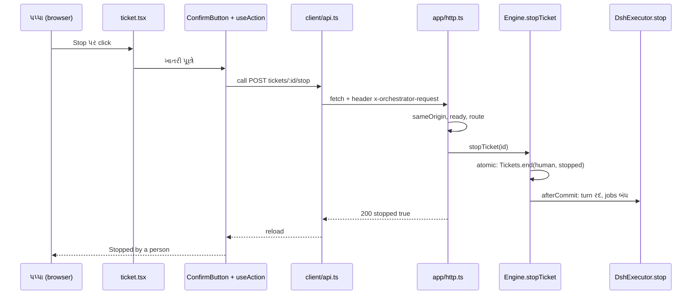

# પ્રકરણ 10 — Panel: પપ્પાનું પાટિયું

> **Level 10 · વાર્તાનો દિવસ 11.**
> પપ્પા રસોડામાં નથી આવતા. તે પાટિયું જુએ છે, અને જરૂર પડે ત્યારે એક બટન દબાવે છે. એ બટનથી ચૂલા સુધીનો રસ્તો આજે ચાલીશું.
> પહેલાં: [પ્રકરણ 9](09-tools-prompts-skills.md).

## 🎯 આ પ્રકરણ પછી તમે શું કરી શકશો

- **Stop** બટનને React component થી HTTP handler અને `Engine.stopTicket` સુધી trace કરી શકશો.
- Same-origin તપાસ અને custom header CSRF ને કેવી રીતે રોકે છે તે સમજાવી શકશો.
- Settings ના revisions, 409 conflict અને draft merge સમજાવી શકશો.
- પાટિયા પર દેખાતી દરેક વસ્તુને તેની પાછળની domain હકીકત સાથે જોડી શકશો.

**નવા શબ્દો:** **React component** (UI નો એક ટુકડો, function તરીકે લખેલો), **hook** (`useState`, `useRef`: component ની યાદશક્તિ), **HTTP status code** (200 સફળ, 400 ખોટી વિનંતી, 403 મનાઈ, 404 નથી, 409 ટકરાવ, 500 server ની ભૂલ), **CSRF** (બીજી website તમારા browser વડે તમારા વતી વિનંતી મોકલે તે હુમલો), **optimistic concurrency** (તાળું ન મારો; સાચવતી વખતે તપાસો કે વચ્ચે કોઈએ બદલ્યું તો નથી).

## 🗺️ નકશો: એક click નો પ્રવાસ



ઉપરથી નીચે સમયનો ક્રમ છે. ટપકાંવાળાં તીર જવાબ છે. Browser નું એક click server પર એક transaction બને છે, અને ટુકડીનો turn commit **પછી** જ રદ થાય છે.

---

## દૃશ્ય 1 — પાટિયું ત્રણ સવાલના જવાબ આપે છે

🎬 પપ્પા સવારે ચા સાથે પાટિયું ખોલે છે. પાંચ seconds જુએ છે, અને બંધ કરે છે. આરવ: "એટલામાં શું જોયું?" પપ્પા: "ત્રણ વાત. મારી અત્યારે જરૂર છે? ઘર બરાબર ચાલે છે? અને જરૂર પડે તો કોઈ એક ઓર્ડરની આખી કહાની મળે છે? પહેલા બેનો જવાબ 'ના' અને 'હા' હતો. એટલે બંધ."

❓ "પાટિયા પરનો દરેક આંકડો ક્યાંથી આવે છે?"

💻 Tabs: **Overview, Source, Trigger, Eval, Execution, Settings** ([docs/005][doc-panel]). ✅

| પાટિયા પર | પાછળની હકીકત | Code |
|---|---|---|
| કાર્ડનો stage ("Awaiting review", "Queued"…) | [`ticketStage(ticket)`][stage-fn] | `stage.ts` |
| Execution ના filters | `TICKET_FILTERS` | [`api-filters`][api-filters] |
| Retry / Stop બટન દેખાય કે નહીં | `actions: { retry: canRetry(ticket), stop: liveTicket(ticket) }` | [`views-actions`][views-actions] |
| "Evaluate again" | `engine.reevaluate` | [`http-requeue`][http-requeue] |
| Overview ની સમસ્યાઓ | Health entries + છેલ્લા 24 h ના `unavailable` નિર્ણયો | `views/overview.ts` |
| પડતા મુકાયેલા જવાબો | Outbox receipts `dropped` + કારણ | [પ્રકરણ 8](08-store-effects-outbox.md) |
| નિયમ-પોથીનો ઇતિહાસ | Settings versions + તફાવત | `settings-history.ts` |

GET requests ફક્ત **views** વાંચે છે, અને views કદી લખતાં નથી ([`http-state`][http-state]).

🔬 **Expert નજર.** "Stop બટન બતાવવું?" એ સવાલનો જવાબ client નથી આપતો. Server કહે છે `actions.stop: true`, અને તે એ જ predicate ([`liveTicket`][model-live]) વાપરે છે જે Engine વાપરે છે. નિયમ **એક જ જગ્યાએ** રહે છે; UI ફક્ત તેને દોરે છે. [docs/005][doc-panel] આને "Honest state" કહે છે: "A count equals the length of the list it links to". પાટિયું જૂઠું બોલે તો operator તેના પર ભરોસો છોડી દે, અને પછી પાટિયું નકામું છે.

## દૃશ્ય 2 — Stop: ખાતરી, અને બે વાર દબાયેલું બટન

🎬 પપ્પા ફોનમાં "Stop" દબાવે છે. એક બારી પૂછે છે: "આ ઓર્ડર રોકવો છે?" પપ્પાની આંગળી ધ્રૂજે છે, અને "Confirm" **બે વાર** દબાઈ જાય છે. આરવ શ્વાસ રોકે છે: બે stop? જશુભાઈ પાસે એક જ સંદેશ પહોંચે છે.

❓ "ખાતરી અને double-click નું રક્ષણ ક્યાં છે?"

💻 UI ([`ticket.tsx`][client-stop], real): ✅

```tsx
{data.actions.stop && <div className="dt-danger-zone">
  <ConfirmButton variant="outline" label={t('stop')} title={t('stopConfirmTitle')} message={t('stopConfirm', { title: data.title })}
    onConfirm={() => after(call('POST tickets/:id/stop', { id }))} />
</div>}
```

[docs/005][doc-panel]: "Destructive actions require confirmation". [`useAction`][client-action] એક `running` ref વડે ફરી-પ્રવેશ અટકાવે છે, અને ભૂલને toast માં બતાવે છે.

`call` નો type `src/app/api.ts` ના `Api` map પરથી આવે છે ([`api-stop`][api-stop]): `'POST tickets/:id/stop': { response: { stopped: true } }`. Panel bundle server નો code import નથી કરતું, ફક્ત **types**.

🧪 Test "sends one stop for a double click on Confirm" (`pnpm vitest run tests/panel-execution.spec.tsx`) પાસ. Server બાજુ પણ બીજો stop નિરુપદ્રવી છે: [test][test-double-stop].

🔬 **Expert નજર.** રક્ષણ બે સ્તરે છે, અને બંને જરૂરી છે. Client નું `running` ref સામાન્ય કિસ્સો (ધ્રૂજતી આંગળી) પકડે છે અને બિનજરૂરી request બચાવે છે. Server ની idempotency (બંધ Ticket ને ફરી બંધ કરવું કશું નથી કરતું) બાકીના બધા કિસ્સા પકડે છે: બે tabs, retry કરતું network, script. **Client ની તપાસ સગવડ છે; server ની તપાસ ખાતરી છે.** Client ની તપાસ પર કદી સુરક્ષા ન ટેકવો.

## દૃશ્ય 3 — દરવાજાનો પાસવર્ડ નથી, છતાં બહારનું કોઈ બટન દબાવી શકતું નથી

🎬 આરવને ચિંતા છે: "પાટિયામાં login નથી. પપ્પા કોઈ બીજી website ખોલે, અને તે website છાનીમાની આ Stop બટનનું સરનામું બોલાવી દે તો?" દીદી: "પાટિયું ફક્ત ઘરની અંદરથી ખૂલે છે (`127.0.0.1`). અને દરેક વિનંતી સાથે એક ખાસ ચબરખી જોઈએ. બહારની website એ ચબરખી જોડી શકતી નથી; browser તેને જોડવા દેતું નથી."

❓ "'ઘરની અંદરથી' અને 'ચબરખી' code માં શું છે?"

💻 Client ([`client-fetch`][client-fetch]): દરેક request માં header `x-orchestrator-request: 1`. Server ([`sameOrigin`][http-origin]): ✅

- `Host` header `127.0.0.1:<port>` કે `localhost:<port>` હોવો જોઈએ.
- Custom header હાજર હોવો જોઈએ.
- `Origin` header કાં તો એ જ origin, કાં તો ગેરહાજર.
- નહીં તો **403**.

પછી [`registerHttp`][http-register]: `await runtime.ready` → route match → handler ([`http-stop`][http-stop]): Ticket ન મળે તો 404, નહીં તો `runtime.engine.stopTicket(id)`.

ભૂલો → status ([`failure`][http-failure]):

| ભૂલ | Status |
|---|---|
| `ZodError` (ખોટો આકાર) | 400 + `issues` |
| `SetupError` | 400 + `setup` |
| `UserError` | 404 (`missing`), અથવા 400 + `code` |
| `SettingsConflict`, `PromptConflict` | 409 |
| બાકી બધું | 500 |

🧪 Test "answers only a same-origin request from the panel on the loopback address" (`pnpm vitest run tests/http.spec.ts`) પાસ.

> ⚠️ **વાર્તાથી ફરક.** પપ્પા ફોનમાંથી પાટિયું ખોલે છે એ વાર્તા છે. ખરું panel ફક્ત loopback પર સાંભળે છે: બીજા machine પરથી જોવા SSH tunnel જેવું કશું જોઈએ ([docs/006][doc-deploy]). ⚠️ અમે ખરા browser માં panel ચલાવ્યું નથી.

🔬 **Expert નજર.** બીજી website નું HTML form કે સાદી `fetch` **custom header** મોકલી શકતી નથી. Header મોકલવા browser પહેલાં CORS preflight (`OPTIONS`) કરે છે, અને આ server તેને મંજૂરી નથી આપતું. એટલે header ની હાજરી પોતે સાબિતી છે કે request એ જ origin ના JavaScript માંથી આવી. `Host` તપાસ **DNS rebinding** રોકે છે (હુમલાખોરનું domain `127.0.0.1` તરફ વાળી દેવાય તે). Login વગરનું local panel આ બે તપાસ વગર ખુલ્લો દરવાજો છે.

## દૃશ્ય 4 — બે જણ એક જ પાનું સુધારે છે

🎬 પપ્પા ફોનમાં નિયમ-પોથી ખોલીને ચૂલાની સંખ્યા 3 થી 4 કરવા બેઠા છે. એ જ વખતે દીદી laptop પર એ જ પાનામાં timeout બદલીને સાચવી દે છે. પપ્પા "Save" દબાવે છે. પાટિયું કહે છે: "આ પાનું વચ્ચે બદલાયું છે." આરવને બીક છે કે પપ્પાનું લખેલું ગયું. નથી ગયું: પાટિયું દીદીનો timeout અને પપ્પાના 4 ચૂલા બંને બતાવે છે, અને ફરી Save માગે છે.

❓ "ટકરાવ કેવી રીતે પકડાય, અને draft કેમ બચે?"

💻 Panel `PUT settings/<block>` `{ value, revision }` → [`Settings.save`][settings-save]: ✅

1. `revision !== store.blockRevision(block)` → `SettingsConflict` → **409**. ધીમી તપાસો (model ઉપલબ્ધ છે? account ના CLIs?) **પછી** ફરી એક વાર.
2. Block parse (zod), merge, guard (tool માંથી આવેલો save account fields ન બદલી શકે).
3. કશું બદલાયું ન હોય → કશું સચવાતું નથી.
4. `store.atomic`: snapshot + notice + (version બદલાયું હોય તો) `engine.policyChanged`. બધું એક transaction.
5. Setup ના fields બદલાયા હોય → `restarting: true`, અને `setup.restart()` ([`setup-restart`][setup-restart]).

Client: [`draftReducer`][client-draft] draft ની અવસ્થાઓ (`clean`, editing, `saving`, `awaitingRevision`) સંભાળે છે, અને નવી સચવાયેલી આવૃત્તિ સાથે merge કરે છે.

🧪 `pnpm vitest run tests/draft.spec.ts`: "keeps mine where both sides changed a key" પાસ.

🔬 **Expert નજર.** તાળું મારવું (pessimistic locking: "પપ્પા સુધારે છે, બીજા રાહ જુઓ") સાદું લાગે, પણ પપ્પા tab ખુલ્લી રાખીને જમવા જાય તો તાળું કાયમ રહે. Optimistic concurrency ધારે છે કે ટકરાવ દુર્લભ છે, અને ફક્ત સાચવતી વખતે તપાસે છે. Revision **block દીઠ** છે, આખા settings દીઠ નહીં, એટલે અલગ-અલગ blocks સુધારતા બે જણ કદી ટકરાતા નથી. અને 409 પર draft બચાવવો એ આ રીતનો બીજો અડધો ભાગ છે: ટકરાવ પકડો, પણ માણસનું કામ ન ગુમાવો.

## દૃશ્ય 5 — "ઘર જવાબ નથી આપતું"

🎬 પપ્પા ચૂલાની સંખ્યા સાચવે છે, અને પાટિયું થોડી seconds માટે ઝાંખું થાય છે: "અન્નપૂર્ણા જવાબ નથી આપતું…" પપ્પા ગભરાય છે. દીદી: "કશું નથી. ઘર નવી ગોઠવણ સાથે ફરી ચાલુ થાય છે. અડધી મિનિટ."

❓ "Panel 'બંધ છે' અને 'ફરી ચાલુ થાય છે' નો ફરક કેવી રીતે જાણે?"

💻 [`client/api.ts`][client-fetch]: ✅

| શું મળ્યું | Panel શું સમજે |
|---|---|
| Network નિષ્ફળ | offline / unreachable |
| **Body વગરનો 404** | "not running": dsh-superagent ના routes હજી mount નથી (DSH નું web server ચાલે છે, પણ plugin ફરી ચાલુ થઈ રહ્યું છે) |
| Body માં `code` | તે `UserError` નો સ્થાનિક ભાષાનો સંદેશ |
| 403 | Panel બીજા host પરથી ખોલ્યું છે (જેમ કે LAN IP): `127.0.0.1` વાપરો |

Restart દરમિયાન provider દર 1 s, 30 s સુધી ફરી પૂછે છે. સામાન્ય સ્થિતિમાં pages દર 5 s poll કરે છે.

🔬 **Expert નજર.** "404, પણ body વગરનો" એક સૂક્ષ્મ સંકેત છે. આપણા handlers હંમેશાં JSON body આપે છે; body ન હોય તો જવાબ **આપણા code માંથી નથી આવ્યો**, તેની ઉપરના સ્તર (DSH) માંથી આવ્યો છે. ભૂલના સંદેશા વચ્ચે ભેદ પાડવાની આ રીત operator ને ખોટી ચિંતામાંથી બચાવે છે: "ફરી ચાલુ થાય છે" અને "તૂટી ગયું" માટે તેણે અલગ પગલાં લેવાનાં છે.

---

## Source map

| ક્રમ | File | Symbols |
|---|---|---|
| 1 | `docs/005-panel.md` | [સિદ્ધાંતો][doc-panel] |
| 2 | `src/client/ticket.tsx` | [Stop બટન][client-stop] |
| 3 | `src/client/provider.tsx` | [`useAction`][client-action] |
| 4 | `src/client/api.ts` | [`api()`][client-fetch] |
| 5 | `src/app/api.ts` | [`Api` map][api-stop], [`TICKET_FILTERS`][api-filters] |
| 6 | `src/app/http.ts` | [`sameOrigin`][http-origin], [`failure`][http-failure], [`registerHttp`][http-register], [stop route][http-stop] |
| 7 | `src/app/views/records.ts` | [`actions`][views-actions] |
| 8 | `src/client/draft.tsx` | [`draftReducer`][client-draft] |

## 🧪 Lab

```bash
pnpm vitest run tests/panel-execution.spec.tsx tests/http.spec.ts tests/draft.spec.ts
```

પછી એક નાનો ફેરફાર: Stop ની ખાતરીના સંદેશમાં કાર્ડનું ટૂંકું નામ ઉમેરો, જેથી operator ખોટું કાર્ડ ન રોકે. તૈયાર patch: [`labs/patches/12.4-stop-confirm-short-name.diff`](../labs/patches/12.4-stop-confirm-short-name.diff) (વિગત [પ્રકરણ 12, દૃશ્ય 4](12-customization.md)).

🧪 **અવલોકન:** patch પછી `pnpm check` પાસ (બધા patches સાથે 61 files, 1199 tests; [પરિશિષ્ટ G](../appendix/G-verification-log.md)).

## 🔮 આગાહી કસોટી

`curl -X POST http://127.0.0.1:<port>/orchestrator/api/tickets/<id>/stop` (કોઈ વધારાના header વગર) ચલાવો તો? (ધારો. જવાબ: **403**. Custom header નથી. ⚠️ આ source અને `tests/http.spec.ts` પરથી છે; અમે ચાલતા server સામે curl ચલાવ્યું નથી.)

## 🩺 નિષ્ફળતા: "panel says dsh-superagent is not answering"

**નિદાન:** Browser devtools → Network. (a) Body વગરનો 404 → restart ચાલુ છે; 30 s રાહ જુઓ. ચાલુ ન થાય તો `scripts/dsh-superagent status` ([પ્રકરણ 2](02-setup-operation.md)): startup configuration error હોઈ શકે. (b) 403 → `127.0.0.1` વાપરો. **Regression test:** `tests/http.spec.ts`.

<a id="saar"></a>

## ✅ સાર

| 🎬 ઘટના | 💻 નિયમ | 🔬 તૂટે તો |
|---|---|---|
| ત્રણ સવાલ | Views ફક્ત વાંચે; `actions` server નક્કી કરે | પાટિયું જૂઠું બોલે |
| બે વાર દબાયેલું બટન | `useAction` re-entrancy + server idempotent | બે stop |
| ચબરખી | `sameOrigin`: Host, custom header, Origin → 403 | CSRF, DNS rebinding |
| બે જણ, એક પાનું | Block દીઠ revision; 409; draft merge | છેલ્લો લખનાર જીતે, ચૂપચાપ |
| "જવાબ નથી આપતું" | Body વગરનો 404 = restart | ખોટો ગભરાટ |

**યાદ-ચાવી "400-403-404-409":** ખોટો આકાર, બહારનો origin, નથી, ટકરાવ.

<details><summary>કાર્ડ 1: પાના પર "stop" લખવું અને Stop બટન: શો ફરક?</summary>

પાના પર લખેલું stop એક **Trigger** છે: gate અને Eval માંથી પસાર થાય, અને Decision `stop` બને. બટન એક **command** છે: Decision નથી બનતો; Ticket પર `ended.by = 'human'`, `outcome = 'stopped'`. અસર સરખી, audit trail અલગ.
</details>

<details><summary>કાર્ડ 2: Custom header CSRF કેમ રોકે?</summary>

બીજી site નું form કે સાદી request custom header ન મોકલી શકે. મોકલવા browser CORS preflight કરે, જેને server મંજૂરી નથી આપતું.
</details>

**મિત્રને સમજાવો:** "પાટિયું ફક્ત દોરે છે; નિયમ રસોડામાં છે. બટન દબાવો તો રસોડું ફરી તપાસે છે કે દબાવનાર ઘરનો છે કે નહીં."

## 🧠 Mastery check

1. Stop બટન દેખાવું જોઈએ કે નહીં તે client કેમ નક્કી નથી કરતું?
2. પાના પર "stop" લખવું અને panel નું Stop: Decision ની દૃષ્ટિએ શો ફરક?
3. Custom header CSRF ને કેવી રીતે રોકે છે?
4. 409 આવે ત્યારે draft કેમ નથી ખોવાતો?

જવાબો: [પરિશિષ્ટ D](../appendix/D-lab-solutions.md#પ્રકરણ-10).

## 🎬 આગળ શું

રાત્રે બહાદુર આંટો મારે છે, અને સવારે તેની નોંધપોથીમાં દસ ફરિયાદ છે: "એક ચિઠ્ઠી બે વાર", "જવાબ ન ગયો", "ઓટલો ન બન્યો"… દીદી નોંધપોથી આરવના હાથમાં મૂકે છે: "આજે તું વૈદ." → [પ્રકરણ 11](11-debugging.md).

<!-- citations:begin (generated by tools/refdefs.py) -->
[api-filters]: https://github.com/deepseek-ai/dsh-superagent-prototype/blob/8c32a9dc5d72c033816c6a8110b37f40cf94fba4/src/app/api.ts#L12
[api-stop]: https://github.com/deepseek-ai/dsh-superagent-prototype/blob/8c32a9dc5d72c033816c6a8110b37f40cf94fba4/src/app/api.ts#L36
[client-action]: https://github.com/deepseek-ai/dsh-superagent-prototype/blob/8c32a9dc5d72c033816c6a8110b37f40cf94fba4/src/client/provider.tsx#L42-L56
[client-draft]: https://github.com/deepseek-ai/dsh-superagent-prototype/blob/8c32a9dc5d72c033816c6a8110b37f40cf94fba4/src/client/draft.tsx#L80-L85
[client-fetch]: https://github.com/deepseek-ai/dsh-superagent-prototype/blob/8c32a9dc5d72c033816c6a8110b37f40cf94fba4/src/client/api.ts#L33-L57
[client-stop]: https://github.com/deepseek-ai/dsh-superagent-prototype/blob/8c32a9dc5d72c033816c6a8110b37f40cf94fba4/src/client/ticket.tsx#L192-L196
[doc-deploy]: https://github.com/deepseek-ai/dsh-superagent-prototype/blob/8c32a9dc5d72c033816c6a8110b37f40cf94fba4/docs/006-deployment.md#L1-L12
[doc-panel]: https://github.com/deepseek-ai/dsh-superagent-prototype/blob/8c32a9dc5d72c033816c6a8110b37f40cf94fba4/docs/005-panel.md#L1-L12
[http-failure]: https://github.com/deepseek-ai/dsh-superagent-prototype/blob/8c32a9dc5d72c033816c6a8110b37f40cf94fba4/src/app/http.ts#L81-L91
[http-origin]: https://github.com/deepseek-ai/dsh-superagent-prototype/blob/8c32a9dc5d72c033816c6a8110b37f40cf94fba4/src/app/http.ts#L75-L79
[http-register]: https://github.com/deepseek-ai/dsh-superagent-prototype/blob/8c32a9dc5d72c033816c6a8110b37f40cf94fba4/src/app/http.ts#L230-L247
[http-requeue]: https://github.com/deepseek-ai/dsh-superagent-prototype/blob/8c32a9dc5d72c033816c6a8110b37f40cf94fba4/src/app/http.ts#L177-L181
[http-state]: https://github.com/deepseek-ai/dsh-superagent-prototype/blob/8c32a9dc5d72c033816c6a8110b37f40cf94fba4/src/app/http.ts#L105-L110
[http-stop]: https://github.com/deepseek-ai/dsh-superagent-prototype/blob/8c32a9dc5d72c033816c6a8110b37f40cf94fba4/src/app/http.ts#L194
[model-live]: https://github.com/deepseek-ai/dsh-superagent-prototype/blob/8c32a9dc5d72c033816c6a8110b37f40cf94fba4/src/core/model.ts#L318
[settings-save]: https://github.com/deepseek-ai/dsh-superagent-prototype/blob/8c32a9dc5d72c033816c6a8110b37f40cf94fba4/src/app/settings.ts#L148-L196
[setup-restart]: https://github.com/deepseek-ai/dsh-superagent-prototype/blob/8c32a9dc5d72c033816c6a8110b37f40cf94fba4/src/app/setup.ts#L59
[stage-fn]: https://github.com/deepseek-ai/dsh-superagent-prototype/blob/8c32a9dc5d72c033816c6a8110b37f40cf94fba4/src/core/stage.ts#L9-L21
[test-double-stop]: https://github.com/deepseek-ai/dsh-superagent-prototype/blob/8c32a9dc5d72c033816c6a8110b37f40cf94fba4/tests/panel-execution.spec.tsx#L217
[views-actions]: https://github.com/deepseek-ai/dsh-superagent-prototype/blob/8c32a9dc5d72c033816c6a8110b37f40cf94fba4/src/app/views/records.ts#L123
<!-- citations:end -->
