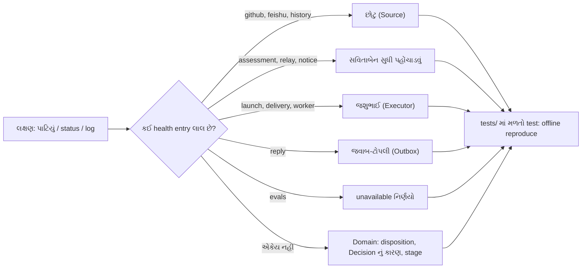

# પ્રકરણ 11 — Debugging: આરવ વૈદ બને છે

> **Level 11 · વાર્તાનો દિવસ 12.**
> બહાદુરની નોંધપોથીમાં દસ ફરિયાદ છે. દરેક માટે ચાર પગલાં: ફરી ઊભી કરો, નિદાન કરો, સાચા સ્તરે સુધારો, અને regression test વડે ખાતરી કરો.
> પહેલાં: [પ્રકરણ 10](10-panel.md). પ્રકરણ 1–10 જરૂરી છે.

## 🎯 આ પ્રકરણ પછી તમે શું કરી શકશો

- દસ સામાન્ય નિષ્ફળતાઓ માટે ચાર પગલાં (**reproduce → diagnose → correct → verify**) કરી શકશો.
- Health entry પરથી કહી શકશો કે કયા ભાગમાં જોવું.
- દરેક નિષ્ફળતા માટે repository નો કયો test તેને offline ફરી ઊભી કરે છે તે શોધી શકશો.

**નવા શબ્દો:** **reproduce** (સમસ્યાને ઇચ્છા મુજબ ફરી ઊભી કરવી), **regression test** (એક વાર સુધારેલી bug પાછી ન આવે તેની ચોકી કરતો test), **root cause** (મૂળ કારણ, લક્ષણ નહીં).

## 🗺️ નકશો: લક્ષણથી test સુધી



Health entry કહે છે કે કયા ભાગમાં જોવું: દરેક entry નો એક જ માલિક છે, એટલે લાલ entry સીધી તેના માલિક તરફ આંગળી ચીંધે છે. કોઈ entry લાલ ન હોય તો system "સ્વસ્થ" છે અને સમસ્યા **નિયમોમાં** છે: ચિઠ્ઠીનો disposition અને નિર્ણયનું કારણ વાંચો.

**ઓજાર:**

- `scripts/dsh-superagent status` (JSON + exit code; [`script-service`][script-service]).
- `GET /orchestrator/api/state`, `/sources`, `/tickets/<id>`, `/threads/<key>`.
- State directory ની **નકલ** પર `sqlite3`. ⚠️ ચાલુ database ને કદી સીધું edit ન કરો.
- `pnpm vitest run <file> -t "<નામ>"`.

🧪 નીચેના બધા regression tests અમે નામથી ચલાવ્યા, અને બધા પાસ થયા ([પરિશિષ્ટ G](../appendix/G-verification-log.md)). ⚠️ પણ નિષ્ફળતાઓ પોતે અમે ખરી deployment માં જોઈ નથી; લક્ષણો source, docs અને tests પરથી છે.

---

## દૃશ્ય 1 — વૈદની રીત: પહેલાં તાવ માપો, દવા પછી

🎬 આરવ પહેલી ફરિયાદ વાંચે છે ("એક ચિઠ્ઠી બે વાર") અને તરત કહે છે: "સિક્કાની રીતમાં ભૂલ હશે, હું બદલી નાખું." દીદી તેનો હાથ પકડે છે: "વૈદ નાડી જોયા વગર દવા આપે? પહેલાં: તું આ ફરિયાદ **ફરી ઊભી** કરી શકે છે? ન કરી શકે, તો સુધાર્યા પછી કેવી રીતે જાણીશ કે સુધરી?"

❓ "આ repository માં 'ફરી ઊભી કરવી' નો સસ્તો રસ્તો કયો?"

💻 Tests એક [fake harness][test-engine-harness] વાપરે છે: ખરો `Engine`, memory માંનો ચોપડો, નકલી Executor. એટલે domain ની લગભગ દરેક સ્થિતિ milliseconds માં, network વગર ઊભી થાય. Sources માટે [નકલી CLI][test-fake-cli], runtime માટે [host fixture][test-host-fixture]. ✅

ચાર પગલાં:

| પગલું | સવાલ | અહીંનું સાધન |
|---|---|---|
| Reproduce | ઇચ્છા મુજબ ફરી થાય છે? | હાલનો test, અથવા તેની નકલ પરથી નવો |
| Diagnose | કઈ હકીકત ધારણાથી અલગ છે? | Disposition, Decision reason, stage, health |
| Correct | ભૂલ કયા **સ્તર** ની છે? | Settings → team prompt → Source → core (આ ક્રમમાં વિચારો) |
| Verify | પાછી નહીં આવે? | Regression test + `pnpm check` |

🔬 **Expert નજર.** શિખાઉ developer લક્ષણ જ્યાં દેખાય ત્યાં code બદલે છે. અનુભવી પહેલાં પૂછે છે: "આ **bug** છે કે **design**?" આ પ્રકરણની દસમાંથી ચાર ફરિયાદોનો જવાબ "design, અને settings બદલો" છે; ત્રણનો "બહારની દુનિયા (account, provider)"; અને ફક્ત બે-ત્રણમાં code બદલવાનો વિચાર પણ વાજબી છે. સુધારાનો ક્રમ હંમેશાં સૌથી સસ્તા અને ઉલટાવી શકાય તેવા સ્તરથી શરૂ કરો.

## દૃશ્ય 2 — ચિઠ્ઠીની ફરિયાદો: "બે વાર આવી" અને "આવી જ નહીં"

🎬 પહેલી બે ફરિયાદ છોટુ અને ગોવિંદકાકાની છે. આરવ હવે પહેલાં આવક-રજિસ્ટર ખોલે છે.

❓ "ચિઠ્ઠી સ્તરે કયા field જોવા?"

💻

**1. Duplicate events**

| પગલું | વિગત |
|---|---|
| લક્ષણ | ટુકડીને એક જ comment બે વાર દેખાય, અથવા બે Tickets બને |
| Reproduce | [`test-intake-once`][test-intake-once]; `tests/sources.spec.ts` "keeps one body Trigger for an Issue that a later poll reads again"; running example `B_duplicate` |
| Diagnose | બંને ચિઠ્ઠીના ids સરખાવો. અલગ હોય → comment **edit** થઈ હતી (`updated_at` id નો ભાગ છે, [પ્રકરણ 4](04-sources-intake.md)). એક ચિઠ્ઠીમાંથી બે Tickets → `decision.triggerIds` |
| Correct | Edit નવી ચિઠ્ઠી બને તે **design** છે. Team ના Communication section માં ઉમેરો: "an edited comment arrives again; check whether it changes the request" |
| Verify | `pnpm vitest run tests/core-engine.spec.ts -t "direct decisions"` ("accepts a Trigger once") |

**2. Denied requests**

| પગલું | વિગત |
|---|---|
| લક્ષણ | `@agent` લખ્યું, કશું ન થયું |
| Reproduce | `tests/policy.spec.ts` "rejects automated messages, unknown senders without a Thread, and allowed senders who did not address the agent"; running example `C_unauthorized` |
| Diagnose | Panel → Trigger → પાનાની timeline. ચિઠ્ઠી **નથી** → Source સુધી પહોંચી જ નથી (Source બંધ, setup બાકી, mention edit વડે ઉમેરાયું, notifications બંધ). `filtered` → Source scope. Decision `ignore` → કારણ: `not_a_member` / `no_mention` / `admission_ignored` / `not_human` |
| Correct | Policy → Source → allowed યાદીમાં login ([`sameName`][text-samename] અક્ષરોના case ને અવગણે છે). પછી ચિઠ્ઠી પર **Evaluate again** |
| Verify | `pnpm vitest run tests/policy.spec.ts -t "grants explicit strength"` |

🔬 **Expert નજર.** "ચિઠ્ઠી દેખાતી જ નથી" અને "ચિઠ્ઠી filtered છે" બે અલગ સ્તરની સમસ્યા છે. પહેલી **Source ની બહાર** છે (GitHub, account, network): system ને ખબર જ નથી કે કશું થયું. બીજી **Source ની અંદર** છે: system જાણે છે, અને કારણ નોંધ્યું છે. "ગેરહાજરી" ને debug કરવી સૌથી અઘરી છે, એટલે prototype શક્ય હોય ત્યાં ગેરહાજરીને હાજરીમાં ફેરવે છે (filtered ચિઠ્ઠી સચવાય છે).

## દૃશ્ય 3 — વિચારની ફરિયાદ: "બેને નિર્ણય ન કર્યો"

🎬 ત્રીજી ફરિયાદ: સવારે સાડા છએ એક ચિઠ્ઠી પર "નિર્ણય ન થઈ શક્યો" લખાયું છે. આરવ સવિતાબેનને દોષ દેવા જાય છે. તે કહે છે: "મારા હાથમાં થોકડો આવ્યો હતો ખરો?"

❓ "Timeout નું મૂળ ક્યાં શોધવું?"

💻

**3. Assessment timeouts**

| પગલું | વિગત |
|---|---|
| લક્ષણ | `status` exit 2, `evals` લાલ; Decision `unavailable` + `timeout` |
| Reproduce | [`test-deadline`][test-deadline]; "lets no Eval expire while processing is paused…" |
| Diagnose | Candidate main Session ને **પહોંચ્યો** હતો (`delivered`)? `models` health માં retry? Main Session લાંબો shell command ચલાવતું હતું? |
| Correct | `eval.timeoutSeconds` વધારો, અથવા હળવું model (`eval.model`). Panel માંથી **Evaluate again**, અથવા dismiss |
| Verify | ઉપરનો deadline test; [પ્રકરણ 5](05-policy-eval.md) નો `REQUEUES` પ્રયોગ |

🔬 **Expert નજર.** Timeout એ લક્ષણ છે, રોગ નહીં. તેને વધારવું એ તાવની દવા છે: કદાચ જરૂરી, પણ પહેલાં પૂછો **કેમ** ધીમું પડ્યું. Deadline delivery થી ગણાય છે ([પ્રકરણ 5](05-policy-eval.md)), એટલે timeout નો અર્થ હંમેશાં "model ને મળ્યા પછી 120 s માં જવાબ ન આવ્યો" છે, "queue લાંબી હતી" નહીં. એ જાણવાથી શોધ અડધી થઈ જાય.

## દૃશ્ય 4 — ચૂલાની ફરિયાદો: ઓટલો, provider, ચિઠ્ઠી પહોંચાડવી

🎬 ચોથીથી છઠ્ઠી ફરિયાદ જશુભાઈની છે. તે પોતે કહે છે: "મારી ત્રણ ફરિયાદ ત્રણ અલગ જગ્યાની છે. ઓટલો **મારું** કામ છે. Provider **બહારનું** છે. અને ચિઠ્ઠી ન પહોંચે તો ઘણી વાર **ટુકડીનું Session** જ ગાયબ હોય છે."

❓ "ત્રણેયને કેવી રીતે અલગ પાડવી?"

💻

**4. Failed workspace preparation**

| પગલું | વિગત |
|---|---|
| લક્ષણ | Ticket `person/failed`: "The prepare command failed: …" |
| Reproduce | [`test-prepare`][test-prepare] |
| Diagnose | Ticket ના પાને environment variables; એ જ command હાથે ચલાવો. [`PrepareFailed`][dsh-prepare-failed] retry નથી થતું |
| Correct | Execution settings માં prepare command → **Retry** |
| Verify | એ જ test; અને "runs a launch that fails for a passing reason again on the launch backoff three times, then fails its ticket; a failed prepare fails at once" |

**5. Provider errors**

| પગલું | વિગત |
|---|---|
| લક્ષણ | Worker અચાનક failed: `429`, `503`, `ECONNRESET` |
| Reproduce | `tests/runtime-concurrency.spec.ts` "lets a worker go on after a passing provider failure, three times, before its ticket fails" |
| Diagnose | [`transient(error)`][dsh-transient]: status અથવા લખાણ પરથી. ભૂલના લખાણમાં ઓળખાય તેવો શબ્દ ન હોય તો તે ક્ષણિક **નથી** ગણાતી, અને તરત failed |
| Correct | Provider ની મર્યાદાઓ; **Retry**. નવું ક્ષણિક લખાણ દેખાય તો regex માં ઉમેરો (core ફેરફાર, test સાથે: [પ્રકરણ 12, દૃશ્ય 2](12-customization.md)) |
| Verify | ઉપરનો test; "starts the count of passing failures again once its turn ends as turns do" |

**6. Failed input delivery**

| પગલું | વિગત |
|---|---|
| લક્ષણ | Stage `person/delivery`, "Input undelivered" |
| Reproduce | `tests/core-engine.spec.ts` "retry after a failed delivery"; `tests/runtime-concurrency.spec.ts` "records on the ticket that its worker Session could not be created again" |
| Diagnose | `ticket.delivery.error`. Worker Session કોઈએ delete કર્યો? DSH preset ખૂટે છે? ([docs/006][doc-deploy]) |
| Correct | કારણ સુધારો → **Retry** (નવી પાળી ચિઠ્ઠી લઈ લે) |
| Verify | "starts a new Assignment for a ticket whose Input keeps failing to reach its worker, which takes the Input" |

🔬 **Expert નજર.** `transient` એક **heuristic** છે: ભૂલના લખાણ પર regex. તે સસ્તું છે અને મોટે ભાગે સાચું, પણ તેની મર્યાદા સ્પષ્ટ છે: નવો provider નવા શબ્દોમાં ભૂલ આપે તો તે "કાયમી" ગણાશે. સાચું વર્ગીકરણ provider SDK ના typed errors પરથી થવું જોઈએ, પણ તે Harness ની હદમાં છે. જ્યાં heuristic વાપરો, ત્યાં તેનો **નિષ્ફળ જવાનો રસ્તો સલામત** રાખો: અહીં ખોટું વર્ગીકરણ "માણસને બોલાવો" તરફ પડે છે, "કાયમ retry કરો" તરફ નહીં.

## દૃશ્ય 5 — જવાબ અને follow-up ની ફરિયાદો

🎬 સાતમી: "ગ્રાહકને જવાબ ન ગયો." આઠમી: "એક પાના પર બે ઓર્ડર છે; નવી ચિઠ્ઠી કોની?" આરવ પાવતી-બુક અને આવક-રજિસ્ટર બંને ખોલે છે.

❓ "જવાબ ક્યાં અટક્યો, અને ચિઠ્ઠીનો માલિક કોણ?"

💻

**7. Failed replies**

| પગલું | વિગત |
|---|---|
| લક્ષણ | `reply` health લાલ; સ્વીકૃતિ કે પરિણામ GitHub પર નથી |
| Reproduce | `tests/effects.spec.ts` "retries a failed effect after a delay that doubles up to its maximum, and reports the kind in error after three failures"; `tests/outbox.spec.ts` |
| Diagnose | Receipt `pending` / `sent` / `dropped`? `dropped` નું કારણ `channelGone` કે `channelIgnored`. [`behind`][store-behind] ને કારણે પાછળના જવાબો અટક્યા છે? |
| Correct | Agent account ની પરવાનગી / token; Source ફરી ચાલુ. Dropped જવાબ ફરી queue **નથી** થતો (id idempotent છે) |
| Verify | `pnpm vitest run tests/effects.spec.ts tests/outbox.spec.ts` |

**8. Concurrent follow-ups**

| પગલું | વિગત |
|---|---|
| લક્ષણ | એક પાના પર બે Tickets; follow-up કોનો? |
| Reproduce | `tests/core-engine.spec.ts` "keeps a follow-up two tickets reached with the one that did not hand it back, and queues it once neither decides it" |
| Diagnose | Disposition: `fanout`, `handbacks`, `acked`; [`followupOwners`][model-owners]. પાનાના `pending` અને `evaluating` |
| Correct | Design: દરેક માલિક પાછી સોંપે ત્યારે જ ચિઠ્ઠી Eval માં જાય. Main Session ને `workerDecides` મળે તે સામાન્ય છે |
| Verify | ઉપરનો test; [`test-fanout`][test-fanout] |

🔬 **Expert નજર.** Disposition ([`model-disposition`][model-disposition]) આ system નું "flight recorder" છે: દરેક ચિઠ્ઠી માટે તે કહે છે કોને મળી, કોણે સ્વીકારી, કોણે પાછી સોંપી. Distributed system માં "આ message નું શું થયું?" નો જવાબ logs ખોદીને મળે; અહીં તે એક row છે. તમારી પોતાની system બનાવો ત્યારે આ વિચાર લઈ જજો: **દરેક input માટે એક નોંધ, જે તેના ભાગ્યનો સાર કહે.**

## દૃશ્ય 6 — લાઈટ અને ચોપડાની ફરિયાદો

🎬 નવમી: "લાઈટ પછી કેટલાક ઓર્ડર ફરી શરૂ થયા, કેટલાક નહીં." દસમી સૌથી ડરામણી છે: સવારે ઘર ખૂલતું જ નથી, અને દરવાજે લખ્યું છે: "આ ચોપડો મારાથી નવો છે."

❓ "કઈ ફરિયાદ ખરેખર ફરિયાદ છે?"

💻

**9. Interrupted workers**

| પગલું | વિગત |
|---|---|
| લક્ષણ | Restart પછી કેટલાક Tickets ફરી શરૂ થયા, કેટલાક નહીં |
| Reproduce | [`test-interrupted`][test-interrupted]; [`test-resume`][test-resume]; running example `G_restart` |
| Diagnose | પાળીનો `report.state`, અને `deliveredAt >= report.at` (`busy`). Settled → Session રહે; બાકી → `hostRestarted` + recovery note ([પ્રકરણ 7, દૃશ્ય 7](07-worker-execution.md)) |
| Correct | કશું નહીં: design. Worker એ બહારનું કામ ફરી કર્યું હોય (બમણો push) તો team section માં વધુ કડક નિયમ લખો |
| Verify | ઉપરના tests |

**10. Incompatible stored state**

| પગલું | વિગત |
|---|---|
| લક્ષણ | શરૂ નથી થતું: "Unsupported orchestrator database version 12", અથવા "older than schema 10" |
| Reproduce | `tests/store.spec.ts` "refuses databases newer than this build and rolls back failed atomic work"; `tests/migration.spec.ts` "changes nothing when one step fails: the database stays at schema 10 as it was" |
| Diagnose | `kv` table માં schema key ([`store-newer`][store-newer], [`migration-versions`][migration-versions]). Downgrade કર્યું? |
| Correct | નવો ચોપડો: upgrade પહેલાંનો **backup**, અથવા નવું build પાછું. 10 થી જૂનો: નવી state directory |
| Verify | ઉપરના tests |

🔬 **Expert નજર.** દસમી ફરિયાદનો ઉપાય debugging માં નથી; **upgrade પહેલાં** છે: state directory ની નકલ. [docs/006][doc-deploy] આને upgrade ની રીતનો ભાગ ગણે છે. "ના પાડવી" (refuse to start) એ અહીં system ની સૌથી સારી સેવા છે: જૂનો code નવા ચોપડામાં લખવા લાગે તો નુકસાન ચૂપચાપ અને કાયમી થાય. **મોટેથી નિષ્ફળ જવું, ચૂપચાપ બગાડવા કરતાં સારું.**

---

## Source map

| ફરિયાદ | પહેલાં ખોલો |
|---|---|
| 1–2 | `src/core/intake.ts`, `src/policy.ts` ([gate][policy-gate]) |
| 3 | `src/core/evals.ts` ([`expire`][evals-expire]) |
| 4–6 | `src/executor/dsh.ts` ([`launchQueued`][dsh-launch-queued], [`deliverQueued`][dsh-deliver-queued]) |
| 7 | `src/app/outbox.ts` ([`deliver`][outbox-deliver]) |
| 8 | `src/core/part.ts` ([`handBack`][part-handback]) |
| 9 | `src/core/assignments.ts` ([`interrupted`][assign-interrupted]) |
| 10 | `src/app/store.ts`, `src/app/migration.ts` |

## 🧪 Lab: સ્વતંત્ર નિદાન

[`labs/running-example.spec.ts`](../labs/running-example.spec.ts) માં પગલું I (alice નો stop) **પહેલાં** આ લીટી ઉમેરો:

```ts
settings.policy.sources.github!.allowed = []
```

**સવાલ:** stop સફળ થશે? પહેલાં લખી રાખો કે તમે શું ધારો છો અને કેમ. પછી ચલાવો.

🧪 **અવલોકન:** નિર્ણય `ignore`, કારણ `stopNotExplicit`. **કેમ:** `settingsPolicy` દરેક call પર આજની settings પરથી બને છે; alice હવે યાદીમાં નથી; Ticket ના પાના પર તે `followup` શાખાથી અંદર આવે છે પણ `inferred` તરીકે; અને stop માટે `explicit` જોઈએ. ([પરિશિષ્ટ D](../appendix/D-lab-solutions.md#પ્રકરણ-11))

## 🔮 આગાહી કસોટી

`reply` effect ત્રણ વાર નિષ્ફળ ગઈ, અને receipt `channelGone` સાથે dropped થઈ (Issue delete થઈ ગઈ હતી). તમે Issue પાછી લાવો છો. જવાબ આપોઆપ ફરી જશે? (ધારો. જવાબ: **ના**. Receipt settle થઈ ગઈ છે, અને એ જ id ફરી `INSERT OR IGNORE` માં અવગણાશે.)

## 🩺 નિષ્ફળતા: "મેં ચાલુ database સીધું edit કર્યું, અને હવે…"

**ન કરો.** ચાલુ process પાસે directory lock છે, WAL માં ન ઉતરેલા ફેરફારો છે, અને memory માં state છે જે તમારા ફેરફાર વિશે જાણતી નથી. **તેને બદલે:** process બંધ કરો → directory ની નકલ → નકલ પર તપાસ. સુધારો Engine ની commands વડે (panel, tools) કરો, SQL વડે નહીં.

<a id="saar"></a>

## ✅ સાર

| # | ફરિયાદ | પ્રકાર | પહેલું પગલું |
|---|---|---|---|
| 1 | Duplicate events | Design (edit) | Trigger ids સરખાવો |
| 2 | Denied requests | Settings | Decision નું કારણ |
| 3 | Assessment timeouts | બહાર / settings | `delivered`? `models` health |
| 4 | Failed prepare | Settings / બહાર | Command હાથે ચલાવો |
| 5 | Provider errors | બહાર | `transient` ઓળખે છે? |
| 6 | Failed delivery | બહાર | `ticket.delivery.error` |
| 7 | Failed replies | બહાર | Receipt status |
| 8 | Concurrent follow-ups | Design | Disposition |
| 9 | Interrupted workers | Design | `settled`? |
| 10 | Incompatible state | Operations | Backup |

**યાદ-ચાવી "ફ-નિ-સુ-ખા":** ફરી ઊભી કરો, નિદાન, સુધારો, ખાતરી.

<details><summary>કાર્ડ 1: Health માં કશું લાલ નથી, છતાં request નો જવાબ નથી. ક્યાં જોવું?</summary>

Domain માં: ચિઠ્ઠીનો disposition (filtered? fanout?) અને Decision નું reason code. System સ્વસ્થ છે; નિયમોએ ના પાડી છે.
</details>

<details><summary>કાર્ડ 2: Dropped જવાબ ફરી કેવી રીતે મોકલવો?</summary>

આપોઆપ નહીં. Worker કે main Session નવો જવાબ લખે (નવું લખાણ → નવું id), અથવા માણસ પાના પર ફરી પૂછે.
</details>

**મિત્રને સમજાવો:** "પહેલાં તાવ માપો. પછી પૂછો: આ રોગ છે કે શરીરની સામાન્ય રીત? દવા સૌથી હળવીથી શરૂ કરો."

## 🧠 Mastery check

1. "Trigger દેખાતો જ નથી" અને "Trigger filtered છે": બંનેનાં કારણો કયા સ્તરમાં હોય?
2. Provider error ક્ષણિક છે કે નહીં તે કયું function નક્કી કરે, અને તેની મર્યાદા શી?
3. ચાલુ SQLite database સીધું edit કેમ ન કરવું?
4. Dropped reply ફરી કેમ નથી મોકલાતો, અને મોકલવો હોય તો?

જવાબો: [પરિશિષ્ટ D](../appendix/D-lab-solutions.md#પ્રકરણ-11).

## 🎬 આગળ શું

દસ ફરિયાદ પૂરી. આરવ હવે ઘરને ઓળખે છે. પપ્પા તેને બોલાવે છે: "આવતા મહિનાથી ઈ-મેલ પરથી પણ ઓર્ડર લેવા છે. અને ટુકડીઓ આપણી ઘરની રીતથી જવાબ આપે એવું કર. પણ ધ્યાન રાખજે: ઘરનો પાયો હલવો ન જોઈએ." → [પ્રકરણ 12](12-customization.md).

<!-- citations:begin (generated by tools/refdefs.py) -->
[assign-interrupted]: https://github.com/deepseek-ai/dsh-superagent-prototype/blob/8c32a9dc5d72c033816c6a8110b37f40cf94fba4/src/core/assignments.ts#L83-L92
[doc-deploy]: https://github.com/deepseek-ai/dsh-superagent-prototype/blob/8c32a9dc5d72c033816c6a8110b37f40cf94fba4/docs/006-deployment.md#L1-L12
[dsh-deliver-queued]: https://github.com/deepseek-ai/dsh-superagent-prototype/blob/8c32a9dc5d72c033816c6a8110b37f40cf94fba4/src/executor/dsh.ts#L290-L328
[dsh-launch-queued]: https://github.com/deepseek-ai/dsh-superagent-prototype/blob/8c32a9dc5d72c033816c6a8110b37f40cf94fba4/src/executor/dsh.ts#L270-L285
[dsh-prepare-failed]: https://github.com/deepseek-ai/dsh-superagent-prototype/blob/8c32a9dc5d72c033816c6a8110b37f40cf94fba4/src/executor/dsh.ts#L39-L43
[dsh-transient]: https://github.com/deepseek-ai/dsh-superagent-prototype/blob/8c32a9dc5d72c033816c6a8110b37f40cf94fba4/src/executor/dsh.ts#L44-L55
[evals-expire]: https://github.com/deepseek-ai/dsh-superagent-prototype/blob/8c32a9dc5d72c033816c6a8110b37f40cf94fba4/src/core/evals.ts#L60-L69
[migration-versions]: https://github.com/deepseek-ai/dsh-superagent-prototype/blob/8c32a9dc5d72c033816c6a8110b37f40cf94fba4/src/app/migration.ts#L20-L22
[model-disposition]: https://github.com/deepseek-ai/dsh-superagent-prototype/blob/8c32a9dc5d72c033816c6a8110b37f40cf94fba4/src/core/model.ts#L42-L61
[model-owners]: https://github.com/deepseek-ai/dsh-superagent-prototype/blob/8c32a9dc5d72c033816c6a8110b37f40cf94fba4/src/core/model.ts#L75-L88
[outbox-deliver]: https://github.com/deepseek-ai/dsh-superagent-prototype/blob/8c32a9dc5d72c033816c6a8110b37f40cf94fba4/src/app/outbox.ts#L39-L51
[part-handback]: https://github.com/deepseek-ai/dsh-superagent-prototype/blob/8c32a9dc5d72c033816c6a8110b37f40cf94fba4/src/core/part.ts#L42-L48
[policy-gate]: https://github.com/deepseek-ai/dsh-superagent-prototype/blob/8c32a9dc5d72c033816c6a8110b37f40cf94fba4/src/policy.ts#L191-L211
[script-service]: https://github.com/deepseek-ai/dsh-superagent-prototype/blob/8c32a9dc5d72c033816c6a8110b37f40cf94fba4/scripts/dsh-superagent#L1-L8
[store-behind]: https://github.com/deepseek-ai/dsh-superagent-prototype/blob/8c32a9dc5d72c033816c6a8110b37f40cf94fba4/src/app/store.ts#L259-L261
[store-newer]: https://github.com/deepseek-ai/dsh-superagent-prototype/blob/8c32a9dc5d72c033816c6a8110b37f40cf94fba4/src/app/store.ts#L66-L67
[test-deadline]: https://github.com/deepseek-ai/dsh-superagent-prototype/blob/8c32a9dc5d72c033816c6a8110b37f40cf94fba4/tests/core-engine.spec.ts#L161-L185
[test-engine-harness]: https://github.com/deepseek-ai/dsh-superagent-prototype/blob/8c32a9dc5d72c033816c6a8110b37f40cf94fba4/tests/core-engine.spec.ts#L15-L66
[test-fake-cli]: https://github.com/deepseek-ai/dsh-superagent-prototype/blob/8c32a9dc5d72c033816c6a8110b37f40cf94fba4/tests/sources.spec.ts#L1046-L1060
[test-fanout]: https://github.com/deepseek-ai/dsh-superagent-prototype/blob/8c32a9dc5d72c033816c6a8110b37f40cf94fba4/tests/core-engine.spec.ts#L187-L205
[test-host-fixture]: https://github.com/deepseek-ai/dsh-superagent-prototype/blob/8c32a9dc5d72c033816c6a8110b37f40cf94fba4/tests/fixtures/host.ts#L1-L20
[test-intake-once]: https://github.com/deepseek-ai/dsh-superagent-prototype/blob/8c32a9dc5d72c033816c6a8110b37f40cf94fba4/tests/core-engine.spec.ts#L75-L82
[test-interrupted]: https://github.com/deepseek-ai/dsh-superagent-prototype/blob/8c32a9dc5d72c033816c6a8110b37f40cf94fba4/tests/core-engine.spec.ts#L702-L722
[test-prepare]: https://github.com/deepseek-ai/dsh-superagent-prototype/blob/8c32a9dc5d72c033816c6a8110b37f40cf94fba4/tests/runtime.spec.ts#L1079-L1097
[test-resume]: https://github.com/deepseek-ai/dsh-superagent-prototype/blob/8c32a9dc5d72c033816c6a8110b37f40cf94fba4/tests/core-engine.spec.ts#L296-L311
[text-samename]: https://github.com/deepseek-ai/dsh-superagent-prototype/blob/8c32a9dc5d72c033816c6a8110b37f40cf94fba4/src/infra/text.ts#L19
<!-- citations:end -->
