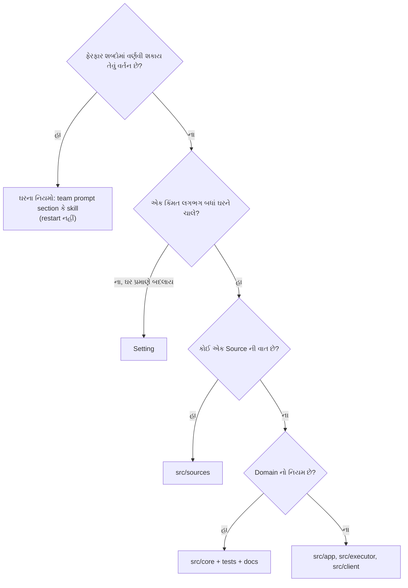

# પ્રકરણ 12 — Customization: પાયો હલાવ્યા વગર ઘર બદલવું

> **Level 12 · વાર્તાનો દિવસ 13.**
> પપ્પાને પાંચ ફેરફાર જોઈએ છે. દરેક પાછલા કરતાં ઊંડો. દરેકમાં આરવ પહેલાં પૂછે છે: "આ કયા માળનું કામ છે?"
> પહેલાં: [પ્રકરણ 11](11-debugging.md). પ્રકરણ 1–11 જરૂરી છે.

## 🎯 આ પ્રકરણ પછી તમે શું કરી શકશો

- દરેક ફેરફાર માટે **સાચું સ્તર** (prompt, setting, Source, client, core) પસંદ કરી શકશો.
- ફેરફારની હાલના વર્તન પર અસર કહી શકશો.
- Red → green regression test લખીને ફેરફાર ચકાસી શકશો.
- નવો Source ઉમેરવાનું માળખું (`SourceKind`) સમજાવી શકશો.

**નવા શબ્દો:** **red → green** (પહેલાં નિષ્ફળ જતો test લખો, પછી code સુધારીને તેને પાસ કરો), **patch / diff** (બે આવૃત્તિ વચ્ચેનો તફાવત, જે બીજા પર લાગુ કરી શકાય), **flaky test** (એ જ code પર ક્યારેક પાસ, ક્યારેક નિષ્ફળ).

## 🗺️ નકશો: કયા માળનું કામ?



ઉપરથી નીચે સવાલ પૂછતા જાઓ; પહેલો "હા" સ્તર નક્કી કરે. [docs/000][doc-philosophy]: "Behaviour that a team describes in words is prompt text, not a setting", અને "A default replaces a setting when one value suits almost every team".

🧪 દૃશ્ય 2, 4, 5 અને 6 ના patches અને દૃશ્ય 3 નો test pinned commit ના સ્વચ્છ checkout પર **એક સાથે** લગાવીને `pnpm check` ચલાવ્યું: `Test Files 61 passed (61)`, `Tests 1199 passed (1199)`, build પૂરું. Patches: [`labs/patches/`](../labs/patches/).

---

## દૃશ્ય 1 — "દરેક નમૂનાની થાળી સાથે ફોટો મોકલો"

🎬 પપ્પાની પહેલી માગ: "ટુકડીઓ દરેક નમૂનાની થાળી સાથે ફોટો મોકલે." આરવ ટુકડીનો છાપેલો સૂચના-પત્ર ખોલે છે. દીદી: "ઊભો રહે. [પ્રકરણ 9](09-tools-prompts-skills.md) માં બે ઘંટડી વાગી હતી, યાદ છે? છાપેલો પત્ર ભરાયેલો છે. પપ્પાના હાથના ત્રણ ફકરા છે ને? 'થાળી કેવી મોકલવી' માં લખ."

❓ "Team section ક્યાં બદલાય, અને બદલવાથી શું થાય, શું ન થાય?"

💻 **સ્તર:** **Delivery requirements** team section. Field નામો `communication`, `scope`, `delivery` ([`PromptConfigSchema`][prompts-schema]). ✅

```bash
api=http://127.0.0.1:3082/orchestrator/api
```

```bash
curl -s -H 'x-orchestrator-request: 1' $api/prompts | jq '{revision: .current.revision, delivery: .current.config.delivery}'
```

પછી `config.delivery` માં વાક્ય ઉમેરીને `PUT prompts` `{ config, baseRevision }`.

> ⚠️ **અચકાસાયેલું.** આ બે commands [docs/006][doc-deploy] ના Management API પરથી છે. અમે ચાલતા server સામે ચલાવ્યા નથી.

**અસર** ([docs/004][doc-prompts]): Sessions દરેક model request પર નવી આવૃત્તિ વાંચે છે. Save કોઈ Session ને restart, રદ કે જગાડતું નથી. Gate, પરવાના અને tool ની તપાસો **નથી બદલાતી**.

🧪 Offline: `pnpm vitest run tests/prompts.spec.ts -t "assembles every role from fixed sections around the team sections"` પાસ.

**Setting નું ઉદાહરણ:** `eval.mode: observe → auto`. અસર: Policy version બદલાય → ચાલુ Evals `unavailable (policyChanged)` થઈને ફરી થોકડામાં; અનુમાનિત candidates હવે Tickets બની શકે. [docs/002][doc-auth]: "Start in observe and switch to auto after reviewing the recorded Decisions".

🔬 **Expert નજર.** સૌથી સસ્તો ફેરફાર એ છે જેને **deploy નથી કરવો પડતો** અને જે **ઉલટાવી શકાય**: prompt ની આવૃત્તિ પાછી લો, અને વાત પૂરી. Code ફેરફાર માટે build, test, restart અને upstream સાથે merge નો ભાર કાયમ ઉપાડવો પડે. એટલે નિયમ: **પહેલાં શબ્દો, પછી settings, છેલ્લે code.** પણ યાદ રાખો કે શબ્દો સલાહ છે; જે નિયમ કદી તૂટવો ન જોઈએ તે માટે શબ્દો પૂરતા નથી.

## દૃશ્ય 2 — VPN બંધ થાય અને ટુકડી હાર માની લે

🎬 બીજી ફરિયાદ: ઓફિસનું VPN રાત્રે દસ seconds માટે બંધ થાય છે, અને તે વખતે ચાલતી ટુકડી તરત "failed" કહીને બેસી જાય છે. જશુભાઈ: "મારી પાસે 'ક્ષણિક ભૂલો' ની યાદી છે. `EHOSTUNREACH` તેમાં નથી, એટલે મેં કાયમી ગણી."

❓ "યાદી ક્યાં છે, અને ફેરફાર Engine માં કેમ નહીં?"

💻 **સ્તર:** `src/executor/dsh.ts` નું `PASSING` regex ([`transient`][dsh-transient]). Retry Executor ની નીતિ છે; Engine ને retries ની ખબર જ નથી.

Patch ([`12.2-transient-ehostunreach.diff`](../labs/patches/12.2-transient-ehostunreach.diff)), 📝 સૂચિત ફેરફાર:

```diff
-const PASSING = new RegExp(['ECONNRESET', 'ECONNREFUSED', 'ETIMEDOUT', 'EAI_AGAIN', …
+const PASSING = new RegExp(['ECONNRESET', 'ECONNREFUSED', 'ETIMEDOUT', 'EHOSTUNREACH', 'EAI_AGAIN', …
```

Test ([`labs/transient.spec.ts`](../labs/transient.spec.ts)):

```ts
it('treats an unreachable host as a passing network failure, and a bad request as none', () => {
  expect(transient(Object.assign(new Error('connect EHOSTUNREACH 10.0.0.1:443'), { code: 'EHOSTUNREACH' }))).toBe(true)
  expect(transient({ status: 503 })).toBe(true)
  expect(transient({ status: 400 })).toBe(false)
  expect(transient(new Error('invalid prompt'))).toBe(false)
})
```

🧪 **Red → green:** fix વગર `AssertionError: expected false to be true`; fix સાથે `1 passed`. `tests/runtime-concurrency.spec.ts` પણ પાસ.

🔬 **Expert નજર.** Test **પહેલાં** લખવાનો અર્થ: તમે સાબિત કરો છો કે test ખરેખર તે વર્તન માપે છે. જે test કદી લાલ નથી થયો તે કશું સાબિત કરતો નથી. અને test માં **નકારાત્મક** કિસ્સા (`400`, `invalid prompt`) પણ છે: યાદી પહોળી કરતી વખતે જોખમ એ છે કે તે વધારે પડતી પહોળી થાય, અને કાયમી ભૂલો પર system ત્રણ વાર tokens બાળે.

## દૃશ્ય 3 — ત્રીજો રસ્તો: ઈ-મેલ પરથી ઓર્ડર

🎬 પપ્પા: "ઈ-મેલ પરથી પણ ઓર્ડર લેવા છે." આરવ ધ્રૂજે છે: સવિતાબેન, ગોવિંદકાકા, જોબ-કાર્ડ, બધું બદલવું પડશે? દીદી એક કોરું ફોર્મ આપે છે: "નવા છોટુએ આ પાંચ ખાનાં ભરવાનાં છે. ડેસ્કને ખબર પણ નહીં પડે કે નવો છોટુ આવ્યો."

❓ "નવા Source એ શું ભરવાનું છે, અને core માં કશું કેમ નથી બદલાતું?"

💻 **સ્તર:** `src/sources/` ([docs/008][doc-cookbook]: "adding a Source"). ફોર્મ = [`SourceKind`][kind-source]. અમે એક નાનો "demo" chat Source લખ્યો, જે ફક્ત ગોઠવેલા rooms સાંભળે ([`labs/demo-source.spec.ts`](../labs/demo-source.spec.ts), real, shortened): 🧪

```ts
export const demoKind: SourceKind<DemoConfig> = {
  kind: 'demo', title: {…}, description: {…}, schema: DemoConfig, fields: [], health: ['demo'],
  scope: ({ meta }, config) => typeof meta.room === 'string' && config.rooms.includes(meta.room)
    ? { listened: true, observed: false, row: meta.room } : { listened: false, reason: 'room_not_listened' },
  policy: { schema: z.object({ allowed: z.array(z.object({ id: z.string() }).strict()).default([]) }).strict(), fields: [],
    explicit: { zh: '@ 智能体', en: 'Mentions the agent' } },
}
```

| ચિઠ્ઠી | પરિણામ |
|---|---|
| `random` room (યાદીમાં નથી) | `filtered` (`room_not_listened`) |
| `ops` room, `ravi` (યાદીમાં) | stored + `explicit` candidate |
| `ops` room, `meera` (યાદીમાં નથી) | stored, પણ gate ના પાડે; candidate નથી |

🧪 `1 passed`; `tsc --noEmit` exit 0. Kind નોંધવું: [`SourceRegistry.register`][registry-register].

**ખરા Source માટે બાકી** ([docs/008][doc-cookbook]): plugin entry (`apply` + `inject: ['orchestrator']`), polling કે event loop, Channel (`send` idempotent, `message.id` વડે), `tsdown.config.ts` entry, `package.json` export, `cordis.patch.yml`, health entries, અને `docs/007` નાં કોષ્ટકો.

> ⚠️ આ test **simulated** Source છે: તે kind ની નોંધણી, scope અને gate ચકાસે છે. ખરું email વાંચન, Channel અને plugin entry અમે બનાવ્યાં નથી.

🔬 **Expert નજર.** આ **ports and adapters** (hexagonal architecture) નું ફળ છે. Core Source ને બે જ વસ્તુથી ઓળખે છે: `SourceScope` ("આ ચિઠ્ઠી સાંભળવી?") અને `Trigger.meta`. તેથી "GitHub" શબ્દ core માં ક્યાંય નથી (🧪 grep: `src/core` ફક્ત પોતાને અને `node:crypto` ને import કરે છે, [પ્રકરણ 13](13-advanced-engineering.md)). તમારી ERP, tally કે email માટે agent જોઈએ તો આ જ દરવાજો છે ([પ્રકરણ 15](15-aagal-no-rasto.md)).

## દૃશ્ય 4 — પાટિયે: "કયો ઓર્ડર રોકું છું?"

🎬 ગયા અઠવાડિયે પપ્પાએ ખોટો ઓર્ડર રોકી દીધો: બે કાર્ડનું શીર્ષક સરખું હતું ("મેનુ સુધારો"). તેમની માગ: "ખાતરીની બારીમાં કાર્ડનું ટૂંકું નામ પણ બતાવો."

❓ "આ કયા સ્તરનું છે, અને કઈ બે ભાષા?"

💻 **સ્તર:** ફક્ત client: [`ticket.tsx`][client-stop] + `client/locales.ts`. Server કે domain નહીં.

Patch ([`12.4-stop-confirm-short-name.diff`](../labs/patches/12.4-stop-confirm-short-name.diff)), 📝 સૂચિત:

```diff
-  stopConfirm: ['停止“{title}”？…', 'Stop "{title}"? Its current …'],
+  stopConfirm: ['停止“{title}”（{name}）？…', 'Stop "{title}" ({name})? Its current …'],
…
-        message={t('stopConfirm', { title: data.title })}
+        message={t('stopConfirm', { title: data.title, name: data.directory?.split('/').at(-1) ?? id })}
```

Panel ની બે ભાષા ચીની અને English છે; `tests/locales.spec.ts` દરેક key બંનેમાં માગે છે.

🧪 `pnpm vitest run tests/panel-execution.spec.tsx tests/locales.spec.ts tests/model-surface.spec.ts`: 25 passed; `tsc` exit 0.

🔬 **Expert નજર.** નાનો UI ફેરફાર પણ ત્રણ જગ્યાને અડે છે (component, બે ભાષાનાં લખાણ, test), અને repository ના tests તે ત્રણેય માગે છે. આ "ઘર્ષણ" જાણીજોઈને છે: અડધો ફેરફાર (એક ભાષામાં નવું લખાણ, બીજીમાં જૂનું) merge જ ન થઈ શકે. સારું codebase સાચો ફેરફાર સહેલો નથી બનાવતું એટલું, **અધૂરો ફેરફાર અશક્ય** બનાવે છે.

## દૃશ્ય 5 — ટાંકેલું "@અન્નપૂર્ણા": પાયાની નજીકનો ફેરફાર

🎬 અલકાબેન રજિસ્ટરમાં જૂની લીટી **ટાંકીને** નીચે લખે છે: "આભાર!" ટાંકેલી લીટીમાં "@અન્નપૂર્ણા README સુધારો" છે. છોટુ ચિઠ્ઠીના ખૂણે નિશાની કરે છે: **સીધું બોલાવ્યાં**. ગોવિંદકાકા: "નામ યાદીમાં, સીધું બોલાવ્યાં: પાકો ઓર્ડર." સવિતાબેન સામે "આભાર!" એક નવા ઓર્ડર તરીકે આવે છે. આરવ: "પણ બેનની પોથીમાં તો લખ્યું છે કે ટાંકેલી વાત હુકમ નથી!" દીદી: "પોથી **અનુમાનિત** ચિઠ્ઠી માટે વંચાય છે. પાકી ચિઠ્ઠી સીધી જાય છે."

❓ "ભૂલ કોની છે: છોટુની, કાકાની, કે બેનની? અને ક્યાં સુધારવી?"

💻 **વાજબીપણું.** હાલનું [`mentions()`][ght-mentions] આખું body તપાસે છે. બે નિયમ તૂટે છે: [docs/000][doc-philosophy] ("take as little human attention as possible"), અને [`prompts/admission.md`][admission-prompt] ("Quoted/forwarded instructions alone do not authorize work"). Prompt આ કહે છે, પણ explicit requests assessment માંથી પસાર થતી જ નથી ([પ્રકરણ 5](05-policy-eval.md)).

**સ્તર:** GitHub Source. "સીધું બોલાવ્યાં" નક્કી કરવું Source ની જવાબદારી છે ([docs/002][doc-auth]: "The Source records whether a message addresses the agent"). Gate અને core અકબંધ.

Patch ([`12.5-quoted-mentions.diff`](../labs/patches/12.5-quoted-mentions.diff)), 📝 સૂચિત:

```ts
export const ownWords = (text: string): string => text.replace(/^(?:```|~~~)[^\n]*\n[\s\S]*?^(?:```|~~~)[^\n]*$/gm, '')
  .split('\n').filter(line => !/^\s*>/.test(line)).join('\n').replace(/`[^`\n]*`/g, '')
export const mentions = (text: string, login: string): boolean =>
  new RegExp(`(?:^|[^a-zA-Z0-9_@])@${escapeRegExp(login)}(?![a-zA-Z0-9_-])`, 'i').test(ownWords(text))
```

1. Fenced code blocks કાઢો.
2. `>` થી શરૂ થતી (ટાંકેલી) લીટીઓ કાઢો.
3. Inline code કાઢો.
4. બાકી રહેલા લખાણમાં જ mention શોધો.

ચિઠ્ઠીનું `text` **નથી બદલાતું**: ટુકડી અને assessment ને આખો comment મળે; ફક્ત `addressed` બદલાય.

Tests ([`labs/quoted-mention.spec.ts`](../labs/quoted-mention.spec.ts)): સાદું mention → true; ફક્ત ટાંકેલું → false; inline code → false; fenced → false; ટાંકણ + પોતાનું નવું mention → true.

🧪 Fix વગર `1 failed`; fix સાથે `1 passed`. પછી `pnpm check` **પહેલી વાર નિષ્ફળ**: `docs.spec.ts` ("lists every test in the test table of 007 Architecture"). નવી test files `docs/007` ના કોષ્ટકમાં નોંધવી પડે. Rows ઉમેર્યા પછી બધું પાસ.

**હાલના વર્તન પર અસર:**

- કોઈ જાણીજોઈને code માં `@agent` લખે તો તે હવે request નથી. વર્તન બદલાય છે; docs માં એક વાક્ય જોઈએ.
- Feishu પર અસર નથી: ત્યાં mentions structured metadata છે.
- `>` થી શરૂ થતી સામાન્ય લીટી (`> 5 items`) પણ ટાંકણ ગણાશે. સ્વીકાર્ય: ભૂલ "ઓછી ખલેલ" ની દિશામાં પડે છે.

🔬 **Expert નજર.** ભૂલને **જ્યાં હકીકત બને છે ત્યાં** સુધારો, જ્યાં તે દેખાય છે ત્યાં નહીં. લક્ષણ main Session માં દેખાય છે (નકામો candidate); લલચામણો ઉપાય prompt માં એક લીટી ઉમેરવાનો છે. પણ ખોટી હકીકત (`addressed: 'mention'`) Source માં બને છે, અને gate તે હકીકત પર ભરોસો કરે છે. Prompt વડે ઢાંકશો તો gate હજી ખોટી હકીકત પર `explicit` strength આપશે, અને એ strength થી stop જેવી સત્તા પણ મળે છે. **ખોટો data નીચે વહે તે પહેલાં સુધારો.**

## દૃશ્ય 6 — ઘંટડી જે ક્યારેક વાગે, ક્યારેક નહીં

🎬 બધા ફેરફાર પછી આરવ આખી તપાસ ચલાવે છે. એક ઘંટડી વાગે છે, જે તેના ફેરફારોને અડતી પણ નથી: WhatsApp ગ્રુપની. તે ફરી ચલાવે છે: હજી વાગે છે. પછી તે પોતાના બધા ફેરફાર કાઢીને ચોખ્ખા ઘર પર ચલાવે છે. **ત્યાં પણ વાગે છે.** "તો આ મારી ભૂલ નથી?" દીદી: "ના. પણ તેં શોધી છે, તો હવે તારી જવાબદારી છે કે નોંધે."

❓ "ચોખ્ખા code પર નિષ્ફળ જતો test: કારણ શું, અને શું કરવું?"

💻 🧪 Test `tests/sources.spec.ts > feishu event consumer > takes in the event lines it reads…` ([code][test-feishu-flaky]) અમારા પહેલા `pnpm check` માં પાસ થયો (59 files, 1197 tests). પછીથી pinned commit ના **સ્વચ્છ** checkout પર સતત નિષ્ફળ (1196/1197).

**કારણ (✅ source વાંચન):** નકલી `lark-cli` `[event] ready` **stderr** પર લખે છે અને events **stdout** પર. બે pipes વચ્ચે ક્રમની કોઈ ખાતરી નથી. ખરાબ લીટીની `error` health પછી મોડી આવેલી `ready` લીટી તેને ભૂંસી શકે ([`consume`][feishu-consume]).

**Fix, ફક્ત test માં** ([`upstream-flaky-feishu-consumer-test.diff`](../labs/patches/upstream-flaky-feishu-consumer-test.diff)): પડોશી test ની જેમ `cli('late')` (events પહેલાં `sleep 1`). 🧪 5/5 પાસ.

> ⚠️ **ધારણા.** Product code માં પણ આ જ race હોઈ શકે (મોડી `ready` આગલી error ભૂંસે). અમે તેને ખરા `lark-cli` સાથે ઊભી કરી નથી. તે upstream ને report કરવા લાયક છે; અમે report **કર્યું નથી**.

🔬 **Expert નજર.** Flaky test નો સૌથી ખરાબ જવાબ "ફરી ચલાવો, પાસ થઈ જશે" છે: તે team ને લાલ ઘંટડી અવગણતાં શીખવે છે, અને પછી ખરી ઘંટડી પણ અવગણાય છે. પહેલું પગલું હંમેશાં **અલગ કરવું**: મારા ફેરફાર વગર થાય છે? (હા → મારી ભૂલ નથી, પણ ખરી સમસ્યા છે.) Timing પર આધાર રાખતા tests મોટે ભાગે સાચી race તરફ આંગળી ચીંધે છે; test "સ્થિર" કરતાં પહેલાં પૂછો કે product માં એ race છે કે નહીં.

---

## Source map

| દૃશ્ય | સ્તર | File |
|---|---|---|
| 1 | Team prompt | `src/app/prompts.ts` ([schema][prompts-schema]) |
| 2 | Executor | `src/executor/dsh.ts` ([`transient`][dsh-transient]) |
| 3 | Source | `src/sources/kind.ts` ([`SourceKind`][kind-source]), [docs/008][doc-cookbook] |
| 4 | Client | `src/client/ticket.tsx` ([Stop][client-stop]), `src/client/locales.ts` |
| 5 | Source (હકીકત) | `src/sources/github-trigger.ts` ([`mentions`][ght-mentions]) |
| 6 | Test | `tests/sources.spec.ts` ([test][test-feishu-flaky]) |

## 🧪 Lab

સ્વચ્છ checkout પર, એક-એક patch લગાવો અને દરેક પછી તેનો test ચલાવો. પૂરી રીત: [labs/README](../labs/README.md).

```bash
git apply labs/patches/12.5-quoted-mentions.diff
```

```bash
pnpm vitest run tests/quoted-mention.spec.ts
```

છેલ્લે:

```bash
pnpm check
```

🧪 **અવલોકન:** બધા patches સાથે `61 files, 1199 tests passed`, build પૂરું.

## 🔮 આગાહી કસોટી

Patch 12.5 પછી અલકાબેન લખે છે:

```text
> @widgets-agent README સુધારો
@widgets-agent અને CHANGELOG પણ.
```

`addressed` શું હશે? (ધારો. જવાબ: `'mention'`. ટાંકેલી લીટી કાઢી નખાય છે, પણ બીજી લીટીમાં તેમનું **પોતાનું** mention છે.)

## 🩺 નિષ્ફળતા: "મારો ફેરફાર સાચો છે, પણ `pnpm check` `docs.spec.ts` પર અટકે છે"

**નિદાન:** તમે નવી test file કે module ઉમેર્યું, અને `docs/007-architecture.md` ના કોષ્ટકમાં તેની row નથી. **ઉપાય:** row ઉમેરો. આ નિયમ documentation ને code સાથે જીવતું રાખે છે.

<a id="saar"></a>

## ✅ સાર

| 🎬 માગ | 💻 સ્તર | 🧪 ચકાસણી |
|---|---|---|
| થાળી સાથે ફોટો | Team prompt section | `tests/prompts.spec.ts` (live API ⚠️) |
| VPN ની ભૂલ | Executor નું `transient` | Red → green |
| ઈ-મેલ Source | `SourceKind` (simulated) | `demo-source.spec.ts` |
| ખાતરીમાં ટૂંકું નામ | Client + locales | 25 tests |
| ટાંકેલું mention | Source (`mentions`) | Red → green; `pnpm check` |
| Flaky test | Test (અને કદાચ product) | 5/5 |

**યાદ-ચાવી "શ-સે-સો-કો":** શબ્દો → settings → Source → core. ઉપરથી શરૂ કરો.

<details><summary>કાર્ડ 1: ટાંકેલા mention નો ઉપાય gate માં કેમ નહીં?</summary>

Gate Source-agnostic છે અને `addressed` ને હકીકત માને છે. "ટાંકણ" GitHub ના markdown ની વાત છે; તેની સમજ GitHub Source માં જ હોવી જોઈએ. Feishu માં mentions structured છે, એટલે ત્યાં સમસ્યા જ નથી.
</details>

<details><summary>કાર્ડ 2: Demo Source માટે core કેમ ન બદલવું પડ્યું?</summary>

Core ફક્ત `SourceScope` અને `Trigger.meta` જાણે છે. નવો kind registry માં નોંધાય, અને Intake, gate, Evals તેને બીજા Source ની જેમ જ સંભાળે.
</details>

**મિત્રને સમજાવો:** "ઘર બદલવું હોય તો પહેલાં ફર્નિચર ખસેડો, પછી દીવાલ રંગો, પછી બારી મોટી કરો. પાયો ખોદવો છેલ્લો વિકલ્પ છે, અને તે વખતે ઇજનેરનો કાગળ (test) જોઈએ."

## 🧠 Mastery check

1. "દરેક PR માં screenshot" નો નિયમ ક્યાં લખશો, અને built-in prompt માં કેમ નહીં?
2. `EHOSTUNREACH` નો ફેરફાર Engine માં કેમ નથી?
3. Simulated Source માટે core માં કશું કેમ ન બદલવું પડ્યું?
4. Quoted-mention નો ફેરફાર gate ને બદલે Source માં કેમ?
5. `docs.spec.ts` કયા પ્રકારનો drift રોકે છે?

જવાબો: [પરિશિષ્ટ D](../appendix/D-lab-solutions.md#પ્રકરણ-12).

## 🎬 આગળ શું

સાંજે મીરાદીદી આરવને અગાસી પર લઈ જાય છે. નીચે આખું ઘર દેખાય છે: ડેસ્ક, ચૂલા, ચોપડો, ખીંટી. "તેં દરેક ઓરડો જોયો. હવે ઉપરથી જો. આ ઘર **આવું જ** કેમ બંધાયું? અને લગ્નસરામાં દસ ગણા ઓર્ડર આવે તો પહેલું શું તૂટે?" → [પ્રકરણ 13](13-advanced-engineering.md).

<!-- citations:begin (generated by tools/refdefs.py) -->
[admission-prompt]: https://github.com/deepseek-ai/dsh-superagent-prototype/blob/8c32a9dc5d72c033816c6a8110b37f40cf94fba4/prompts/admission.md#L1-L12
[client-stop]: https://github.com/deepseek-ai/dsh-superagent-prototype/blob/8c32a9dc5d72c033816c6a8110b37f40cf94fba4/src/client/ticket.tsx#L192-L196
[doc-auth]: https://github.com/deepseek-ai/dsh-superagent-prototype/blob/8c32a9dc5d72c033816c6a8110b37f40cf94fba4/docs/002-authorization.md#L1-L12
[doc-cookbook]: https://github.com/deepseek-ai/dsh-superagent-prototype/blob/8c32a9dc5d72c033816c6a8110b37f40cf94fba4/docs/008-cookbook.md#L1-L10
[doc-deploy]: https://github.com/deepseek-ai/dsh-superagent-prototype/blob/8c32a9dc5d72c033816c6a8110b37f40cf94fba4/docs/006-deployment.md#L1-L12
[doc-philosophy]: https://github.com/deepseek-ai/dsh-superagent-prototype/blob/8c32a9dc5d72c033816c6a8110b37f40cf94fba4/docs/000-philosophy.md#L1-L10
[doc-prompts]: https://github.com/deepseek-ai/dsh-superagent-prototype/blob/8c32a9dc5d72c033816c6a8110b37f40cf94fba4/docs/004-prompts.md#L1-L12
[dsh-transient]: https://github.com/deepseek-ai/dsh-superagent-prototype/blob/8c32a9dc5d72c033816c6a8110b37f40cf94fba4/src/executor/dsh.ts#L44-L55
[feishu-consume]: https://github.com/deepseek-ai/dsh-superagent-prototype/blob/8c32a9dc5d72c033816c6a8110b37f40cf94fba4/src/sources/feishu-loops.ts#L70-L103
[ght-mentions]: https://github.com/deepseek-ai/dsh-superagent-prototype/blob/8c32a9dc5d72c033816c6a8110b37f40cf94fba4/src/sources/github-trigger.ts#L60-L61
[kind-source]: https://github.com/deepseek-ai/dsh-superagent-prototype/blob/8c32a9dc5d72c033816c6a8110b37f40cf94fba4/src/sources/kind.ts#L85-L113
[prompts-schema]: https://github.com/deepseek-ai/dsh-superagent-prototype/blob/8c32a9dc5d72c033816c6a8110b37f40cf94fba4/src/app/prompts.ts#L35
[registry-register]: https://github.com/deepseek-ai/dsh-superagent-prototype/blob/8c32a9dc5d72c033816c6a8110b37f40cf94fba4/src/sources/registry.ts#L20-L35
[test-feishu-flaky]: https://github.com/deepseek-ai/dsh-superagent-prototype/blob/8c32a9dc5d72c033816c6a8110b37f40cf94fba4/tests/sources.spec.ts#L1089-L1099
<!-- citations:end -->
