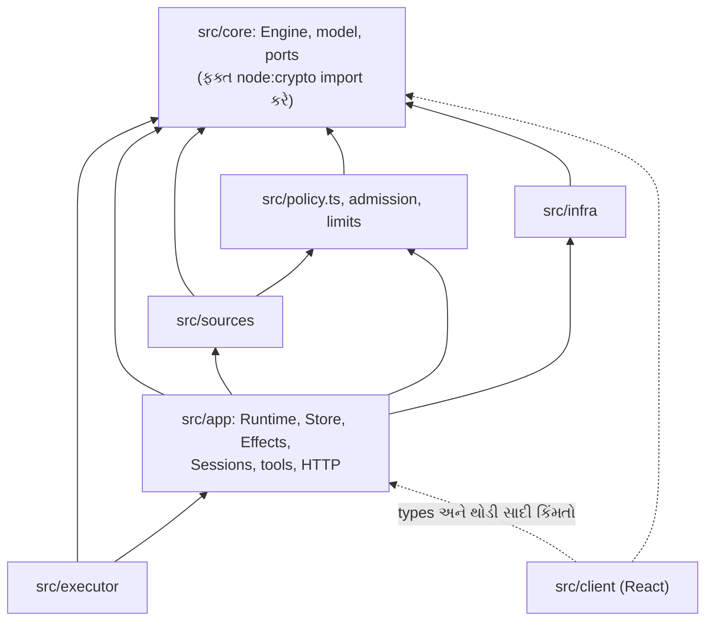

# પ્રકરણ 13 — Advanced engineering: અગાસી પરથી ઘર

> **Level 13 · વાર્તાનો દિવસ 14.**
> આજે કોઈ નવો ઓરડો નથી. આજે ઉપરથી જોવાનું છે: ઘર આ રીતે કેમ બંધાયું, ક્યાં મજબૂત છે, અને ક્યાં જાણીજોઈને કાચું રાખ્યું છે.
> પહેલાં: [પ્રકરણ 12](12-customization.md).

## 🎯 આ પ્રકરણ પછી તમે શું કરી શકશો

- આ repository ને આઠ દૃષ્ટિકોણથી તપાસી શકશો: dependency direction, transactional consistency, concurrency, cancellation, recovery, observability, context/model ખર્ચ, અને performance.
- એક workload ને ફેરફાર **પહેલાં અને પછી** માપી શકશો, અને માપ પરથી પ્રામાણિક નિર્ણય લઈ શકશો.
- Review description સાથે એક કેન્દ્રિત contribution તૈયાર કરી શકશો.

**નવા શબ્દો:** **dependency direction** (કોણ કોને import કરે છે તેની દિશા), **serializable** (commands એક પછી એક ચાલ્યા હોય તેવું પરિણામ), **observability** (બહારથી જોઈને અંદરની સ્થિતિ જાણી શકવી), **fsync** (operating system ને કહેવું કે data ખરેખર disk પર ઉતારે), **bottleneck** (આખી system ની ઝડપ નક્કી કરતો સૌથી સાંકડો ભાગ).

## 🗺️ નકશો: કોણ કોના પર ટેકે છે



"A → B" એટલે A, B ને import કરે છે. બધાં સળંગ તીર **અંદરની તરફ**, `core` તરફ જાય છે. ટપકાંવાળાં તીર ફક્ત types અને થોડી સાદી કિંમતો છે.

---

## દૃશ્ય 1 — પાયો કોઈના પર ટેકતો નથી

🎬 અગાસી પરથી મીરાદીદી આંગળી ચીંધે છે: "રસોડાની દીવાલ ડેસ્કના ઓરડા પર ટેકે છે. ડેસ્કનો ઓરડો પાયા પર. પાયો? કોઈના પર નહીં. છોટુ બદલાય, જશુભાઈ બદલાય, પાટિયું નવું આવે: પાયાને ખબર પણ ન પડે." આરવ: "એ તો તું કહે છે. સાબિતી?"

❓ "Dependency ની દિશા ખરેખર ચકાસી શકાય?"

💻 🧪 Pinned commit પર grep:

- `src/core/*.ts` ના બધા imports core ની અંદરના છે, ઉપરાંત ફક્ત `node:crypto` ([`ids.ts`][ids-key] નો hash).
- `src/sources/*.ts` માંથી કોઈ `../app` import નથી કરતું.
- `src/client` host બાજુથી `app/api.ts` (types અને filter યાદીઓ), `setup.ts`, `sources/kind.ts`, `limits.ts`, `sources/host.ts`, `core/errors.ts`, `core/stage.ts`, `core/reasons.ts`, `navigation.ts` અને `admission.ts` import કરે છે. આ [docs/007][doc-arch] ની મંજૂર યાદી સાથે મળે છે. એક ફરક: `core/stage.ts` docs ની યાદીમાં નથી; client તેને ફક્ત type તરીકે લે છે.

**એક ચક્ર:** `src/executor/dsh.ts` `../app/effects.ts` અને `../app/sessions.ts` import કરે છે, અને `src/app/runtime.ts` executor ને. Module સ્તરે આ cycle છે; runtime પર getters ([`rt-getter`][rt-getter]) તેને તોડે છે ([પ્રકરણ 3](03-startup.md)). ✅

Core બહારની દુનિયા સાથે ફક્ત [ports][ports-executor] વડે વાત કરે છે, અને દરેક ભાગીદારને Engine નો ફક્ત તેનો ભાગ મળે છે ([`engine-roles`][engine-roles]).

🔬 **Expert નજર.** Dependency direction એ architecture નો સૌથી ચકાસી શકાય તેવો ગુણ છે: `grep` જૂઠું નથી બોલતું. "અંદર તરફ" નો નિયમ નક્કી કરે છે કે **શું બદલવું સસ્તું છે**: બહારના થર (Source, panel, Executor) બદલવા સસ્તા, કારણ કે કોઈ તેમના પર ટેકતું નથી. Core બદલવું મોંઘું, કારણ કે બધું તેના પર ટેકે છે, એટલે core માં સૌથી ઓછી, સૌથી સ્થિર વસ્તુઓ હોવી જોઈએ. Executor ↔ app નું ચક્ર એક પ્રામાણિક ડાઘ છે, અને docs તેને છુપાવતું નથી.

## દૃશ્ય 2 — એક પછી એક: ઉતાવળ વગરની ચોકસાઈ

🎬 આરવ: "સવિતાબેન એક સમયે એક જ ચિઠ્ઠી નોંધે છે. દસ હાથ હોત તો દસ ગણું ઝડપી થાત." દીદી: "અને દસ હાથ એક જ પાના પર લખત. ઘરનો નિયમ: **નોંધ એક હાથે, દોડધામ ઘણા પગે.** ચોપડામાં લખવું એક પછી એક; બહારનું કામ (રજિસ્ટરમાં જવાબ, ચૂલા) સાથે-સાથે."

❓ "Node.js તો એક thread પર ચાલે છે. તો race ક્યાંથી આવે, અને ક્યાં-ક્યાં રોકી છે?"

💻 Race `await` ના બિંદુઓ પર આવે છે: ત્યાં બીજું કામ વચ્ચે ઘૂસી શકે. ઉપાયોનો સાર: ✅

| જોખમ | ઉપાય | જગ્યા |
|---|---|---|
| બે passes સાથે | `pumping` / `pumpAgain` (એક ચાલે, બીજો "ફરી એક વાર" નોંધે) | [`passes-pump`][passes-pump] |
| એક પાના પર બે Evals | `Thread.evaluating`; બાકી `pending` | [`evals-start`][evals-start] |
| છેલ્લો ચૂલો બે વાર | Synchronous `reserve`, `await` પહેલાં | [`dsh-slots`][dsh-slots] |
| Launch દરમિયાન stop / retry | દરેક `await` પછી `current()` | [`dsh-launch`][dsh-launch] |
| Effect ચાલતી વખતે નવો payload | `generation` | [`effects-attempt`][effects-attempt] |
| જૂનો settings save | Block revision + 409 | [`settings-save`][settings-save] |
| બે processes | Directory lock | [`rt-lock`][rt-lock] |

**Transaction ના નિયમો:**

- **Engine ની એક command = એક transaction** ([`engine-receive`][engine-receive], [`engine-decide`][engine-decide]). અપવાદ: [`evaluateDue`][engine-evaluatedue] દરેક Eval અને Ticket માટે અલગ transaction વાપરે, જેથી એકની નિષ્ફળતા બીજાને rollback ન કરે.
- **Effects અંદર, I/O બહાર** ([પ્રકરણ 8](08-store-effects-outbox.md)).
- **ધીમી તપાસ પછી ફરી વાંચો** (`Settings.save` revision બે વાર તપાસે).
- **Network read transaction ની બહાર** (`orchestrator_report`, [પ્રકરણ 9](09-tools-prompts-skills.md)).

**રદ કરવું (cancellation):** આખા જીવનકાળ માટે એક `AbortController` ([`rt-shutdown`][rt-shutdown]); commands, polls અને prepare તેને સાંભળે. Domain નો અંત → `afterCommit` → turn રદ. `keepInbox`: shutdown પર `true` (ચિઠ્ઠી સચવાય), Ticket stop પર `false`.

🧪 `pnpm vitest run tests/runtime-concurrency.spec.ts` પાસ.

🔬 **Expert નજર.** Engine **synchronous** છે, અને તે આખી ડિઝાઇનની ચાવી છે. Async હોત તો દરેક command ની વચ્ચે બીજી command ઘૂસી શકત, અને દરેક નિયમ ("આ Ticket ખુલ્લું છે, તો…") માટે lock કે ફરી-તપાસ જોઈત. Synchronous Engine + synchronous SQLite = commands **serializable**, મફતમાં. કિંમત: Engine ની અંદર કોઈ I/O નહીં, કદી નહીં. એ શિસ્ત ports (`void` પરત કરતા), Effects અને `afterCommit` વડે જળવાય છે. Concurrency ની બધી મુશ્કેલી **ધાર પર** (Executor, Sources) ધકેલાઈ છે, જ્યાં તે દેખાય છે અને test થઈ શકે છે.

## દૃશ્ય 3 — પડી જાય તો ઊભા થવાના છ રસ્તા

🎬 દીદી: "આ ઘરમાં છ પ્રકારની ઠોકર લાગી શકે. દરેક માટે ઊભા થવાની અલગ રીત છે. અને એક ઠોકર એવી છે જેમાં ઘર પોતે ઊભું નથી થઈ શકતું." આરવ: "કઈ?" "ઘર જ બેભાન થઈ જાય ત્યારે. એટલે બહાદુર **બહાર** રહે છે."

❓ "દરેક નિષ્ફળતાનો recovery ક્યાં છે?"

💻

| ઠોકર | ઊભા થવાની રીત | પ્રકરણ |
|---|---|---|
| Process restart | `executor.resume` → `assignmentInterrupted` → recovery note | [7](07-worker-execution.md) |
| Effect નિષ્ફળ | Backoff; rows SQLite માં ટકે | [8](08-store-effects-outbox.md) |
| Source poll નિષ્ફળ | પાના દીઠ `pollError`; cursor સચવાય | [4](04-sources-intake.md) |
| Eval timeout | 2 requeue → `unavailable` | [5](05-policy-eval.md) |
| Provider ની ક્ષણિક ભૂલ | 3 પ્રયત્ન | [7](07-worker-execution.md) |
| Process મૃત | **બહારની** કલાકદીઠ તપાસ ([`script-service`][script-service]) | [0A](00a-lekh-ane-prototype.md), [2](02-setup-operation.md) |

**Observability, જે છે:** ✅

- **Health:** દરેક entry નો એક માલિક; `GET state` → `status` → exit code.
- **કારણોના codes:** દરેક Decision માં `reason` ([`REASONS`][reasons-table]).
- **Dispositions:** દરેક ચિઠ્ઠીનો હિસાબ.
- **ઇતિહાસ:** settings ના તફાવત; Session દીઠ prompt આવૃત્તિઓ.

**Observability, જે નથી:** metrics કે tracing (latency, token ગણતરી) નથી. [docs/007][doc-arch] કહે છે કે domain events ([`ports-events`][ports-events], [`rt-emit`][rt-emit]) ના મોટા ભાગના હજી કોઈ ગ્રાહક નથી. 📝 **સૂચન:** `emit` પર એક counter: સૌથી નાનો ઉપયોગી ફેરફાર.

🔬 **Expert નજર.** [લેખ](00a-lekh-ane-prototype.md) "Watchdog" ની વાત કરે છે: એક સ્વતંત્ર agent જે router ને તપાસે, નિદાન કરે, સુધારે. Prototype માં તેનું **સૌથી નાનું રૂપ** છે: કલાકે એક વાર `status`, અને ફક્ત જાણ. નિદાન કે સુધારો નહીં. આ ફરક છુપાવવા જેવો નથી, સમજવા જેવો છે: prototype બતાવે છે કે વિચારનો **કયો ભાગ સસ્તો** છે (બહારથી જીવતું છે કે નહીં તે જોવું) અને કયો મોંઘો (આપમેળે સુધારવું). મૂળ સિદ્ધાંત બંનેમાં સરખો: **જોનાર, જેને જુએ છે તેનાથી સ્વતંત્ર હોવો જોઈએ.**

## દૃશ્ય 4 — મહારાજનો સમય સૌથી મોંઘો છે

🎬 મહિનાના અંતે મુનીમજી ખર્ચ વાંચે છે. શાકભાજી, ગેસ, પગાર. અને એક લીટી જે બધાથી મોટી છે: "મહારાજનો વિચારવાનો સમય." આરવ: "તો ઘર આખું મહારાજને ઓછું પૂછવા માટે બંધાયું છે?" દીદી સ્મિત કરે છે: "હવે તું ઘર સમજ્યો."

❓ "Model calls અને context ક્યાં-ક્યાં બચાવાય છે?"

💻 **Model calls ની બચત:** ✅

1. **Gate deterministic:** bots, અજાણ્યા, બોલાવ્યા વગરના: મોટા ભાગની ચિઠ્ઠી model સુધી પહોંચતી જ નથી ([પ્રકરણ 5](05-policy-eval.md)).
2. **Explicit માટે assessment નહીં:** ફક્ત routing.
3. **Pass-through:** follow-ups main Session ના નિર્ણય વગર સીધા ટુકડીને ([પ્રકરણ 6](06-tickets-assignments.md)).
4. **Batching:** પાના દીઠ `pending` થોકડો.

**Context ની બચત:**

- Inline & Spill ની મર્યાદાઓ ([`assess-limits`][assess-limits], [`text-limits`][text-limits]): કામનો સંદેશ 1500 અક્ષર, ચિઠ્ઠી 600, routing નોંધ ≤ 30 શબ્દ, IM ≤ 100 શબ્દ.
- દરેક role ની સૂચનાઓનું કદ test વડે બંધાયેલું ([પ્રકરણ 9](09-tools-prompts-skills.md)).
- Policy છેલ્લે, જેથી prompt નો આગળનો ભાગ સ્થિર રહે અને cache થાય.

> ⚠️ **લેખનો આંકડો, અમારો નહીં.** [લેખ](00a-lekh-ane-prototype.md) કહે છે કે pass-through વગર cache-read tokens લગભગ 37% વધ્યા, અને router ની એક request 2.5–3.9 s લે છે. અમે આમાંથી કશું માપ્યું નથી (model અને DSH વગર માપી શકાય તેમ નથી).

🔬 **Expert નજર.** LLM system માં ખર્ચનું એકમ CPU cycle નથી; **token** છે, અને latency નું એકમ millisecond નથી; **model call** છે (seconds). એટલે optimization નો પહેલો સવાલ "આ code ઝડપી કેમ કરું?" નથી. તે છે: "આ model call **ટાળી** શકાય?" Deterministic gate, explicit માટે સીધું routing અને pass-through, ત્રણેય એ સવાલના જવાબ છે. આગલું દૃશ્ય એ જ પાઠ આંકડાથી બતાવે છે.

## દૃશ્ય 5 — આરવ ચોપડો ઝડપી કરે છે, અને શીખે છે કે તે ધીમો નહોતો

🎬 આરવને એક વિચાર આવે છે: "મુનીમજી દરેક લીટી પછી શાહી સુકાય તેની રાહ જુએ છે (`synchronous=FULL`). રાહ ન જુએ તો?" તે માપે છે. ચોપડો ખરેખર **બમણો ઝડપી** થાય છે. તે દોડીને દીદી પાસે જાય છે. દીદી બે સવાલ પૂછે છે: "પહેલાં એક ચિઠ્ઠી નોંધતાં કેટલી વાર લાગતી હતી?" "એક millisecond." "અને મહારાજ એક ચિઠ્ઠી પર કેટલું વિચારે છે?" આરવ ચૂપ. "ત્રણ seconds."

❓ "માપ કેવી રીતે લીધું, અને તેના પરથી શું નક્કી કરવું?"

💻 **Workload** ([`labs/intake-bench.ts`](../labs/intake-bench.ts)): ખરો SQLite `Store` + ખરું `Engine`. 2000 ચિઠ્ઠી, 200 પાનાં પર `receive`; પછી એક `evaluateDue` (200 Evals). Assessor, Executor અને Outbox ખાલી નકલી.

```bash
node --no-warnings --experimental-transform-types bench/intake-bench.ts 2000 FULL
```

(Node 22 નો strip-only mode TypeScript ની parameter properties નથી ચલાવતો, એટલે `--experimental-transform-types`.)

**ફેરફાર:** `PRAGMA synchronous=FULL` ([default][store-open]) → `NORMAL`, benchmark માં runtime પર.

🧪 **પરિણામ** (આ environment: 4 vCPU Linux container; વારાફરતી છ runs):

| Run | synchronous | receive 2000 (ms) | ms / ચિઠ્ઠી | evaluateDue, 200 Evals (ms) |
|---|---|---|---|---|
| 1 | FULL | 2046 | 1.023 | 366 |
| 2 | NORMAL | 819 | 0.410 | 198 |
| 3 | FULL | 1690 | 0.845 | 267 |
| 4 | NORMAL | 1000 | 0.500 | 280 |
| 5 | FULL | 2336 | 1.168 | 442 |
| 6 | NORMAL | 895 | 0.447 | 254 |

**વિશ્લેષણ:**

- `NORMAL` આશરે **2× ઝડપી** (મધ્યક 0.45 સામે 1.02 ms / ચિઠ્ઠી). દરેક `receive` એક transaction છે, અને `FULL` દરેક commit પર fsync કરે છે.
- **પણ** GitHub Source દર 60 s poll કરે છે. 1 ms / ચિઠ્ઠી પર મિનિટે સેંકડો ચિઠ્ઠી સહેલાઈથી સમાય. Bottleneck model છે, SQLite નહીં.
- **નિર્ણય: `FULL` રાખો.** `NORMAL` માં વીજળી જાય તો છેલ્લા commits ખોવાઈ શકે, જ્યારે Source ની દોરી આગળ ખસી ચૂકી હોય ([પ્રકરણ 8](08-store-effects-outbox.md)).
- **માપની મર્યાદા:** container નું I/O machine પ્રમાણે બદલાય; ફેલાવો મોટો છે (FULL માં 1690–2336 ms). છ runs આંકડાશાસ્ત્ર નથી, દિશા છે.

🔬 **Expert નજર.** આ પ્રકરણનો સૌથી મહત્વનો પાઠ: **"2× ઝડપી" એ સિદ્ધિ નથી, જો તે bottleneck પર ન હોય.** Amdahl નો નિયમ: system ની ઝડપ તેના સૌથી ધીમા ફરજિયાત ભાગથી બંધાયેલી છે. અહીં 1 ms ને 0.5 ms કરવાથી 3000 ms ની પ્રક્રિયા 2999.5 ms થાય, અને બદલામાં durability ની ખાતરી જાય. સારો engineer માપે છે; ઉત્તમ engineer માપીને **ફેરફાર ન કરવાનો** નિર્ણય લઈ શકે છે, અને તે નિર્ણય લખી રાખે છે.

## દૃશ્ય 6 — ફેરફાર મોકલવો: કાગળ પર સમજાવવું

🎬 આરવને [પ્રકરણ 12](12-customization.md) નો ટાંકેલા mention વાળો ફેરફાર મૂળ ઘરના માલિકોને મોકલવો છે. તે patch જોડીને લખે છે: "bug સુધારી." દીદી કાગળ પાછો આપે છે: "વાંચનાર પાસે તારા જેટલો સંદર્ભ નથી. ચાર વાત લખ: **સમસ્યા, ફેરફાર, વર્તનમાં શું બદલાશે, અને કેવી રીતે ચકાસ્યું.**"

❓ "સારું review description કેવું હોય?"

💻 Patch 12.5 માટે (📝 સૂચિત; અમે upstream ને મોકલ્યું **નથી**):

```markdown
## Quoted mentions do not address the agent on GitHub

**Problem.** A GitHub reply that quotes an earlier comment (`> @agent …`) is recorded as `addressed: 'mention'`, so a
listed person's "Thanks!" under a quote becomes an explicit candidate for the main Session. docs/002 says the Source
records whether a message addresses the agent, and prompts/admission.md says quoted instructions alone do not authorize work.

**Change.** `mentions()` in src/sources/github-trigger.ts looks for the mention only in the author's own words: without
`>` quoted lines, fenced code blocks and inline code (`ownWords`). The Trigger text is unchanged.

**Behaviour change.** A mention written only inside code no longer addresses the agent. Feishu is unaffected.

**Tests.** tests/quoted-mention.spec.ts (fails before the change, passes after); docs/007 test table updated.
`pnpm check`: 61 files, 1199 tests passed, build complete (with the feishu consumer test fix noted separately).
```

**Architecture review ની યાદી** ([પ્રકરણ 14](14-antim-project.md) માં વપરાશે):

1. Domain નો નિયમ core માં છે, glue માં નહીં?
2. દરેક state નો એક જ લખનાર છે?
3. Side effects enqueue થાય છે? Transaction ની અંદર I/O તો નથી?
4. ના પાડવાનાં કારણો `UserError` codes છે, અને બંને ભાષામાં લખાણ છે?
5. Docs, tests અને `docs/007` નાં કોષ્ટકો સાથે અપડેટ થયાં?
6. ફક્ત prompt પર ટકેલી ખાતરી ક્યાં છે, અને તેનું જોખમ શું?

🔬 **Expert નજર.** Review description નો વાચક ભવિષ્યનો maintainer પણ છે, જે `git blame` વડે અહીં પહોંચશે અને પૂછશે: "આ કેમ કર્યું હતું?" "વર્તનમાં ફેરફાર" નો ફકરો સૌથી વધુ અવગણાય છે અને સૌથી કિંમતી છે: તે સ્વીકારે છે કે દરેક fix કોઈક માટે નવું વર્તન છે. છઠ્ઠો સવાલ LLM systems માટે ખાસ છે: દરેક PR માં પૂછો, "આ ખાતરી code આપે છે કે prompt?"

---

## Source map

| દૃષ્ટિકોણ | ક્યાં જોવું |
|---|---|
| Dependency direction | [docs/007][doc-arch]; `src/core/ports.ts` |
| Transactions | [`Engine`][engine-class], [`Store.atomic`][store-atomic] |
| Concurrency | [`Passes.pump`][passes-pump], [`WorkerSlots`][dsh-slots], [`Effects.attempt`][effects-attempt] |
| Cancellation | [`rt-shutdown`][rt-shutdown], [`DshExecutor.stop`][dsh-stop] |
| Recovery | [`resume`][dsh-resume], [`interrupted`][assign-interrupted] |
| Observability | [`REASONS`][reasons-table], [`ports-events`][ports-events] |
| ખર્ચ | [`assess-limits`][assess-limits], [`policy-gate`][policy-gate] |
| Performance | [`store-open`][store-open], [`labs/intake-bench.ts`](../labs/intake-bench.ts) |

## 🧪 Lab

Benchmark જાતે ચલાવો (રીત: [labs/README](../labs/README.md)), `FULL` અને `NORMAL` વારાફરતી, ઓછામાં ઓછી ત્રણ-ત્રણ વાર. તમારા આંકડા નોંધો. તે અમારા આંકડાથી અલગ હશે; **ગુણોત્તર** અને **નિર્ણય** સરખાવો.

પછી dependency grep જાતે કરો:

```bash
grep -rhoE "from '[^']+'" src/core/*.ts | sort | uniq -c | sort -rn
```

🧪 **અવલોકન:** બધા imports `./…` (core ની અંદર) અથવા `node:crypto`.

## 🔮 આગાહી કસોટી

Workload બદલો: દરેક પાના પર એક ખુલ્લું Ticket (ટેગ) હોય. `receive` ઝડપી થશે, ધીમું, કે સરખું? (ધારો. ⚠️ **અમે આ માપ્યું નથી.** Source વાંચન પરથી અનુમાન: ધીમું, કારણ કે [`Intake.receive`][intake-fanout] દરેક ટેગ માટે Ticket row વાંચે છે અને Input ઉમેરે છે. તમે માપો, અને તમારું પરિણામ નોંધો.)

## 🩺 નિષ્ફળતા: "મેં core માં એક `await` ઉમેર્યો, અને હવે tests ક્યારેક નિષ્ફળ જાય છે"

**નિદાન:** Engine ની command હવે અડધેથી બીજી command ને વચ્ચે આવવા દે છે; `atomic` નું `operation` synchronous હોવું જોઈએ. **ઉપાય:** I/O ને command ની બહાર લઈ જાઓ: પહેલાં વાંચો (async), પછી એક synchronous atomic block (દૃશ્ય 2 ના નિયમો). **Regression test:** `tests/core-engine.spec.ts`, `tests/store.spec.ts`.

<a id="saar"></a>

## ✅ સાર

| દૃષ્ટિકોણ | ઘરનો જવાબ | કાચી જગ્યા |
|---|---|---|
| Dependency | બધું core તરફ; core કોઈ તરફ નહીં | Executor ↔ app ચક્ર |
| Consistency | Command = transaction; I/O બહાર | (કોઈ નહીં, domain માટે) |
| Concurrency | Synchronous Engine; ધાર પર guards | ધારના guards હાથે લખેલા |
| Cancellation | `afterCommit`; એક lifetime signal | Worker નાં shell કામ |
| Recovery | છ રીત; બહારનો ચોકીદાર | આપમેળે સુધારો નથી |
| Observability | Health, reasons, dispositions | Metrics, tracing નથી |
| ખર્ચ | Gate, pass-through, cache-મૈત્રી prompt | અમે માપ્યું નથી |
| Performance | 1 ms / ચિઠ્ઠી; bottleneck model | Retention નથી |

**યાદ-ચાવી "માપો, પછી ન બદલો":** 2× ઝડપ, bottleneck પર ન હોય તો, ખોટનો સોદો.

<details><summary>કાર્ડ 1: Engine async હોત તો કઈ ખાતરી તૂટત?</summary>

Commands નું serializable હોવું. બે commands વચ્ચે-વચ્ચે ચાલત, અને દરેક નિયમને lock કે ફરી-તપાસ જોઈત. `DatabaseSync` અને synchronous `atomic` પણ શક્ય ન રહેત.
</details>

<details><summary>કાર્ડ 2: `evaluateDue` અનેક transactions કેમ વાપરે?</summary>

એક Eval કે Ticket ની નિષ્ફળતા બાકીનાંને rollback ન કરે. દરેક એકમ સ્વતંત્ર રીતે સફળ કે નિષ્ફળ.
</details>

**મિત્રને સમજાવો:** "ઘરનો પાયો કોઈ પર ટેકતો નથી. નોંધ એક હાથે, દોડધામ ઘણા પગે. અને રસોડું ઝડપી કરતાં પહેલાં જુઓ કે ગ્રાહક ખરેખર રસોડાની રાહ જુએ છે કે મહારાજની."

## 🧠 Mastery check

1. Engine synchronous કેમ છે? Async હોત તો કઈ ખાતરીઓ તૂટે?
2. `evaluateDue` એક ને બદલે અનેક transactions કેમ વાપરે?
3. Benchmark નો 2× સુધારો production માં કેમ મહત્વનો નથી?
4. Observability માં સૌથી મોટી ખોટ કઈ, અને સૌથી નાનો ઉપયોગી ફેરફાર કયો?

જવાબો: [પરિશિષ્ટ D](../appendix/D-lab-solutions.md#પ્રકરણ-13).

## 🎬 આગળ શું

છેલ્લો દિવસ. વેકેશન પૂરું થાય છે. પપ્પા આરવને એક કોરો કાગળ આપે છે: "કાલે તું જાય છે. જતાં પહેલાં, અલકાબેનના README વાળા ઓર્ડરની આખી કહાની લખ: ચિઠ્ઠીથી છેલ્લા જવાબ સુધી. પછી ઘરમાં **એક** સુધારો કર, અને સાબિત કર કે તે કામ કરે છે." → [પ્રકરણ 14](14-antim-project.md).

<!-- citations:begin (generated by tools/refdefs.py) -->
[assess-limits]: https://github.com/deepseek-ai/dsh-superagent-prototype/blob/8c32a9dc5d72c033816c6a8110b37f40cf94fba4/src/app/assessment.ts#L37
[assign-interrupted]: https://github.com/deepseek-ai/dsh-superagent-prototype/blob/8c32a9dc5d72c033816c6a8110b37f40cf94fba4/src/core/assignments.ts#L83-L92
[doc-arch]: https://github.com/deepseek-ai/dsh-superagent-prototype/blob/8c32a9dc5d72c033816c6a8110b37f40cf94fba4/docs/007-architecture.md#L1-L10
[dsh-launch]: https://github.com/deepseek-ai/dsh-superagent-prototype/blob/8c32a9dc5d72c033816c6a8110b37f40cf94fba4/src/executor/dsh.ts#L424-L470
[dsh-resume]: https://github.com/deepseek-ai/dsh-superagent-prototype/blob/8c32a9dc5d72c033816c6a8110b37f40cf94fba4/src/executor/dsh.ts#L524-L537
[dsh-slots]: https://github.com/deepseek-ai/dsh-superagent-prototype/blob/8c32a9dc5d72c033816c6a8110b37f40cf94fba4/src/executor/dsh.ts#L171-L199
[dsh-stop]: https://github.com/deepseek-ai/dsh-superagent-prototype/blob/8c32a9dc5d72c033816c6a8110b37f40cf94fba4/src/executor/dsh.ts#L357-L370
[effects-attempt]: https://github.com/deepseek-ai/dsh-superagent-prototype/blob/8c32a9dc5d72c033816c6a8110b37f40cf94fba4/src/app/effects.ts#L130-L146
[engine-class]: https://github.com/deepseek-ai/dsh-superagent-prototype/blob/8c32a9dc5d72c033816c6a8110b37f40cf94fba4/src/core/engine.ts#L24-L38
[engine-decide]: https://github.com/deepseek-ai/dsh-superagent-prototype/blob/8c32a9dc5d72c033816c6a8110b37f40cf94fba4/src/core/engine.ts#L100
[engine-evaluatedue]: https://github.com/deepseek-ai/dsh-superagent-prototype/blob/8c32a9dc5d72c033816c6a8110b37f40cf94fba4/src/core/engine.ts#L75-L85
[engine-receive]: https://github.com/deepseek-ai/dsh-superagent-prototype/blob/8c32a9dc5d72c033816c6a8110b37f40cf94fba4/src/core/engine.ts#L48
[engine-roles]: https://github.com/deepseek-ai/dsh-superagent-prototype/blob/8c32a9dc5d72c033816c6a8110b37f40cf94fba4/src/core/engine.ts#L261-L270
[evals-start]: https://github.com/deepseek-ai/dsh-superagent-prototype/blob/8c32a9dc5d72c033816c6a8110b37f40cf94fba4/src/core/evals.ts#L71-L119
[ids-key]: https://github.com/deepseek-ai/dsh-superagent-prototype/blob/8c32a9dc5d72c033816c6a8110b37f40cf94fba4/src/core/ids.ts#L3-L5
[intake-fanout]: https://github.com/deepseek-ai/dsh-superagent-prototype/blob/8c32a9dc5d72c033816c6a8110b37f40cf94fba4/src/core/intake.ts#L38-L46
[passes-pump]: https://github.com/deepseek-ai/dsh-superagent-prototype/blob/8c32a9dc5d72c033816c6a8110b37f40cf94fba4/src/app/passes.ts#L56-L68
[policy-gate]: https://github.com/deepseek-ai/dsh-superagent-prototype/blob/8c32a9dc5d72c033816c6a8110b37f40cf94fba4/src/policy.ts#L191-L211
[ports-events]: https://github.com/deepseek-ai/dsh-superagent-prototype/blob/8c32a9dc5d72c033816c6a8110b37f40cf94fba4/src/core/ports.ts#L86-L102
[ports-executor]: https://github.com/deepseek-ai/dsh-superagent-prototype/blob/8c32a9dc5d72c033816c6a8110b37f40cf94fba4/src/core/ports.ts#L59-L69
[reasons-table]: https://github.com/deepseek-ai/dsh-superagent-prototype/blob/8c32a9dc5d72c033816c6a8110b37f40cf94fba4/src/core/reasons.ts#L5-L26
[rt-emit]: https://github.com/deepseek-ai/dsh-superagent-prototype/blob/8c32a9dc5d72c033816c6a8110b37f40cf94fba4/src/app/runtime.ts#L138-L153
[rt-getter]: https://github.com/deepseek-ai/dsh-superagent-prototype/blob/8c32a9dc5d72c033816c6a8110b37f40cf94fba4/src/app/runtime.ts#L128-L130
[rt-lock]: https://github.com/deepseek-ai/dsh-superagent-prototype/blob/8c32a9dc5d72c033816c6a8110b37f40cf94fba4/src/app/runtime.ts#L90-L98
[rt-shutdown]: https://github.com/deepseek-ai/dsh-superagent-prototype/blob/8c32a9dc5d72c033816c6a8110b37f40cf94fba4/src/app/runtime.ts#L229-L253
[script-service]: https://github.com/deepseek-ai/dsh-superagent-prototype/blob/8c32a9dc5d72c033816c6a8110b37f40cf94fba4/scripts/dsh-superagent#L1-L8
[settings-save]: https://github.com/deepseek-ai/dsh-superagent-prototype/blob/8c32a9dc5d72c033816c6a8110b37f40cf94fba4/src/app/settings.ts#L148-L196
[store-atomic]: https://github.com/deepseek-ai/dsh-superagent-prototype/blob/8c32a9dc5d72c033816c6a8110b37f40cf94fba4/src/app/store.ts#L140-L153
[store-open]: https://github.com/deepseek-ai/dsh-superagent-prototype/blob/8c32a9dc5d72c033816c6a8110b37f40cf94fba4/src/app/store.ts#L58-L101
[text-limits]: https://github.com/deepseek-ai/dsh-superagent-prototype/blob/8c32a9dc5d72c033816c6a8110b37f40cf94fba4/src/infra/text.ts#L3-L4
<!-- citations:end -->
