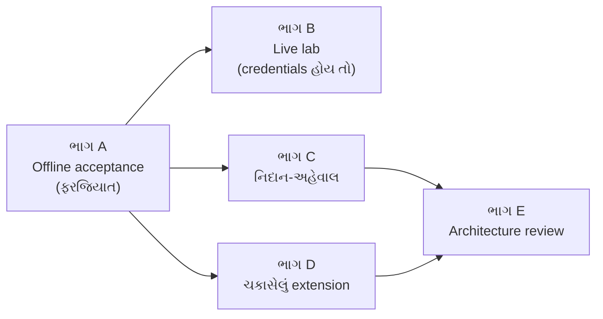

# પ્રકરણ 14 — અંતિમ project: આરવનો છેલ્લો દિવસ

> **Level 14 · વાર્તાનો દિવસ 15.**
> એક ઓર્ડરની આખી કહાની, એક નિદાન, એક ચકાસેલો સુધારો, અને ઘરનું એક પાનાનું મૂલ્યાંકન. આ પ્રકરણ શીખવતું નથી; તે **તમારી પાસે કરાવે છે**.
> પહેલાં: [પ્રકરણ 13](13-advanced-engineering.md). મૂલ્યાંકન: [પરિશિષ્ટ E (rubric)](../appendix/E-mastery-rubric.md).

## 🎯 આ project પછી તમારી પાસે શું હશે

- `demo-org/widgets` માટે એક **નિયંત્રિત** GitHub coding bot નું offline પ્રદર્શન: admission, Ticket, execution, checks, reporting, follow-ups, stop અને recovery સાથે.
- એક સ્વતંત્ર નિદાન-અહેવાલ.
- Red → green test સાથેનું એક extension.
- એક પાનાનું architecture review.

"નિયંત્રિત" એટલે [docs/000][doc-philosophy] ની જવાબદારીના ત્રણ નિયમ: **સાંકડું શરૂ કરો** (યાદીમાં એક માણસ, `observe` mode), **ઘોંઘાટ ઘટાડતા જાઓ**, અને **જે બોલો તેની જવાબદારી લો**.

## 🗺️ નકશો: project ના પાંચ ભાગ



A બધાનો પાયો છે. B વૈકલ્પિક છે (DSH, model provider અને GitHub accounts જોઈએ). C અને D સ્વતંત્ર છે; E બંનેના અનુભવ પર ઊભું છે.

---

## દૃશ્ય 1 — ભાગ A: એક ઓર્ડરની આખી કહાની, કાગળ પર

🎬 આરવ કોરા કાગળ પર અલકાબેનના ઓર્ડરની કહાની લખવા બેસે છે. દીદી: "લખ નહીં. **ચલાવ.** કહાની એવી લખ કે મશીન તેને વાંચીને કહી શકે: સાચી કે ખોટી." આરવ સમજે છે: કહાની એક test છે.

❓ "કયો test આખી કહાની કહે છે, અને દરેક માગણીની સાબિતી ક્યાં છે?"

💻 🧪 [`labs/running-example.spec.ts`](../labs/running-example.spec.ts) તમારો acceptance test છે: ખરું Engine, ખરી Policy, ખરા GitHub Trigger builders; નકલી Executor, Assessor અને Outbox. દરેક પગલાની જોયેલી સ્થિતિ [`evidence/running-example.log.json`](../evidence/running-example.log.json) માં.

| માગણી | પગલું | સાબિતી (log માં) |
|---|---|---|
| Admission (explicit) | A | `A_evalStarted.strength = explicit`, basis `via: addressed` |
| Ticket creation, atomic | A | `A_accepted`: `outbox: [acknowledgement]`, `launches: 1`, `thread7.subscriptions: 1` |
| Duplicate | B | `duplicate`; સ્થિતિ અકબંધ |
| અનધિકૃત | C, D | #8 પર `not_a_member`; #7 પર ટુકડીને fan-out, સત્તા વગર |
| Follow-up | E | નવો Decision નહીં; `undelivered: 2` |
| નિષ્ફળતા + માણસની રાહ | F | `person/failed`; bot input held; retry → `retried` |
| Recovery | G | `hostRestarted` + recovery નોંધ; `working/queued` |
| Stop | H, I | mallory: `ignore / stopNotExplicit`; alice: `stop`, `ended.by: human` |
| Stop પછી resume નહીં | J | `fanout: []`; ચિઠ્ઠી Eval માં |

**તમારું કામ:** કહાનીને **ready → PR merge** સુધી લંબાવો. પગલાં: નવું Ticket સ્વીકારો → `assignmentStarted` → `engine.bindThread(ticketId, { source: 'github', id: '12' }, true)` → `engine.report(ticketId, { state: 'ready', … })` → Ticket હજી ખુલ્લું (`person/review`) → `engine.threadClosed({ source: 'github', id: '12' }, 'merged', at)` → `ended.outcome = 'merged'`.

ઉકેલ: [`labs/final-project.spec.ts`](../labs/final-project.spec.ts). 🧪 `1 passed`. નિયમ: [`followsDone`][tickets-followsdone] ([પ્રકરણ 6, દૃશ્ય 6](06-tickets-assignments.md)).

🔬 **Expert નજર.** આ test કહાનીના **નિયમો** ચકાસે છે, ખરી દુનિયા નહીં: અહીં કોઈ model વિચારતો નથી, કોઈ worker code લખતો નથી, GitHub પર કશું જતું નથી. તે જાણીજોઈને છે. Domain ના નિયમો (કોણ માગી શકે, ક્યારે retry, ક્યારે resume) deterministic છે અને milliseconds માં ચકાસી શકાય. Model નું વર્તન non-deterministic છે અને તેને અલગ રીતે (live lab, evals) ચકાસવું પડે. **જે ચકાસી શકાય તેને સસ્તામાં ચકાસો, અને બાકીનાને પ્રામાણિકપણે "અચકાસાયેલું" કહો.**

## દૃશ્ય 2 — ભાગ B: ખરા રસોડામાં (જો ચાવી હોય તો)

🎬 આરવ: "કાગળ પરની કહાની બરાબર. પણ ખરા ચૂલા પર?" દીદી: "તે માટે ત્રણ ચાવી જોઈએ: DSH, મહારાજ (model provider), અને રજિસ્ટરમાં ડેસ્કનું પોતાનું ખાતું. તારી પાસે છે?" આરવ પાસે નથી. "તો યોજના લખ, અને જ્યારે ચાવી મળે ત્યારે ચલાવજે. અને **લખજે કે ચલાવી નથી**."

❓ "Live પ્રદર્શનનાં પગલાં કયાં, અને દરેકમાં શું જોવાનું?"

💻 > ⚠️ **અચકાસાયેલું.** આ આખો ભાગ અમે ચલાવ્યો નથી. પગલાં repository ના docs ([setup][setup-md], [docs/006][doc-deploy]) પરથી છે.

1. **Setup** ([પ્રકરણ 2](02-setup-operation.md)): profile, port 3082, `stateDir`, `gh-agent` wrapper (agent account `widgets-agent`), repository `demo-org/widgets`, allowed `alice`, mode `observe`, prepare command (worktree).
2. **Delivery requirements** team section: "Run `pnpm install && pnpm check` before marking ready; include the command output summary in the PR. Never enable auto-merge."
3. **પ્રદર્શન:**

| # | ક્રિયા | જોવાનું |
|---|---|---|
| 1 | alice: Issue "@widgets-agent READMEમાં setup instructions સુધારો અને જરૂરી checks ચલાવો." | લગભગ એક મિનિટમાં: Overview પર Ticket; Issue પર સ્વીકૃતિ-comment |
| 2 | એ જ Issue ફરી poll થાય | Trigger tab: એક જ Trigger |
| 3 | mallory: બીજી Issue પર `@widgets-agent …` | Eval tab: `ignore`, યાદીમાં નથી |
| 4 | alice: "lint પણ ચલાવજો" | પાનું: "Delivered to Ticket"; Decision નથી |
| 5 | Worker: branch `agent/readme-setup-…`, PR, checks | PR Ticket સાથે જોડાય; "Awaiting review" |
| 6 | Prepare command તોડીને નવું Ticket | "Failed"; સુધાર્યા પછી **Retry** |
| 7 | Worker કામમાં હોય ત્યારે `scripts/dsh-superagent restart` | જૂની પાળી "restarted"; recovery નોંધ સાથે નવી |
| 8 | alice: "@widgets-agent stop", અથવા panel નું Stop | "Stopped by a person"; પછીની ચિઠ્ઠી resume નથી કરતી |
| 9 | PR merge | Ticket "Pull request merged" |

4. દરેક પગલા પછી `scripts/dsh-superagent status` → exit 0.

🔬 **Expert નજર.** Live પ્રદર્શનની સ્ક્રિપ્ટમાં "શું કરવું" જેટલું જ મહત્વનું "**શું જોવાનું**" છે. અપેક્ષા પહેલેથી લખી ન હોય તો જે કંઈ થાય તે "બરાબર લાગે". પગલાં 6 અને 7 જાણીજોઈને નિષ્ફળતા ઊભી કરે છે: જે system નું ફક્ત સુખી રસ્તે પ્રદર્શન થયું છે, તેના વિશે તમે અડધું જ જાણો છો.

## દૃશ્ય 3 — ભાગ C: નિદાન-અહેવાલ

🎬 પપ્પા એક કોયડો આપે છે: "ધાર કે અલકાબેનનો ઓર્ડર ચાલુ છે, અને હું તેમને યાદીમાંથી કાઢી નાખું છું. પછી તે લખે છે 'બંધ કરો'. શું થશે? અને મારે ખરેખર રોકવો હોય તો?"

❓ "પરિણામ શું, અને ચાર 'કેમ' ના જવાબ ક્યાં છે?"

💻 🧪 [પ્રકરણ 11 ના lab](11-debugging.md) નું પરિણામ: `{ kind: 'ignore', strength: 'inferred', reason: [{ code: 'stopNotExplicit' }] }`.

તમારો અહેવાલ ચાર સવાલના જવાબ આપે, દરેક code ના સંદર્ભ સાથે:

1. Gate એ alice ને `followup` + `inferred` કેમ આપ્યું? ([`gate`][policy-gate] ની follow-up શાખા)
2. Stop ને `explicit` કેમ જોઈએ? ([`evals-stop`][evals-stop])
3. ચાલુ Ticket ને [`policyEffects`][policy-effects] કયો Input આપશે? (`requesterAllowed: false`)
4. Operator Ticket રોકવા શું કરી શકે? (Panel નું Stop: [`Engine.stopTicket`][engine-stop], Eval અને gate વગર.)

નમૂનાનો અહેવાલ: [પરિશિષ્ટ D](../appendix/D-lab-solutions.md#પ્રકરણ-14).

🔬 **Expert નજર.** સારો નિદાન-અહેવાલ "શું થયું" પર અટકતો નથી. તે ત્રણ સ્તર આપે છે: **શું** (જોયેલું પરિણામ), **કેમ** (code ની કઈ લીટી), અને **તો શું** (operator માટે પગલું). ચોથો સવાલ એ "તો શું" છે, અને તે બતાવે છે કે ડિઝાઇનમાં છટકબારી પહેલેથી છે: નિયમો ચિઠ્ઠીને ના પાડે, પણ માલિકના હાથમાં હંમેશાં બટન છે.

## દૃશ્ય 4 — ભાગ D: એક સુધારો, સાબિતી સાથે

🎬 "હવે ઘરમાં એક સુધારો," પપ્પા કહે છે. આરવ પાસે ટાંકેલા mention વાળો તૈયાર છે. દીદી: "એ ચાલે. પણ તારો પોતાનો વધુ સારો. શરત ચાર છે."

❓ "Extension સ્વીકારવાની શરતો કઈ?"

💻 [પ્રકરણ 12, દૃશ્ય 5](12-customization.md) નો ફેરફાર, અથવા તમારો પોતાનો, આ ચાર શરતે:

| શરત | કેવી રીતે બતાવવી |
|---|---|
| Red → green | Fix વગર test નો નિષ્ફળ output, અને fix સાથે પાસ output |
| Docs અપડેટ | `docs/007` ના test કોષ્ટકમાં row (નહીં તો `docs.spec.ts` અટકાવશે) |
| `pnpm check` પાસ | Flaky Feishu consumer test ની નોંધ સાથે ([પ્રકરણ 12, દૃશ્ય 6](12-customization.md)) |
| Review description | ચાર ફકરા ([પ્રકરણ 13, દૃશ્ય 6](13-advanced-engineering.md)) |

**વિચારો (📝 સૂચિત; અમે આમાંથી એકેય બનાવ્યું નથી):**

- `transient` માં તમારા provider નું ભૂલ-લખાણ.
- Domain events પર એક counter ([પ્રકરણ 13, દૃશ્ય 3](13-advanced-engineering.md)).
- `orchestrator_read` માં નવો resource.
- Issue body edit વડે ઉમેરાયેલું mention પકડવું (સાવધાન: id ની ડિઝાઇન બદલાય, [પ્રકરણ 4](04-sources-intake.md)).

🔬 **Expert નજર.** નાનો, પૂરો ફેરફાર મોટા, અધૂરા ફેરફાર કરતાં વધુ કહે છે. Reviewer એક વાક્યમાં સમજી શકે તેવો ફેરફાર પસંદ કરો. છેલ્લો વિચાર (body edit) જાણીજોઈને યાદીમાં છે: તે લલચામણો છે, પણ content-derived id ની આખી ખાતરીને અડે છે. તેના વિશે **design note લખવી**, code લખ્યા વગર, પણ એક માન્ય extension છે.

## દૃશ્ય 5 — ભાગ E: ઘરનું એક પાનાનું મૂલ્યાંકન

🎬 છેલ્લી સાંજ. પપ્પા: "પંદર દિવસ તું આ ઘરમાં રહ્યો. હવે મને કહે, એક પાનામાં: ઘર ક્યાં મજબૂત છે, ક્યાં કાચું, અને તું પહેલું શું સુધારે?" આરવ લખવા બેસે છે. પહેલી લીટી: "ઘર સારું છે." તે છેકી નાખે છે. વખાણ મૂલ્યાંકન નથી.

❓ "Review માં ઓછામાં ઓછું શું આવરવું?"

💻 [પ્રકરણ 13 ની યાદી](13-advanced-engineering.md) વાપરો. ઓછામાં ઓછા આ ત્રણ મુદ્દા:

1. **ફક્ત prompt પર ટકેલી ખાતરી.** Restart પછી worker બહારનાં કામ (git push, PR comment) ફરી ન કરે તેની ખાતરી ફક્ત recovery નોંધ આપે છે ([પ્રકરણ 8, દૃશ્ય 5](08-store-effects-outbox.md)). 📝 દિશા: `orchestrator_report` સાથે "બહારના કામની પાવતી" નોંધવી.
2. **અલગતા (isolation).** Worker `danger-full-access` સાથે, operator ના OS user તરીકે ચાલે છે ([`sessions-presets`][sessions-presets]). [docs/006][doc-deploy]: wrappers "do not isolate the process". [લેખ](00a-lekh-ane-prototype.md) નું "credentials વાપરો, જોયા વગર" અહીં આંશિક જ છે.
3. **અમર્યાદિત storage.** કશું delete નથી થતું ([પ્રકરણ 8, દૃશ્ય 6](08-store-effects-outbox.md)). Retention ની ડિઝાઇન: કયા records, ક્યારે, કોની જવાબદારી.

નમૂનાનું review: [પરિશિષ્ટ D](../appendix/D-lab-solutions.md#પ્રકરણ-14).

🔬 **Expert નજર.** Architecture review નો હેતુ દોષ કાઢવાનો નથી; **trade-offs ને દૃશ્યમાન કરવાનો** છે. ત્રણેય મુદ્દા prototype ની "ભૂલો" નથી: તે જાણીજોઈને લીધેલા નિર્ણયો છે, અને docs તેમને સ્વીકારે છે. સારું review કહે છે: "આ નિર્ણય આ સંદર્ભમાં સાચો છે; આ બીજા સંદર્ભમાં (production, ઘણા users, સંવેદનશીલ data) તે આ કારણે તૂટે; અને ત્યાં પહોંચવાનું પહેલું પગલું આ છે."

---

## Source map

| ભાગ | ફાઇલો |
|---|---|
| A | [`labs/running-example.spec.ts`](../labs/running-example.spec.ts), [`labs/final-project.spec.ts`](../labs/final-project.spec.ts), [`evidence/`](../evidence/running-example.log.json) |
| B | [`docs/setup.md`][setup-md], [docs/006][doc-deploy] |
| C | `src/policy.ts` ([gate][policy-gate], [effects][policy-effects]), `src/core/evals.ts` ([stop][evals-stop]) |
| D | [`labs/patches/`](../labs/patches/) |
| E | [docs/007][doc-arch], [docs/000][doc-philosophy] |

## 🧪 Lab

```bash
pnpm vitest run tests/running-example.spec.ts tests/final-project.spec.ts
```

🧪 **અવલોકન:** બંને પાસ (files ને પહેલાં upstream `tests/` માં નકલ કરો; [labs/README](../labs/README.md)).

## 🔮 આગાહી કસોટી

ભાગ A ના વિસ્તારમાં `bindThread` ને `report(ready)` **પછી** બોલાવો તો? (ધારો. ⚠️ **અમે આ ક્રમ ચલાવ્યો નથી.** Source વાંચન પરથી અનુમાન: `ready` રિપોર્ટ વખતે કાર્ડ કોઈ PR ને follow નથી કરતું, એટલે તે `completed` તરીકે બંધ થાય, અને પછીનું `bindThread` બંધ કાર્ડ પર આવે. ચલાવો, અને તમારું પરિણામ નોંધો.)

## 🩺 નિષ્ફળતા: "મારો acceptance test પાસ છે, પણ live માં કશું થતું નથી"

**નિદાન:** Offline test Source, model અને Executor ને બાયપાસ કરે છે. Live માં ક્રમથી તપાસો: (1) `status` → કઈ health entry લાલ? (2) Trigger tab → ચિઠ્ઠી આવી? (3) Eval tab → નિર્ણય અને કારણ? (4) Execution → stage? દરેક પગલું [પ્રકરણ 11](11-debugging.md) ની એક ફરિયાદ સાથે જોડાય છે.

<a id="saar"></a>

## ✅ સાર

| ભાગ | તમે શું સાબિત કરો છો |
|---|---|
| A | તમે domain ના નિયમો test તરીકે વ્યક્ત કરી શકો છો |
| B | તમે system ચલાવી શકો છો, અને નિષ્ફળતા જાણીજોઈને ઊભી કરી શકો છો |
| C | તમે વર્તનને code ની લીટી સુધી સમજાવી શકો છો |
| D | તમે સાચા સ્તરે, સાબિતી સાથે ફેરફાર કરી શકો છો |
| E | તમે trade-offs જોઈ અને લખી શકો છો |

<details><summary>કાર્ડ 1: પ્રદર્શનના પગલા 4 માં Decision કેમ નથી?</summary>

Follow-up ટેગવાળા પાના પર છે, અને તેની માલિક ટુકડી છે. તે સીધો ટુકડીને જાય છે (pass-through); Eval થતું નથી.
</details>

<details><summary>કાર્ડ 2: પગલા 9 પહેલાં `ready` રિપોર્ટ છતાં Ticket કેમ ખુલ્લું?</summary>

Ticket એ PR ખોલ્યો છે (`follows`, `own`). `followsDone` ખોટું છે જ્યાં સુધી PR બંધ ન થાય. "પૂરું" દુનિયા કહે છે, worker નહીં.
</details>

## 🧠 Mastery check

1. પ્રદર્શનના પગલા 4 માં Decision કેમ નથી?
2. પગલા 7 માં કઈ પાળીઓ ફરી શરૂ થશે, અને કઈ નહીં?
3. પગલા 9 પહેલાં worker `ready` રિપોર્ટ કરે તો Ticket કેમ પૂરું નથી થતું?

જવાબો: [પરિશિષ્ટ D](../appendix/D-lab-solutions.md#પ્રકરણ-14). તમારું સ્તર: [પરિશિષ્ટ E](../appendix/E-mastery-rubric.md).

## 🎬 આગળ શું

આરવ બેગ બાંધે છે. પપ્પા દરવાજે ઊભા રહીને છેલ્લો સવાલ પૂછે છે, જે પંદર દિવસથી તેમના મનમાં છે: "બેટા, આ બધું થાળીના ઓર્ડર માટે છે. પણ મારો હિસાબ-કિતાબ, ખરીદી, પગાર? ત્યાં તો દરેક કામમાં કોઈકની **સહી** જોઈએ, અને એક નહીં, ત્રણ વિભાગની. આ ઘર તે સંભાળી શકે?" → [પ્રકરણ 15](15-aagal-no-rasto.md).

<!-- citations:begin (generated by tools/refdefs.py) -->
[doc-arch]: https://github.com/deepseek-ai/dsh-superagent-prototype/blob/8c32a9dc5d72c033816c6a8110b37f40cf94fba4/docs/007-architecture.md#L1-L10
[doc-deploy]: https://github.com/deepseek-ai/dsh-superagent-prototype/blob/8c32a9dc5d72c033816c6a8110b37f40cf94fba4/docs/006-deployment.md#L1-L12
[doc-philosophy]: https://github.com/deepseek-ai/dsh-superagent-prototype/blob/8c32a9dc5d72c033816c6a8110b37f40cf94fba4/docs/000-philosophy.md#L1-L10
[engine-stop]: https://github.com/deepseek-ai/dsh-superagent-prototype/blob/8c32a9dc5d72c033816c6a8110b37f40cf94fba4/src/core/engine.ts#L160
[evals-stop]: https://github.com/deepseek-ai/dsh-superagent-prototype/blob/8c32a9dc5d72c033816c6a8110b37f40cf94fba4/src/core/evals.ts#L293-L302
[policy-effects]: https://github.com/deepseek-ai/dsh-superagent-prototype/blob/8c32a9dc5d72c033816c6a8110b37f40cf94fba4/src/policy.ts#L144-L165
[policy-gate]: https://github.com/deepseek-ai/dsh-superagent-prototype/blob/8c32a9dc5d72c033816c6a8110b37f40cf94fba4/src/policy.ts#L191-L211
[sessions-presets]: https://github.com/deepseek-ai/dsh-superagent-prototype/blob/8c32a9dc5d72c033816c6a8110b37f40cf94fba4/src/app/sessions.ts#L48
[setup-md]: https://github.com/deepseek-ai/dsh-superagent-prototype/blob/8c32a9dc5d72c033816c6a8110b37f40cf94fba4/SETUP.md#L1-L12
[tickets-followsdone]: https://github.com/deepseek-ai/dsh-superagent-prototype/blob/8c32a9dc5d72c033816c6a8110b37f40cf94fba4/src/core/tickets.ts#L95-L101
<!-- citations:end -->
