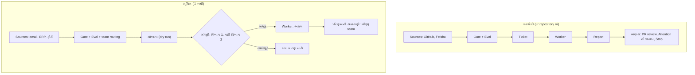
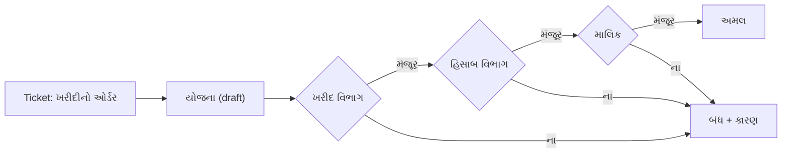

# પ્રકરણ 15 — આગળનો રસ્તો: થાળી ઘરથી આખી પેઢી સુધી

> **ઉપસંહાર · વેકેશન પછી.**
> પપ્પાનો સવાલ: "આ ઘર હિસાબ, ખરીદી અને પગાર જેવાં કામ સંભાળી શકે, જ્યાં દરેક પગલે સહી જોઈએ અને ઘણા વિભાગ ભાગ લે?" આ પ્રકરણ એક **ડિઝાઇન-ચર્ચા** છે, તૈયાર ઉકેલ નહીં.
> પહેલાં: [પ્રકરણ 14](14-antim-project.md).

> ⚠️ **આ આખું પ્રકરણ 📝 સૂચિત (Proposed) છે.** અહીં વર્ણવેલું કશું repository માં નથી, અને અમે તેમાંથી કશું બનાવ્યું કે ચલાવ્યું નથી. જ્યાં "આજે છે" લખ્યું છે ત્યાં ✅ source નો સંદર્ભ છે; બાકીનું બધું વિચાર છે, જેને તમારે જાતે ડિઝાઇન, બનાવવું અને ચકાસવું પડે.

## 🎯 આ પ્રકરણ પછી તમે શું કરી શકશો

- Prototype ને 24×7 ચલાવવા શું જોઈએ, અને તે ક્યાં સુધી ટકે, તે પ્રામાણિકપણે કહી શકશો.
- GitHub સિવાયના કામ (ERP, હિસાબ, back-office) માટે કયા ભાગ **જેમ છે તેમ** વપરાય અને કયા બદલવા પડે તે અલગ પાડી શકશો.
- માણસની મંજૂરીનો થર (approval layer) અને ઘણી teams વાળું routing ક્યાં બેસે તેની ડિઝાઇન દોરી શકશો.
- આવી system ના જોખમો નામ દઈને કહી શકશો.

**નવા શબ્દો:** **approval gate** (કામ આગળ વધે તે પહેલાં માણસની મંજૂરી માગતું પગલું), **separation of duties** (જે માગે તે મંજૂર ન કરે; જે મંજૂર કરે તે અમલ ન કરે), **dry run** (કામનું પરિણામ બતાવવું, અમલ કર્યા વગર), **audit trail** (કોણે, ક્યારે, શું, કોની મંજૂરીથી કર્યું તેની ન બદલી શકાય તેવી નોંધ).

## 🗺️ નકશો: આજનું ઘર અને આવતી કાલની પેઢી

ઉપરનું ખોખું આજનો પ્રવાહ છે: માણસ **અંતે** આવે છે (PR ચાખે છે). નીચેનું ખોખું સૂચિત પ્રવાહ છે: માણસ **અમલ પહેલાં** પણ આવે છે (યોજના મંજૂર કરે), અને એક નહીં પણ ઘણા વિભાગ.

---

## દૃશ્ય 1 — ચોવીસ કલાક, સાતેય દિવસ

🎬 પપ્પા: "પહેલી વાત. આ ઘર રાત્રે પણ ચાલવું જોઈએ. હું cloud માં એક computer ભાડે લઈ શકું. પછી?" આરવ: "પછી પાંચ વસ્તુ. Computer, ઘર, ત્રણ ચાવી, ચોકીદાર, અને ચોપડાની નકલ."

❓ "24×7 માટે આજે શું છે, અને શું તમારે ઉમેરવું પડે?"

💻

| જરૂરિયાત | આજે છે (✅) | તમારે કરવાનું (📝 / ⚠️) |
|---|---|---|
| Process ચાલુ રાખવો | `scripts/dsh-superagent` (start, stop, restart, status; [`script-service`][script-service]) | Reboot પછી આપોઆપ શરૂ (systemd unit) ⚠️ |
| ત્રણ ચાવી | Setup ([`setup.md`][setup-md]): DSH, model provider, agent નું GitHub ખાતું | ચાવીઓ સુરક્ષિત રાખવી; agent માટે **અલગ**, ઓછી સત્તાવાળું ખાતું |
| ચોકીદાર | કલાકદીઠ બહારની તપાસ ([પ્રકરણ 2](02-setup-operation.md)) | ચેતવણી તમારા ફોન સુધી પહોંચાડવી ⚠️ |
| ચોપડાની નકલ | State directory એક folder છે ([પ્રકરણ 8](08-store-effects-outbox.md)) | નિયમિત backup; upgrade પહેલાં નકલ ⚠️ |
| પાટિયું દૂરથી | ફક્ત loopback ([પ્રકરણ 10](10-panel.md)) | SSH tunnel; panel ને internet પર **ખુલ્લું ન મૂકો** |

> ⚠️ અમે prototype ને cloud VM પર, કે ક્યાંય પણ live, ચલાવ્યું નથી. ઉપરની જમણી કોલમ સામાન્ય operations ની સમજ છે, ચકાસેલી રીત નહીં.

**ક્યાં સુધી ટકે:** એક process, એક machine, કશું delete નથી થતું ([docs/007][doc-arch]). નાની team અને મધ્યમ ભાર માટે ઠીક; તેનાથી આગળ retention અને scaling તમારું કામ.

🔬 **Expert નજર.** 24×7 નો અર્થ "કદી બંધ ન થાય" નથી; કશું એવું નથી. અર્થ છે: **બંધ થાય ત્યારે ખબર પડે, ચાલુ થાય ત્યારે કશું ન ખોવાય.** Prototype બીજા ભાગમાં મજબૂત છે (durable effects, recovery; [પ્રકરણ 7](07-worker-execution.md)–[8](08-store-effects-outbox.md)). પહેલો ભાગ અડધો છે: તપાસ છે, પણ તે તમને જગાડતી નથી. અને યાદ રાખો કે worker `danger-full-access` સાથે ચાલે છે ([પ્રકરણ 14, દૃશ્ય 5](14-antim-project.md)): VM પર બીજું કશું કિંમતી ન રાખો.

## દૃશ્ય 2 — GitHub નહીં, હિસાબનો ચોપડો

🎬 પપ્પા: "બીજી વાત. મારું કામ code નથી. મારું કામ: બિલ આવે, તેને ચોપડે ચડાવવું, ચુકવણીની યાદી બનાવવી. ERP માં." આરવ ઘરના દરેક ભાગ પર આંગળી મૂકે છે અને પૂછે છે: "આ ભાગ 'થાળી' જાણે છે, કે ફક્ત 'ઓર્ડર'?"

❓ "કયા ભાગ કામના પ્રકારથી સ્વતંત્ર છે, અને કયા GitHub સાથે બંધાયેલા છે?"

💻

| ભાગ | GitHub સાથે બંધાયેલો? | ERP / back-office માટે |
|---|---|---|
| Core (Trigger, Eval, Ticket, Assignment) | **ના** (✅ `src/core` ફક્ત `node:crypto` import કરે; [પ્રકરણ 13](13-advanced-engineering.md)) | જેમ છે તેમ |
| Gate, Policy, modes | ના ([`policy-gate`][policy-gate]) | જેમ છે તેમ; નિયમો તમારા |
| Store, Effects, Outbox | ના | જેમ છે તેમ |
| Source | હા: GitHub, Feishu | **નવો Source** ([`SourceKind`][kind-source]; 🧪 simulated નમૂનો [પ્રકરણ 12, દૃશ્ય 3](12-customization.md)) |
| "પૂરું" ની વ્યાખ્યા | હા: PR merge / close ([`followsDone`][tickets-followsdone]) | **નવી**: ERP માં entry "posted"? ચુકવણી "approved"? |
| Workspace | હા: git worktree, prepare command | Prepare command તમારો; worktree ને બદલે કામનું folder |
| Worker ના prompts અને skills | હા: `gh` CLI | **નવા** skills: તમારી ERP ના CLI કે API |

**સૌથી મોટો ફરક:** code માં ભૂલ **ઉલટાવી શકાય** (PR બંધ કરો). ચુકવણી મોકલાઈ ગઈ હોય તો નહીં. એટલે:

- Worker ને ERP માં **લખવાની** સીધી સત્તા ન આપો. તેને **draft** બનાવવા દો (journal entry નો મુસદ્દો, ચુકવણીની **સૂચિત** યાદી), અને અમલ માણસની મંજૂરી પછી.
- Mode `observe` થી શરૂ કરો ([પ્રકરણ 5, દૃશ્ય 4](05-policy-eval.md)), અઠવાડિયાંઓ સુધી.

🔬 **Expert નજર.** Coding agent નું સૌથી મોટું છૂપું સુરક્ષા-જાળું **git** છે: દરેક ફેરફાર diff તરીકે દેખાય, review થાય, અને revert થાય. Back-office માં તે જાળું નથી. એટલે "generalize" કરતી વખતે પહેલો સવાલ "કયો Source?" નથી. તે છે: **"મારા domain નો PR શું છે?"** એટલે કે એવી કઈ વસ્તુ છે જે worker બનાવે, માણસ ચાખે, અને મંજૂર થયા પછી જ દુનિયાને અડે? તે વસ્તુ વગર આ architecture તમારા domain માં સલામત નથી.

## દૃશ્ય 3 — સહીનો થર: અમલ પહેલાં મંજૂરી

🎬 પપ્પા: "ત્રીજી વાત. મારા ઘરમાં બેન ઓર્ડર લે, ટુકડી રાંધે. પણ પેઢીમાં: બેન કામ સમજે, પછી **મેનેજર સહી કરે**, પછી જ ટુકડી હાથ લગાડે. એ થર ક્યાં બેસે?" આરવ વિચારે છે: આજના ઘરમાં માણસ ક્યાં-ક્યાં આવે છે?

❓ "આજે માણસની ભૂમિકા કઈ છે, અને 'અમલ પહેલાં મંજૂરી' માટે શું ખૂટે છે?"

💻 **આજે માણસ ચાર જગ્યાએ છે** (✅):

| જગ્યા | ક્યારે | Code |
|---|---|---|
| માગનાર | શરૂઆતમાં | [`gate`][policy-gate]: યાદી + સીધું બોલાવ્યાં |
| જવાબ આપનાર | ટુકડી પૂછે ત્યારે | [`Attention`][model-attention]: `human_action`, `question_for_trigger_id` |
| ચાખનાર | અંતે | PR review; [`followsDone`][tickets-followsdone] |
| રોકનાર | ગમે ત્યારે | Stop ([`Engine.stopTicket`][engine-stop]) |

**ખૂટે છે:** Eval અને launch **વચ્ચે** ફરજિયાત મંજૂરી. આજે accept થાય કે તરત `Tickets.create` `executor.start` બોલાવે છે ([`tickets-create`][tickets-create]).

**📝 ત્રણ રસ્તા, સસ્તાથી મોંઘા:**

| રસ્તો | કેવી રીતે | ખાતરી કોણ આપે | નબળાઈ |
|---|---|---|---|
| **1. શબ્દોથી** | Team section: "પહેલાં યોજના લખો, `human_action` વડે મંજૂરી માગો, 'હા' મળે પછી જ અમલ" | **Prompt** (model) | Model ભૂલી શકે. ઉલટાવી ન શકાય તેવાં કામ માટે **અપૂરતું** |
| **2. બે Tickets થી** | પહેલું Ticket ફક્ત યોજના / draft બનાવે (worker પાસે લખવાની ચાવી જ નથી). મંજૂરી આપનાર માણસ **બીજી** explicit ચિઠ્ઠી લખે: "અમલ કરો". બીજું Ticket, બીજો પરવાનો | **Gate** (code): બીજી ચિઠ્ઠી યાદીવાળા માણસની, સીધી બોલાવેલી | મંજૂર કરનારની યાદી અને માગનારની યાદી આજે એક જ છે |
| **3. Core માં નવી અવસ્થા** | Ticket માં `awaitingApproval`; `executor.start` મંજૂરીના Decision પછી જ | **Engine** (code) | Core ફેરફાર: model, stage, panel, tests, docs. મોટું કામ |

**ભલામણ:** રસ્તો 2 થી શરૂ કરો. તે આજના code સાથે, ફક્ત settings અને prompts વડે, શક્ય **લાગે છે** (⚠️ અમે તેને ચલાવ્યું નથી), અને તેની ખાતરી gate આપે છે, model નહીં. ચાવીરૂપ વાત: **યોજના બનાવનાર worker પાસે અમલની ચાવી ન હોય.** Credentials ની હદ account wrappers વડે ([docs/006][doc-deploy]).

🔬 **Expert નજર.** [પ્રકરણ 9](09-tools-prompts-skills.md) નો પાઠ અહીં નિર્ણાયક છે: **prompt સલાહ છે, code કાયદો છે.** "મંજૂરી વગર અમલ ન કરો" જો ફક્ત prompt માં હોય, તો તે મંજૂરી નથી, આશા છે. સાચી approval gate ની કસોટી: *model ગમે તે કરે, મંજૂરી વગર અમલ અશક્ય છે?* રસ્તો 2 માં જવાબ "હા" છે, જો ચાવીઓ અલગ હોય. આ **separation of duties** છે, જે હિસાબની દુનિયા સદીઓથી જાણે છે: લખનાર, મંજૂર કરનાર અને ચૂકવનાર ત્રણ અલગ હાથ.

## દૃશ્ય 4 — ત્રણ વિભાગ, એક ઓર્ડર

🎬 પપ્પા: "ચોથી વાત, અને સૌથી અઘરી. એક ખરીદીનો ઓર્ડર: ખરીદ વિભાગ ભાવ તપાસે, હિસાબ વિભાગ બજેટ જુએ, અને હું છેલ્લી સહી કરું. ટુકડી કામ પૂરું કરીને બેનને આપે, પણ બેન કોને બતાવે? ધંધો એક માણસથી નથી ચાલતો." આરવ ઘરમાં "વિભાગ" શોધે છે. નથી મળતો.

❓ "'Team' નો ખ્યાલ આજે ક્યાં છે, અને ઘણી teams માટે શું જોઈએ?"

💻 **આજે** (✅): "team" શબ્દ ફક્ત **prompt sections** માં છે ([`TEAM_SECTIONS`][prompts-teams]): આખા deployment માટે એક team. યાદી Source દીઠ એક છે ([`allowed`][policy-allowed]). નિયમો ([`rules`][policy-rules]) કામના **પ્રકાર** ઓળખે છે, વિભાગ નહીં.

**📝 ઘણી teams માટે ડિઝાઇનના ટુકડા:**

ડાબેથી જમણે એક ઓર્ડર ત્રણ મંજૂરીમાંથી પસાર થાય છે. કોઈ એક "ના" તેને કારણ સાથે બંધ કરે છે.

| ટુકડો | વિચાર | આજના code માં સૌથી નજીકનું |
|---|---|---|
| **ભૂમિકાઓ** | યાદીમાં દરેક માણસની ભૂમિકા: માગનાર, મંજૂર કરનાર (કયા વિભાગ માટે), જોનાર | `allowed: [{ id }]`: ફક્ત id; ભૂમિકા નથી |
| **Routing** | નિયમ નક્કી કરે કે કયા પ્રકારના કામને કયા વિભાગોની મંજૂરી, કયા ક્રમે | `rules`: પ્રકાર ઓળખે, અને તે Ticket ને સૂચના આપે |
| **મંજૂરીની ચિઠ્ઠી** | દરેક મંજૂરી એક Trigger: gate ચકાસે કે લખનાર તે વિભાગનો મંજૂર કરનાર છે | Gate + Disposition (દરેક ચિઠ્ઠીનો હિસાબ પહેલેથી છે) |
| **વિભાગ દીઠ વાતચીત** | દરેક વિભાગની પોતાની Channel; ડેસ્ક યોગ્ય Channel પર પૂછે | Outbox: Channel દીઠ ક્રમ; context-only ટેગ ([પ્રકરણ 6, દૃશ્ય 5](06-tickets-assignments.md)) |
| **પરિણામની ચકાસણી** | અમલ પછી **બીજી** team પરિણામ ચાખે | PR review નો નમૂનો |
| **Audit** | કોણે, ક્યારે, શું મંજૂર કર્યું | Decisions, Dispositions, settings ઇતિહાસ: કશું delete નથી થતું |

**સાદો પહેલો પ્રયોગ (📝, ⚠️ અચકાસાયેલો):** દરેક વિભાગ માટે **અલગ deployment** (અલગ state directory, અલગ યાદી, અલગ નિયમો), અને તેમની વચ્ચે એક વહેંચાયેલી જગ્યા (જેમ કે એક repository કે ટિકિટ-બોર્ડ) જ્યાં એક deployment નું પરિણામ બીજાની ચિઠ્ઠી બને. કોઈ core ફેરફાર નહીં; પણ સંકલન તમારે બહારથી ગોઠવવું પડે.

🔬 **Expert નજર.** ઘણી teams ની સમસ્યા technical ઓછી, **સંસ્થાકીય** વધુ છે: કોની સહી ક્યારે જોઈએ તે તમારી પેઢીના નિયમ છે, software ના નહીં. Software નું કામ તે નિયમોને **code માં લાગુ કરવાનું** અને **દરેક પગલાની નોંધ રાખવાનું** છે. સારા સમાચાર: prototype નાં બે સૌથી મજબૂત અંગ બરાબર તે માટે છે: deterministic gate ("કોણ") અને durable audit trail ("શું થયું"). ખરાબ સમાચાર: "ભૂમિકા" અને "ક્રમબદ્ધ મંજૂરી" core ના નવા ખ્યાલ છે, અને તેમને ઉમેરવા એ [પ્રકરણ 12](12-customization.md) ના નકશાના સૌથી નીચેના માળનું કામ છે.

## દૃશ્ય 5 — છેલ્લી સલાહ: ઘર ધીમે-ધીમે મોટું થાય

🎬 Station પર. ગાડી આવવાને પાંચ મિનિટ. પપ્પા: "તો ટૂંકમાં, ક્યાંથી શરૂ કરું?" આરવ પંદર દિવસ પહેલાં આ સવાલનો જવાબ "બધું એક સાથે" આપત. આજે તે કહે છે: "એક કામ. એક માણસ. ફક્ત જોવાનું. એક મહિનો."

❓ "અપનાવવાનો સલામત ક્રમ કયો, અને કયાં જોખમ નામ દઈને લખી રાખવાં?"

💻 **📝 સૂચિત ક્રમ:**

1. **એક સાંકડું, ઉલટાવી શકાય તેવું કામ** પસંદ કરો (જેમ કે બિલમાંથી entry નો **મુસદ્દો**; ચુકવણી નહીં).
2. **`observe` mode**, યાદીમાં એક માણસ ([docs/000][doc-philosophy]: start narrow).
3. "લીધું હોત" ની નોંધો અઠવાડિયાંઓ સુધી વાંચો; નિયમો સુધારો.
4. **`auto`** ફક્ત તે એક પ્રકાર માટે. Worker ફક્ત draft બનાવે.
5. મંજૂરીનો રસ્તો 2 (બે Tickets, અલગ ચાવી) ઉમેરો.
6. બીજો વિભાગ, બીજો કામનો પ્રકાર. દરેક વખતે પગલું 2 થી.

**જોખમો, નામ દઈને:**

| જોખમ | કેમ | ઘટાડવાની રીત |
|---|---|---|
| ઉલટાવી ન શકાય તેવો અમલ | Restart પછી બહારનું કામ બે વાર થઈ શકે (ખાતરી ફક્ત prompt-સ્તરે; [પ્રકરણ 8](08-store-effects-outbox.md)) | Worker ને અમલની ચાવી ન આપો; ERP બાજુ idempotency key |
| Prompt injection | બિલ, email, ચિઠ્ઠીનું લખાણ model ને છેતરી શકે | સત્તા gate માં (code); બહારનું લખાણ "data, સૂચના નહીં" ([docs/004][doc-prompts]); ઓછી સત્તાવાળી ચાવીઓ |
| અલગતા નથી | Worker operator ના user તરીકે, પૂરી સત્તા સાથે | અલગ machine / VM; તેના પર બીજું કશું કિંમતી નહીં |
| ગોપનીય data | હિસાબનો data model provider ને જાય | Provider ની શરતો; જરૂર હોય તો data છુપાવવો |
| ચોપડો વધતો જાય | કશું delete નથી થતું | Backup + retention ની યોજના |
| Prototype છે | "prototype" નામમાં જ છે; API અને schema બદલાઈ શકે | Commit pin કરો (આ પુસ્તકની જેમ); upgrade પહેલાં નકલ |

🔬 **Expert નજર.** [લેખ](00a-lekh-ane-prototype.md) નું શીર્ષક "Towards a More Autonomous Agent System" છે: **towards**, "તરફ". સ્વાયત્તતા એક મંજિલ નથી જ્યાં એક કૂદકે પહોંચાય; તે એક ઢાળ છે, અને દરેક પગથિયે તમે એક સવાલ પૂછો છો: *"આ પગથિયે ભૂલ થાય તો કેટલું નુકસાન, અને કોણ પકડે?"* જ્યાં જવાબ "થોડું, અને review માં પકડાય" હોય, ત્યાં agent ને છૂટ આપો. જ્યાં "ઘણું, અને કોઈ નહીં" હોય, ત્યાં માણસની સહી રાખો, અને તે સહી **code** માં લાગુ કરો. આ પુસ્તકમાં શીખેલી દરેક તરકીબ (deterministic gate, atomic state, durable effects, idempotency, observe mode) એ ઢાળ પર સલામત ચડવાનાં સાધન છે.

---

## Source map

| વિચાર | આજના code માં ક્યાંથી શરૂ કરવું |
|---|---|
| નવો Source | [`SourceKind`][kind-source], [docs/008][doc-cookbook], [`labs/demo-source.spec.ts`](../labs/demo-source.spec.ts) |
| માણસને સવાલ | [`Attention`][model-attention], [`orchestrator_report`][tools-report] |
| સત્તા | [`gate`][policy-gate], [`allowed`][policy-allowed], [docs/002][doc-auth] |
| "પૂરું" ની વ્યાખ્યા | [`followsDone`][tickets-followsdone], [`claimPull`][ghp-claim] |
| Audit | [`Disposition`][model-disposition], [`Decision`][model-decision] |
| Operations | [docs/006][doc-deploy], [`script-service`][script-service] |

## 🧪 Lab (કાગળ પર)

આ lab માં code નથી. એક પાનું લખો:

1. તમારા કામમાંથી **એક** પુનરાવર્તિત, ઉલટાવી શકાય તેવું કામ પસંદ કરો.
2. તેના માટે ભરો: Source કયો? ચિઠ્ઠી કેવી દેખાય? યાદીમાં કોણ? "તમારા domain નો PR" શું? "પૂરું" કોણ કહે?
3. દૃશ્ય 3 ના ત્રણ રસ્તામાંથી કયો, અને કેમ?
4. દૃશ્ય 5 ના જોખમ-કોષ્ટકમાં તમારા કિસ્સાની એક નવી row ઉમેરો.

નમૂનો: [પરિશિષ્ટ D](../appendix/D-lab-solutions.md#પ્રકરણ-15).

## 🔮 આગાહી કસોટી

તમે રસ્તો 1 (ફક્ત શબ્દોથી મંજૂરી) વાપરો છો. Worker ને યોજના પછી "હા" મળે તે પહેલાં host restart થાય છે, અને નવી પાળી recovery નોંધ સાથે શરૂ થાય છે. Worker મંજૂરીની રાહ જોશે? (⚠️ **જવાબ અજ્ઞાત છે, અને એ જ મુદ્દો છે.** તે model ના વર્તન પર આધાર રાખે છે; code તેની ખાતરી નથી આપતું. જે સવાલનો જવાબ "model પર આધાર રાખે છે" હોય, અને ભૂલ મોંઘી હોય, ત્યાં રસ્તો 1 પૂરતો નથી.)

## 🩺 નિષ્ફળતા: "Agent એ મંજૂરી વગર કામ કરી નાખ્યું"

**નિદાન:** મંજૂરી ક્યાં લાગુ હતી: prompt માં, કે code / ચાવીમાં? Worker પાસે અમલની ચાવી હતી? **ઉપાય:** ચાવી કાઢી લો. મંજૂરીને gate માંથી પસાર થતી અલગ ચિઠ્ઠી બનાવો (રસ્તો 2). Prompt ને વધુ કડક કરવું ઉપાય **નથી**.

## ✅ સાર

| પપ્પાનો સવાલ | ટૂંકો જવાબ | ખાતરીનું સ્તર |
|---|---|---|
| 24×7 ચાલે? | હા, એક machine પર; ચોકીદાર અને backup તમારાં | ⚠️ live અચકાસાયેલું |
| GitHub સિવાય? | Core સ્વતંત્ર; Source, "પૂરું" અને skills નવાં | 🧪 simulated Source; બાકી 📝 |
| અમલ પહેલાં સહી? | આજે નથી; બે Tickets + અલગ ચાવી થી શરૂ કરો | 📝 |
| ઘણા વિભાગ? | ભૂમિકા અને ક્રમબદ્ધ મંજૂરી core ના નવા ખ્યાલ | 📝 |
| ક્યાંથી શરૂ? | એક કામ, એક માણસ, `observe`, એક મહિનો | ✅ docs/000 નો સિદ્ધાંત |

**યાદ-ચાવી "મારા domain નો PR શું?":** જે વસ્તુ worker બનાવે, માણસ ચાખે, અને મંજૂરી પછી જ દુનિયાને અડે.

કાર્ડ 1: "મંજૂરી વગર અમલ ન કરો" prompt માં લખવું કેમ પૂરતું નથી?

Prompt સલાહ છે. Model ભૂલી શકે, ખોટું સમજી શકે, કે બહારના લખાણથી છેતરાઈ શકે. ખાતરી ત્યારે જ છે જ્યારે મંજૂરી વગર અમલ **અશક્ય** હોય: worker પાસે ચાવી ન હોય, અથવા Engine launch ન કરે.

કાર્ડ 2: Back-office માટે પહેલો સવાલ કયો?

"મારા domain નો PR શું છે?" Coding માં git diff + review એ સુરક્ષા-જાળું છે. તમારા કામમાં તેનો સમકક્ષ (draft, સૂચિત યાદી) ન હોય તો આ architecture સલામત નથી.

**મિત્રને સમજાવો:** "રસોઇયાને શાક સમારવા દો, પણ તિજોરીની ચાવી ન આપો. તે યાદી બનાવે, તમે સહી કરો, અને સહી પછી જ કોઈ બીજું પૈસા આપે."

## 🧠 Mastery check

1. Prototype ના કયા ભાગ કામના પ્રકારથી સ્વતંત્ર છે, અને તમે તે કેવી રીતે સાબિત કરો?
2. મંજૂરીના ત્રણ રસ્તામાં ખાતરી કોણ આપે છે (prompt, gate, Engine)?
3. "Separation of duties" ને આ architecture માં કઈ બે વસ્તુ વડે લાગુ કરી શકાય?
4. `observe` mode back-office માટે coding કરતાં વધુ મહત્વનો કેમ છે?

જવાબો: [પરિશિષ્ટ D](../appendix/D-lab-solutions.md#પ્રકરણ-15).

## 🎬 વાર્તાનો અંત

ગાડી ઊપડે છે. આરવ બારીમાંથી હાથ હલાવે છે. Platform પર પપ્પા ફોન કાઢે છે, પાટિયું ખોલે છે, પાંચ seconds જુએ છે, અને બંધ કરે છે. ત્રણ સવાલ, ત્રણ જવાબ: મારી જરૂર નથી; ઘર બરાબર ચાલે છે; અને જરૂર પડે તો દરેક ઓર્ડરની કહાની ચોપડામાં છે.

અન્નપૂર્ણા થાળી ઘરમાં ચૂલા ચાલુ છે.

**પુસ્તક અહીં પૂરું થાય છે. તમારું કામ અહીંથી શરૂ થાય છે:** [પરિશિષ્ટ E](../appendix/E-mastery-rubric.md) માં તમારું સ્તર તપાસો, [labs](../labs/README.md) ફરી ચલાવો, અને પછી [મૂળ repository](https://github.com/deepseek-ai/dsh-superagent-prototype/tree/8c32a9dc5d72c033816c6a8110b37f40cf94fba4) ખોલો, આ વખતે નકશા વગર.

<!-- citations:begin (generated by tools/refdefs.py) -->
[doc-arch]: https://github.com/deepseek-ai/dsh-superagent-prototype/blob/8c32a9dc5d72c033816c6a8110b37f40cf94fba4/docs/007-architecture.md#L1-L10
[doc-auth]: https://github.com/deepseek-ai/dsh-superagent-prototype/blob/8c32a9dc5d72c033816c6a8110b37f40cf94fba4/docs/002-authorization.md#L1-L12
[doc-cookbook]: https://github.com/deepseek-ai/dsh-superagent-prototype/blob/8c32a9dc5d72c033816c6a8110b37f40cf94fba4/docs/008-cookbook.md#L1-L10
[doc-deploy]: https://github.com/deepseek-ai/dsh-superagent-prototype/blob/8c32a9dc5d72c033816c6a8110b37f40cf94fba4/docs/006-deployment.md#L1-L12
[doc-philosophy]: https://github.com/deepseek-ai/dsh-superagent-prototype/blob/8c32a9dc5d72c033816c6a8110b37f40cf94fba4/docs/000-philosophy.md#L1-L10
[doc-prompts]: https://github.com/deepseek-ai/dsh-superagent-prototype/blob/8c32a9dc5d72c033816c6a8110b37f40cf94fba4/docs/004-prompts.md#L1-L12
[engine-stop]: https://github.com/deepseek-ai/dsh-superagent-prototype/blob/8c32a9dc5d72c033816c6a8110b37f40cf94fba4/src/core/engine.ts#L160
[ghp-claim]: https://github.com/deepseek-ai/dsh-superagent-prototype/blob/8c32a9dc5d72c033816c6a8110b37f40cf94fba4/src/sources/github-pull.ts#L35-L50
[kind-source]: https://github.com/deepseek-ai/dsh-superagent-prototype/blob/8c32a9dc5d72c033816c6a8110b37f40cf94fba4/src/sources/kind.ts#L85-L113
[model-attention]: https://github.com/deepseek-ai/dsh-superagent-prototype/blob/8c32a9dc5d72c033816c6a8110b37f40cf94fba4/src/core/model.ts#L275
[model-decision]: https://github.com/deepseek-ai/dsh-superagent-prototype/blob/8c32a9dc5d72c033816c6a8110b37f40cf94fba4/src/core/model.ts#L192-L209
[model-disposition]: https://github.com/deepseek-ai/dsh-superagent-prototype/blob/8c32a9dc5d72c033816c6a8110b37f40cf94fba4/src/core/model.ts#L42-L61
[policy-allowed]: https://github.com/deepseek-ai/dsh-superagent-prototype/blob/8c32a9dc5d72c033816c6a8110b37f40cf94fba4/src/policy.ts#L119-L121
[policy-gate]: https://github.com/deepseek-ai/dsh-superagent-prototype/blob/8c32a9dc5d72c033816c6a8110b37f40cf94fba4/src/policy.ts#L191-L211
[policy-rules]: https://github.com/deepseek-ai/dsh-superagent-prototype/blob/8c32a9dc5d72c033816c6a8110b37f40cf94fba4/src/policy.ts#L62-L65
[prompts-teams]: https://github.com/deepseek-ai/dsh-superagent-prototype/blob/8c32a9dc5d72c033816c6a8110b37f40cf94fba4/src/app/prompts.ts#L14
[script-service]: https://github.com/deepseek-ai/dsh-superagent-prototype/blob/8c32a9dc5d72c033816c6a8110b37f40cf94fba4/scripts/dsh-superagent#L1-L8
[setup-md]: https://github.com/deepseek-ai/dsh-superagent-prototype/blob/8c32a9dc5d72c033816c6a8110b37f40cf94fba4/SETUP.md#L1-L12
[tickets-create]: https://github.com/deepseek-ai/dsh-superagent-prototype/blob/8c32a9dc5d72c033816c6a8110b37f40cf94fba4/src/core/tickets.ts#L37-L56
[tickets-followsdone]: https://github.com/deepseek-ai/dsh-superagent-prototype/blob/8c32a9dc5d72c033816c6a8110b37f40cf94fba4/src/core/tickets.ts#L95-L101
[tools-report]: https://github.com/deepseek-ai/dsh-superagent-prototype/blob/8c32a9dc5d72c033816c6a8110b37f40cf94fba4/src/app/tools/executor.ts#L74-L103
<!-- citations:end -->
