# સમગ્ર નકશો — આખું પુસ્તક એક નજરે

> **આ પાનું પહેલાં વાંચો.** અહીં આખું પુસ્તક એક જ **વાર્તા** અને એક જ **નકશા** માં જોડાયેલું છે.
> વાર્તા અને technical અલગ નથી: અન્નપૂર્ણા થાળી ઘરના ઓર્ડર-ડેસ્ક પર જે **ઘટના** બને છે, તે જ dsh-superagent નો **નિયમ** છે, અને બંને એક જ કારણથી બન્યા છે.
> દરેક પ્રકરણ **દૃશ્યો** માં ચાલે છે, અને દરેક દૃશ્ય ચાર પગથિયાંમાં: 🎬 ઘટના → ❓ આરવનો પ્રશ્ન → 💻 code માં → 🔬 expert નજર. પછી 🧪 Lab → 🔮 આગાહી → 🩺 નિષ્ફળતા → ✅ સાર → 🧠 Mastery check → 🎬 આગળ શું.

## આ પાનું વાંચ્યા પછી તમે શું કરી શકશો

- સત્તર પ્રકરણો (0, 0A, 1–15) શેના વિશે છે અને કયા ક્રમમાં કેમ છે તે એક મિનિટમાં કહી શકશો.
- ભોજનાલયની એક-એક ઘટના પરથી dsh-superagent નો એક-એક નિયમ, અને તેનું કારણ, કહી શકશો.
- એક request ના **બાર સ્ટેશન** મોઢે બોલી શકશો.
- તમારા સ્તર પ્રમાણે વાંચવાનો માર્ગ પસંદ કરી શકશો.

---

## 1. એક વાક્યમાં આખું પુસ્તક

**dsh-superagent એ ભોજનાલયનો એવો "ઓર્ડર-ડેસ્ક" છે જે 24 કલાક ચિઠ્ઠીઓ વાંચે છે, દરવાજે તપાસે છે કે કોણ કામ માગી શકે, દરેક મંજૂર કામ માટે અલગ રસોઈ-ટુકડી અને અલગ ઓટલો ફાળવે છે, દરેક નિર્ણય પાકા ચોપડામાં લખે છે, અને શેઠને ફક્ત ત્યારે બોલાવે છે જ્યારે ખરેખર શેઠની જરૂર હોય.**

Repository ની પોતાની ભાષામાં: "take as little human attention as possible, and give as much value as possible" ([docs/000][doc-philosophy]). ✅

## 2. વાર્તા: 15 દિવસ, એક લગ્નસરા

[પહેલા પુસ્તક](https://github.com/vrajkher/DeepSeekHarnessBookNEW) માં **આરવ** ઉનાળાના 15 દિવસમાં DeepSeek Harness શીખ્યો: મહારાજ (AI model), રમેશભાઈ (agent loop), કોઠાર (tools), ઓર્ડર-ચોપડો (session log). હવે દિવાળીની રજા છે, અને લગ્નસરા શરૂ થઈ છે. અન્નપૂર્ણા થાળી ઘર ટિફિન અને કેટરિંગના ઓર્ડર લેવા માંડ્યું છે.

મુશ્કેલી નવી છે. **પપ્પાનો ફોન આખો દિવસ વાગે છે.** એક રમેશભાઈ એક સમયે એક જ ટેબલ સંભાળી શકે. પાંચ ઓર્ડર એક સાથે ચાલે, તો કયા ઓર્ડરમાં કોણે શું કહ્યું હતું તે પપ્પાએ યાદ રાખવું પડે. મીરાદીદી કહે છે: "મહારાજ તો સારું રાંધે છે. અટકે છે **તમારું ધ્યાન**." DeepSeek Harness team નો લેખ પણ એ જ કહે છે: માણસ એક સાથે 3 થી 5 sessions જ સંભાળી શકે ([પ્રકરણ 0A](00a-lekh-ane-prototype.md)).

એટલે દીદી અને આરવ 15 દિવસમાં ભોજનાલયમાં **ઓર્ડર-ડેસ્ક** ઊભો કરે છે, અને એ જ દિવસોમાં આરવ `dsh-superagent-prototype` નો code ખોલીને દરેક ટુકડો મેળવે છે.

```mermaid
flowchart LR
  D1["દિવસ 1<br/>પ્ર. 0, 0A<br/>ફોન વાગ્યા કરે છે"] --> D2["દિવસ 2<br/>પ્ર. 1<br/>ડેસ્કના શબ્દો"]
  D2 --> D3["દિવસ 3<br/>પ્ર. 2<br/>ડેસ્ક ગોઠવવો"]
  D3 --> D4["દિવસ 4<br/>પ્ર. 3<br/>સવારે તાળું ખોલવું"]
  D4 --> D5["દિવસ 5<br/>પ્ર. 4<br/>છોટુ અને ચિઠ્ઠીઓ"]
  D5 --> D6["દિવસ 6<br/>પ્ર. 5<br/>દરવાન અને નિર્ણય"]
  D6 --> D7["દિવસ 7<br/>પ્ર. 6<br/>જોબ-કાર્ડ અને પાળી"]
  D7 --> D8["દિવસ 8<br/>પ્ર. 7<br/>ચૂલા અને ટુકડી"]
  D8 --> D9["દિવસ 9<br/>પ્ર. 8<br/>પાકો ચોપડો"]
  D9 --> D10["દિવસ 10–11<br/>પ્ર. 9, 10<br/>પોથી અને પાટિયું"]
  D10 --> D12["દિવસ 12–14<br/>પ્ર. 11–13<br/>ખરાબ દિવસ, સુધારા"]
  D12 --> D15["દિવસ 15<br/>પ્ર. 14, 15<br/>ઉદ્ઘાટન અને આગળ"]
```

ઉપરના ચિત્રમાં દરેક ખાનું વાર્તાના દિવસ અને પ્રકરણ બતાવે છે; તીર વાંચવાનો ક્રમ છે. દરેક પ્રકરણનો અંત ("🎬 આગળ શું") આગલા પ્રકરણનો પ્રશ્ન ઊભો કરે છે.

## 3. કોણ કોણ છે: ઓર્ડર-ડેસ્ક

ત્રીજી column ખરો technical અર્થ આપે છે. વાર્તા અને technical વચ્ચે ક્યાંય ફરક લાગે, તો ત્રીજી column જ સાચી ગણવી.

| ભોજનાલયમાં | dsh-superagent માં | ખરો technical અર્થ | પ્રકરણ |
|---|---|---|---|
| **ઓર્ડર-રજિસ્ટર**: કાઉન્ટર પરનો ચોપડો, દરેક પાને એક બાબત, પાના પર નંબર | **Source: GitHub** | એક repository ના Issues, PRs, comments, CI | 4 |
| સોસાયટીનું **WhatsApp ગ્રુપ** | **Source: Feishu** (વૈકલ્પિક) | chat messages; દરેક topic અલગ | 4 |
| **છોટુ**, જે દર મિનિટે રજિસ્ટર જોઈ નવી ચિઠ્ઠીઓ લાવે, અને દોરીથી નિશાની રાખે કે ક્યાં સુધી વાંચ્યું | **Polling loop + cursor** | `pollRound`, `cursorAt` | 4 |
| **ચિઠ્ઠી**, જેના પર લખાણ પરથી બનેલો સિક્કો છે | **Trigger** | એક immutable event; id content પરથી | 1, 4 |
| રજિસ્ટરનું એક **પાનું** (ફાઇલ 7) | **Thread** | Triggers નો સમયક્રમ; અહીં એક સમયે એક જ Eval | 1 |
| પાનાની નીચે જવાબ લખવાની જગ્યા | **Channel** | Thread ની write side | 1, 8 |
| **આવક-રજિસ્ટર**: દરેક ચિઠ્ઠી ક્યાં ગઈ | **Disposition** | filtered / eval / fan-out / hand-back નો હિસાબ | 1, 4 |
| **ગોવિંદકાકા** (દરવાન), હાથમાં ખાતાવાળા ગ્રાહકોની યાદી | **Gate** | `Policy.gate`: deterministic તપાસ | 5 |
| **નિયમ-પોથી**, જેની દરેક આવૃત્તિ પર નંબર | **Policy** + version | rules, accept mode, દરેક Source ની allowed list | 5 |
| **સવિતાબેન** (ઓર્ડર-ડેસ્ક): ચિઠ્ઠી વાંચે, કામ સોંપે, જવાબ આપે; ચૂલાને હાથ નથી લગાડતાં | **Main Session** (router, `orchestrator`) | એક લાંબું જીવતું DSH session | 0A, 5, 9 |
| ડેસ્ક પર ચિઠ્ઠીઓના થોકડાનો વિચાર | **Eval** | gate + assessment → Decision | 5 |
| **નિર્ણય-નોંધ** | **Decision** | accept / stop / ignore / unavailable | 5 |
| **પરવાનો**: કોના કહેવાથી, કેટલું કામ; સહી પછી બદલાય નહીં | **Mandate** | strength, scope, policy version, basis | 1, 6 |
| **જોબ-કાર્ડ** | **Ticket** | authorized કામનો એકમ | 6 |
| **પાળી**: એક જોબ-કાર્ડ પર એક ટુકડીનો એક વારો | **Assignment** | pending → running → ended | 6 |
| પાના પર ચોંટાડેલો ટુકડીનો **ટેગ** | **Subscription** | Ticket ↔ Thread; fan-out | 4, 6 |
| **જશુભાઈ** (રસોડા-મુકાદમ): ચૂલો અને ઓટલો ફાળવે | **Executor** (`DshExecutor`) | worker session, directory, slots | 7 |
| **રસોઈ-ટુકડી**, પોતાના **ઓટલા** પર | **Worker Session** + ticket directory | `worker-<ticketId>` | 7 |
| **ચૂલા** (ત્રણ), અને ગ્રાહક માટે એક વધારાનો | **Worker slots** | `maxWorkers` + 1 | 7 |
| ટુકડીની **રિપોર્ટ-કાપલી** | **Report** | progress / waiting / ready / blocked / failed / dropped | 6, 7 |
| "શેઠને પૂછવાનો પ્રશ્ન" | **Attention** | `human_action` | 6, 9 |
| તિજોરીનો **પાકો ચોપડો**, એક જ ચાવી | **Store** (SQLite) + directory lock | `orchestrator.sqlite` | 8 |
| **ખીંટી**: ચોપડામાં લખ્યા પછી કરવાનાં કામની કાપલીઓ | **Effects** | durable side-effect queue | 8 |
| **જવાબ-ટોપલી** અને પહોંચ | **Outbox** + receipts | ક્રમસર, એક જ વાર | 8 |
| ગલ્લા પરનું **પાટિયું**: કોને શેઠની જરૂર છે | **Management panel** | React UI + HTTP API | 10 |
| રાતનો ચોકીદાર **બહાદુર**, દર કલાકે આંટો | **Hourly check** | `scripts/dsh-superagent status` | 2, 0A |
| **નમૂનાની થાળી** ચાખવા મોકલવી; "રવાના" | **Pull request**; merge | Ticket PR ને follow કરે | 6 |
| **અલકાબેન** (ખાતાવાળાં ગ્રાહક) | `alice` | allowed list પરની વ્યક્તિ | બધે |
| **મનોજભાઈ** (યાદી બહાર) | `mallory` | allowed list બહારની વ્યક્તિ | બધે |

**વાર્તા અને technical વચ્ચે ફરક (પુસ્તકમાં ⚠️ નિશાન):**

1. સવિતાબેન માણસ નથી: તે **AI session** છે, અને ભૂલ કરી શકે. એટલે કોણ કામ માગી શકે તે સવિતાબેન નહીં, **code** (ગોવિંદકાકા) નક્કી કરે છે.
2. છોટુ રજિસ્ટરનાં બધાં પાનાં નથી ફેરવતો. તે agent account ની **notifications** વાંચે છે, અને ફક્ત subscribed પાનાં ફરી જુએ છે.
3. રસોઈ-ટુકડી અલગ ઓટલા પર છે, પણ **અલગ તાળામાં નથી**. Worker operator ના OS user તરીકે `danger-full-access` થી ચાલે છે ([docs/006][doc-deploy]).
4. લાઈટ ગયા પછી "જે રવાના થઈ ગયું તે ફરી ન મોકલો" એ ફક્ત **ચિઠ્ઠીમાં લખેલી સૂચના** છે (recovery note). Code તેની ખાતરી આપતો નથી.
5. WhatsApp ગ્રુપ ઉપમા છે; ખરો Source **Feishu** છે.
6. પપ્પા "ના" કહી શકે તેવું મંજૂરી-પગથિયું worker ના દરેક પગલા પર **નથી**. માણસનો કાબૂ allowed list, accept mode, Stop અને Attention પ્રશ્નોથી આવે છે. મંજૂરી-સ્તરો ઉમેરવાની design [પ્રકરણ 15](15-aagal-no-rasto.md) માં છે.

## 3a. મુખ્ય ઘટનાઓ: આખું પુસ્તક "ઘટના → નિયમ" માં

ડાબી column વાંચો, અને જમણી બે column ઢાંકીને જાતે બોલો.

| પ્રકરણ | 🎬 ઘટના | 💻 નિયમ | 🔬 તૂટે તો |
|---|---|---|---|
| 0 | પપ્પાનો ફોન વાગ્યા કરે છે | માણસનું ધ્યાન સૌથી મોંઘું; દરેક message તેની કિંમત વસૂલે | Agent જેટલો સક્ષમ, એટલો ઘોંઘાટિયો |
| 0A | રમેશભાઈ પાંચ ટેબલ વચ્ચે ગૂંચવાયા | બે સ્તર: Router ફક્ત વહેંચે, Workers ફક્ત કરે | એક session માં બધા ઓર્ડર ભળી જાય |
| 1 | "કાકા, કઈ ચિઠ્ઠી? કઈ ફાઇલ?" | થોડા જ concepts; દરેકનો એક માલિક | એક વસ્તુનાં ત્રણ નામ, ત્રણ ભૂલો |
| 2 | ડેસ્કની ચાવી સવિતાબેનની અલગ | Agent નું અલગ account, અલગ profile | Agent તમારા નામે બોલે |
| 3 | તિજોરી પહેલાં, પછી ચોપડો; છેલ્લે દરવાજો | Lock → Store → components → setup → loops | બે જણ એક ચોપડો બગાડે |
| 4 | છોટુ એ જ ચિઠ્ઠી બે વાર લાવ્યો | Content-derived id; duplicate કશું બદલતું નથી | એક ઓર્ડરની બે ટુકડી |
| 4 | છોટુની દોરી બે લીટી પાછળ | Cursor 5 s પાછળ; overlap ને id નિષ્ક્રિય કરે | મોડી પડેલી ચિઠ્ઠી ખોવાય |
| 4 | ટેગવાળા પાનાની ચિઠ્ઠી સીધી ટુકડીને | Subscription fan-out; follow-up નો માલિક worker | ડેસ્ક દરેક નાની વાતમાં અટવાય |
| 5 | મનોજભાઈ: "મારો પણ ઓર્ડર લો" | Gate code માં: allowed + addressed = explicit | મીઠું બોલનાર કામ કરાવી જાય |
| 5 | સવિતાબેન વ્યસ્ત; થોકડો રાહ જુએ | Deadline delivery થી; 2 requeue, પછી unavailable | વ્યસ્ત ડેસ્ક ઓર્ડર ગુમાવે |
| 5 | નિયમ-પોથી બદલાઈ, ચૂલા પરનું કામ ચાલુ | Policy change cancel નથી કરતું; જાણ કરે છે | અડધી રંધાયેલી થાળી |
| 6 | જોબ-કાર્ડ, ટેગ, પહોંચ, ચૂલાની કાપલી: એક ઝાટકે | Accept એક transaction | કાર્ડ છે પણ ટુકડી નથી |
| 6 | અલકાબેન: "રદ કરો" | Stop માટે explicit strength; પરવાનો પાછો ખેંચાય | ગમે તે ગ્રાહક બીજાનો ઓર્ડર રદ કરે |
| 6 | થાળી ચાખણીમાં છે, ઓર્ડર હજી ખુલ્લો | PR બંધ થાય ત્યારે જ Ticket પૂરો (`followsDone`) | ચાખ્યા પહેલાં "પૂરું" |
| 7 | ત્રણ ચૂલા, ચોથો ગ્રાહક માટે | Slots; માણસના message માટે +1 | નવા ઓર્ડર જૂના ગ્રાહકને રોકે |
| 7 | ચિઠ્ઠી આપી, પણ ટુકડીએ વાંચી? | delivered ≠ read | ન વંચાયેલી વાત ખોવાય |
| 7 | લાઈટ ગઈ; સવારે અધૂરા ચૂલા | Interrupted → recovery note સાથે નવી પાળી | બે વાર રવાના, અથવા કદી નહીં |
| 8 | પહેલાં ચોપડો, પછી ખીંટી | Effects transaction ની અંદર enqueue, બહાર ચાલે | ફોન કર્યો પણ નોંધ નથી |
| 8 | જવાબ પર સિક્કો | Outbox receipt + channel marker | એક જવાબ બે વાર ચોંટે |
| 9 | ટુકડીના ઓજારોમાં બીજાનું કાર્ડ નથી | Worker tools `ticketId` સાથે બંધાયેલા | ટુકડી બીજાના ઓર્ડરમાં હાથ નાખે |
| 9 | પોથીમાં એક વાક્ય ઉમેર્યું, બે ઘંટડી વાગી | Drift tests: tools, limits, size budget | Prompt ચૂપચાપ ખોટું બોલે |
| 10 | પાટિયા પર "રદ" બટન | Panel → HTTP → `EngineForPeople`; UI નિયમ નથી બનાવતું | બે જગ્યાએ બે નિયમ |
| 11 | ખરાબ દિવસ: દસ ગરબડ | Health entry → માલિક → test | અંધારામાં શોધ |
| 12 | ટાંકેલી ચિઠ્ઠીમાં જૂનું "@" | Addressed ફક્ત લેખકના પોતાના શબ્દોમાં | "આભાર" પણ ઓર્ડર બને |
| 13 | ચોપડો ધીમો? | માપો; durability ઝડપ કરતાં મોંઘી | ખોટા આંકડા પર નિર્ણય |
| 14 | ઉદ્ઘાટનનો દિવસ | આખી સાંકળ, પુરાવા સાથે | "ચાલે છે" ફક્ત દાવો રહે |

## 4. સત્તર પગથિયાંની નિસરણી

| પગથિયું | પ્રશ્ન | ટૂંકો જવાબ | યાદ-શબ્દ |
|---|---|---|---|
| [0](00-paayo.md) | આ શું છે, અને કેવી રીતે ખોલું? | DSH bundle; `pnpm check`; `src/index.ts` | **ઓળખ** |
| [0A](00a-lekh-ane-prototype.md) | વિચાર ક્યાંથી આવ્યો? | લેખના 5 modules ↔ code | **વિચાર** |
| [1](01-domain-model.md) | કયા શબ્દો છે? | 19 concepts, દરેકનો type અને માલિક | **શબ્દ** |
| [2](02-setup-operation.md) | ગોઠવું કેવી રીતે? | profile, agent account, settings, status | **ગોઠવ** |
| [3](03-startup.md) | સવારે કેવી રીતે ખૂલે? | lock → Store → wiring → setup → loops | **ખોલ** |
| [4](04-sources-intake.md) | ચિઠ્ઠી અંદર કેવી રીતે આવે? | poll → Trigger → `Intake.receive` | **આવક** |
| [5](05-policy-eval.md) | કામ લેવું કે નહીં? | gate + assessment → Decision | **નિર્ણય** |
| [6](06-tickets-assignments.md) | કામ કેવી રીતે ચાલે અને પૂરું થાય? | Mandate, Ticket, Assignment, stop/resume/retry | **કાર્ડ** |
| [7](07-worker-execution.md) | ટુકડી કેવી રીતે કામ કરે? | slots, launch, delivery, recovery | **ચૂલો** |
| [8](08-store-effects-outbox.md) | લખાય ક્યાં, અને બહાર કેવી રીતે જાય? | SQLite, atomic, Effects, Outbox | **ચોપડો** |
| [9](09-tools-prompts-skills.md) | Agents શું વાંચે અને શું કરી શકે? | tools, prompts, skills, drift tests | **પોથી** |
| [10](10-panel.md) | શેઠ કેવી રીતે જુએ અને દખલ કરે? | panel → HTTP → Engine | **પાટિયું** |
| [11](11-debugging.md) | તૂટે તો? | દસ failures: reproduce → diagnose → fix → verify | **તૂટ** |
| [12](12-customization.md) | બદલું ક્યાં? | prompt → setting → Source → panel → core | **બદલ** |
| [13](13-advanced-engineering.md) | સાચું છે તે સાબિત કેવી રીતે? | dependencies, transactions, માપન, review | **સાબિત** |
| [14](14-antim-project.md) | આખું જાતે કરી શકું? | controlled GitHub bot | **બનાવ** |
| [15](15-aagal-no-rasto.md) | આગળ ક્યાં? | ટીમો, મંજૂરી-સ્તરો, GitHub બહાર | **આગળ** |

**યાદ-ચાવી:** "ઓળખ-વિચાર-શબ્દ-ગોઠવ-ખોલ, આવક-નિર્ણય-કાર્ડ-ચૂલો-ચોપડો, પોથી-પાટિયું, તૂટ-બદલ-સાબિત-બનાવ-આગળ."

## 5. એક request ના બાર સ્ટેશન

આખા પુસ્તકનું હૃદય આ એક મુસાફરી છે. ભોજનાલયમાં: અલકાબેન ફાઇલ 7 પર લખે છે. Code માં: `alice` Issue #7 ખોલે છે:

> **"@widgets-agent READMEમાં setup instructions સુધારો અને જરૂરી checks ચલાવો."**

| # | ભોજનાલયમાં | dsh-superagent માં | પ્રકરણ |
|---|---|---|---|
| 1 | અલકાબેન રજિસ્ટરના નવા પાને લખે | GitHub Issue #7, `@widgets-agent` mention | 4 |
| 2 | છોટુ ચિઠ્ઠી લાવે, સિક્કો મારે | `pollNotifications` → `issueTrigger` (id = hash) | 4 |
| 3 | આવક-રજિસ્ટરમાં નોંધ; પાનાના થોકડામાં | `Intake.receive` → `stored`, `pending` | 4 |
| 4 | ગોવિંદકાકા યાદી જુએ: ખાતાવાળાં, અને સીધું બોલાવ્યાં | gate → `explicit`, `via: addressed` | 5 |
| 5 | સવિતાબેન કાર્ડ વાંચી "લો" કહે | `orchestrator_route` accept → `Engine.decide` | 5, 9 |
| 6 | એક ઝાટકે: નિર્ણય, પરવાનો, જોબ-કાર્ડ, ટેગ, પહોંચ, ચૂલાની કાપલી | એક transaction: Decision, Mandate, Ticket, Subscription, ack, `launch` effect | 6, 8 |
| 7 | પહોંચ પાના નીચે ચોંટે | Outbox `reply` effect → GitHub comment (marker સાથે) | 8 |
| 8 | જશુભાઈ ચૂલો અને ઓટલો આપે | `launch`: slot, prepare command (worktree), worker session | 7 |
| 9 | ટુકડી કામ કરે, ચાખણી માટે નમૂનો મોકલે | Worker: edit, `pnpm check`, PR, `orchestrator_report ready` | 7, 9 |
| 10 | "lint પણ" ની ચિઠ્ઠી સીધી ટુકડીને | follow-up fan-out; Eval નહીં | 4, 6 |
| 11 | નમૂનો પાસ, ઓર્ડર રવાના | PR merged → `threadClosed` → Ticket `merged` | 6 |
| 12 | પાટિયું ખાલી: શેઠની જરૂર નથી | Panel: no Ticket in a `person` stage | 10 |

**યાદ-ચાવી "1-1-1-0":** **1** ચિઠ્ઠી, **1** નિર્ણય, **1** જોબ-કાર્ડ, અને follow-up માટે **0** નવા નિર્ણય. 🧪 [`evidence/running-example.log.json`](../evidence/running-example.log.json) માં `E_followup.decisions7` ની લંબાઈ 1 છે.

## 6. તમારા સ્તર પ્રમાણે વાંચવાનો માર્ગ

| તમે કોણ છો | માર્ગ |
|---|---|
| **College graduate, થોડું programming** | આ પાનું → પ્રકરણ 0 થી ક્રમમાં → પહેલી વાંચનમાં 🔬 ઝડપથી → દરેક ✅ સાર ના કાર્ડ → બીજી વાંચનમાં 🔬 પર અટકો |
| **પહેલું પુસ્તક વાંચ્યું છે** | આ પાનું → 0A → 1 → 4, 5, 6 (હૃદય) → બાકી ક્રમમાં |
| **અનુભવી developer** | 3a → પ્રકરણ 4–8 ના 💻 અને 🔬 → 11, 12, 13 ના labs → [પરિશિષ્ટ E](../appendix/E-mastery-rubric.md) |
| **પોતાનો business agent બનાવવો છે** | 0, 0A → 5 (કોણ કામ માગી શકે) → 12.3 (નવો Source) → [15](15-aagal-no-rasto.md) |

### યાદ રાખવાની રીતો

1. **ઘટના → નિયમ.** નિયમને એવી ઘટના સાથે જોડો જેમાં નિયમ ન હોવાથી કંઈક બગડે.
2. **આગાહી પહેલાં.** દીદીનો નિયમ: "પહેલાં ધાર, પછી ચલાવ." દરેક પ્રકરણમાં 🔮 છે.
3. **સંખ્યા-ચાવી.** "1-1-1-0"; retry માટે "2-2-60" (Eval: 2 requeue; effects: 2 s થી 60 s); slots માટે "3+1".
4. **મિત્રને સમજાવો.** પહેલાં વાર્તાથી, પછી વાર્તા વગર ફક્ત technical શબ્દોથી.
5. **વધતા અંતરે પુનરાવર્તન.** +1, +3, +7 દિવસે કાર્ડ; દર રવિવારે 3a ની table.

## 7. ચકાસણીનાં નિશાન

- ✅ pinned source (commit `8c32a9d`) વાંચીને ચકાસ્યું.
- 🧪 આ પુસ્તક લખતી વખતે ચલાવીને ચકાસ્યું; પુરાવો [`evidence/`](../evidence/) અથવા [પરિશિષ્ટ G](../appendix/G-verification-log.md) માં.
- ⚠️ ચકાસ્યું નથી (ધારણા), અથવા વાર્તા અને technical વચ્ચેનો ફરક.

Code ના ત્રણ પ્રકાર હંમેશા ઓળખાવેલા છે: **repository code** (pinned link સાથે), **teaching pseudocode**, અને **book lab code** ([`labs/`](../labs/README.md)).

---

આગળ: [પ્રકરણ 0 — પાયો](00-paayo.md)

<!-- citations:begin (generated by tools/refdefs.py) -->
[doc-deploy]: https://github.com/deepseek-ai/dsh-superagent-prototype/blob/8c32a9dc5d72c033816c6a8110b37f40cf94fba4/docs/006-deployment.md#L1-L12
[doc-philosophy]: https://github.com/deepseek-ai/dsh-superagent-prototype/blob/8c32a9dc5d72c033816c6a8110b37f40cf94fba4/docs/000-philosophy.md#L1-L10
<!-- citations:end -->
