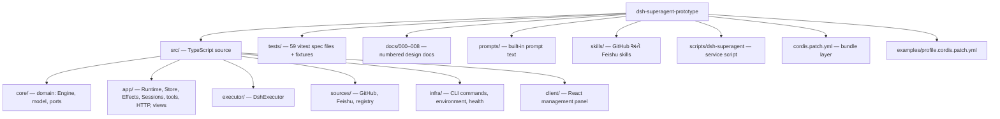

# પ્રકરણ 0 — Repository વાંચવાનો પાયો

[← અનુક્રમણિકા](../README.md) · [આગળ: 0A Super-agent article →](00a-superagent-article.md)

## શીખવાનું પરિણામ અને પૂર્વજરૂરિયાત

આ પ્રકરણ પછી તમે:
- project નો હેતુ સમજાવી શકશો, અને તેને "research prototype" કેમ કહેવાય છે તે કહી શકશો;
- દરેક top-level directory નું કામ કહી શકશો;
- `pnpm check` ચલાવી શકશો અને તેનું output વાંચી શકશો;
- આ repository માં વારંવાર આવતી TypeScript syntax (`interface`, union types, `Pick`, `readonly`, `async/await`, `zod`) વાંચી શકશો;
- પહેલી file `src/index.ts` line-by-line સમજાવી શકશો.

**પૂર્વજરૂરિયાત:** કોઈ પણ ભાષામાં functions, objects અને loops; terminal માં `cd` અને `ls`; Git માં `clone` અને `checkout`.

## 0.1 સાદી ગુજરાતીમાં: આ project શું છે?

કલ્પના કરો કે તમારી team માં એક નવો સભ્ય છે જે કદી ઊંઘતો નથી. તે GitHub પર નજર રાખે છે. કોઈ allowed વ્યક્તિ તેને `@` કરીને કામ સોંપે, ત્યારે તે:

1. request ઓળખે છે (**Trigger**),
2. નક્કી કરે છે કે આ કામ સ્વીકારવું કે નહીં (**Eval**),
3. સ્વીકારે તો એક work item ખોલે છે (**Ticket**),
4. તે કામ માટે અલગ AI session અને અલગ directory માં કામ કરે છે (**Executor / worker**),
5. જ્યાં request આવી હતી ત્યાં જ જવાબ આપે છે, ઘણીવાર pull request સાથે (**Channel**).

README માં project ની મૂળ ફિલસૂફી આ વાક્યમાં છે: *"take as little human attention as possible, and give as much value as possible."* ([README.md](https://github.com/deepseek-ai/dsh-superagent-prototype/blob/8c32a9dc5d72c033816c6a8110b37f40cf94fba4/README.md))

**[Source] Research prototype status.** README ની શરૂઆતમાં જ ચેતવણી છે: આ "Research prototype for reference only, not an official DeepSeek product" છે. તેમાં bugs હોઈ શકે છે, code style એકસરખી ન પણ હોય, અને *Exploring Super-agent Design* લેખની કેટલીક designs અહીં implement **નથી** થઈ. આ પુસ્તક એટલે જ "લેખ શું કહે છે" અને "code શું કરે છે" ને અલગ રાખે છે ([પ્રકરણ 0A](00a-superagent-article.md)).

**External boundary:** dsh-superagent પોતે standalone program નથી. તે **DeepSeek Harness (DSH)** નો *bundle/plugin* છે. DSH sessions, LLM calls, tools, web server અને plugin system (**Cordis**) પૂરા પાડે છે. આ repository એ framework ઉપર domain logic ઉમેરે છે. આ પુસ્તકમાં DSH ને "બહારની સીમા" (external boundary) ગણીએ છીએ: અમે તેના interfaces બતાવીશું, પણ તેનો internal code નહીં.

## 0.2 Repository map

**[Source]** Pinned commit માં 216 tracked files છે. `pnpm-lock.yaml` સિવાય લગભગ 33,700 lines છે.



Diagram ના તીર "અંદર સમાયેલું છે" દર્શાવે છે. ઉદાહરણ તરીકે `src → core` એટલે `core/` એ `src/` ની અંદરની directory છે.

| Directory | કામ | પ્રથમ ખોલવાની file |
| --- | --- | --- |
| `src/core/` | Domain logic: I/O વગરનું, synchronous | [`src/core/engine.ts`](https://github.com/deepseek-ai/dsh-superagent-prototype/blob/8c32a9dc5d72c033816c6a8110b37f40cf94fba4/src/core/engine.ts) |
| `src/app/` | Application glue: Runtime, SQLite Store, Effects queue, Sessions, tools, HTTP | [`src/app/runtime.ts`](https://github.com/deepseek-ai/dsh-superagent-prototype/blob/8c32a9dc5d72c033816c6a8110b37f40cf94fba4/src/app/runtime.ts) |
| `src/executor/` | Ticket ને DSH worker session માં ચલાવવું | [`src/executor/dsh.ts`](https://github.com/deepseek-ai/dsh-superagent-prototype/blob/8c32a9dc5d72c033816c6a8110b37f40cf94fba4/src/executor/dsh.ts) |
| `src/sources/` | GitHub/Feishu events ને Triggers માં બદલવા | [`src/sources/github.ts`](https://github.com/deepseek-ai/dsh-superagent-prototype/blob/8c32a9dc5d72c033816c6a8110b37f40cf94fba4/src/sources/github.ts) |
| `src/infra/` | `gh`/`lark-cli`/`git` ચલાવવા, process environment, health board | [`src/infra/commands.ts`](https://github.com/deepseek-ai/dsh-superagent-prototype/blob/8c32a9dc5d72c033816c6a8110b37f40cf94fba4/src/infra/commands.ts) |
| `src/client/` | Browser માં ચાલતી React panel | [`src/client/app.tsx`](https://github.com/deepseek-ai/dsh-superagent-prototype/blob/8c32a9dc5d72c033816c6a8110b37f40cf94fba4/src/client/app.tsx) |
| `prompts/` | Models વાંચે તે built-in text (એક લાઇન = એક વાક્ય) | `prompts/worker.md` |
| `docs/` | Design docs; ક્રમમાં વાંચવા | `docs/001-domain.md` |

## 0.3 Package scripts અને dependencies

**[Source]** [`package.json`](https://github.com/deepseek-ai/dsh-superagent-prototype/blob/8c32a9dc5d72c033816c6a8110b37f40cf94fba4/package.json):

```json
"scripts": {
  "build": "tsdown",
  "typecheck": "tsc --noEmit",
  "test": "vitest run",
  "check": "pnpm typecheck && pnpm test && pnpm build"
}
```

| Script | શું કરે છે | Tool |
| --- | --- | --- |
| `pnpm typecheck` | Types તપાસે છે; કોઈ file લખતું નથી (`--noEmit`) | TypeScript 6.0.3 |
| `pnpm test` | બધા `tests/*.spec.ts(x)` ચલાવે છે | vitest 4.1.8 |
| `pnpm build` | `lib/` માં ESM bundles બનાવે છે: `index.js`, `client.js`, `github-watch.js`, `feishu-watch.js` | tsdown 0.22.14 |
| `pnpm check` | ત્રણેય ક્રમમાં ચલાવે છે; કોઈ એક fail થાય તો ત્યાં અટકે છે (`&&`) | — |

Runtime dependencies માત્ર બે છે: `zod` (schema validation) અને `proper-lockfile` (state directory lock). બાકીના બધા `@deepseek-ai/*` packages **peer dependencies** છે: તે DSH host પૂરું પાડે છે. `engines.node` માટે `^22.19.0 || >=24.0.0` જોઈએ, અને `engines.dsh` માટે `^0.2.1-alpha.2`.

`"dsh": { "bundle": { "patch": "./cordis.patch.yml" } }` DSH ને કહે છે કે આ bundle નો configuration layer ક્યાં છે ([પ્રકરણ 3](03-startup.md)).

## 0.4 આ પ્રકરણ માટે જરૂરી TypeScript

Repository ની ભાષા જ શીખવા માટે, નીચેનાં બધાં ઉદાહરણો repository માંથી જ લીધાં છે.

### (a) `interface` અને optional fields

**[Source, real]** [`src/core/model.ts#L23-L39`](https://github.com/deepseek-ai/dsh-superagent-prototype/blob/8c32a9dc5d72c033816c6a8110b37f40cf94fba4/src/core/model.ts#L23-L39) (shortened):

```ts
export interface Trigger {
  id: string
  source: string
  threads: ThreadRef[]
  actor: ActorRef
  human: boolean
  addressed?: 'mention' | 'direct'
  at: string
  text: string
  channel?: ChannelRef
  meta: Record<string, unknown>
}
```

- `interface` object નો આકાર (shape) વર્ણવે છે. Runtime પર તે કંઈ કરતું નથી; ફક્ત compiler તપાસ કરે છે.
- `addressed?:` માં `?` એટલે આ field હોઈ પણ શકે અને ન પણ હોય.
- `'mention' | 'direct'` એક **union of string literals** છે: આ બે સિવાય બીજી કોઈ string ચાલતી નથી.
- `Record<string, unknown>` એટલે ગમે તે key ધરાવતો object, જેની value નો પ્રકાર "અજ્ઞાત" છે. `unknown` વાપરતાં પહેલાં તેની તપાસ કરવી પડે છે.

### (b) Discriminated union

**[Source, real]** [`src/core/ports.ts#L7`](https://github.com/deepseek-ai/dsh-superagent-prototype/blob/8c32a9dc5d72c033816c6a8110b37f40cf94fba4/src/core/ports.ts#L7):

```ts
export type GateResult = { admissible: false; reason: string } | { admissible: true; strength: Strength; basis: MandateBasis }
```

`admissible` field ને "discriminant" કહેવાય. `if (!gate.admissible)` પછી TypeScript જાણે છે કે `gate.reason` ઉપલબ્ધ છે, અને `else` શાખામાં `gate.strength` ઉપલબ્ધ છે.

### (c) `Pick` — narrow interfaces

**[Source, real]** [`src/core/engine.ts#L261`](https://github.com/deepseek-ai/dsh-superagent-prototype/blob/8c32a9dc5d72c033816c6a8110b37f40cf94fba4/src/core/engine.ts#L261-L270):

```ts
export type EngineForSources = Pick<Engine, 'receive' | 'bindThread' | 'threadClosed'>
```

`Pick<T, K>` એ `T` ના ફક્ત `K` નામના members વાળો નવો type બનાવે છે. આ repository નો મુખ્ય architecture નિયમ આ જ છે: દરેક caller ને તેની જરૂર જેટલી જ શક્તિ આપવી. Source plugin `stopTicket` બોલાવી શકતો નથી, કારણ કે તેના type માં તે method છે જ નહીં.

### (d) `class`, `private readonly`, constructor parameter properties

**[Source, real]** [`src/core/intake.ts#L16-L17`](https://github.com/deepseek-ai/dsh-superagent-prototype/blob/8c32a9dc5d72c033816c6a8110b37f40cf94fba4/src/core/intake.ts#L16-L17):

```ts
export class Intake extends EnginePart {
  constructor(options: EngineOptions, private readonly tickets: Tickets) { super(options) }
```

`private readonly tickets` constructor parameter ને જ class field બનાવી દે છે. `readonly` હોવાથી પછી તેને બદલી શકાતું નથી. (પ્રકરણ 13 માં જોઈશું કે Node નો "strip-only" TypeScript mode આ syntax ચલાવી શકતો નથી.)

### (e) `async`/`await` અને `Promise`

Engine ના methods **synchronous** છે, પણ બહારની દુનિયાનું કામ, જેમ કે CLI ચલાવવું કે LLM session ને message મોકલવો, **asynchronous** છે. `async function` હંમેશાં `Promise` પાછું આપે છે, અને `await` તે Promise પૂરું થાય ત્યાં સુધી રાહ જુએ છે, thread ને block કર્યા વગર. **[Source]** [`src/app/passes.ts#L56-L62`](https://github.com/deepseek-ai/dsh-superagent-prototype/blob/8c32a9dc5d72c033816c6a8110b37f40cf94fba4/src/app/passes.ts#L56-L62) માં `pump()` એક જ વખતે એક pass ચાલે તેની ખાતરી `Promise` field (`pumping`) વડે કરે છે.

### (f) `zod` — runtime validation

TypeScript types runtime પર અદૃશ્ય થઈ જાય છે. બહારથી આવતો data (settings, GitHub JSON, tool arguments) runtime પર તપાસવો પડે છે. **[Source, real]** [`src/policy.ts#L83-L87`](https://github.com/deepseek-ai/dsh-superagent-prototype/blob/8c32a9dc5d72c033816c6a8110b37f40cf94fba4/src/policy.ts#L83-L87):

```ts
export const EvalConfigSchema = z.object({
  mode: z.enum(['off', 'observe', 'auto']).default('observe'),
  timeoutSeconds: z.number().int().min(LIMITS.evalTimeoutSeconds.min).max(LIMITS.evalTimeoutSeconds.max).default(120),
  model: RoleModelSchema.nullable().default(null),
}).strict()
```

`.default('observe')` ખૂટતી value ભરી દે છે. `.strict()` અજાણી keys નકારે છે. `z.infer<typeof Schema>` આ schema પરથી TypeScript type બનાવે છે.

## 0.5 પહેલો code walkthrough: `src/index.ts`

**ખોલવાનો ક્રમ:** `package.json` (`main`, `exports`) → `src/index.ts` → `src/deployment.ts` (`Config`) → `src/app/runtime.ts` (પ્રકરણ 3).

**[Source, real]** [`src/index.ts#L1-L27`](https://github.com/deepseek-ai/dsh-superagent-prototype/blob/8c32a9dc5d72c033816c6a8110b37f40cf94fba4/src/index.ts#L1-L27):

```ts
export const name = 'dsh-superagent'
export const inject = ['agents', 'sessionController', 'sessionPersistence', 'workspaceRegistry', 'permissionPresets', 'tools', 'systemPrompt', 'skills', 'webServer', 'llm', 'subprocess']
export { Config }
export async function apply(ctx: Context, config: DeploymentConfig): Promise<void> {
  const machine = machineOf(config)
  ctx.inject(['settings'], child => { child.effect(() => child.settings.configure({ auto: false }, ctx.fiber)) })
  const restart = (): void => {
    ctx.fiber.restart().then(() => { ctx.get('settings')?.describe() }).catch(…)
  }
  const runtime = new Runtime(ctx, machine, restart)
  ctx.effect(() => async () => { await runtime.stop() })
  await runtime.ready
  ctx.logger.info(runtime.configured() ? 'dsh-superagent ready; …' : `dsh-superagent is waiting for setup: …`)
}
```

Line-by-line:

| Line | અર્થ |
| --- | --- |
| `name` | Cordis plugin નું નામ. `cordis.patch.yml` માં `name: dsh-superagent` આને જ refer કરે છે |
| `inject` | આ plugin ને DSH host પાસેથી જોઈતી **services**. આમાંથી કોઈ ઉપલબ્ધ ન હોય તો Cordis plugin ને start કરતું નથી (external boundary: Cordis dependency injection) |
| `Config` | Plugin configuration નો schema (`stateDir`, `promptMaxChars`, …). [`src/deployment.ts#L15-L17`](https://github.com/deepseek-ai/dsh-superagent-prototype/blob/8c32a9dc5d72c033816c6a8110b37f40cf94fba4/src/deployment.ts#L15-L17) |
| `apply(ctx, config)` | Cordis plugin load થાય ત્યારે આ function બોલાવે છે. `ctx` એ plugin નો context છે |
| `settings.configure({ auto: false })` | DSH નું auto-generated settings page બંધ કરે છે, કારણ કે panel પોતાનું UI આપે છે |
| `restart` | Account change પછી plugin ને "fiber restart" વડે ફરી શરૂ કરવાનો callback |
| `new Runtime(…)` | **Composition root** ([પ્રકરણ 3](03-startup.md)) |
| `ctx.effect(() => async () => …stop())` | Cordis effect: plugin unload થાય ત્યારે return થયેલું cleanup function ચાલે છે, એટલે graceful shutdown |
| `await runtime.ready` | Startup પૂરું થાય અથવા setup અધૂરો છે એમ નક્કી થાય ત્યાં સુધી રાહ |

**Inputs:** Cordis `Context` અને validated `DeploymentConfig`. **State:** અહીં કંઈ લખાતું નથી; `Runtime` constructor state directory lock કરે છે. **Failure:** `stateDir` ન હોય તો `Config` schema plugin ને start થવા દેતો નથી (`.required()`). **પછી શું:** Runtime ની `initialize()` ([પ્રકરણ 3](03-startup.md)).

## 0.6 Runnable exercise: build અને test

**[Test ચલાવ્યો]** આ પુસ્તક માટે ચલાવેલા commands. Network access જરૂરી છે, કારણ કે `pnpm install` npm registry માંથી `@deepseek-ai/*` packages લાવે છે:

```bash
git clone https://github.com/deepseek-ai/dsh-superagent-prototype.git
```

```bash
cd dsh-superagent-prototype && git checkout 8c32a9dc5d72c033816c6a8110b37f40cf94fba4
```

```bash
pnpm install --frozen-lockfile
```

```bash
pnpm check
```

**અપેક્ષિત અને observed output (ટૂંકાવેલું):**

```text
$ tsc --noEmit
$ vitest run
 Test Files  59 passed (59)
      Tests  1197 passed (1197)
✔ Build complete …
ℹ [ESM] lib/index.js 450.26 kB
```

દરેક test process `ExperimentalWarning: SQLite is an experimental feature` છાપે છે. આ ચેતવણી Node ના built-in `node:sqlite` module ની છે. Store તે જ module વાપરે છે ([પ્રકરણ 8](08-store-effects-outbox.md)). આ error નથી.

## 0.7 Modification અને verification

**કાર્ય:** ફક્ત `core` ના tests ચલાવો, અને test ના નામથી filter કરો:

```bash
pnpm vitest run tests/core-engine.spec.ts -t "stores a trigger once"
```

**[Test ચલાવ્યો]** આ test ([`tests/core-engine.spec.ts#L75-L82`](https://github.com/deepseek-ai/dsh-superagent-prototype/blob/8c32a9dc5d72c033816c6a8110b37f40cf94fba4/tests/core-engine.spec.ts#L75-L82)) સાબિત કરે છે કે એક જ Trigger બે વખત `receive` કરવાથી બીજી વખત `'duplicate'` મળે છે. આ running example નો "duplicate event" છે ([પ્રકરણ 4](04-sources-intake.md)).

## 0.8 Debugging exercise

`pnpm build` પહેલાં `pnpm install` ભૂલી જાઓ, અથવા Node 20 વાપરો. **અપેક્ષા:** `node:sqlite` import fail થાય છે, અથવા `engines` mismatch ની ચેતવણી આવે છે. **નિદાન:** `node -v` ચલાવો અને જુઓ કે version `^22.19.0 || >=24` માં છે કે નહીં. **સુધારો:** Node ને supported version પર upgrade કરો. **[ધારણા]** Node 20 પર અમે ચલાવ્યું નથી; ઉપરનું વર્ણન `engines` field અને `node:sqlite` ની જરૂરિયાત પરથી કરેલું અનુમાન છે.

## Mastery પ્રશ્નો

1. `peerDependencies` અને `dependencies` વચ્ચેનો તફાવત આ project માં કેમ મહત્વનો છે?
2. `EngineForSources` type, Source plugin ને Ticket stop કરતાં કેવી રીતે રોકે છે?
3. `ctx.effect(() => async () => runtime.stop())` માં બે arrow functions કેમ છે?
4. `zod` વગર ફક્ત TypeScript types થી settings ની તપાસ કેમ શક્ય નથી?

ઉકેલો: [પરિશિષ્ટ E § પ્રકરણ 0](../appendices/E-solutions.md#પ્રકરણ-0)

[← અનુક્રમણિકા](../README.md) · [આગળ: 0A Super-agent article →](00a-superagent-article.md)
