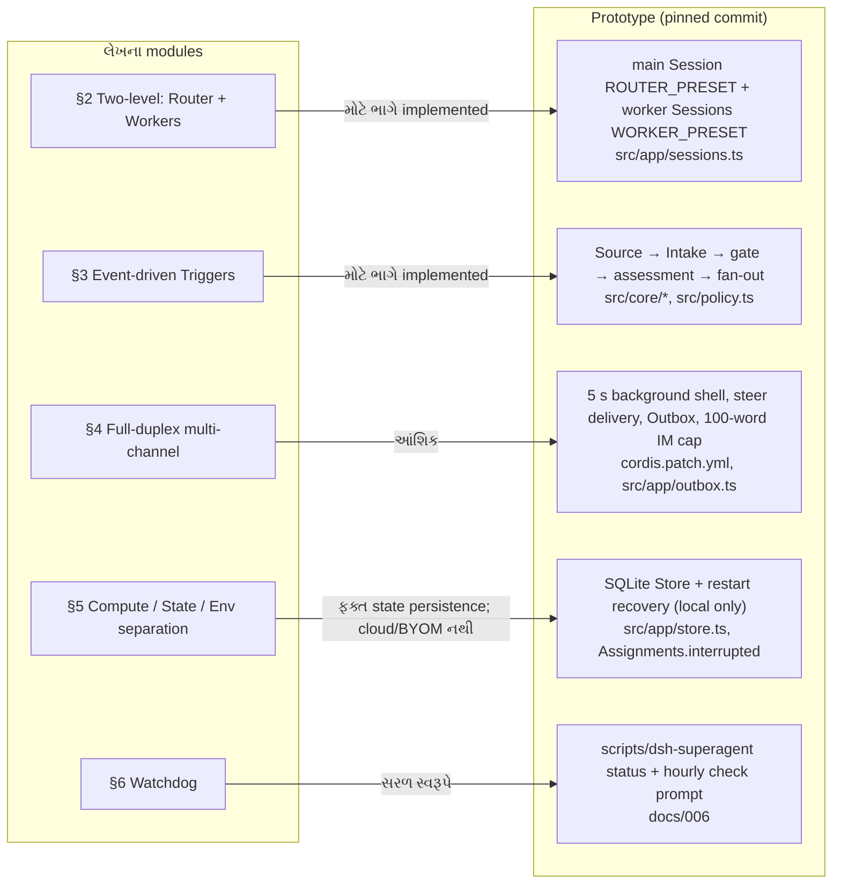

# પ્રકરણ 0A — Super-agent design article અને આ prototype

[← પ્રકરણ 0](00-foundation.md) · [અનુક્રમણિકા](../README.md) · [આગળ: પ્રકરણ 1 →](01-domain-model.md)

## શીખવાનું પરિણામ

આ પ્રકરણ પછી તમે DeepSeek Harness team ના લેખ *Exploring Super-agent Design: Towards a More Autonomous Agent System* ના પાંચ મુખ્ય modules સમજાવી શકશો. એટલું જ નહીં, દરેક વિચાર માટે કહી શકશો કે pinned commit માં તે **ક્યાં** અને **કેટલો** implement થયો છે. Repository નું README પોતે ચેતવે છે કે prototype આ લેખના implementation જેવો **નથી**, અને લેખની કેટલીક designs "directions for future development" છે. એટલે આ પ્રકરણ દરેક દાવા સાથે label મૂકે છે.

**Sources અને સીમા:**
- લેખ: [X post, @DeepSeekHarness, 1 Nov 2026](https://x.com/DeepSeekHarness/status/2116857257245987236). મૂળ લેખ ચીની ભાષામાં છે; અહીં વપરાયેલ લખાણ X પરનું machine translation છે, જે વપરાશકર્તાએ આ પુસ્તક માટે આપ્યું. X article page login વગર scrape થઈ શક્યું નહીં. ચીની સારાંશ [第一财经, 2026-10-31](https://www.yicai.com/news/103419784.html) સાથે મુખ્ય મુદ્દાઓ મેળ ખાય છે.
- લેખનો અંતિમ ફકરો: *"Parts of the design in this article are implemented in dsh-superagent-prototype. This plugin is only a prototype for validating the technical approach."*
- આ પ્રકરણમાં લેખનું ફક્ત વર્ણન છે. લેખના experiments (§7) ના આંકડા લેખના છે; અમે તે ફરી ચલાવ્યા નથી.

## 0A.1 લેખનો મુખ્ય વિચાર, ગુજરાતીમાં

લેખની દલીલ: models એક task સારી રીતે કરવા લાગ્યા છે, એટલે હવે bottleneck **માણસનું ધ્યાન** છે. લેખ મુજબ એક વ્યક્તિ સામાન્ય રીતે એક સાથે ફક્ત 3–5 સક્રિય sessions સંભાળી શકે છે. ઉકેલ એ છે કે agent ને કોઈ એક session થી અલગ પાડો, અને તેને એક સતત "entity" બનાવો. લેખ તેને **Super-agent** કહે છે, અને તેના ચાર ગુણો ગણાવે છે:

| ગુણ (લેખ) | અર્થ | Prototype માં સૌથી નજીકની વસ્તુ |
| --- | --- | --- |
| Continuous (સતત) | વપરાશકર્તાને હંમેશાં એક જ agent લાગે; "session X માં માહિતી Y છે કે નહીં" તેની ચિંતા ન કરવી પડે | એક જ લાંબું જીવતું main Session, Thread subscriptions, resume |
| Productive (ઉત્પાદક) | ઘણાં tasks સમાંતરે ચાલે; પાછલું કામ પૂરું થાય તે પહેલાં નવી સૂચના લઈ શકે | Ticket દીઠ અલગ worker Session, `maxWorkers` slots, 5-second background shell |
| Proactive (પહેલ કરનાર) | Events જુએ; કામ લાયક હોય તો કરે, નહીં તો ચૂપ રહે | Admission table, accept mode `observe`/`auto`, rules |
| Persistent (કાયમી) | હંમેશાં online રહે, અને anomalies માંથી પોતે recover થાય | SQLite Store, restart recovery, hourly status check |

લેખ પાંચ modules ને આ ગુણોનો આધાર ગણાવે છે: (2) two-level architecture, (3) event-driven Triggers, (4) full-duplex multi-channel interaction, (5) compute, state અને environment નું વિભાજન, (6) Watchdog.



**તીરોનો અર્થ:** ડાબી બાજુ લેખનો module છે, જમણી બાજુ તેને સૌથી નજીકનો code છે. તીર પરનું લખાણ implementation કેટલું પૂરું છે તે કહે છે. આગળના વિભાગો દરેક તીરની વિગત આપે છે.

## 0A.2 §2 Two-level architecture → main Session અને worker Sessions

**લેખ:** Router layer લાંબું જીવે છે, બધી માનવ interaction સંભાળે છે, અને પોતે task **execute કરતું નથી**: "it can run without a Bash tool at all". Worker layer માં દરેક task માટે અલગ context વાળું session હોય છે. "Workers never interact with humans directly."

**[Source] Prototype:**
- Router = **main Session** (`orchestrator` in code). તેનું id `orchestrator-<hash(stateDir)>` છે, અને તે `KV.runtime.masterId` માં સચવાય છે ([`runtime.ts#L104-L105`](https://github.com/deepseek-ai/dsh-superagent-prototype/blob/8c32a9dc5d72c033816c6a8110b37f40cf94fba4/src/app/runtime.ts#L104-L105)). તે `dsh-superagent-router` preset વાપરે છે ([`sessions.ts#L48`](https://github.com/deepseek-ai/dsh-superagent-prototype/blob/8c32a9dc5d72c033816c6a8110b37f40cf94fba4/src/app/sessions.ts#L48), [`cordis.patch.yml#L125-L193`](https://github.com/deepseek-ai/dsh-superagent-prototype/blob/8c32a9dc5d72c033816c6a8110b37f40cf94fba4/cordis.patch.yml#L125-L193)).
- Worker = દરેક Ticket માટે `worker-<ticketId>` Session ([`dsh.ts#L24`](https://github.com/deepseek-ai/dsh-superagent-prototype/blob/8c32a9dc5d72c033816c6a8110b37f40cf94fba4/src/executor/dsh.ts#L24)) અને અલગ directory.

**લેખથી તફાવતો (પુસ્તકનું અવલોકન):**
1. **Router પાસે bash છે.** Router preset માં `tool-bash` છે, પણ foreground command 5 seconds પછી background માં જાય છે. ઉપરાંત `noWait` guard `sleep`, 30 s થી લાંબો shell timeout અને 5 s થી લાંબો job wait નકારે છે ([`sessions.ts#L77-L86`](https://github.com/deepseek-ai/dsh-superagent-prototype/blob/8c32a9dc5d72c033816c6a8110b37f40cf94fba4/src/app/sessions.ts#L77-L86)). File writes બંધ છે (`tool-fs` config `write: false, edit: false`). "Code ન વાંચવો" એ tool restriction નથી, prompt rule છે (`docs/007` "Avoiding code reads is a prompt rule").
2. **Worker માણસો સાથે સીધી વાત કરે છે, પણ મર્યાદિત રીતે.** Worker `orchestrator_ack` વડે acknowledgement પોસ્ટ કરી શકે છે ([`tools/executor.ts#L28-L40`](https://github.com/deepseek-ai/dsh-superagent-prototype/blob/8c32a9dc5d72c033816c6a8110b37f40cf94fba4/src/app/tools/executor.ts#L28-L40)). પરિણામ, જવાબ અને પ્રશ્નો main Session ના `orchestrator_reply` માંથી જાય છે, અને workers GitHub પર `gh` વડે PR comments કરે છે. બધું Engine ના `Replies` નિયમોમાંથી પસાર થાય છે ([પ્રકરણ 6](06-tickets-assignments.md)).
3. **Router batching:** લેખ કહે છે કે એક turn દરમિયાન આવેલા Triggers આગલી LLM call માં ભેગા થાય છે. Prototype માં આ DSH inbox નું `steer` delivery કરે છે: `relay` effect `sessions.prompt(masterId, id, text, 'steer')` ([`sessions.ts#L104`](https://github.com/deepseek-ai/dsh-superagent-prototype/blob/8c32a9dc5d72c033816c6a8110b37f40cf94fba4/src/app/sessions.ts#L104)), અને `docs/007` નોંધે છે કે "Relays arriving during a turn are delivered together at its next step through the DeepSeek Harness inbox". બીજું, domain-level batching પણ છે: એક Thread પર Eval ચાલતું હોય ત્યારે આવેલા Triggers `pending` માં રાહ જુએ છે, અને પછી એક batch તરીકે evaluate થાય છે ([`evals.ts#L71-L119`](https://github.com/deepseek-ai/dsh-superagent-prototype/blob/8c32a9dc5d72c033816c6a8110b37f40cf94fba4/src/core/evals.ts#L71-L119)).

## 0A.3 §3 Event-driven Triggers → Source, gate, assessment, fan-out

| લેખનો ખ્યાલ | Prototype માં | Status |
| --- | --- | --- |
| Trigger: semi-structured environment event | `Trigger` interface ([`model.ts#L23-L39`](https://github.com/deepseek-ai/dsh-superagent-prototype/blob/8c32a9dc5d72c033816c6a8110b37f40cf94fba4/src/core/model.ts#L23-L39)) | ✅ |
| §3.1 Fast Path: programmatic policy ("respond only to explicit requests / treat as candidate / ignore") | `settingsPolicy().gate` અને admission table cells `explicit` / `inferred` / `ignore` ([`policy.ts#L191-L211`](https://github.com/deepseek-ai/dsh-superagent-prototype/blob/8c32a9dc5d72c033816c6a8110b37f40cf94fba4/src/policy.ts#L191-L211)) | ✅ |
| §3.1 Slow Path: LLM + prompt-written policies | Main Session `orchestrator_eval*`; rules (`DEFAULT_RULES`), `prompts/admission.md`, `assessmentOutcome` | ✅ |
| §3.2 Thread | `Thread` aggregate ([`model.ts#L157-L182`](https://github.com/deepseek-ai/dsh-superagent-prototype/blob/8c32a9dc5d72c033816c6a8110b37f40cf94fba4/src/core/model.ts#L157-L182)) | ✅ |
| §3.2 Subscribed fast path: code પોતે follow-up સીધું worker ને આપે | `Intake.receive` fan-out + `followupOwners` ([`intake.ts#L38-L58`](https://github.com/deepseek-ai/dsh-superagent-prototype/blob/8c32a9dc5d72c033816c6a8110b37f40cf94fba4/src/core/intake.ts#L38-L58)) | ✅ |
| §3.2 Worker unsubscribe/handback | `orchestrator_thread_unrelated`, `orchestrator_trigger_handback` | ✅ |
| §3.2 Router "can still see every event" | Main Session ને `follow_up` relay મળે છે, પણ તે ફક્ત stop કરી શકે છે (`workerDecides` error) | ✅, વધારાના નિયમ સાથે |
| §3.2 Many-to-many subscriptions | `Thread.subscriptions: string[]`, `followForContext` | ✅ |
| §3.3 Inline & Spill | `capped()` (assignment 1500, trigger 600 chars, `read` pointer) [`dsh.ts#L113-L116`](https://github.com/deepseek-ai/dsh-superagent-prototype/blob/8c32a9dc5d72c033816c6a8110b37f40cf94fba4/src/executor/dsh.ts#L113-L116); assessment window: trigger 4000, પડોશી 1200, બાકી 400, stubs 50 chars ([`assessment.ts#L37`](https://github.com/deepseek-ai/dsh-superagent-prototype/blob/8c32a9dc5d72c033816c6a8110b37f40cf94fba4/src/app/assessment.ts#L37)) | ✅ |
| §3.3 Chain of Recall: દરેક object માં next-hop IDs | `orchestrator_read` resources: `ticket/<id>`, `thread/<key>`, `trigger/<id>`…; `docs/007`: "Every id a page shows reads through one of these" ([`resources.ts`](https://github.com/deepseek-ai/dsh-superagent-prototype/blob/8c32a9dc5d72c033816c6a8110b37f40cf94fba4/src/app/resources.ts)) | ✅ |
| §3.4 Acting ahead / "silently reproduce and fix" | Proactive rules + accept mode `auto`; default `observe` ફક્ત "would accept" નોંધે છે. Default rules માત્ર `copy` અને `visual` છે. "Silently reproduce" rule ટીમે પોતે લખવો પડે | ⚠️ mechanism છે; લેખ જેવો default rule નથી |

**Running example સાથે જોડાણ:** `alice` ની Issue `github:7` Thread બને છે. Gate તેને `explicit` આપે છે (Fast Path). LLM assessment ની જરૂર પડતી નથી: explicit request main Session સીધું `orchestrator_route` વડે accept કરે છે. પછી alice ની follow-up "lint પણ ચલાવજો" fan-out (pass-through) વડે સીધી worker ને પહોંચે છે; કોઈ નવું Eval થતું નથી. **[Observed]** [`examples/running-example.log.json`](../examples/running-example.log.json) માં `E_followup.decisions7` માં એક જ Decision છે.

## 0A.4 §4 Full-duplex અને multi-channel

- **[Source] Full-duplex (§4.1):** લેખ async `start()`/`stop()` વર્ણવે છે, અને નોંધે છે કે DSH માં આ mechanism "is not yet enabled by default". Prototype તેને presets વડે ચાલુ કરે છે: bash sandbox `timeoutMs: 5000, maxTimeoutMs: 5000`, અને jobs `waitTimeoutMs: 5000` ([`cordis.patch.yml#L37-L76`](https://github.com/deepseek-ai/dsh-superagent-prototype/blob/8c32a9dc5d72c033816c6a8110b37f40cf94fba4/cordis.patch.yml#L37-L76)). Job પૂરો થાય ત્યારે worker ને જગાડે છે ([પ્રકરણ 7](07-worker-execution.md)).
- **[Source] Multi-channel (§4.2):** લેખનો "cap of 100 words per reply" નિયમ code માં `IM_WORDS = 100` છે. Feishu replies પર `checkedImText` તેનો અમલ કરે છે ([`infra/text.ts#L3`](https://github.com/deepseek-ai/dsh-superagent-prototype/blob/8c32a9dc5d72c033816c6a8110b37f40cf94fba4/src/infra/text.ts#L3), [`outbox.ts#L29`](https://github.com/deepseek-ai/dsh-superagent-prototype/blob/8c32a9dc5d72c033816c6a8110b37f40cf94fba4/src/app/outbox.ts#L29)). GitHub માટે prompt સંપૂર્ણ PR description માગે છે ("Delivery requirements"), અને દરેક GitHub message ની શરૂઆતમાં disclosure line મૂકે છે.

## 0A.5 §5 Compute / state / environment separation

**લેખ:** Agent loop cloud માં stateless ચાલે, state database માં રહે, અને execution environments સુધી હળવા daemons (BYOM) વડે પહોંચાય.

**[Source] Prototype:** આમાંથી ફક્ત પહેલો અડધો ભાગ, અને તે પણ local રીતે:
- Domain state DSH Session થી અલગ છે: SQLite `<stateDir>/orchestrator.sqlite` ([પ્રકરણ 8](08-store-effects-outbox.md)). `docs/001` "Ticket state that follows the DSH Session" ને rejected concept ગણાવે છે, કારણ કે Ticket પોતાની state પોતે define કરે છે.
- Restart પછી running Assignments "host restarted" સાથે પૂરાં થાય છે, અને recovery note સાથે ફરી શરૂ થાય છે ([`assignments.ts#L83-L92`](https://github.com/deepseek-ai/dsh-superagent-prototype/blob/8c32a9dc5d72c033816c6a8110b37f40cf94fba4/src/core/assignments.ts#L83-L92)).
- **નથી:** cloud containers, BYOM endpoint daemons, intermittent devices. Prototype એક machine પર એક DSH profile માં ચાલે છે. Workers operator ના OS user તરીકે `danger-full-access` થી ચાલે છે (`docs/006`). Running example નું "restart" scenario આ local recovery જ છે.

## 0A.6 §6 Watchdog

**લેખ:** Main system થી બહાર એક સ્વતંત્ર Watchdog Session, જે scheduled messages થી ચાલે છે. તે infrastructure failures ઉપરાંત model વડે એ પણ તપાસે છે કે worker સાચી દિશામાં પ્રગતિ કરે છે કે નહીં.

**[Source] Prototype:** `docs/006` "Hourly check" વિભાગ operator ની **બીજી** DSH profile માં hourly schedule બનાવવાનું કહે છે, જે `scripts/dsh-superagent --profile superagent status` ચલાવે છે. Exit codes 0/1/2/3 ના આધારે તે restart કરે છે અથવા માણસને જાણ કરે છે. Worker ની અર્થપૂર્ણ પ્રગતિનો model-based judgment prototype માં **નથી**. તેની સૌથી નજીકની વસ્તુઓ: background work ની 30-minute મર્યાદા (`BACKGROUND_LIMIT_MS`) અને `orchestrator_ticket_request_status`.

## 0A.7 §7 Experiments અને §8 Open problems

- §7 ના ablation અને batching ના આંકડા (દા.ત. Super-agent p50 12.4 min; pass-through વગર cache-read tokens 23.2M થી 31.8M) **લેખના** છે. તેમને ફરી ચલાવવા માટેનો code અથવા workload repository માં નથી. પ્રકરણ 13 નું measurement આનાથી અલગ, નાનો **local** workload છે.
- §8.4 Security: લેખ કહે છે કે credentials model ના context માં ન આવવા જોઈએ. Prototype તેનો આંશિક અમલ કરે છે: setup `KEY|PASSWORD|SECRET|TOKEN` ધરાવતા env vars દૂર કરે છે, `GH_TOKEN`/`GITHUB_TOKEN` હટાવે છે, અને git credential helper ને agent CLI બનાવે છે ([`infra/environment.ts#L47`](https://github.com/deepseek-ai/dsh-superagent-prototype/blob/8c32a9dc5d72c033816c6a8110b37f40cf94fba4/src/infra/environment.ts#L47)). છતાં `docs/006` સ્પષ્ટ કહે છે: wrappers "do not isolate the process", અને worker absolute path થી programs ચલાવી શકે છે. પ્રકરણ 13 આને architecture review માં ફરી જુએ છે.

## Exercise: લેખ → code ટ્રેસ

1. લેખનું વાક્ય "Code passes follow-up events in the Thread straight through to the subscribed Worker" લો. [`intake.ts`](https://github.com/deepseek-ai/dsh-superagent-prototype/blob/8c32a9dc5d72c033816c6a8110b37f40cf94fba4/src/core/intake.ts) માં તે કઈ lines કરે છે?
2. લેખ કહે છે કે Router "can still see every event". Main Session ને follow-up ની જાણ કઈ function થી થાય છે? (સંકેત: `runtime.ts` નો `emit`, `followupNotice`.)
3. આ test ચલાવો, અને બતાવો કે Router follow-up ને accept કરી શકતું નથી:

```bash
pnpm vitest run tests/core-engine.spec.ts -t "follow-up"
```

ઉકેલો: [પરિશિષ્ટ E § પ્રકરણ 0A](../appendices/E-solutions.md#પ્રકરણ-0a)

## Mastery પ્રશ્નો

1. લેખ Router ને "bash વગર" ચલાવવાની વાત કરે છે. Prototype bash રાખે છે, પણ કયાં બે સાધનોથી Router ને block થતું અટકાવે છે?
2. "Pass-through" દૂર કરીએ તો લેખ મુજબ શું વધે છે? Prototype માં pass-through કયો function બંધ કરે?
3. Prototype માં §5 નો કયો ભાગ **નથી**, અને running example નું restart scenario તેમાંથી કયો ભાગ દર્શાવે છે?

[← પ્રકરણ 0](00-foundation.md) · [આગળ: પ્રકરણ 1 →](01-domain-model.md)
