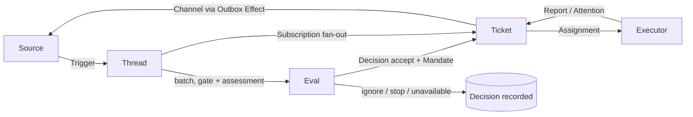
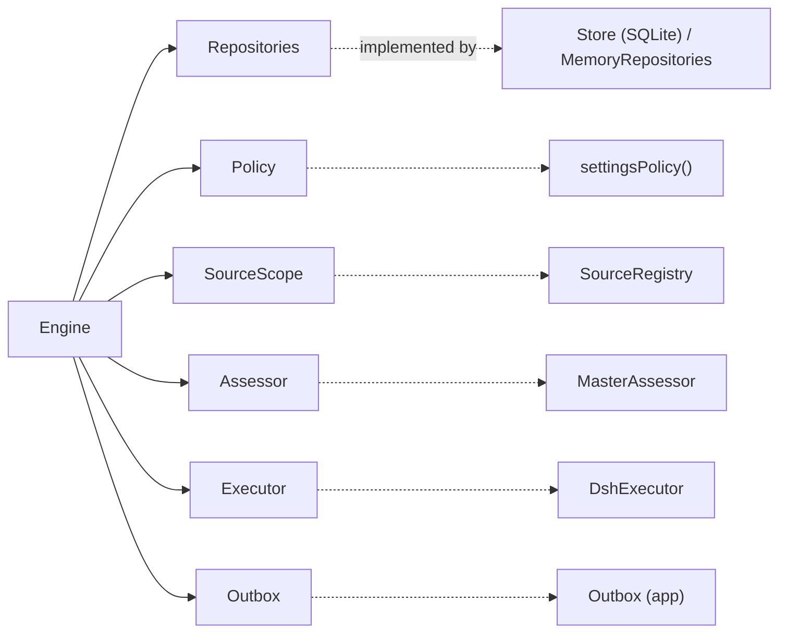

# પ્રકરણ 1 — Domain model

[← 0A](00a-superagent-article.md) · [અનુક્રમણિકા](../README.md) · [આગળ: પ્રકરણ 2 →](02-setup-operation.md)

## શીખવાનું પરિણામ અને પૂર્વજરૂરિયાત

આ પ્રકરણ પછી તમે 19 domain terms માંથી દરેક માટે ચાર બાબતો કહી શકશો: તેનો હેતુ, તેનો TypeScript type, તેને કોણ લખે છે (owner), અને running example માં તે ક્યાં દેખાય છે. **પૂર્વજરૂરિયાત:** પ્રકરણ 0 ની TypeScript.

**ખોલવાનો ક્રમ:** [`docs/001-domain.md`](https://github.com/deepseek-ai/dsh-superagent-prototype/blob/8c32a9dc5d72c033816c6a8110b37f40cf94fba4/docs/001-domain.md) → [`src/core/model.ts`](https://github.com/deepseek-ai/dsh-superagent-prototype/blob/8c32a9dc5d72c033816c6a8110b37f40cf94fba4/src/core/model.ts) → [`src/core/ports.ts`](https://github.com/deepseek-ai/dsh-superagent-prototype/blob/8c32a9dc5d72c033816c6a8110b37f40cf94fba4/src/core/ports.ts) → [`src/core/reasons.ts`](https://github.com/deepseek-ai/dsh-superagent-prototype/blob/8c32a9dc5d72c033816c6a8110b37f40cf94fba4/src/core/reasons.ts).

## 1.1 સાદી ગુજરાતીમાં: એક વાર્તા

GitHub (**Source**) પર alice એક Issue ખોલે છે. તે એક ઘટના છે, એટલે **Trigger**. Issue #7 ના બધા messages મળીને **Thread** `github:7` બને છે. જવાબ ક્યાં લખવો તેનું સરનામું **Channel** છે. **Policy** નક્કી કરે છે કે કોણ કામ માગી શકે. તેનો deterministic ભાગ **Gate** છે, અને LLM નો નિર્ણય **Assessment** છે. આ બંને મળીને **Eval** બને છે. Eval નું પરિણામ **Decision** છે. Accept થાય તો **Mandate** (કામની પરવાનગી) સાથે **Ticket** બને છે. Ticket ને worker સુધી પહોંચાડવાનું બંધન **Assignment** છે, અને worker ચલાવનાર ભાગ **Executor** છે. Ticket Thread ને **Subscription** વડે સાંભળે છે. Worker **Report** આપે છે, અને માણસને પ્રશ્ન પૂછવો હોય તો **Attention** રાખે છે. દરેક Trigger ક્યાં ગયો તેનો હિસાબ **Disposition** રાખે છે. Commit પછી કરવાનું બહારનું કામ **Effect** છે.



**તીરોનો અર્થ:** Source ના Trigger Thread માં ઉમેરાય છે. Thread ના queued Triggers ભેગા થઈને Eval બને છે. Accept થાય તો Ticket બને છે; બીજા પરિણામો ફક્ત Decision તરીકે નોંધાય છે. Ticket subscribed Thread ના નવા Triggers fan-out થી મેળવે છે. Ticket નું કામ Assignment વડે Executor ને જાય છે, અને Executor Report પાછો આપે છે. જવાબો Channel વડે, Outbox effect તરીકે, પાછા Source પર જાય છે.

## 1.2 Terms, એક પછી એક

દરેક row માં છે: purpose, actual type, owner (એકમાત્ર writer), અને running example માં તેની જગ્યા. Owner નો નિયમ `docs/007` ના "One writer per state" પરથી છે.

| Term | હેતુ | Actual type / source | Owner | Running example |
| --- | --- | --- | --- | --- |
| **Source** | Events નો પ્રવાહ; kind એ reusable implementation છે, instance એ configuration | `SourceKind` [`kind.ts#L85-L113`](https://github.com/deepseek-ai/dsh-superagent-prototype/blob/8c32a9dc5d72c033816c6a8110b37f40cf94fba4/src/sources/kind.ts#L85-L113), `SourceInstance` | `SourceRegistry`; read position Source પોતે રાખે છે | `githubKind`, repository `demo-org/widgets` |
| **Trigger** | એક immutable event; audit અને idempotence નો એકમ | `Trigger` [`model.ts#L23-L39`](https://github.com/deepseek-ai/dsh-superagent-prototype/blob/8c32a9dc5d72c033816c6a8110b37f40cf94fba4/src/core/model.ts#L23-L39) | Engine (`Intake`) | alice ની Issue body: id `6618ff4a…`, `addressed: 'mention'` |
| **Thread** | Triggers નો સમયક્રમ; Eval અહીં એક સમયે એક જ ચાલે છે | `Thread` [`model.ts#L157-L182`](https://github.com/deepseek-ai/dsh-superagent-prototype/blob/8c32a9dc5d72c033816c6a8110b37f40cf94fba4/src/core/model.ts#L157-L182) | Engine; `meta` Source લખે છે | `github:7` (`threadKey` = `source:id`) |
| **Correlation** | એક Trigger અનેક Threads પર હોય ત્યારે તે Threads વચ્ચેનો સંબંધ; ફક્ત context, routing નહીં | `Thread.correlated: string[]` | Engine (`Intake.receive` L37) | Example માં નથી; test: "records correlation…" |
| **Channel** | Thread ની write side (reply address) | `ChannelRef` [`model.ts#L9`](https://github.com/deepseek-ai/dsh-superagent-prototype/blob/8c32a9dc5d72c033816c6a8110b37f40cf94fba4/src/core/model.ts#L9) | Source નક્કી કરે; Ticket `channels[]` રાખે | `{source:'github', thread:'github:7', address:{number:'7', url:…}}` |
| **Policy** | Versioned નિયમો: rules, accept mode, દરેક Source નો ભાગ | `Policy` port [`ports.ts#L17-L27`](https://github.com/deepseek-ai/dsh-superagent-prototype/blob/8c32a9dc5d72c033816c6a8110b37f40cf94fba4/src/core/ports.ts#L17-L27); `settingsPolicy` | `Settings` (save) | `allowed: [{id:'alice'}]`, mode `observe` |
| **Gate** | Eval નું deterministic પહેલું સ્તર: કોણ, કેટલી strength | `Policy.gate` → `GateResult` | Policy (stateless) | alice → `explicit` / `via: 'addressed'`; mallory → `not_a_member` |
| **Assessment** | Model નો નિર્ણય (proactive candidates માટે) | `Assessor` port [`ports.ts#L49-L53`](https://github.com/deepseek-ai/dsh-superagent-prototype/blob/8c32a9dc5d72c033816c6a8110b37f40cf94fba4/src/core/ports.ts#L49-L53), `MasterAssessor` | Main Session | Explicit request હોવાથી assessment છોડી દેવાય છે |
| **Eval** | Batch → Decision ની પ્રક્રિયા | `Evaluation` [`model.ts#L136-L154`](https://github.com/deepseek-ai/dsh-superagent-prototype/blob/8c32a9dc5d72c033816c6a8110b37f40cf94fba4/src/core/model.ts#L136-L154) (`Thread.evaluating`) | Engine (`Evals`) | `A_evalStarted.thread7.evaluating = true` |
| **Decision** | Eval નું પરિણામ: accept/stop/ignore/unavailable (+legacy reopen) | `Decision` [`model.ts#L192-L209`](https://github.com/deepseek-ai/dsh-superagent-prototype/blob/8c32a9dc5d72c033816c6a8110b37f40cf94fba4/src/core/model.ts#L192-L209) | Engine | `accept` (`explicitRouted`), પછી `stop` |
| **Mandate** | Accept શું આપે છે: strength, scope, Policy version, basis; immutable | `Mandate`, `MandateBasis` [`model.ts#L116-L133`](https://github.com/deepseek-ai/dsh-superagent-prototype/blob/8c32a9dc5d72c033816c6a8110b37f40cf94fba4/src/core/model.ts#L116-L133) | Engine (accept વખતે એક જ વાર) | `{strength:'explicit', via:'addressed', actor:'alice'}` |
| **Ticket** | Authorized કામનો એકમ | `Ticket` [`model.ts#L277-L308`](https://github.com/deepseek-ai/dsh-superagent-prototype/blob/8c32a9dc5d72c033816c6a8110b37f40cf94fba4/src/core/model.ts#L277-L308) | Engine (`Tickets`) | `97bdef32…`, directory `/srv/state/work/readme-setup-97bdef320703` |
| **Assignment** | Ticket અને એક Executor instance નું બંધન; pending → running → ended | `Assignment` [`model.ts#L218-L233`](https://github.com/deepseek-ai/dsh-superagent-prototype/blob/8c32a9dc5d72c033816c6a8110b37f40cf94fba4/src/core/model.ts#L218-L233) | Engine (`Tickets`/`Assignments`) | 3 assignments: `retried`, `hostRestarted`, પછી stop |
| **Subscription** | Ticket ↔ Thread નો many-to-many સંબંધ, Thread પર રાખેલો | `Thread.subscriptions`, `Thread.context` | Engine | `thread7.subscriptions = 1` |
| **Executor** | Assignments ચલાવતો port (domain ની બહાર) | `Executor` port [`ports.ts#L59-L69`](https://github.com/deepseek-ai/dsh-superagent-prototype/blob/8c32a9dc5d72c033816c6a8110b37f40cf94fba4/src/core/ports.ts#L59-L69); `DshExecutor` | Adapter (domain ની બહાર) | Example માં fake executor, જે ફક્ત calls નોંધે છે |
| **Report** | Assignment ની સ્થિતિ: progress/waiting/ready/blocked/failed/dropped | `ReportState` [`model.ts#L216`](https://github.com/deepseek-ai/dsh-superagent-prototype/blob/8c32a9dc5d72c033816c6a8110b37f40cf94fba4/src/core/model.ts#L216), `WorkerReport` | Engine (`Assignments.report`) | `failed: "pnpm test failed…"` |
| **Attention** | માણસના જવાબની રાહ જોતો એક પ્રશ્ન | `Attention` [`model.ts#L275`](https://github.com/deepseek-ai/dsh-superagent-prototype/blob/8c32a9dc5d72c033816c6a8110b37f40cf94fba4/src/core/model.ts#L275) | Engine | Example માં નથી; પ્રકરણ 6 માં |
| **Disposition** | Trigger ક્યાં ગયો: filtered, evalId/decisionId, fanout, handbacks, acked | `TriggerDisposition` [`model.ts#L42-L61`](https://github.com/deepseek-ai/dsh-superagent-prototype/blob/8c32a9dc5d72c033816c6a8110b37f40cf94fba4/src/core/model.ts#L42-L61) | Engine | mallory ના #7 message નું `fanout:[ticket]` |
| **Effect** | Commit પછી કરવાનું durable બહારનું કામ | `EffectPayloads` [`effects.ts#L11-L24`](https://github.com/deepseek-ai/dsh-superagent-prototype/blob/8c32a9dc5d72c033816c6a8110b37f40cf94fba4/src/app/effects.ts#L11-L24) | `Effects` | ack `reply`, `launch`, `assessment` |

**નોંધ:** Gate, Assessment અને Effect ના નામ glossary માં છે, પણ `model.ts` માં તે domain types નથી. Gate એ `Policy` port ની method છે, Assessment એ `Assessor` port છે, અને Effect application layer (`src/app`) નો ખ્યાલ છે, core નો નહીં.

## 1.3 ત્રણ સૌથી મહત્વના types, line by line

### Mandate અને MandateBasis

**[Source, real]** [`model.ts#L116-L133`](https://github.com/deepseek-ai/dsh-superagent-prototype/blob/8c32a9dc5d72c033816c6a8110b37f40cf94fba4/src/core/model.ts#L116-L133):

```ts
export type MandateBasis = Received & { sender?: string; rules?: string[] } & (
  | { via: 'addressed'; addressed: 'mention' | 'direct' }
  | { via: 'followup'; authority?: string }
  | { via: 'admission'; cell: AdmissionCell; addressed?: 'mention' | 'direct'; observation?: { mode: AcceptMode } }
  | { via: 'listed'; addressed?: 'mention' | 'direct'; observation?: { mode?: AcceptMode }; authority?: string }
  | { via: 'bot'; addressed?: 'mention' | 'direct'; observation: { mode: AcceptMode } }
)
export interface Mandate { strength: Strength; policyVersion: string; basis: MandateBasis; actor: ActorRef; scope: string }
```

- `&` (intersection) common fields અને `via` ના variants ને જોડે છે.
- `via` જણાવે છે કે gate એ કયા કારણે પરવાનગી આપી. ટિકિટ ફરી શરૂ (resume) થાય તે પહેલાં `revalidate` ([પ્રકરણ 5](05-policy-eval.md)) આ જ basis ફરી તપાસે છે.
- `listed` અને `authority` જૂના records માટે છે (migration compatibility).

**[Observed]** Running example માં `A_accepted.decision.mandate.basis`:

```json
{ "source": "github", "scope": { "number": 7, "isPr": false, "kind": "issue" }, "row": "issues",
  "sender": "alice", "via": "addressed", "addressed": "mention" }
```

### Ticket

Ticket ની state, Executor ની state થી સ્વતંત્ર છે. `ended` ન હોય તો Ticket **open** ગણાય છે (`liveTicket`, [`model.ts#L318`](https://github.com/deepseek-ai/dsh-superagent-prototype/blob/8c32a9dc5d72c033816c6a8110b37f40cf94fba4/src/core/model.ts#L318)). "Latest report" માટે અલગ field નથી; તે assignments પરથી ગણાય છે (`latestReport`). `undelivered` એ inputs ની એ ids છે જે હજી worker સુધી પહોંચી નથી. `follows` એ Source એ બાંધેલા PR Threads છે.

### TriggerDisposition

Disposition authority આપતું **નથી**, પણ નક્કી કરે છે કે follow-up નો નિર્ણય કોણ કરશે. તે `followupOwners` ([`model.ts#L75-L88`](https://github.com/deepseek-ai/dsh-superagent-prototype/blob/8c32a9dc5d72c033816c6a8110b37f40cf94fba4/src/core/model.ts#L75-L88)) નું input છે:

```ts
export function followupOwners(trigger, records): string[] {
  if (!trigger.human) return []
  const disposition = records.triggers.disposition(trigger.id)
  if (!disposition || disposition.requeued) return []
  const returned = new Set(disposition.handbacks?.map(item => item.ticketId))
  const reached = disposition.fanout.filter(id => !returned.has(id) && !disposition.context?.includes(id))
  if (!reached.length || records.threads.get(threadKey(trigger.threads[0]!))?.evaluating?.triggerIds.includes(trigger.id)) return []
  return reached.filter(id => { … live, or ended-not-by-human with this trigger waiting undelivered … })
}
```

Line by line: (1) bots ના messages ક્યારેય "owned" હોતા નથી. (2) કોઈ વ્યક્તિએ requeue કર્યું હોય તો હવે Eval નો વારો છે. (3–4) જે tickets એ hand back કર્યું, અથવા જે ફક્ત context માટે સાંભળે છે, તેમને બાદ કરો. (5) કોઈ Eval પહેલેથી પકડી રાખે તો કોઈ owner નથી. (6) બાકી tickets માંથી જે live છે, અથવા માણસે stop કર્યા વગર ended છે અને આ message ની રાહ જુએ છે, તે owners છે.

**[Observed]** `D_unauthorizedOnTicketThread.owners = ["97bdef32…"]`: mallory allowed list પર નથી, છતાં ticket ના Thread પર તેનો message worker નો છે. `docs/002`: "This delivery bypasses the gate and grants no new authority."

## 1.4 Ports: domain ની બહારની દુનિયા

[`ports.ts`](https://github.com/deepseek-ai/dsh-superagent-prototype/blob/8c32a9dc5d72c033816c6a8110b37f40cf94fba4/src/core/ports.ts) core ની બધી બહારની જરૂરિયાતો interfaces તરીકે જાહેર કરે છે: `Repositories`, `Policy`, `SourceScope`, `Assessor`, `Executor`, `Outbox`. Core ફક્ત interfaces જાણે છે, implementations નહીં. એટલે જ `tests/core-engine.spec.ts` આખું domain in-memory fakes સાથે ચલાવી શકે છે.



સળંગ તીર: Engine આ interfaces ને બોલાવે છે. Dotted તીર: application layer માં તેનો implementation કયો છે.

## 1.5 Exercise: running example ચલાવો

**[Test ચલાવ્યો]** [`examples/running-example.spec.ts`](../examples/running-example.spec.ts) ને checkout ના `tests/` માં copy કરો અને ચલાવો:

```bash
cp <book>/examples/running-example.spec.ts tests/ && pnpm vitest run tests/running-example.spec.ts
```

**અપેક્ષા:** `1 passed`, અને checkout ના root માં `running-example.log.json` બને. તેમાં `A_accepted.ticket` ના `mandate`, `assignments`, `execution` શોધો, અને ઉપરના table સાથે મેળવો.

## 1.6 Modification અને verification

Test માં alice નું login `Alice` (મોટો A) કરો. **અપેક્ષા:** gate તોય `explicit` આપે છે, કારણ કે `allowedSender` `sameName` વાપરે છે ([`policy.ts#L119-L121`](https://github.com/deepseek-ai/dsh-superagent-prototype/blob/8c32a9dc5d72c033816c6a8110b37f40cf94fba4/src/policy.ts#L119-L121)). **[Source]** `sameName = (a, b) => a.toLowerCase() === b.toLowerCase()` ([`text.ts#L19`](https://github.com/deepseek-ai/dsh-superagent-prototype/blob/8c32a9dc5d72c033816c6a8110b37f40cf94fba4/src/infra/text.ts#L19)). GitHub logins case-insensitive હોવાથી આ યોગ્ય છે.

## 1.7 Debugging exercise

કોઈ કહે છે: "mallory allowed નથી, છતાં તેનો message worker ને કેમ મળ્યો?" `D_unauthorizedOnTicketThread.disposition` જુઓ: `fanout` માં ticket છે અને `evalId` નથી. **નિદાન:** આ subscription fan-out છે, Eval નથી. **નિયમ:** worker message ને context તરીકે મેળવે છે; Mandate બદલાતો નથી (`mandate.actor` હજી `alice` છે). Worker scope બહારની માગણી `orchestrator_trigger_handback` વડે પાછી આપે છે.

## Mastery પ્રશ્નો

1. Mandate immutable કેમ છે? વધુ scope જોઈએ તો શું થાય? (`docs/001`)
2. Assignment ની state Ticket ની state થી અલગ કેમ રાખી છે?
3. `Correlation` routing કેમ કરતું નથી?
4. Disposition authority નથી આપતું, છતાં તે કયો નિર્ણય બદલે છે?

ઉકેલો: [પરિશિષ્ટ E § પ્રકરણ 1](../appendices/E-solutions.md#પ્રકરણ-1)

[← 0A](00a-superagent-article.md) · [આગળ: પ્રકરણ 2 →](02-setup-operation.md)
