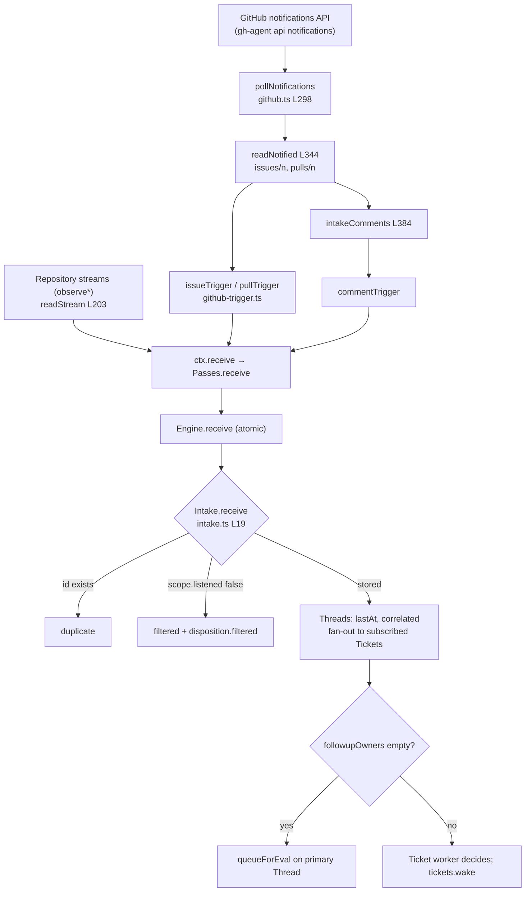

# પ્રકરણ 4 — Sources અને intake

[← પ્રકરણ 3](03-startup.md) · [અનુક્રમણિકા](../README.md) · [આગળ: પ્રકરણ 5 →](05-policy-eval.md)

## શીખવાનું પરિણામ અને પૂર્વજરૂરિયાત

આ પ્રકરણ પછી તમે GitHub Source ને notification થી `Engine.receive` સુધી trace કરી શકશો. રસ્તામાં: normalization, filtering, cursors, Thread mapping, Channel addressing. પછી `Intake.receive` ના ત્રણ પરિણામો (`stored`, `duplicate`, `filtered`), correlation, fan-out અને Eval queuing સમજાવી શકશો. Feishu Source નું માળખું પણ જાણશો.

**નવા concepts:**
- **Polling:** થોડી-થોડી વારે API ને પૂછવું કે નવું શું છે.
- **Cursor:** "ક્યાં સુધી વાંચ્યું" તેની નોંધ.
- **Idempotency:** એક જ ક્રિયા બે વાર થાય તો પણ પરિણામ એક જ વાર જેવું રહે.
- **Content-derived id:** data પરથી ગણેલું id, જે સમાન data માટે હંમેશાં સમાન હોય.

**ખોલવાનો ક્રમ:** [`src/sources/kind.ts`](https://github.com/deepseek-ai/dsh-superagent-prototype/blob/8c32a9dc5d72c033816c6a8110b37f40cf94fba4/src/sources/kind.ts) → [`src/sources/github.ts`](https://github.com/deepseek-ai/dsh-superagent-prototype/blob/8c32a9dc5d72c033816c6a8110b37f40cf94fba4/src/sources/github.ts) → [`src/sources/github-trigger.ts`](https://github.com/deepseek-ai/dsh-superagent-prototype/blob/8c32a9dc5d72c033816c6a8110b37f40cf94fba4/src/sources/github-trigger.ts) → [`src/sources/poll.ts`](https://github.com/deepseek-ai/dsh-superagent-prototype/blob/8c32a9dc5d72c033816c6a8110b37f40cf94fba4/src/sources/poll.ts) → [`src/app/source-context.ts`](https://github.com/deepseek-ai/dsh-superagent-prototype/blob/8c32a9dc5d72c033816c6a8110b37f40cf94fba4/src/app/source-context.ts) → [`src/core/intake.ts`](https://github.com/deepseek-ai/dsh-superagent-prototype/blob/8c32a9dc5d72c033816c6a8110b37f40cf94fba4/src/core/intake.ts).

## 4.1 Trigger intake diagram



**તીરોનો અર્થ:** ઉપરથી નીચે data નો પ્રવાહ છે. Notifications અને repository streams માંથી GitHub objects વંચાય છે. Trigger builders તેમને `Trigger` માં બદલે છે. `ctx.receive` તેમને Engine ને આપે છે. Intake ના diamond માં ત્રણ શાખાઓ છે: duplicate, filtered, stored. Stored Trigger fan-out થાય છે, અને પછી ક્યાં તો Eval queue માં જાય છે, ક્યાં તો કોઈ ticket નો worker તેનો નિર્ણય કરે છે.

## 4.2 GitHub Source: plugin entry અને loop

**[Source, real]** [`github.ts#L112-L122`](https://github.com/deepseek-ai/dsh-superagent-prototype/blob/8c32a9dc5d72c033816c6a8110b37f40cf94fba4/src/sources/github.ts#L112-L122):

```ts
export function apply(ctx: Context): void {
  ctx.effect(() => ctx.orchestrator.sources.register(githubKind), 'github: source kind')
  ctx.effect(() => {
    const source = sourceContext(ctx.orchestrator, githubKind)
    const controller = new AbortController()
    const running = watch(source, controller.signal)
      .catch((error: unknown) => { source.report('github', { state: 'error', detail: String(error) }) })
    return async () => { controller.abort(); await running }
  })
}
```

- પહેલો effect kind ને `SourceRegistry` માં register કરે છે. Register function નું return થયેલું unregister તેનો cleanup બને છે.
- બીજો effect polling loop શરૂ કરે છે. Loop ની error health માં નોંધાય છે, unhandled rejection બનતી નથી: "Unhandled rejections terminate the DSH process".

**`watch`** ([L127-L146](https://github.com/deepseek-ai/dsh-superagent-prototype/blob/8c32a9dc5d72c033816c6a8110b37f40cf94fba4/src/sources/github.ts#L127-L146)): `await ctx.ready` → configured ન હોય તો `paused/setupPending` report કરીને બહાર નીકળે છે. નહીં તો `pollRound` ચલાવે છે, અને પછી `max(GitHub નો X-Poll-Interval, pollSeconds)` seconds ની pause લે છે. સળંગ failures ગણાય છે; `failuresBeforeError` (default 3) પછી જ health error બને છે.

**`pollRound`** ([L280-L296](https://github.com/deepseek-ai/dsh-superagent-prototype/blob/8c32a9dc5d72c033816c6a8110b37f40cf94fba4/src/sources/github.ts#L280-L296)) ના ચાર સ્વતંત્ર પગલાં:
1. `pollNotifications`: agent account ની notifications. Running example ની Issue અહીંથી આવે છે.
2. `pollRepository`: `observeIssues/Pulls/Comments/Ci` switches ચાલુ હોય તો આખી repository નું વાંચન.
3. `pollTicketPulls`: open tickets ના PRs, તેમની CI, merge/close.
4. `pollThreads`: subscribed Threads (છેલ્લા Trigger અથવા ticket ના અંત પછી 14 દિવસ સુધી, `POLL_HORIZON_MS`).

એક પગલું fail થાય તો પણ બાકીનાં ચાલે છે. Round fail થાય છે, પણ છેલ્લે.

## 4.3 Cursor handling અને duplicate events

**[Source]** બે સ્તરના cursors છે:
- **Global** `KV.github.since`: notifications ક્યારથી માગવી. Round ના અંતે `cursorAt(round.started)` થી atomically આગળ વધે છે, retries map સાથે ([L341](https://github.com/deepseek-ai/dsh-superagent-prototype/blob/8c32a9dc5d72c033816c6a8110b37f40cf94fba4/src/sources/github.ts#L341)).
- **Per Issue/PR** `KV.github.cursor(number)`: comments ક્યારથી વાંચવા ([L372](https://github.com/deepseek-ai/dsh-superagent-prototype/blob/8c32a9dc5d72c033816c6a8110b37f40cf94fba4/src/sources/github.ts#L372)).

**[Source, real]** [`poll.ts#L16`](https://github.com/deepseek-ai/dsh-superagent-prototype/blob/8c32a9dc5d72c033816c6a8110b37f40cf94fba4/src/sources/poll.ts#L16):

```ts
export const cursorAt = (started: string): string => new Date(Date.parse(started) - 5000).toISOString()
```

Cursor **5 seconds પાછળ** રખાય છે, જેથી remote બાજુ મોડું પહોંચેલું event ચૂકી ન જવાય. તેથી overlap જાણીજોઈને થાય છે, અને એક જ comment બે rounds માં વંચાઈ શકે છે. Duplicate ને શું રોકે છે? **Content-derived Trigger id:**

```ts
const id = key('github-comment', comment.html_url ?? `github:${ref.number}`, String(comment.id), version)  // version = updated_at ?? submitted_at
```

([`github-trigger.ts#L68`](https://github.com/deepseek-ai/dsh-superagent-prototype/blob/8c32a9dc5d72c033816c6a8110b37f40cf94fba4/src/sources/github-trigger.ts#L65-L77)) અને `issueTrigger` નું id `key('github-issue', String(number))` છે. `key()` SHA-256 hash ના પહેલા 32 hex અક્ષરો છે ([`ids.ts`](https://github.com/deepseek-ai/dsh-superagent-prototype/blob/8c32a9dc5d72c033816c6a8110b37f40cf94fba4/src/core/ids.ts)).

**Running example, duplicate event:** **[Observed]** `B_duplicate.result = "duplicate"`. Ticket, Thread અને Decisions જરા પણ બદલાયાં નથી.

**મહત્વનું અવલોકન:** comment **edit** કરવામાં આવે તો `updated_at` બદલાય છે, એટલે id પણ બદલાય છે, અને edit એક **નવો Trigger** બને છે. પણ Issue body નું id ફક્ત number પરથી બને છે, એટલે body edit નવો Trigger બનાવતું નથી. ઉપરાંત `readNotified` ફક્ત cursor પછી ખોલાયેલી Issue નું body લે છે. આ જ કારણે docs કહે છે કે edit થી ઉમેરેલું mention વંચાતું નથી.

**Retries:** notification વાળી Issue નું read fail થાય તો તે `KV.github.retries` માં જાય છે, અને આગલા round માં સૌથી પહેલાં વંચાય છે. 24 કલાક પછી તેને છોડી દેવાય છે. HTTP 410 (deleted) હોય તો તરત છોડાય છે. 404 retry થાય છે, કારણ કે private repo માં access ગુમાવવાથી પણ 404 આવે છે (L156-L165).

## 4.4 Normalization, filtering, Thread mapping, Channel addressing

| પાસું | GitHub નિયમ | Source |
| --- | --- | --- |
| Agent ના પોતાના messages | `sameName(comment.user.login, login)` હોય તો skip | [`github.ts#L397`](https://github.com/deepseek-ai/dsh-superagent-prototype/blob/8c32a9dc5d72c033816c6a8110b37f40cf94fba4/src/sources/github.ts#L397) |
| Human કે bot | `isHumanLogin`: `[bot]` suffix નહીં, અને `type === 'User'` | [`github-trigger.ts#L46-L47`](https://github.com/deepseek-ai/dsh-superagent-prototype/blob/8c32a9dc5d72c033816c6a8110b37f40cf94fba4/src/sources/github-trigger.ts#L46-L47) |
| Addressed | Body માં `@<agent>` word boundary સાથે (`mentions`) | L60-L61 |
| Thread | `github:<number>`; default-branch CI માટે `github:ci:<branch>` | `issueTrigger`, `branchCiTrigger` |
| Channel | `{ source:'github', thread:'github:<n>', address:{ number, url? } }`; review comment ના `url` પરથી reply review thread માં જાય | `githubChannel` L8-L9 |
| Body વગરની review | Text ખાલી હોય તો skip; પણ approval (`APPROVED review of commit …`) text બને છે | `commentText`, L398-L400 |
| Scope / row | `meta.kind` → `issues`/`pulls`/`comments`/`ci`; `observed` switch પરથી | `scope` L59-L62 |

**[Observed]** Running example નો Trigger:

```json
{ "threads": [{ "source": "github", "id": "7" }], "addressed": "mention",
  "channel": { "source": "github", "thread": "github:7", "address": { "number": "7", "url": "https://github.com/demo-org/widgets/issues/7" } } }
```

**`SourceContext.receive`:** Source Engine ને સીધું બોલાવતો નથી. તે `deps.receive` બોલાવે છે, જે `passes.receive` છે ([`runtime.ts#L161`](https://github.com/deepseek-ai/dsh-superagent-prototype/blob/8c32a9dc5d72c033816c6a8110b37f40cf94fba4/src/app/runtime.ts#L161)). Passes shutdown દરમિયાન નવા Triggers નકારે છે, અને Trigger stored થાય તો pass માગે છે. Host interface ની doc કહે છે: "callers should await completion before advancing read cursors" ([`host.ts#L41-L42`](https://github.com/deepseek-ai/dsh-superagent-prototype/blob/8c32a9dc5d72c033816c6a8110b37f40cf94fba4/src/sources/host.ts#L41-L42)). એટલે cursor ત્યારે જ આગળ વધે છે જ્યારે Trigger SQLite માં commit થઈ ગયો હોય.

## 4.5 `Engine.receive` → `Intake.receive`, line by line

**[Source, real]** [`intake.ts#L19-L62`](https://github.com/deepseek-ai/dsh-superagent-prototype/blob/8c32a9dc5d72c033816c6a8110b37f40cf94fba4/src/core/intake.ts#L19-L62). `Engine.receive` તેને `repo.atomic(…)` માં લપેટે છે ([`engine.ts#L48`](https://github.com/deepseek-ai/dsh-superagent-prototype/blob/8c32a9dc5d72c033816c6a8110b37f40cf94fba4/src/core/engine.ts#L48)):

```ts
receive(received: Trigger): ReceiveResult {
  const trigger = { ...received, at: isoTime(received.at) }                       // (1)
  if (!trigger.threads.length) throw new Error('A trigger must belong to at least one thread')
  if (this.repo.triggers.get(trigger.id)) return 'duplicate'                       // (2)
  const at = this.now()
  const filter = this.options.scope.scope(trigger)                                 // (3)
  if (!filter.listened) {
    this.repo.triggers.save(trigger); this.repo.triggers.saveDisposition(trigger.id, { filtered: { code: filter.reason }, fanout: [], at })
    return 'filtered'
  }
  this.repo.triggers.save(trigger)
  const keys = trigger.threads.map(threadKey)
  const reached = new Map<string, { ticket: Ticket; context: boolean }>()
  for (const ref of trigger.threads) {                                             // (4)
    const thread = this.thread(ref)
    if (!thread.lastAt || trigger.at > thread.lastAt) thread.lastAt = trigger.at
    thread.correlated = [...new Set([...thread.correlated, ...keys.filter(other => other !== thread.key)])]
    for (const ticketId of thread.subscriptions) {                                 // (5)
      const ticket = this.repo.tickets.get(ticketId)
      const followed = !!thread.context?.includes(ticketId)
      const resumes = trigger.human && ticket?.ended?.by !== 'human' && !followed
      if (!ticket || (!liveTicket(ticket) && !resumes)) continue
      reached.set(ticketId, { ticket, context: followed && (reached.get(ticketId)?.context ?? true) })
    }
    this.repo.threads.save(thread)
  }
  for (const [ticketId, { ticket, context: followed }] of reached) {               // (6)
    this.tickets.addInput(ticket, { id: key('input', ticketId, 'trigger', trigger.id), kind: 'trigger', triggerId: trigger.id, at, … })
  }
  …saveDisposition(trigger.id, { fanout, context?, at })
  if (!this.owners(trigger).length) this.queueForEval(trigger)                     // (7)
  for (const ticketId of fanout) this.tickets.wake(ticketId)                       // (8)
  this.emit('trigger.received', …)
  return 'stored'
}
```

1. **Time normalization:** GitHub whole seconds માં સમય આપે છે; `isoTime` તેને `toISOString` સ્વરૂપમાં લાવે છે, જેથી SQL અને memory બંનેમાં string comparison સાચું પડે.
2. **Duplicate:** id પહેલેથી હોય તો **કશું લખાતું નથી**.
3. **Filtered:** `SourceRegistry.scope`. Source disabled હોય તો `source_disabled`; plugin ન હોય તો `source_not_installed`; Feishu માં chat configured ન હોય તો `chat_not_allowed`. Filtered Trigger **સચવાય છે**, audit માટે: panel "Filtered Triggers" બતાવે છે, અને પછીથી "Evaluate again" થઈ શકે છે.
4. **Correlation:** એક Trigger અનેક Threads પર હોય તો દરેક Thread બીજા Threads ને `correlated` માં નોંધે છે. Eval ફક્ત **primary** (`threads[0]`) Thread પર થાય છે. Test: "records correlation for a trigger on several threads and evaluates only on the primary one".
5. **Subscriptions → fan-out:** live ticket ને બધું મળે છે. Ended ticket ને ફક્ત **માણસનો** message, અને તે પણ ત્યારે જ જ્યારે ticket માણસે stop ન કર્યો હોય અને Thread context-only ન હોય. આ resume નો આધાર છે.
6. **Input:** idempotent id `key('input', ticketId, 'trigger', triggerId)`.
7. **Eval queue:** કોઈ ticket follow-up નો owner ન હોય ત્યારે જ (bots ના messages, stopped tickets, context-only threads).
8. **Wake:** ended ticket ને resume કરવાનો પ્રયાસ ([પ્રકરણ 6](06-tickets-assignments.md)).

**Return value નો ઉપયોગ:** `Passes.receive` ફક્ત `'stored'` પર pass માગે છે.

## 4.6 Running example નાં intake પરિણામો

| Scenario | `receive` | Disposition | Eval queue? | [Observed] |
| --- | --- | --- | --- | --- |
| alice Issue #7 | stored | `fanout: []` | હા → explicit Eval | `A_received.thread7.pending = 1` |
| ફરી poll (same id) | duplicate | — | — | `B_duplicate` |
| mallory #8 (કોઈ ticket નથી) | stored | `fanout: []` | હા → gate `not_a_member` → ignore | `C_unauthorized` |
| mallory #7 (ticket thread) | stored | `fanout: [ticket]` | **ના** (worker owner) | `D_…disposition` |
| alice follow-up #7 | stored | `fanout: [ticket]` | ના | `E_followup` |
| `github-actions[bot]` #7 | stored | `fanout: [ticket]` | **હા** (bot ના messages owned નથી) → `not_human` ignore | `F_failed.decisions7[1]` |
| stop પછી "Thanks!" | stored | `fanout: []` (stopped ticket) | હા | `J_afterStop` |

## 4.7 Feishu: વૈકલ્પિક Source

**[Source]** `cordis.patch.yml` માં `disabled: true`. માળખું:
- **Trigger:** `feishuTrigger` ([`feishu-trigger.ts#L31-L44`](https://github.com/deepseek-ai/dsh-superagent-prototype/blob/8c32a9dc5d72c033816c6a8110b37f40cf94fba4/src/sources/feishu-trigger.ts#L31-L44)). Bot ના પોતાના messages drop થાય છે. `p2p` chat હોય તો `addressed: 'direct'`, bot નો mention હોય તો `'mention'`. Thread id = chat + root message (`feishuThreadId`), એટલે Feishu નો એક "topic" એક Thread છે.
- **Scope rows:** દરેક configured chat (`listen: mentions|all`), `other` (અન્ય chats, `otherChats: 'mentions'` હોય તો), અને `direct` ([`feishu.ts#L55-L58`](https://github.com/deepseek-ai/dsh-superagent-prototype/blob/8c32a9dc5d72c033816c6a8110b37f40cf94fba4/src/sources/feishu.ts#L55-L58)).
- **Loops** ([`feishu-loops.ts`](https://github.com/deepseek-ai/dsh-superagent-prototype/blob/8c32a9dc5d72c033816c6a8110b37f40cf94fba4/src/sources/feishu-loops.ts)): `consume` (live event consumer, `lark-cli` દ્વારા), `backfillLoop` (history recovery, જે restart દરમિયાન ચૂકાયેલા messages લાવે છે), `chatNamesLoop`, અને `pollThreads` (subscribed topics). Test: "translates a polled topic reply as the event consumer translates the live event". એટલે live અને history બંને માર્ગો **એક જ** Trigger id બનાવે છે, અને duplicate થતા નથી.
- **Policy sync:** sync chat ના members allowed list બને છે (`orchestrator_policy_sync`, panel નું **Sync now** બટન).

## 4.8 Exercise

```bash
pnpm vitest run tests/core-engine.spec.ts -t "intake"
```

```bash
pnpm vitest run tests/sources.spec.ts -t "keeps one body Trigger for an Issue that a later poll reads again"
```

બીજો test સાબિત કરે છે કે Issue body નો Trigger બીજા poll માં ફરી સ્ટોર થતો નથી, જે duplicate guard નું GitHub-side સ્વરૂપ છે.

## 4.9 Modification અને verification

**કાર્ય:** running example માં alice ના follow-up પહેલાં તે જ comment ને નવા `updated_at` સાથે ફરી `receive` કરો, જાણે comment edit થઈ હોય. **અપેક્ષા:** `'stored'`, અને ticket ને બીજું Input મળે. **Verify:** `commentTrigger` ના id માં version છે, એટલે બે અલગ ids બનશે. Patch અને પરિણામ: [પરિશિષ્ટ E](../appendices/E-solutions.md#પ્રકરણ-4).

## 4.10 Debugging exercise: "duplicate events"

**લક્ષણ:** worker ને એક જ comment બે વાર દેખાય છે. **નિદાન-પગલાં:** (1) panel → Trigger tab → બંને Trigger ids સરખાવો. Ids અલગ હોય તો comment edit થઈ હતી (version બદલાયું). Ids સરખા હોય તો Intake એ બીજી વાર તેને stored કર્યો જ નહીં હોય. (2) Input ids જુઓ: `key('input', ticket, 'trigger', triggerId)` પણ idempotent છે. (3) એક સરખું input બે વાર પહોંચ્યું હોય તો delivery side જુઓ: restart પછી session inbox માં copy ([પ્રકરણ 7](07-worker-execution.md), `agent.inbox.remove`). **Regression test:** "stores a trigger once and records source filtering".

## Mastery પ્રશ્નો

1. Cursor 5 seconds પાછળ રાખવાથી શું જોખમ ઊભું થાય છે, અને તે કેવી રીતે નિષ્ક્રિય થાય છે?
2. Filtered Trigger ને drop કરવાને બદલે store કેમ કરવો?
3. Bot નો message ticket ના Thread પર fan-out **અને** Eval queue, બંનેમાં કેમ જાય છે?
4. `threads[0]` primary કેમ છે, અને Correlation routing કેમ કરતું નથી?

ઉકેલો: [પરિશિષ્ટ E § પ્રકરણ 4](../appendices/E-solutions.md#પ્રકરણ-4)

[← પ્રકરણ 3](03-startup.md) · [આગળ: પ્રકરણ 5 →](05-policy-eval.md)
