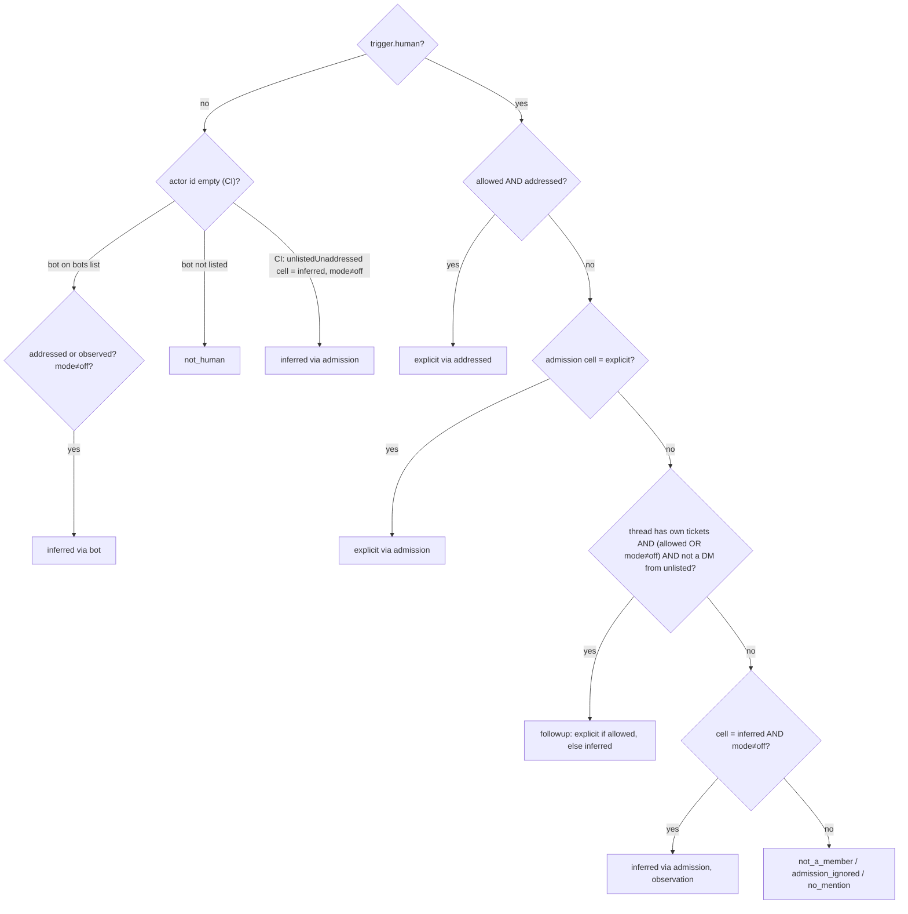
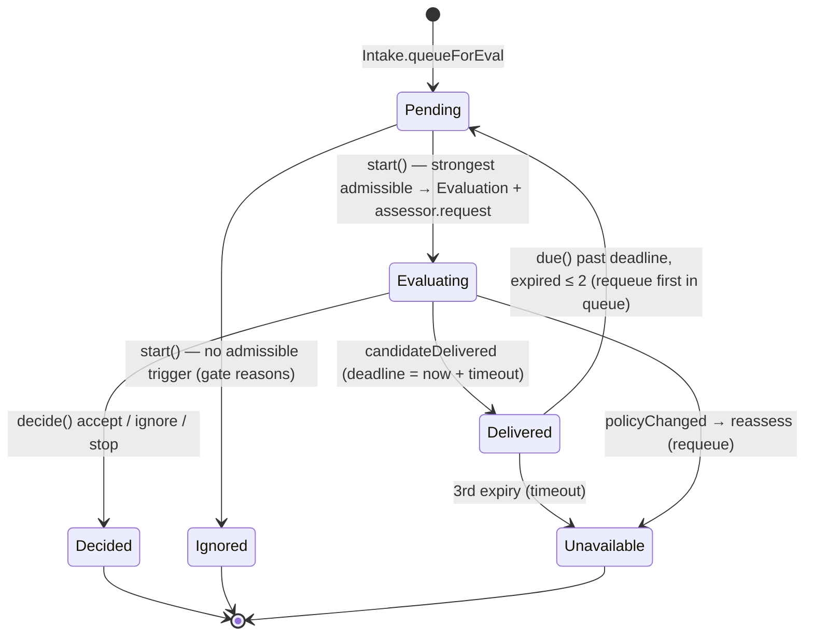

# પ્રકરણ 5 — Policy અને evaluation

[← પ્રકરણ 4](04-sources-intake.md) · [અનુક્રમણિકા](../README.md) · [આગળ: પ્રકરણ 6 →](06-tickets-assignments.md)

## શીખવાનું પરિણામ અને પૂર્વજરૂરિયાત

આ પ્રકરણ પછી તમે:
- deterministic admission (**gate**) અને model **assessment** ને અલગ પાડી શકશો;
- `explicit` અને `inferred` strength, allowed identities, admission table અને accept modes સમજાવી શકશો;
- `Evals.start` ના batching, candidate, deadline, requeue અને `unavailable` trace કરી શકશો;
- versioned Policy નો Evals અને ચાલુ Tickets પર થતો પ્રભાવ (`policyEffects`, `revalidate`) code અને tests વડે સમજાવી શકશો.

**ખોલવાનો ક્રમ:** [`docs/002-authorization.md`](https://github.com/deepseek-ai/dsh-superagent-prototype/blob/8c32a9dc5d72c033816c6a8110b37f40cf94fba4/docs/002-authorization.md) → [`src/policy.ts`](https://github.com/deepseek-ai/dsh-superagent-prototype/blob/8c32a9dc5d72c033816c6a8110b37f40cf94fba4/src/policy.ts) → [`src/admission.ts`](https://github.com/deepseek-ai/dsh-superagent-prototype/blob/8c32a9dc5d72c033816c6a8110b37f40cf94fba4/src/admission.ts) → [`src/core/evals.ts`](https://github.com/deepseek-ai/dsh-superagent-prototype/blob/8c32a9dc5d72c033816c6a8110b37f40cf94fba4/src/core/evals.ts) → [`src/app/assessment.ts`](https://github.com/deepseek-ai/dsh-superagent-prototype/blob/8c32a9dc5d72c033816c6a8110b37f40cf94fba4/src/app/assessment.ts) → [`tests/policy.spec.ts`](https://github.com/deepseek-ai/dsh-superagent-prototype/blob/8c32a9dc5d72c033816c6a8110b37f40cf94fba4/tests/policy.spec.ts).

## 5.1 સાદી ગુજરાતીમાં

દરવાજે ઊભેલો ચોકીદાર એ **gate** છે. તે ફક્ત યાદી જુએ છે: "નામ યાદીમાં છે? તમે અમને સીધું બોલાવ્યા?" પછી અંદર બેઠેલો સમજદાર મેનેજર, એટલે **assessment**, વાત સમજીને નક્કી કરે છે કે કામ લેવું કે નહીં. પણ જો યાદીમાંનો માણસ સીધું બોલાવે, તો મેનેજરનો મત જરૂરી નથી: તે **explicit** request છે, અને main Session તેને સીધું route કરે છે. મેનેજરની જરૂર ફક્ત અનુમાનિત (**inferred**) કામ માટે પડે છે.

## 5.2 Gate: decision tree

**[Source]** [`settingsPolicy().gate`, `policy.ts#L191-L211`](https://github.com/deepseek-ai/dsh-superagent-prototype/blob/8c32a9dc5d72c033816c6a8110b37f40cf94fba4/src/policy.ts#L191-L211), અને bots/CI માટે `machineGate` ([L171-L188](https://github.com/deepseek-ai/dsh-superagent-prototype/blob/8c32a9dc5d72c033816c6a8110b37f40cf94fba4/src/policy.ts#L171-L188)).



**તીરોનો અર્થ:** દરેક diamond એક શરત છે, અને તીર તેનો જવાબ છે. પાંદડાં gate નું પરિણામ (`GateResult`) છે. Explicit cell નો check follow-up check **પહેલાં** આવે છે: code comment મુજબ, "so a thread's tickets never weaken an explicit request to a follow-up".

**Admission table defaults** (`docs/002`):

| Cell | Choices | Default |
| --- | --- | --- |
| `listedUnaddressed` (યાદીમાં છે, બોલાવ્યા નથી) | inferred, ignore | inferred |
| `unlistedAddressed` (યાદીમાં નથી, બોલાવ્યા છે) | explicit, inferred, ignore | ignore |
| `unlistedUnaddressed` | inferred, ignore | ignore |

Unaddressed cells ફક્ત ત્યારે લાગુ પડે છે જ્યારે Source એ scope ના **બધા** messages મેળવતો હોય (`scope.observed`).

### Running example માં gate

**[Observed]** alice: `{ admissible: true, strength: 'explicit', basis: { via: 'addressed', addressed: 'mention', sender: 'alice', row: 'issues', … } }`. mallory #8 પર: `not_a_member`.

**[Test ચલાવ્યો]** ticket ના Thread (`github:7`) પર mallory નું `@widgets-agent stop` દરેક accept mode માં (અમારો એક temporary test, [પરિશિષ્ટ F](../appendices/F-verification-report.md)):

| Mode | Gate result |
| --- | --- |
| `off` | `{ admissible: false, reason: 'not_a_member' }` |
| `observe` | `{ admissible: true, strength: 'inferred', basis: { via: 'followup', row: 'comments' } }` |
| `auto` | same as observe |

એટલે `observe` (default) માં mallory નો stop **admissible** છે, પણ inferred છે. `Evals.decideEval` stop માટે `explicit` માગે છે, એટલે તે `ignore` + `stopNotExplicit` બને છે. **[Observed]** `H_stopRefused.decision = { kind: 'ignore', strength: 'inferred', reason: [{ code: 'stopNotExplicit' }] }`. `off` mode માં `decide` direct Eval માં `notAdmissible` UserError ફેંકે છે.

## 5.3 Eval lifecycle: start, candidate, deadline, decision



**State diagram ના તીરો** method calls છે, અને દરેક label તે transition કરનાર function નું નામ છે. Pending અને Evaluating એ `Thread.pending` અને `Thread.evaluating` fields ની સ્થિતિ છે.

### `Evals.start` — batching અને strength

**[Source]** [`evals.ts#L71-L119`](https://github.com/deepseek-ai/dsh-superagent-prototype/blob/8c32a9dc5d72c033816c6a8110b37f40cf94fba4/src/core/evals.ts#L71-L119). મુખ્ય પગલાં:

1. Queue માં રહેલા follow-ups, જેનો હવે કોઈ ticket owner છે (જૂના version એ queue કર્યા હોય), Decision વગર queue માંથી નીકળી જાય છે.
2. જે Triggers એ પહેલાં ticket શરૂ કર્યો હતો તે `startedTicket` reason સાથે ignore થાય છે. આ replay ને બીજો ticket બનાવતો અટકાવે છે.
3. દરેક Trigger પર gate ચાલે છે. **Strongest** admissible Trigger batch ની strength, actor અને basis આપે છે; સરખી strength હોય તો સૌથી છેલ્લો (`later`).
4. `evalId = key('eval', thread.key, policy.version, at, ...pending)`, અને `deadline = at + evalTimeoutMs` (default 120 s, `EvalConfigSchema`).
5. આખો `pending` એક batch બને છે, અને `pending = []`. Eval ચાલતું હોય ત્યારે આવતા Triggers પછીના Eval માટે રાહ જુએ છે. Test: "serializes evals per thread and debounces triggers that arrive meanwhile".
6. `assessor.request(candidate)`. `MasterAssessor.request` ફક્ત એક `assessment` effect enqueue કરે છે ([`assessment.ts#L104`](https://github.com/deepseek-ai/dsh-superagent-prototype/blob/8c32a9dc5d72c033816c6a8110b37f40cf94fba4/src/app/assessment.ts#L104)).

### Deadline ક્યારથી ગણાય છે?

**[Source]** Effect handler candidate card ને main Session માં `steer` કરે છે, પછી `engine.candidateDelivered(evalId)` બોલાવે છે ([`assessment.ts#L96-L101`](https://github.com/deepseek-ai/dsh-superagent-prototype/blob/8c32a9dc5d72c033816c6a8110b37f40cf94fba4/src/app/assessment.ts#L96-L101)). `Evals.delivered` deadline ને **delivery ના સમયથી** ફરી ગણે છે ([L48-L55](https://github.com/deepseek-ai/dsh-superagent-prototype/blob/8c32a9dc5d72c033816c6a8110b37f40cf94fba4/src/core/evals.ts#L48-L55)). `due()` ફક્ત `delivered` Evals ને expire કરે છે, એટલે busy main Session નો સમય Eval ના budget માંથી કપાતો નથી. Pause દરમિયાન `pausedAt` નોંધાય છે, અને pause પૂરો થાય ત્યારે deadline એટલી જ આગળ ખસે છે.

**Requeue → unavailable:** `REQUEUES = 2` ([L19](https://github.com/deepseek-ai/dsh-superagent-prototype/blob/8c32a9dc5d72c033816c6a8110b37f40cf94fba4/src/core/evals.ts#L19)). પહેલી બે expiries Triggers ને queue ની **આગળ** પાછા મૂકે છે; ત્રીજી expiry `unavailable` + `timeout` નોંધે છે ([`expire`, L60-L69](https://github.com/deepseek-ai/dsh-superagent-prototype/blob/8c32a9dc5d72c033816c6a8110b37f40cf94fba4/src/core/evals.ts#L60-L69)).

### `decide` — explicit requests માટે direct Eval

Explicit request માં assessment ની રાહ જોવાની જરૂર નથી. Main Session `orchestrator_route` accept બોલાવે છે, જે `engine.decide(triggerId, { kind: 'accept', … reason: { code: 'explicitRouted' } })` છે ([`tools/main.ts#L95-L105`](https://github.com/deepseek-ai/dsh-superagent-prototype/blob/8c32a9dc5d72c033816c6a8110b37f40cf94fba4/src/app/tools/main.ts#L95-L105)). `Evals.decide` ([L131-L156](https://github.com/deepseek-ai/dsh-superagent-prototype/blob/8c32a9dc5d72c033816c6a8110b37f40cf94fba4/src/core/evals.ts#L131-L156)) ના નિયમો:

| ચકાસણી | નિષ્ફળ થાય તો |
| --- | --- |
| Trigger અસ્તિત્વમાં છે | `unknownTrigger` |
| `outcome.evalId` હજી ચાલુ Eval નું છે | `evalFinished` |
| આ Trigger પહેલાં accept થયો હતો | તે જ જૂનો Decision પાછો (બીજો ticket નહીં) |
| Stop સિવાયનું outcome, અને worker follow-up નો owner છે | `workerDecides` |
| Eval નથી → `directEval`: gate admissible? | `notAdmissible` |
| Inferred accept: `policy.admitsInferred(rules)` (auto mode + enabled rules) | `notExplicit` |
| Policy version બદલાઈ ગયું | `unavailable` + `policyChanged` → batch requeue |

**[Observed]** Running example માં `A_accepted.decisions7 = [{ kind: 'accept', reason: ['explicitRouted'] }]`.

## 5.4 Assessment (inferred candidates) અને `assessmentOutcome`

**[Source]** [`policy.ts#L40-L61`](https://github.com/deepseek-ai/dsh-superagent-prototype/blob/8c32a9dc5d72c033816c6a8110b37f40cf94fba4/src/policy.ts#L40-L61): model નો structured જવાબ Engine outcome માં ફેરવાય છે.
1. દરેક enabled rule માટે બરાબર એક `rule_assessment` હોવું જોઈએ, નહીં તો throw.
2. `decision !== 'accept'` હોય તો તે જ kind પાછો.
3. `direction` settled ન હોય (implementation requested નથી, target `undetermined` છે, અથવા design decision બાકી છે) તો `ignore` + `directionUnsettled`.
4. કોઈ rule match ન થાય તો `ignore` + `noRuleMatched`.
5. Accept માટે `intent_evidence` ફરજિયાત છે.
6. **Inferred + mode ≠ auto** → `ignore`, audit માં `would_accept: true`, reason `observed`. આ જ `observe` mode નો અર્થ છે: નિર્ણય નોંધાય છે, પણ કામ થતું નથી.

Main Session ના instructions [`prompts/admission.md`](https://github.com/deepseek-ai/dsh-superagent-prototype/blob/8c32a9dc5d72c033816c6a8110b37f40cf94fba4/prompts/admission.md) માં છે. ઉદાહરણ: "Before matching rules, establish three independent facts: the discussion targets this project, the participants express intent…, and the direction is sufficiently settled". Default rules `copy` અને `visual` છે ([`DEFAULT_RULES`, L62-L65](https://github.com/deepseek-ai/dsh-superagent-prototype/blob/8c32a9dc5d72c033816c6a8110b37f40cf94fba4/src/policy.ts#L62-L65)).

**Running example ને proactive બનાવો:** જો GitHub `observeIssues` ચાલુ હોય અને કોઈ Issue `@` વગર "README માં typo છે" કહે, તો listed sender હોય તો gate `listedUnaddressed` → inferred આપે છે. Main Session `orchestrator_eval` → `orchestrator_eval_decide` કરે છે. `observe` mode માં Decision `ignore (observed: would accept …)` બને છે.

## 5.5 Versioned Policy

**[Source, real]** [`policy.ts#L116-L118`](https://github.com/deepseek-ai/dsh-superagent-prototype/blob/8c32a9dc5d72c033816c6a8110b37f40cf94fba4/src/policy.ts#L116-L118):

```ts
export function policyVersion(settings: Settings): string {
  return key(POLICY_REVISION, JSON.stringify({ rules: settings.policy.rules, mode: settings.eval.mode, sources: settings.policy.sources }))
}
```

Version માં ફક્ત rules, mode અને Sources ના policy parts આવે છે. Models, concurrency, pause અને Source configuration તેમાં **નથી**. Test: "changes the Policy version for rules, accept mode and the Sources' parts, not for pause, concurrency, models or Source configuration".

**Version બદલાય ત્યારે** (`Settings.save` → `engine.policyChanged`):
1. **Running Evals:** `Evals.policyChanged` દરેક ચાલુ Eval ને `unavailable` + `policyChanged` નોંધે છે, અને Triggers ને queue ની આગળ પાછા મૂકે છે (`reassess`).
2. **Live tickets:** `policyEffects` ([L144-L165](https://github.com/deepseek-ai/dsh-superagent-prototype/blob/8c32a9dc5d72c033816c6a8110b37f40cf94fba4/src/policy.ts#L144-L165)) ફક્ત પ્રભાવિત tickets ને `policy-changed` Input આપે છે. શક્ય પ્રભાવો: rule બદલાયો/બંધ થયો, requester ને હવે મંજૂરી નથી, અથવા proactive કામ હવે સ્વીકારાતું નથી. Mandate **revoke થતો નથી**, અને ચાલુ કામ cancel થતું નથી (`docs/001` rejected: "Cancelling running Tickets on a Policy change").
3. **Ended tickets:** resume પહેલાં `revalidate(mandate)` ([L213-L240](https://github.com/deepseek-ai/dsh-superagent-prototype/blob/8c32a9dc5d72c033816c6a8110b37f40cf94fba4/src/policy.ts#L213-L240)). Fail થાય તો ticket ended જ રહે છે, અને waiting messages Eval માં જાય છે.

**Running example:** alice ને allowed list માંથી કાઢી નાખો તો `policyEffects` alice ના live ticket ને `requesterAllowed: false` Input આપે છે. Worker ને સંદેશ મળે છે: "may no longer start work here: finish the assignment within its scope" ([`policyMessage`, `dsh.ts#L138-L148`](https://github.com/deepseek-ai/dsh-superagent-prototype/blob/8c32a9dc5d72c033816c6a8110b37f40cf94fba4/src/executor/dsh.ts#L138-L148)). Ticket પછી પૂરો થાય અને alice ફરી comment કરે, તો `revalidate` (`via: 'addressed'` → `allowedSender`) false આપે છે, અને resume થતો નથી.

## 5.6 Exercise

```bash
pnpm vitest run tests/policy.spec.ts
```

```bash
pnpm vitest run tests/core-engine.spec.ts -t "counts an Eval's deadline from its delivery"
```

બીજો test આ સાબિત કરે છે: deadline delivery થી ગણાય છે, બે requeue પછી `unavailable` આવે છે, અને undelivered Eval expire થતું નથી.

## 5.7 Modification અને regression verification

**[Test ચલાવ્યો]** `REQUEUES = 2` ને `3` કરો:

```diff
-const REQUEUES = 2
+const REQUEUES = 3
```

```bash
pnpm vitest run tests/core-engine.spec.ts
```

**Observed:** `Tests 1 failed | 112 passed (113)`. Fail થનાર test: "counts an Eval's deadline from its delivery, queues its Triggers again twice when it expires, then records it unavailable", `AssertionError: expected [] to deeply equal [ ObjectContaining{…} ]`. **અર્થ:** behavior (`docs/002`: "After two consecutive retries, the third expiry records unavailable") test થી સુરક્ષિત છે. આ ફેરફાર કરવો હોય તો docs, test અને code ત્રણેય સાથે બદલવાં પડે. પછી `git checkout src/core/evals.ts`.

## 5.8 Debugging exercise: "denied request" અને "assessment timeout"

1. **Denied:** panel → Eval tab → Decision નો reason `not_a_member` હોય તો sender allowed list માં નથી. `no_mention` હોય તો sender listed છે પણ agent ને `@` કર્યું નથી, અને scope observed નથી. `admission_ignored` હોય તો table cell `ignore` છે. **સુધારો:** Policy → On each Source.
2. **Timeout:** `evals` health entry છેલ્લા કલાકના unresolved unavailable Decisions બતાવે છે. તપાસો કે main Session ચાલે છે કે નહીં, model retry (`models` health) છે કે નહીં, અને timeout (`eval.timeoutSeconds`) પૂરતો છે કે નહીં. **Regression:** ઉપરનો deadline test.

## Mastery પ્રશ્નો

1. Explicit request માટે assessment કેમ છોડી દેવાય છે, અને accept કયા reason code સાથે નોંધાય છે?
2. `observe` mode માં positive assessment નું Decision શું હોય છે?
3. Eval ની deadline શરૂઆતથી નહીં પણ delivery થી કેમ ગણાય છે?
4. Policy version બદલાય તો ચાલુ ticket cancel કેમ નથી થતો?
5. mallory ticket ના thread પર stop લખે તો `off` mode માં અને `observe` mode માં શું અલગ પડે છે?

ઉકેલો: [પરિશિષ્ટ E § પ્રકરણ 5](../appendices/E-solutions.md#પ્રકરણ-5)

[← પ્રકરણ 4](04-sources-intake.md) · [આગળ: પ્રકરણ 6 →](06-tickets-assignments.md)
