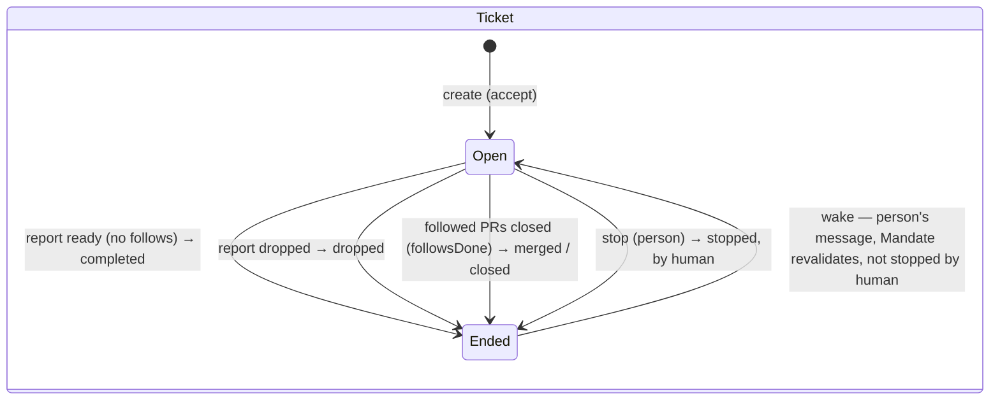
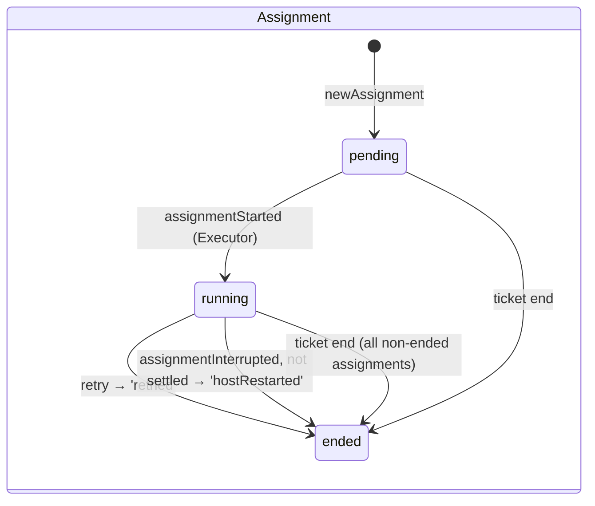
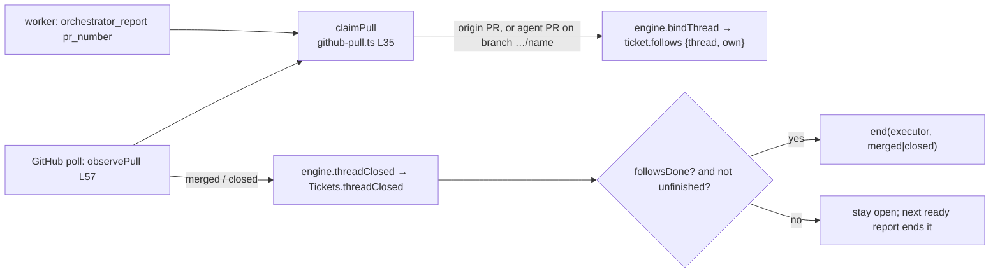

# પ્રકરણ 6 — Tickets અને Assignments

[← પ્રકરણ 5](05-policy-eval.md) · [અનુક્રમણિકા](../README.md) · [આગળ: પ્રકરણ 7 →](07-worker-execution.md)

## શીખવાનું પરિણામ અને પૂર્વજરૂરિયાત

આ પ્રકરણ પછી તમે:
- accept ને Mandate, Ticket, Subscription, acknowledgement અને Assignment સુધી, **એક transaction** માં trace કરી શકશો;
- Ticket અને Assignment ના સ્વતંત્ર lifecycles (state diagrams) દોરી શકશો;
- stop, resume, retry, follow-up ownership, context-only subscriptions, hand-back અને PR closure સમજાવી શકશો;
- running example ના stop પછી Thread પર 3 messages કેમ queue થયા તે કારણ સાથે સમજાવી શકશો.

**Database concept:** **transaction** એટલે ફેરફારોનો એવો સમૂહ જે કાં તો બધો commit થાય, કાં તો કંઈ જ નહીં (atomicity).

**ખોલવાનો ક્રમ:** [`docs/003-execution.md`](https://github.com/deepseek-ai/dsh-superagent-prototype/blob/8c32a9dc5d72c033816c6a8110b37f40cf94fba4/docs/003-execution.md) → [`src/core/tickets.ts`](https://github.com/deepseek-ai/dsh-superagent-prototype/blob/8c32a9dc5d72c033816c6a8110b37f40cf94fba4/src/core/tickets.ts) → [`src/core/assignments.ts`](https://github.com/deepseek-ai/dsh-superagent-prototype/blob/8c32a9dc5d72c033816c6a8110b37f40cf94fba4/src/core/assignments.ts) → [`src/core/replies.ts`](https://github.com/deepseek-ai/dsh-superagent-prototype/blob/8c32a9dc5d72c033816c6a8110b37f40cf94fba4/src/core/replies.ts) → [`src/core/stage.ts`](https://github.com/deepseek-ai/dsh-superagent-prototype/blob/8c32a9dc5d72c033816c6a8110b37f40cf94fba4/src/core/stage.ts) → [`src/sources/github-pull.ts`](https://github.com/deepseek-ai/dsh-superagent-prototype/blob/8c32a9dc5d72c033816c6a8110b37f40cf94fba4/src/sources/github-pull.ts).

## 6.1 Accept → Ticket: એક transaction

**Call chain:** `orchestrator_route` → `engine.decide` → `repo.atomic` → `Evals.decide` → `decideEval` → `accept` ([`evals.ts#L306-L316`](https://github.com/deepseek-ai/dsh-superagent-prototype/blob/8c32a9dc5d72c033816c6a8110b37f40cf94fba4/src/core/evals.ts#L306-L316)) → `finish`/`record` (Decision) → `Tickets.create` ([`tickets.ts#L37-L56`](https://github.com/deepseek-ai/dsh-superagent-prototype/blob/8c32a9dc5d72c033816c6a8110b37f40cf94fba4/src/core/tickets.ts#L37-L56)).

**[Source, real]** `Tickets.create` (shortened):

```ts
create(id, decisionId, mandate, evaluation, outcome, at) {
  const primary = this.repo.triggers.get(evaluation.primary ?? triggerIds.at(-1)!)
  const origin = { triggerId: primary?.id ?? triggerIds[0]!, triggerIds }
  let ticket: Ticket = { id, title: outcome.title, decisionId, mandate, channels: [], assignments: [], inputs: [], undelivered: [], createdAt: at, updatedAt: at, origin }
  for (const triggerId of triggerIds) { …add unique channel… }
  ticket = this.options.prepareTicket?.(ticket, outcome) ?? ticket          // (a) Executor names the directory
  const assignment = this.newAssignment(ticket)                              // (b) pending Assignment
  this.repo.tickets.save(ticket)
  for (…) this.subscribe(id, ref)                                            // (c) Subscriptions
  if (outcome.acknowledgement && primary) this.replies.acknowledgeAccepted(id, primary, outcome.acknowledgement)  // (d) ack → Outbox
  this.options.executor.start(this.require(id), assignment)                  // (e) launch effect
  this.emit('ticket.created', …)
}
```

(a) `prepareTicket` એટલે `DshExecutor.prepare` → `ticketExecution`: worktree name `<name>-<ticketId first 12 chars>`, અને directory `<root>/<name>` ([`dsh.ts#L97-L111`](https://github.com/deepseek-ai/dsh-superagent-prototype/blob/8c32a9dc5d72c033816c6a8110b37f40cf94fba4/src/executor/dsh.ts#L97-L111)). (d) અને (e) ફક્ત **queue** કરે છે: Outbox receipt + `reply` effect, અને `launch` effect, બંને આ જ SQLite transaction માં. એટલે crash થાય તો ક્યાં તો Ticket અને તેનું ack બંને હશે, ક્યાં તો કંઈ નહીં. Test: "records an accept with its ticket, subscriptions and acknowledgement together, or none of them".

**Ticket id deterministic છે:** `key('ticket', evaluation.id)`. **[Observed]** `ticketId = 97bdef3207031d61e10165dee53441b3`, અને directory `/srv/state/work/readme-setup-97bdef320703`.

## 6.2 Ticket અને Assignment states





**તીરોનો અર્થ:** દરેક તીર એક Engine method છે, અને label માં outcome અથવા `endedReason` છે. Ticket નો `Ended → Open` ફક્ત `Tickets.wake` થી થાય છે, અને તે કોઈ Decision **વગર** થાય છે. Assignment ની કોઈ state "ended" થી પાછી જતી નથી; retry/restart **નવું** Assignment બનાવે છે.

**Stages** (panel નું label), [`stage.ts#L9-L21`](https://github.com/deepseek-ai/dsh-superagent-prototype/blob/8c32a9dc5d72c033816c6a8110b37f40cf94fba4/src/core/stage.ts#L9-L21). પહેલો match જીતે છે:

| ક્રમ | Condition | Stage |
| --- | --- | --- |
| 1 | `ticket.ended` | ended |
| 2 | `ticket.delivery` (Input delivery fail) | person / delivery |
| 3 | `ticket.attention` | person / answer |
| 4 | latest report `ready` | person / review |
| 5 | blocked/failed + `waitsForPerson` | person / blocked·failed |
| 6 | no assignment / pending | working / queued |
| 7 | report `waiting` અથવા assignment ended | idle |
| 8 | બાકી બધું | working |

**[Observed]** Running example: accept પછી `working`; `failed` report પછી `person/failed`; retry પછી `working`; restart પછી `working/queued`; stop પછી `ended`.

## 6.3 Replies: કોણ, શું, ક્યાં લખી શકે

**[Source]** [`replies.ts`](https://github.com/deepseek-ai/dsh-superagent-prototype/blob/8c32a9dc5d72c033816c6a8110b37f40cf94fba4/src/core/replies.ts):

| Purpose | Rule | Channel | Message id (idempotent) |
| --- | --- | --- | --- |
| acknowledgement | Live ticket, માણસનો Trigger, જે ticket ને પહોંચ્યો હોય અને context-only ન હોય | તે message ની Channel | `key('ack', triggerId)` |
| answer | Worker એ `answers` report કર્યો હોય | પ્રશ્નની Channel | `key('reply', triggerId, text)` |
| result | Ticket `ready`/completed/merged/dropped હોય | Ticket ની origin Channel | `key('reply', …)` |
| attention | Ticket ના **current** attention પ્રશ્ન જેવો જ | પ્રશ્ન ઉઠાવનાર message ની Channel, નહીં તો origin | `key('attention-reply', attentionId)` |

Refusals fixed `UserError` codes છે (`notReady`, `noAnswer`, `notAttention`, …), જેનો English text main Session ને **કારણ** સમજાવે છે ([`errors.ts`](https://github.com/deepseek-ai/dsh-superagent-prototype/blob/8c32a9dc5d72c033816c6a8110b37f40cf94fba4/src/core/errors.ts)). ઉદાહરણ: "Ticket is not ready for delivery. Keep progress internal…". Philosophy નો નિયમ "speak only when a person must act or can use a result" અહીં code માં લાગુ થાય છે.

## 6.4 Follow-ups, hand-back, context-only

| ઘટના | Code | પરિણામ |
| --- | --- | --- |
| માણસનો message ticket ના Thread પર | `Intake` fan-out + `followupOwners` | Worker નિર્ણય કરે છે; main Session ને `follow_up` relay મળે, પણ તે ફક્ત stop કરી શકે |
| Worker: "આ scope બહાર છે" | `orchestrator_trigger_handback` → `Evals.handback` → `EnginePart.handBack` ([`part.ts#L42-L48`](https://github.com/deepseek-ai/dsh-superagent-prototype/blob/8c32a9dc5d72c033816c6a8110b37f40cf94fba4/src/core/part.ts#L42-L48)) | Disposition માં `handbacks`. બીજો કોઈ owner ન હોય તો queue for Eval. એક Trigger એક ticket માંથી ફક્ત એક વાર hand back થાય |
| Main Session attach | `Engine.attach` ([`engine.ts#L109-L121`](https://github.com/deepseek-ai/dsh-superagent-prototype/blob/8c32a9dc5d72c033816c6a8110b37f40cf94fba4/src/core/engine.ts#L109-L121)) | Ticket Thread ને subscribe કરે છે અને Input મેળવે છે; Eval પૂરું થાય છે. Hand back કરેલા message ને તે જ ticket પર attach કરવાનો ઇનકાર (`handedBackHere`) |
| Worker: સંબંધિત Thread (context) | `orchestrator_thread_follow` → `followForContext` | `Thread.context` માં ticket. Messages પહોંચે, પણ authority/ownership ન મળે, અને ended ticket ને resume ન કરે |
| Worker: attach થયેલો Thread અસંબંધિત | `orchestrator_thread_unrelated` → `markUnrelated` | ફક્ત આ ticket નું subscription જાય; origin/own PR Thread drop કરી શકાતો નથી |

## 6.5 Stop, resume, retry

**Stop (વ્યક્તિ):**
- **Thread માં "stop" લખવું** ordinary Trigger છે. Main Session `orchestrator_route` stop બોલાવે, તો `decide` → `decideEval`, જેમાં **explicit strength** જોઈએ ([`evals.ts#L293-L302`](https://github.com/deepseek-ai/dsh-superagent-prototype/blob/8c32a9dc5d72c033816c6a8110b37f40cf94fba4/src/core/evals.ts#L293-L302)). Worker follow-up નો owner હોય ત્યારે પણ stop ને મંજૂરી છે (`if (outcome.kind !== 'stop') this.leftToWorkers(trigger)`).
- **Panel માં Stop** command છે: `engine.stopTicket` → `Tickets.end(…, 'human', 'stopped')`, Eval વગર.
- `Tickets.end` ([L345-L363](https://github.com/deepseek-ai/dsh-superagent-prototype/blob/8c32a9dc5d72c033816c6a8110b37f40cf94fba4/src/core/tickets.ts#L345-L363)): `ended` set કરે છે, `undelivered` ખાલી કરે છે, attention/delivery હટાવે છે, બધાં non-ended Assignments ને ended કરે છે, `letGo` બોલાવે છે, event emit કરે છે, અને `executor.stop` બોલાવે છે. `executor.stop` cancellation ને `afterCommit` પછી કરે છે ([પ્રકરણ 7](07-worker-execution.md)).

**`letGo`, running example નું આશ્ચર્ય:** **[Observed]** stop પછી `I_stopped.thread7.pending = 3`. કારણ: ticket પૂરો થાય ત્યારે, જે follow-ups worker એ **વાંચ્યા નથી** અથવા ack/answer/hand back **કર્યા નથી**, તે Eval માં પાછા જાય છે ([L294-L309](https://github.com/deepseek-ai/dsh-superagent-prototype/blob/8c32a9dc5d72c033816c6a8110b37f40cf94fba4/src/core/tickets.ts#L294-L309)). અમારા simulation માં fake executor એ કશું deliver/read કર્યું ન હતું. એટલે mallory નો "license" message (82), alice નો lint follow-up (83) અને mallory નો refused stop (85; `stopNotExplicit` "settled" ગણાતું નથી) queue માં ગયા. alice નો stop message (86) **નહીં**, કારણ કે આ જ ticket ને stop કરનાર Decision નો message ફરી evaluate થતો નથી (`stopped` condition). Real system માં worker એ read કરેલા messages પાછા નહીં જાય (`readBefore`). `docs/002`: "When a Ticket ends, it releases follow-ups its Executor did not read or take up."

**Resume (`wake`, [L252-L270](https://github.com/deepseek-ai/dsh-superagent-prototype/blob/8c32a9dc5d72c033816c6a8110b37f40cf94fba4/src/core/tickets.ts#L252-L270)):** ended ticket, માણસે stop કર્યો ન હોય, waiting input હોય, processing paused ન હોય, અને `revalidate(mandate)` સાચું હોય. ત્યારે `ended` હટે છે, નવું Assignment બને છે, `resumed` input queue ની **આગળ** મુકાય છે, અને launch થાય છે. **Decision બનતો નથી.** Test: "resumes an ended ticket on any person's message on its thread, under the same mandate and without a Decision". Revalidate fail થાય તો `refuse` → `letGo`.

**[Observed] stop પછી resume નહીં:** `J_afterStop.disposition.fanout = []`, અને "Thanks!" Eval માં ગયો. Ticket `ended.by = 'human'` જ રહ્યો.

**Retry (`Tickets.retry`, [L168-L180](https://github.com/deepseek-ai/dsh-superagent-prototype/blob/8c32a9dc5d72c033816c6a8110b37f40cf94fba4/src/core/tickets.ts#L168-L180)):** ફક્ત `canRetry` હોય ત્યારે: open અને (`waitsForPerson` અથવા delivery fail). Latest assignment `retried` તરીકે ended થાય છે; ન વંચાયેલા inputs ફરી queue થાય છે (`requeueUntaken`); નવું Assignment બને છે; `executor.stop` પછી `executor.start`. **[Observed]** `F_retried.assignments = [ended/failed/retried, running]`, અને `stops = ['retried']`.

**Failed અને automatic inputs:** `failed` પછી bot નો CI comment ticket ના `inputs` માં આવે છે, પણ `undelivered` માં **નહીં** (`addInput`: `held = automatic(input) && waitsForPerson(ticket)`, [L234-L245](https://github.com/deepseek-ai/dsh-superagent-prototype/blob/8c32a9dc5d72c033816c6a8110b37f40cf94fba4/src/core/tickets.ts#L234-L245)). **[Observed]** `F_failed.botHeldBack = true`. Bot ના messages failed worker ને જગાડતા નથી; માણસનો message જગાડે છે.

## 6.6 Pull-request closure



**તીરોનો અર્થ:** PR ticket સાથે બે રીતે જોડાય છે: worker report કરે ત્યારે, અથવા poll દરમિયાન Source ને agent નો PR ticket ની branch પર મળે ત્યારે. PR બંધ થાય તો Source `threadClosed` fact આપે છે, અને core નક્કી કરે છે કે ticket પૂરો થાય કે નહીં.

- **Branch rule:** `ticketBranch` = branch ના છેલ્લા path segment == ticket નું short name ([L27-L28](https://github.com/deepseek-ai/dsh-superagent-prototype/blob/8c32a9dc5d72c033816c6a8110b37f40cf94fba4/src/sources/github-pull.ts#L27-L28)). Running example: `agent/readme-setup-97bdef320703`.
- **`followsDone`** ([`tickets.ts#L95-L101`](https://github.com/deepseek-ai/dsh-superagent-prototype/blob/8c32a9dc5d72c033816c6a8110b37f40cf94fba4/src/core/tickets.ts#L95-L101)): ticket એ ખોલેલા (`own`) બધા PRs બંધ હોય. જો તેણે એક પણ ખોલ્યો ન હોય, તો તે follow કરે તે બધા બંધ હોય. Outcome છેલ્લા close પરથી આવે છે.
- **`unfinished`:** close પછી શરૂ થયેલું કામ હજી ready નથી, અથવા worker એ follow-up લીધો છે પણ પછી report કર્યો નથી. તો ticket ખુલ્લો રહે છે. Test: "keeps a ticket open after its pull request merged while its worker is on a person's message it took up after its last report".
- `pullEndNotices`: chat (Feishu) Channels ને એક final notice મળે છે; GitHub ને નહીં, કારણ કે GitHub પોતે merge બતાવે છે.

## 6.7 Exercise

```bash
pnpm vitest run tests/core-engine.spec.ts -t "resume and stop"
```

```bash
pnpm vitest run tests/sources.spec.ts -t "binds a PR to the unique live ticket on its branch"
```

## 6.8 Modification અને verification

Running example ના step F માં retry **પહેલાં** alice નો message ઉમેરો (`comment(90, 'alice', 'try again please')`) અને `engine.retryTicket` બોલાવો. **[Test ચલાવ્યો]** પરિણામ: `notRetryable` UserError ("Only an open ticket can be retried…"), test pass. કારણ: માણસના message પછી `waitsForPerson` false છે. **Verify:** `canRetry` ([`stage.ts#L24-L26`](https://github.com/deepseek-ai/dsh-superagent-prototype/blob/8c32a9dc5d72c033816c6a8110b37f40cf94fba4/src/core/stage.ts#L24-L26)) અને `docs/003`: "Once a person's message reached a blocked or failed Ticket… offers no retry". Patch: [પરિશિષ્ટ E](../appendices/E-solutions.md#પ્રકરણ-6).

## 6.9 Debugging exercise: "concurrent follow-ups"

**લક્ષણ:** બે tickets એક જ Thread પર છે, અને એક follow-up બંનેને પહોંચે છે. તે કોનો છે? **નિદાન:** `followupOwners` બંને ids આપે છે. જો એક ticket hand back કરે, તો તે બીજા ticket નો જ રહે છે. **બંને** hand back કરે ત્યારે જ message Eval માં જાય છે. Test: "keeps a follow-up two tickets reached with the one that did not hand it back, and queues it once neither decides it".

## Mastery પ્રશ્નો

1. Ack, Ticket, Subscription અને launch effect એક transaction માં કેમ હોવા જોઈએ?
2. Ticket resume થાય ત્યારે Decision કેમ બનતો નથી?
3. Stop ના message ને ticket પૂરો થયા પછી ફરી Eval માં કેમ મોકલાતો નથી?
4. `failed` ticket ને CI comment કેમ જગાડતો નથી?
5. PR merge થયા પછી પણ ticket ક્યારે ખુલ્લો રહે છે?

ઉકેલો: [પરિશિષ્ટ E § પ્રકરણ 6](../appendices/E-solutions.md#પ્રકરણ-6)

[← પ્રકરણ 5](05-policy-eval.md) · [આગળ: પ્રકરણ 7 →](07-worker-execution.md)
