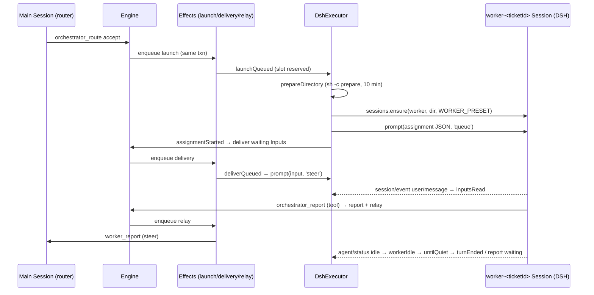

# પ્રકરણ 7 — Worker execution

[← પ્રકરણ 6](06-tickets-assignments.md) · [અનુક્રમણિકા](../README.md) · [આગળ: પ્રકરણ 8 →](08-store-effects-outbox.md)

## શીખવાનું પરિણામ અને પૂર્વજરૂરિયાત

આ પ્રકરણ પછી તમે `DshExecutor` ને `Executor` port થી DSH Session સુધી trace કરી શકશો. ખાસ કરીને:
- worker session identity અને directory preparation;
- execution environment variables;
- input delivery અને `inputsRead`;
- worker slots;
- reports (ખાસ કરીને `waiting`);
- cancellation, background jobs, transient retries, અને interrupted-work recovery.

સાથે, આ repository **ક્યાં** DSH (Harness) ને કામ સોંપે છે તે ઓળખી શકશો.

**Async concepts:** event listener (`ctx.on`), `AbortSignal.any`, `AbortSignal.timeout`, `setTimeout` backoff, "fire-and-forget" (`void promise`). **OS concepts:** subprocess, `sh -c`, git worktree.

**ખોલવાનો ક્રમ:** [`src/core/ports.ts` (Executor)](https://github.com/deepseek-ai/dsh-superagent-prototype/blob/8c32a9dc5d72c033816c6a8110b37f40cf94fba4/src/core/ports.ts#L59-L69) → [`src/executor/dsh.ts`](https://github.com/deepseek-ai/dsh-superagent-prototype/blob/8c32a9dc5d72c033816c6a8110b37f40cf94fba4/src/executor/dsh.ts) → [`src/executor/background.ts`](https://github.com/deepseek-ai/dsh-superagent-prototype/blob/8c32a9dc5d72c033816c6a8110b37f40cf94fba4/src/executor/background.ts) → [`src/app/sessions.ts`](https://github.com/deepseek-ai/dsh-superagent-prototype/blob/8c32a9dc5d72c033816c6a8110b37f40cf94fba4/src/app/sessions.ts) → [`src/app/execution-environment.ts`](https://github.com/deepseek-ai/dsh-superagent-prototype/blob/8c32a9dc5d72c033816c6a8110b37f40cf94fba4/src/app/execution-environment.ts) → [`tests/runtime-concurrency.spec.ts`](https://github.com/deepseek-ai/dsh-superagent-prototype/blob/8c32a9dc5d72c033816c6a8110b37f40cf94fba4/tests/runtime-concurrency.spec.ts).

## 7.1 Executor port: ફક્ત queue કરવાનું વચન

**[Source, real]** [`ports.ts#L59-L69`](https://github.com/deepseek-ai/dsh-superagent-prototype/blob/8c32a9dc5d72c033816c6a8110b37f40cf94fba4/src/core/ports.ts#L59-L69) (shortened):

```ts
export interface Executor {
  start(ticket: Ticket, assignment: Assignment): void
  deliver(ticket: Ticket, assignment: Assignment): void
  stop(ticket: Ticket, assignment: Assignment, reason: string): void
}
```

Doc comment: "The Engine calls it inside its commands, so each method only queues work, which reports back through the Engine's callbacks." `DshExecutor.start` એટલે `effects.enqueue('launch', assignment.id, …)`, અને `deliver` એટલે `enqueue('delivery', ticket.id, …)` ([`dsh.ts#L264-L268`](https://github.com/deepseek-ai/dsh-superagent-prototype/blob/8c32a9dc5d72c033816c6a8110b37f40cf94fba4/src/executor/dsh.ts#L264-L268)). બંને Engine ના transaction ની અંદર SQLite માં લખાય છે.

## 7.2 Main Session ↔ worker interaction



**તીરોનો અર્થ:** સળંગ તીર એ call અથવા message છે, અને ડેશવાળું તીર એ DSH event છે જેને Executor સાંભળે છે. Main Session અને worker એકબીજાને સીધું બોલાવતાં નથી. બધું Engine અને Effects મારફતે જાય છે: આ જ લેખનું "Workers report to the Router".

## 7.3 Session identity અને directory

- `workerSessionId(ticketId) = 'worker-' + ticketId` ([L24](https://github.com/deepseek-ai/dsh-superagent-prototype/blob/8c32a9dc5d72c033816c6a8110b37f40cf94fba4/src/executor/dsh.ts#L24)). Id deterministic છે, એટલે restart પછી તે જ Session ફરી મળે છે. એ જ Session retry અને resume માં પણ ચાલુ રહે છે: "A retry ends the current Assignment and starts a new one in the same Executor Session, directory, branch and pull request" (`docs/003`).
- `Sessions.ensure` ([`sessions.ts#L138-L155`](https://github.com/deepseek-ai/dsh-superagent-prototype/blob/8c32a9dc5d72c033816c6a8110b37f40cf94fba4/src/app/sessions.ts#L138-L155)) **DSH ને સોંપે છે**: `sessionController.resolveAgent/create`, `workspaceRegistry.create(cwd)`, role model, prompts/tools ઉમેરવા (decorate), અને `permissionPresets.set(…, 'danger-full-access')`.
- **Directory preparation** (`prepareDirectory`, [L247-L262](https://github.com/deepseek-ai/dsh-superagent-prototype/blob/8c32a9dc5d72c033816c6a8110b37f40cf94fba4/src/executor/dsh.ts#L247-L262)): directory **અસ્તિત્વમાં ન હોય** ત્યારે જ prepare થાય છે. Parent directory બને છે. `sh -c <prepare>` worker જેવા environment માં ચાલે છે (`runAsWorker`), execution variables સાથે, અને `PREPARE_TIMEOUT_MS` = 10 minutes. Fail થાય તો **ખાલી** directory દૂર થાય છે (`rmdir` ફક્ત ખાલી directory દૂર કરે છે) અને `PrepareFailed` throw થાય છે. પછી `verifyDirectory` git credential settings તપાસે છે: repository ની પોતાની config credential ઉમેરે તો ticket fail થાય છે.

**PrepareFailed કેમ retry થતું નથી?** Code comment: "an existing directory counts as prepared, and an automatic retry would treat whatever a failed prepare command left behind in the directory as a prepared workspace" ([L40-L43](https://github.com/deepseek-ai/dsh-superagent-prototype/blob/8c32a9dc5d72c033816c6a8110b37f40cf94fba4/src/executor/dsh.ts#L40-L43)).

## 7.4 Execution environment

**[Source]** `docs/003` ના variables, `ticketEnvironment` વડે ([`execution-environment.ts`](https://github.com/deepseek-ai/dsh-superagent-prototype/blob/8c32a9dc5d72c033816c6a8110b37f40cf94fba4/src/app/execution-environment.ts)):

| Variable | Running example value | કોણ register કરે |
| --- | --- | --- |
| `DSH_SUPERAGENT_DIR` | `/srv/state/work/readme-setup-97bdef320703` (example stateDir) | Executor |
| `DSH_SUPERAGENT_NAME` | `readme-setup-97bdef320703` | Executor |
| `DSH_SUPERAGENT_TICKET` | `97bdef3207031d61e10165dee53441b3` | Executor |
| `DSH_SUPERAGENT_GITHUB_REPOSITORY` | `demo-org/widgets` | GitHub kind ([`github.ts#L92-L105`](https://github.com/deepseek-ai/dsh-superagent-prototype/blob/8c32a9dc5d72c033816c6a8110b37f40cf94fba4/src/sources/github.ts#L92-L105)) |
| `DSH_SUPERAGENT_GITHUB_NUMBER` | `7` | GitHub kind |
| `DSH_SUPERAGENT_GITHUB_PR_HEAD` | `''` (Issue છે, PR નથી) | GitHub kind |

Prepare command આ variables ને environment variables તરીકે વાંચે છે, અને worker તેમને પોતાના prompt ના `runtime/environment` section માં વાંચે છે. Variable નામોમાં `KEY|PASSWORD|SECRET|TOKEN` નથી. કારણ: DSH આવા credential-shaped variables ને child environments માંથી દૂર કરે છે ([`environment.ts#L3`](https://github.com/deepseek-ai/dsh-superagent-prototype/blob/8c32a9dc5d72c033816c6a8110b37f40cf94fba4/src/infra/environment.ts#L3)).

## 7.5 Launch, line by line

**[Source]** [`launch`, L424-L470](https://github.com/deepseek-ai/dsh-superagent-prototype/blob/8c32a9dc5d72c033816c6a8110b37f40cf94fba4/src/executor/dsh.ts#L424-L470). મુખ્ય વિચાર: **દરેક `await` પછી `current()` ફરી તપાસો.** `await` દરમિયાન ticket stop થયો હોઈ શકે, retry થી નવું Assignment બન્યું હોઈ શકે, અથવા processing pause થયું હોઈ શકે.

```ts
const current = () => {
  if (this.host.closing()) throw new Error('dsh-superagent is stopping')
  if (this.host.paused()) throw new Later('Processing is paused')
  const stored = this.host.store.tickets.get(ticket.id)
  return !!stored && liveTicket(stored) && latestAssignment(stored)?.id === assignment.id
}
```

પછીના પગલાં:
1. Directory ન હોય તો prepare.
2. `sessions.ensure(…, 'worker')`.
3. જૂના Assignment નું background work બંધ થાય તેની રાહ (`stopped`).
4. Session inbox માંથી undelivered inputs ની જૂની copies દૂર કરો (`agent.inbox.remove`). આથી નવી delivery જ એકમાત્ર copy રહે છે; restart/crash પછીના duplicate અટકે છે.
5. પહેલા Assignment માટે પૂરો JSON message (`ticket_id`, `title`, `assignment` ≤1500 chars, origin `trigger` card, `batch`). પછીના Assignment માટે ફક્ત `{ticket_id, assignment: n, note?}`, જો session પાસે પહેલો message હજી હોય (`holds`).
6. `sessions.prompt(sessionId, requestId, text, 'queue', authorize, accepted)` → `engine.assignmentStarted`.

**`launchQueued`** ([L270-L285](https://github.com/deepseek-ai/dsh-superagent-prototype/blob/8c32a9dc5d72c033816c6a8110b37f40cf94fba4/src/executor/dsh.ts#L270-L285)) error handling:
- closing અથવા `Later` → throw (effect ફરી પ્રયાસ કરશે, failure ગણ્યા વગર).
- Transient error અને tries < 3 → throw (effect backoff 5 s → 300 s).
- બાકી બધું (PrepareFailed સહિત) → `launchFailed` → `engine.report(…, failed)` + main Session ને relay.

## 7.6 Worker slots

**[Source]** `WorkerSlots` ([L171-L199](https://github.com/deepseek-ai/dsh-superagent-prototype/blob/8c32a9dc5d72c033816c6a8110b37f40cf94fba4/src/executor/dsh.ts#L171-L199)):
- `used()` = running workers + starting reservations.
- `reserve(ticketId, 'launch'|'wake'|'person')`: જગ્યા ન હોય તો `Later` throw થાય છે. **`person` ને `maxWorkers + 1` સુધી** જગ્યા મળે છે, જેથી નવું કામ કોઈ વ્યક્તિને ચાલુ ticket સાથે આગળ વધતાં રોકી ન શકે.
- `launches()` = max − (running + wake reservations), જે `launch` effect ની concurrency limit છે.
- Reservation **synchronously**, `await` પહેલાં થાય છે, જેથી બે starts છેલ્લો slot એક સાથે ન લઈ શકે (race condition ટળે છે).

Test: "wakes an idle worker for a person's message at once, in the slot kept beyond the limit".

## 7.7 Delivery અને `inputsRead`

`deliverQueued` ([L290-L328](https://github.com/deepseek-ai/dsh-superagent-prototype/blob/8c32a9dc5d72c033816c6a8110b37f40cf94fba4/src/executor/dsh.ts#L290-L328)) inputs **એક પછી એક**, ક્રમમાં મોકલે છે. દરેક input પહેલાં ticket ફરી વાંચે છે. Idle worker ને જગાડવા slot reserve કરે છે, deleted session ફરી બનાવે છે, અને `inputMessage` ([L156-L164](https://github.com/deepseek-ai/dsh-superagent-prototype/blob/8c32a9dc5d72c033816c6a8110b37f40cf94fba4/src/executor/dsh.ts#L156-L164)) render કરીને `steer` mode માં મોકલે છે. Steer mode નો અર્થ: input ચાલુ turn ના આગલા step માં પહોંચે છે. સફળ થાય તો `engine.inputsDelivered`; નિષ્ફળ જાય તો `engine.deliveryFailed`, અને ticket stage `person/delivery` બને છે.

**Delivered ≠ read.** `install()` DSH ના `session/event` ને સાંભળે છે: `user/message` event જેનો `source.kind === 'dsh-superagent'` હોય ([L495-L504](https://github.com/deepseek-ai/dsh-superagent-prototype/blob/8c32a9dc5d72c033816c6a8110b37f40cf94fba4/src/executor/dsh.ts#L495-L504)). Message session history માં ગયો ત્યારે જ `engine.inputsRead`. જે step cancel થયો કે fail ગયો, તેણે claim કરેલો message "read" ગણાતો નથી. આ ચોકસાઈ ticket પૂરો થાય ત્યારે `letGo` માં કામ લાગે છે ([પ્રકરણ 6](06-tickets-assignments.md)): ન વંચાયેલા messages Eval માં પાછા જાય છે.

## 7.8 Turn end, `waiting` report અને background work

`agent/status` `idle` થાય ત્યારે `workerIdle` ([L601-L672](https://github.com/deepseek-ai/dsh-superagent-prototype/blob/8c32a9dc5d72c033816c6a8110b37f40cf94fba4/src/executor/dsh.ts#L601-L672)):
1. Transient retry ચાલુ હોય તો કશું નહીં.
2. **Handed off** (`ready` અથવા attention પછી નવું input નથી, અથવા `waitsForPerson`) હોય તો `turnEnded` + `handOff`. Slot મુક્ત થાય છે, subagents બંધ થાય છે, અને shell jobs (દા.ત. review માટેનો server) Assignment પૂરું થાય ત્યાં સુધી ચાલે છે.
3. નહીં તો `untilQuiet`: background jobs/subagents પૂરાં થાય ત્યાં સુધી slot રાખે છે, વધુમાં વધુ `BACKGROUND_LIMIT_MS` = 30 minutes. પછી jobs kill થાય છે અને worker ને કહેવાય છે.
4. છેવટે `report(waiting, summary = છેલ્લો assistant text)` + main Session ને relay. Text ખાલી હોય તો: "Worker ended without a status report. Use orchestrator_ticket_request_status…".

**Harness ને સોંપાયેલું કામ (external boundary):** `ctx.jobs` અને `ctx.subagents` (background.ts), `agent.whenIdle()`, `agent.cancel()`, `agent.inbox`, `session.snapshotEvents()`, અને presets નું 5-second "foreground → background job" behavior (`cordis.patch.yml`). આ repository આ APIs ને બોલાવે છે; તેમનું implementation DSH માં છે.

## 7.9 Cancellation

`stop(ticket, assignment, reason)` ([L357-L370](https://github.com/deepseek-ai/dsh-superagent-prototype/blob/8c32a9dc5d72c033816c6a8110b37f40cf94fba4/src/executor/dsh.ts#L357-L370)) બધું `store.afterCommit` માં કરે છે: "so a rollback leaves the worker working". પછી settling look abort થાય છે; worker ની છેલ્લી વાત `ready`/`dropped` ન હોય તો turn cancel થાય છે (`keepInbox: false`); અને shell jobs + subagents stop થાય છે. `track` વડે stop નું Promise સચવાય છે, અને તે જ ticket નું આગલું launch/delivery તેની રાહ જુએ છે (`stopped`). નહીં તો stop નું `cancel` નવી delivery ને ભૂંસી નાખે.

## 7.10 Transient retries

`transient(error)` ([L50-L55](https://github.com/deepseek-ai/dsh-superagent-prototype/blob/8c32a9dc5d72c033816c6a8110b37f40cf94fba4/src/executor/dsh.ts#L50-L55)): HTTP 408/429/5xx, અથવા text માં `ECONNRESET|ECONNREFUSED|ETIMEDOUT|…|overloaded|rate limit`.
- **Launch:** effect retry (5 s → 300 s), 3 વાર.
- **Worker turn** (`agent/error`): `resumeAfter` 15 s, 30 s, 60 s પછી message મોકલે છે: "Your last turn failed for a passing reason (…). Continue the assignment where it stopped." 3 વાર પછી `failed`.

Test: "lets a worker go on after a passing provider failure, three times, before its ticket fails".

## 7.11 Interrupted-work recovery (restart)

**[Source]** `resume()` ([L524-L537](https://github.com/deepseek-ai/dsh-superagent-prototype/blob/8c32a9dc5d72c033816c6a8110b37f40cf94fba4/src/executor/dsh.ts#L524-L537)), જે `initialize()` માંથી બોલાય છે. Open tickets **સૌથી જૂના પહેલા** લેવાય છે:
- Running Assignment હોય તો: in-process restart માંથી બચેલો turn cancel થાય છે (`keepInbox: true`), background stop થાય છે, અને `engine.assignmentInterrupted` બોલાય છે.
- Pending હોય અને `waitsForPerson` ન હોય તો: `start` (launch ફરી enqueue).

`Assignments.interrupted` ([`assignments.ts#L83-L92`](https://github.com/deepseek-ai/dsh-superagent-prototype/blob/8c32a9dc5d72c033816c6a8110b37f40cf94fba4/src/core/assignments.ts#L83-L92)):

```ts
const busy = !!running.deliveredAt && !!report && running.deliveredAt >= report.at
const settled = !!report && ['waiting', 'ready', 'blocked', 'failed'].includes(report.state) && !busy
if (!settled) this.tickets.restart(ticket, running, 'hostRestarted', RECOVERY_NOTE)
else if (ticket.undelivered.length) this.options.executor.deliver(ticket, running)
```

`RECOVERY_NOTE`: "The host restarted during this ticket. Inspect the current worktree, git history and GitHub state before continuing. Do not repeat an already completed external operation…" Worker ને બહારનાં actions (push, PR comment) ફરી ન કરવા કહેવાય છે. આ **at-least-once** execution ના જોખમનું prompt-level નિવારણ છે ([પ્રકરણ 8](08-store-effects-outbox.md)).

**[Observed] running example નો restart:** `G_restart.assignments = [ended/failed/retried, ended/hostRestarted, pending]`. Inputs માં `text` (recovery note) ઉમેરાયો છે, અને `undelivered = 3` (બે માણસના follow-ups + note). Stage `working/queued`.

## 7.12 Exercise

```bash
pnpm vitest run tests/runtime-concurrency.spec.ts
```

```bash
pnpm vitest run tests/core-engine.spec.ts -t "interrupted assignments"
```

બીજો test બતાવે છે કે `waiting` report પછી કોઈ નવું input ન આવ્યું હોય તો worker Session સચવાય છે. પણ report પછી માણસનો message આવ્યો હોય, તો Assignment નવેસરથી શરૂ થાય છે.

## 7.13 Modification અને verification

**[Proposed]** `BACKGROUND_LIMIT_MS` ને 30 થી 60 minutes કરવું. **Layer:** આ Executor નો policy constant છે, Engine નો નહીં. **Verify:**

```bash
pnpm vitest run tests/runtime-concurrency.spec.ts tests/background.spec.ts tests/model-surface.spec.ts
```

**[Test ચલાવ્યો]** પરિણામ: `Tests 3 failed | 65 passed (68)`. Fail થયેલા tests: `runtime-concurrency.spec.ts > a worker whose work runs in the background >` "gives each idle of a worker its own 30 minutes…", "kills the jobs that run 30 minutes after the turn ended…", અને "says a worker's subagents still run when only they ran 30 minutes after the turn ended". આ tests fake timers થી બરાબર 30 minutes આગળ જાય છે. **અર્થ:** 30 minutes એ documented behavior છે, test થી સુરક્ષિત છે, અને `docs/003` ("at most 30 minutes") માં પણ લખેલો છે. આ ફેરફાર ખરેખર કરવો હોય તો constant, ત્રણ tests અને docs, ત્રણેય એક જ PR માં બદલો. પછી `git checkout src/executor/dsh.ts`.

## 7.14 Debugging exercise: "failed workspace preparation"

**લક્ષણ:** Ticket `person/failed`, અને report `The prepare command failed: … exited with code 128`. **નિદાન:** (1) Ticket page પર environment variables જુઓ. (2) Operator user તરીકે તે જ `sh -c` command, તે જ variables સાથે, `<root>` માં હાથે ચલાવો (`docs/006`: "run the named program by hand"). (3) સામાન્ય કારણો: clone path ખોટો છે, અથવા branch `agent/<name>` પહેલેથી અસ્તિત્વમાં છે. **સુધારો:** prepare command ઠીક કરો, પછી panel માં **Retry**. Prepare ફરી ચાલશે, કારણ કે failed run પછી directory ખાલી હતી અને દૂર થઈ ગઈ હતી. ⚠️ Directory ખાલી ન હોય, દા.ત. worktree અડધું બન્યું હોય, તો તે prepared ગણાશે. તેને હાથે સાફ કરો (`git worktree remove`).

## Mastery પ્રશ્નો

1. Executor ની methods ફક્ત effects queue કેમ કરે છે, સીધું DSH ને કેમ બોલાવતી નથી?
2. `launch` માં દરેક `await` પછી `current()` કેમ ફરી બોલાવાય છે?
3. "Delivered" અને "read" વચ્ચેનો ફરક ticket ના અંતે કેમ મહત્વનો છે?
4. માણસના message માટે `maxWorkers + 1` slot શા માટે?
5. Restart પછી `waiting` report વાળું Assignment ફરી કેમ શરૂ થતું નથી, પણ report પછી input મળ્યું હોય તો કેમ થાય છે?

ઉકેલો: [પરિશિષ્ટ E § પ્રકરણ 7](../appendices/E-solutions.md#પ્રકરણ-7)

[← પ્રકરણ 6](06-tickets-assignments.md) · [આગળ: પ્રકરણ 8 →](08-store-effects-outbox.md)
