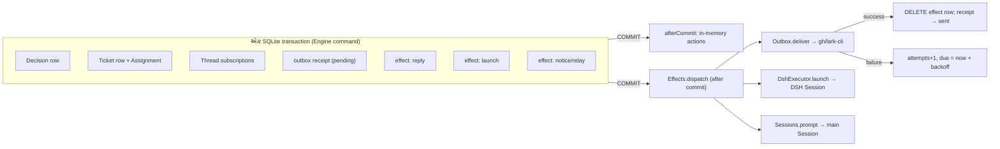

# પ્રકરણ 8 — Store, Effects અને Outbox

[← પ્રકરણ 7](07-worker-execution.md) · [અનુક્રમણિકા](../README.md) · [આગળ: પ્રકરણ 9 →](09-tools-prompts-skills.md)

## શીખવાનું પરિણામ અને પૂર્વજરૂરિયાત

આ પ્રકરણ પછી તમે:
- SQLite persistence, repository interfaces, savepoint-based `atomic` અને `afterCommit` સમજાવી શકશો;
- directory locking, effect scheduling, retries અને message receipts trace કરી શકશો;
- **crash windows** અને duplicate delivery નું વિશ્લેષણ કરી શકશો, અને implementation ખરેખર કઈ guarantees આપે છે તે કહી શકશો;
- migrations, settings versions, prompt versions અને storage limitations સમજાવી શકશો.

**Database concepts:** SQLite એક file માં સચવાતો database છે. **WAL** (write-ahead log) journal mode છે. **SAVEPOINT** nested transaction છે. **Generated column** row ના JSON માંથી ગણાતી column છે. **Partial index** ફક્ત `WHERE` ની શરત સંતોષતી rows પરનો index છે.

**ખોલવાનો ક્રમ:** [`src/app/store.ts`](https://github.com/deepseek-ai/dsh-superagent-prototype/blob/8c32a9dc5d72c033816c6a8110b37f40cf94fba4/src/app/store.ts) → [`src/core/memory.ts`](https://github.com/deepseek-ai/dsh-superagent-prototype/blob/8c32a9dc5d72c033816c6a8110b37f40cf94fba4/src/core/memory.ts) → [`src/app/effects.ts`](https://github.com/deepseek-ai/dsh-superagent-prototype/blob/8c32a9dc5d72c033816c6a8110b37f40cf94fba4/src/app/effects.ts) → [`src/app/outbox.ts`](https://github.com/deepseek-ai/dsh-superagent-prototype/blob/8c32a9dc5d72c033816c6a8110b37f40cf94fba4/src/app/outbox.ts) → [`src/sources/github-channel.ts`](https://github.com/deepseek-ai/dsh-superagent-prototype/blob/8c32a9dc5d72c033816c6a8110b37f40cf94fba4/src/sources/github-channel.ts) → [`src/app/migration.ts`](https://github.com/deepseek-ai/dsh-superagent-prototype/blob/8c32a9dc5d72c033816c6a8110b37f40cf94fba4/src/app/migration.ts) → [`src/kv.ts`](https://github.com/deepseek-ai/dsh-superagent-prototype/blob/8c32a9dc5d72c033816c6a8110b37f40cf94fba4/src/kv.ts).

## 8.1 Store: એક SQLite file

**[Source]** `<stateDir>/orchestrator.sqlite`, Node ના built-in `node:sqlite` (`DatabaseSync`) વડે. Constructor ([`store.ts#L58-L101`](https://github.com/deepseek-ai/dsh-superagent-prototype/blob/8c32a9dc5d72c033816c6a8110b37f40cf94fba4/src/app/store.ts#L58-L101)):
- File mode `0o600`; `PRAGMA journal_mode=WAL; PRAGMA synchronous=FULL`.
- Schema version > 11 હોય તો refuse; < 10 હોય તો `tooOld`.
- Tables: `trigger`, `disposition`, `thread`, `ticket`, `decision`, `outbox`, `trigger_thread`, `effect`, `kv`. દરેક aggregate એક **JSON value** column માં સચવાય છે; SQL schema નાનું છે.
- **Working sets** (`SETS`, [L30-L44](https://github.com/deepseek-ai/dsh-superagent-prototype/blob/8c32a9dc5d72c033816c6a8110b37f40cf94fba4/src/app/store.ts#L30-L44)): JSON પરથી generated columns, દા.ત. `thread.active` (pending હોય અથવા evaluating), `ticket.open`, અને `ticket.active` (undelivered હોય અથવા છેલ્લું assignment pending/running). Partial indexes વડે `evaluateDue` ફક્ત active rows વાંચે છે, આખું table નહીં.

**Repositories:** `Store implements Repositories` (core port). Tests એ જ port નું in-memory version, `MemoryRepositories`, વાપરે છે. Test "lists in the same order in SQLite and in memory, and undoes a failed nested transaction alone in both" ([`tests/store.spec.ts#L220`](https://github.com/deepseek-ai/dsh-superagent-prototype/blob/8c32a9dc5d72c033816c6a8110b37f40cf94fba4/tests/store.spec.ts#L220)) બંનેનું behavior સરખું છે તેની ખાતરી કરે છે.

## 8.2 `atomic` અને `afterCommit`

**[Source, real]** [`store.ts#L140-L162`](https://github.com/deepseek-ai/dsh-superagent-prototype/blob/8c32a9dc5d72c033816c6a8110b37f40cf94fba4/src/app/store.ts#L140-L162):

```ts
atomic<T>(operation: () => T): T {
  const level = this.depth++
  const name = `orchestrator_atomic_${level}`
  this.committed[level] = []
  this.db.exec(`SAVEPOINT ${name}`)
  let value: T
  try { value = operation(); this.db.exec(`RELEASE ${name}`) }
  catch (error) { this.db.exec(`ROLLBACK TO ${name}`); this.db.exec(`RELEASE ${name}`); throw error }
  finally { this.depth-- }
  const actions = this.committed.splice(level)[0]!
  if (level) this.committed[level - 1]!.push(...actions)
  else for (const action of actions) { try { action() } catch (error) { this.report(error) } }
  return value
}
```

Line by line:
1. દરેક `atomic` call એક **SAVEPOINT** છે. Nested calls ના savepoints પણ nested બને છે.
2. Error આવે તો `ROLLBACK TO` ફક્ત **આ સ્તરના** ફેરફારો પાછા લે છે, પછી error ફરી throw થાય છે.
3. `afterCommit` actions સ્તર પ્રમાણે ભેગી થાય છે. અંદરનું સ્તર commit થાય તો તેની actions બહારના સ્તરને સોંપાય છે; **સૌથી બહારનું** સ્તર commit થાય ત્યારે જ તે ચાલે છે. Rollback થયેલા સ્તરની actions ફેંકી દેવાય છે.
4. Action નિષ્ફળ જાય તો commit થયેલો data અકબંધ રહે છે; error ફક્ત log થાય છે.

**`afterCommit` vs Effects** (code comment, L157): `afterCommit` immediate, **in-memory** follow-ups માટે છે, જેમ કે turn cancel કરવો અથવા health refresh કરવી. Restart પછી પણ ટકવું જોઈએ તેવું કામ **Effects** માં જાય છે.

## 8.3 Transaction અને effect boundaries



**તીરોનો અર્થ:** box ની અંદરનું બધું એક જ commit માં લખાય છે. Commit **પછી** જ effect handlers બહારની દુનિયાને સ્પર્શે છે. Handler સફળ થાય તો row delete થાય છે; નિષ્ફળ જાય તો row backoff સાથે રહે છે.

Running example માં accept વખતે એક જ commit માં Decision, Ticket, subscription, ack receipt, `reply` effect અને `launch` effect લખાય છે.

## 8.4 Effects queue

**[Source]** [`effects.ts`](https://github.com/deepseek-ai/dsh-superagent-prototype/blob/8c32a9dc5d72c033816c6a8110b37f40cf94fba4/src/app/effects.ts):
- `enqueue(kind, key, payload)` ([L61-L66](https://github.com/deepseek-ai/dsh-superagent-prototype/blob/8c32a9dc5d72c033816c6a8110b37f40cf94fba4/src/app/effects.ts#L61-L66)): `INSERT … ON CONFLICT(kind,key) DO UPDATE SET value, generation+1, attempts=0, due`. Primary key `(kind, key)` છે, એટલે **coalescing** થાય છે: એક ticket માટે delivery effect એક જ row રહે છે. `seq` (queue position) સચવાય છે.
- `dispatch` ([L103-L122](https://github.com/deepseek-ai/dsh-superagent-prototype/blob/8c32a9dc5d72c033816c6a8110b37f40cf94fba4/src/app/effects.ts#L103-L122)): દરેક kind માટે, due rows ને `seq` ક્રમમાં, `limit()` જેટલી concurrency સુધી ચલાવે છે. `ordered` kinds (relay, notice) સૌથી જૂની row પર અટકે છે, ભલે તે હજી due ન હોય.
- `attempt` ([L130-L146](https://github.com/deepseek-ai/dsh-superagent-prototype/blob/8c32a9dc5d72c033816c6a8110b37f40cf94fba4/src/app/effects.ts#L130-L146)): સફળ થાય તો `DELETE … WHERE seq=? AND generation=?`. ચાલતી વખતે નવો payload આવ્યો હોય તો generation બદલાઈ ગયું હોય છે, એટલે row delete થતી નથી અને ફરી ચાલે છે. `Later` throw થાય તો failure ગણાતી નથી; ફક્ત `due` ખસે છે. બીજી error હોય તો `attempts+1`, અને `delay = min(max, initial × 2^attempts)`. Shutdown દરમિયાન row ને અડતું નથી, એટલે આગલા start પર ફરી ચાલે છે.
- Health: એક effect 3 વાર સળંગ fail થાય પછી error (`FAILURES_BEFORE_ERROR`), સિવાય કે kind `quiet` હોય (delivery).

| Kind | Handler | Limit | Retry |
| --- | --- | --- | --- |
| `assessment` | MasterAssessor | 4, paused હોય તો 0 | 2 s → 60 s |
| `launch` | DshExecutor | free slots, paused હોય તો 0 | 5 s → 300 s |
| `delivery` | DshExecutor | 4, paused હોય તો 0, quiet | 2 s → 60 s |
| `relay` | Sessions | 1, ordered | 2 s → 60 s |
| `notice` | Sessions | 1, ordered | 2 s → 60 s |
| `reply` | Outbox | 1, paused હોય તો 0 | 5 s → 300 s |

## 8.5 Outbox અને message receipts

**[Source, real]** [`outbox.ts#L27-L51`](https://github.com/deepseek-ai/dsh-superagent-prototype/blob/8c32a9dc5d72c033816c6a8110b37f40cf94fba4/src/app/outbox.ts#L27-L51):

```ts
send(message: OutboundMessage): void {
  if (message.kind === 'reply' && message.channel.source === 'feishu') checkedImText(message.text)
  store.atomic(() => { if (store.receipts.add(message)) effects.enqueue('reply', message.id, {}) })
}
private async deliver(id: string): Promise<void> {
  const receipt = store.receipts.get(id)
  if (receipt?.status !== 'pending') return
  if (!sources.instance(receipt.channel.source)?.enabled) throw new Later('The Source is off or not installed')
  if (store.receipts.behind(id, FAILURES_BEFORE_ERROR)) throw new Later('An earlier message of this ticket to this conversation waits')
  if (!sources.channelAllowed(receipt.channel)) { store.receipts.settle(receipt, 'channelIgnored'); return }
  const result = await sources.send(receipt, commands)
  if (result === 'waiting') throw new Later('The Source is not installed')
  store.receipts.settle(receipt, result === 'gone' ? 'channelGone' : 'sent')
}
```

- `receipts.add` એ `INSERT OR IGNORE` છે: એક id **ક્યારેય બે વાર queue થતું નથી**. Receipts કાયમ રાખવામાં આવે છે.
- **Per-conversation ordering:** `behind` ([`store.ts#L259-L261`](https://github.com/deepseek-ai/dsh-superagent-prototype/blob/8c32a9dc5d72c033816c6a8110b37f40cf94fba4/src/app/store.ts#L259-L261)) જુએ છે કે તે જ ticket + conversation નો કોઈ વહેલો pending message 3 કરતાં ઓછી failures સાથે હજી રાહ જુએ છે કે નહીં. એટલે ack હંમેશાં result પહેલાં જાય છે.
- **Drop:** Source હવે conversation સાંભળતો ન હોય તો `channelIgnored`; Source કહે કે conversation કાયમ માટે ગઈ છે (deleted Issue, locked) તો `channelGone`. Dropped receipt અને તેનું કારણ panel માં દેખાય છે.

## 8.6 Crash windows અને guarantees

| Crash ક્યાં થાય | પરિણામ | આધાર |
| --- | --- | --- |
| Engine command ની વચ્ચે, commit પહેલાં | કશું નહીં: SQLite rollback (WAL). Source નું cursor આગળ વધ્યું નથી, એટલે Trigger ફરી વંચાશે | `atomic`, "await receive before advancing cursors" |
| Commit પછી, effect ચાલે તે પહેલાં | Effect row ટકી રહે છે; restart પછી `effects.start()` તેને ચલાવે છે | `effect` table |
| `reply` handler: GitHub POST થયો, પણ `settle`/DELETE પહેલાં crash | Restart પછી handler ફરી ચાલે. **GitHub:** `sendGithub` પહેલાં comments માં `<!-- dsh-superagent:<id> -->` marker શોધે છે; મળે તો POST કરતું નથી, અને `'sent'` પાછું આપે છે ([`github-channel.ts#L34-L40`](https://github.com/deepseek-ai/dsh-superagent-prototype/blob/8c32a9dc5d72c033816c6a8110b37f40cf94fba4/src/sources/github-channel.ts#L34-L40)). **Feishu:** `--idempotency-key message.id` ([`feishu-channel.ts#L23`](https://github.com/deepseek-ai/dsh-superagent-prototype/blob/8c32a9dc5d72c033816c6a8110b37f40cf94fba4/src/sources/feishu-channel.ts#L23)) | Channel-level idempotency |
| `launch`: worker ને message પહોંચ્યો, પણ `assignmentStarted` પહેલાં crash | Restart: pending Assignment ફરી launch થાય છે. `AgentDelivery` request id પ્રમાણે એક વાર જ પહોંચાડે છે, અને `inbox.remove` જૂની copy કાઢે છે | `sessions.prompt` "Deliver a message once per request id"; [`dsh.ts#L448`](https://github.com/deepseek-ai/dsh-superagent-prototype/blob/8c32a9dc5d72c033816c6a8110b37f40cf94fba4/src/executor/dsh.ts#L448) |
| Worker એ `git push` કર્યું, પછી crash | Domain ને push ની ખબર નથી. Assignment `hostRestarted` થાય છે, અને worker ને RECOVERY_NOTE કહે છે "Do not repeat an already completed external operation" | **ફક્ત prompt-level** guarantee |

**સારાંશ, implementation કઈ guarantees આપે છે:**
1. **Domain state:** દરેક Engine command atomic છે, અને Decisions/Tickets/effects ક્યારેય અડધા લખાતા નથી.
2. **Side effects:** effects **at-least-once** ચાલે છે. Channel messages GitHub marker અને Feishu idempotency key વડે, વ્યવહારમાં, લગભગ **effectively-once** બને છે. **[ધારણા]** GitHub marker search `commands.pages` પર આધાર રાખે છે; comments list read નિષ્ફળ જાય તો effect ફરી પ્રયાસ કરે છે, એટલે duplicate થતો નથી. પણ marker ધરાવતો comment કોઈ હાથે delete કરે, તો message ફરી post થઈ શકે.
3. **Worker ના બહારનાં actions** (git, gh): ફક્ત worker ની સમજ અને recovery note પર આધાર. આ prototype ની સ્પષ્ટ મર્યાદા છે.

## 8.7 Directory locking

`proper-lockfile.lockSync(stateDir, { stale: 30_000 })` ([પ્રકરણ 3](03-startup.md)). Lock compromised થાય તો runtime error થાય છે અને lifetime abort થાય છે. Shutdown માં database બંધ થયા **પછી** જ lock છૂટે છે.

## 8.8 Migrations અને versions

- **[Source]** `SCHEMA_VERSION = 11`, `OLDEST_SCHEMA = 10` ([`migration.ts#L20-L22`](https://github.com/deepseek-ai/dsh-superagent-prototype/blob/8c32a9dc5d72c033816c6a8110b37f40cf94fba4/src/app/migration.ts#L20-L22)). Schema 10 → 11 નું migration એક જ transaction માં થાય છે; fail થાય તો database બદલાયા વગર રહે છે, અને error message કહે છે "The orchestrator database is unchanged at schema 10…". `SCHEMA_VERSION` ફક્ત વધે છે.
- **Settings versions:** `Versions<SettingsVersion>` ([`versions.ts`](https://github.com/deepseek-ai/dsh-superagent-prototype/blob/8c32a9dc5d72c033816c6a8110b37f40cf94fba4/src/app/versions.ts)) દરેક save ને immutable snapshot (`settings-version:<n>`) તરીકે સાચવે છે, અને pointer (`settings-revision`) ખસેડે છે. Snapshot માં origin, policyVersion અને notified tickets હોય છે. Block-level revisions (`settings-block-revision:<block>`) optimistic concurrency માટે છે: stale save → `SettingsConflict` → HTTP 409.
- **Prompt versions:** એ જ `Versions` pattern (`prompt-revision`, `prompt-version:<n>`). Session એ કયા revisions નો ઉપયોગ કર્યો તે `session-prompts:<id>` માં નોંધાય છે.

## 8.9 Storage limitations (`docs/007` "Persistence")

- **કશું delete થતું નથી:** triggers, dispositions, decisions, ended tickets, outbox receipts, settings/prompt versions, અને Source ના per-thread records અમર્યાદિત વધે છે. Long-running deployment માટે retention policy નથી.
- In-memory caches (`TextCache`) restart પછી ખોવાઈ જાય છે. Feishu link search ફક્ત current process lifetime માં કામ કરે છે.
- એક જ writer process (lock). Horizontal scaling નથી.

## 8.10 Exercise

```bash
pnpm vitest run tests/effects.spec.ts tests/store.spec.ts tests/outbox.spec.ts
```

**દરેક test શું સાબિત કરે છે:** "runs an effect queued inside a transaction once it commits, and none from a transaction that rolled back" transaction boundary સાબિત કરે છે. "keeps an effect's place in its queue when it is queued again with a new payload" coalescing અને ordering. "starts nothing once drained, keeps what waits and what shutdown cut short, and runs it after the next start" crash/restart durability.

## 8.11 Modification અને verification: `synchronous=NORMAL` પ્રયોગ

Chapter 13 માં measurement સાથે. **[Test ચલાવ્યો]** benchmark એ `store.db.exec('PRAGMA synchronous=NORMAL')` વડે durability ઘટાડીને receive ઝડપ માપી. પરિણામ ત્યાં છે. **Recommendation:** source માં **ન** બદલો. WAL સાથે `NORMAL` હોય તો power loss પછી છેલ્લા commits ખોવાઈ શકે છે, જ્યારે Sources ના cursors પહેલેથી આગળ વધી ગયા હોય. આ "await receive before advancing cursors" ના વચનને નબળું પાડે છે.

## 8.12 Debugging exercise: "failed replies"

**લક્ષણ:** overview પર `reply` health error: "1 waiting since …; the last failure: CliError 422". **પગલાં:** (1) `GET /orchestrator/api/sources` → `dropped` અને failing replies જુઓ. (2) `effect` table માં `kind='reply'` ની `error`/`attempts` જુઓ (state directory ની **copy** પર `sqlite3` થી). (3) ack fail થયો હોય તો તે જ ticket ના પછીના messages `behind` ને કારણે 3 failures સુધી અટકેલા રહે છે. **ઉકેલ:** કારણ સુધારો (દા.ત. agent account ના permissions). Effect આપોઆપ ફરી પ્રયાસ કરશે, backoff વધુમાં વધુ 300 s.

## Mastery પ્રશ્નો

1. `afterCommit` અને Effects નો ઉપયોગ ક્યારે ક્યાં કરવો?
2. Effect row નું `generation` field કઈ race condition અટકાવે છે?
3. GitHub reply crash પછી duplicate કેમ થતો નથી? કઈ સ્થિતિમાં થઈ શકે?
4. Worker ના `git push` માટે domain કઈ guarantee **નથી** આપી શકતું?
5. Database ની newer schema જૂનું build કેમ નથી ખોલતું, અને rollback કેવી રીતે કરવું?

ઉકેલો: [પરિશિષ્ટ E § પ્રકરણ 8](../appendices/E-solutions.md#પ્રકરણ-8)

[← પ્રકરણ 7](07-worker-execution.md) · [આગળ: પ્રકરણ 9 →](09-tools-prompts-skills.md)
