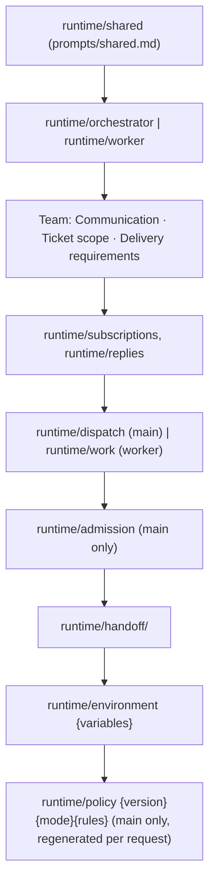

# પ્રકરણ 9 — Tools, prompts અને skills

[← પ્રકરણ 8](08-store-effects-outbox.md) · [અનુક્રમણિકા](../README.md) · [આગળ: પ્રકરણ 10 →](10-panel.md)

## શીખવાનું પરિણામ અને પૂર્વજરૂરિયાત

આ પ્રકરણ પછી તમે:
- main Session ના 14 અને worker ના 6 application tools ના schemas, permissions, results અને errors સમજાવી શકશો;
- `orchestrator_read` resources અને તેમની role boundaries (worker ફક્ત પોતાનો ticket વાંચી શકે) સમજાવી શકશો;
- prompt assembly નો ક્રમ, editable sections, overrides અને templates trace કરી શકશો;
- structured reports, attention questions અને Source skills સમજાવી શકશો;
- interfaces ના drift ને કયા tests પકડે છે તે કહી શકશો.

**Concept:** LLM "tool" એ એક function છે જેનું નામ, વર્ણન અને JSON schema model ને બતાવાય છે. Model arguments આપે છે, અને host તે function ચલાવે છે.

**ખોલવાનો ક્રમ:** [`src/app/tools/tool.ts`](https://github.com/deepseek-ai/dsh-superagent-prototype/blob/8c32a9dc5d72c033816c6a8110b37f40cf94fba4/src/app/tools/tool.ts) → [`src/app/tools/main.ts`](https://github.com/deepseek-ai/dsh-superagent-prototype/blob/8c32a9dc5d72c033816c6a8110b37f40cf94fba4/src/app/tools/main.ts) → [`src/app/tools/executor.ts`](https://github.com/deepseek-ai/dsh-superagent-prototype/blob/8c32a9dc5d72c033816c6a8110b37f40cf94fba4/src/app/tools/executor.ts) → [`src/app/resources.ts`](https://github.com/deepseek-ai/dsh-superagent-prototype/blob/8c32a9dc5d72c033816c6a8110b37f40cf94fba4/src/app/resources.ts) → [`src/app/prompts.ts`](https://github.com/deepseek-ai/dsh-superagent-prototype/blob/8c32a9dc5d72c033816c6a8110b37f40cf94fba4/src/app/prompts.ts) → [`prompts/`](https://github.com/deepseek-ai/dsh-superagent-prototype/tree/8c32a9dc5d72c033816c6a8110b37f40cf94fba4/prompts) → [`skills/`](https://github.com/deepseek-ai/dsh-superagent-prototype/tree/8c32a9dc5d72c033816c6a8110b37f40cf94fba4/skills) → [`tests/model-surface.spec.ts`](https://github.com/deepseek-ai/dsh-superagent-prototype/blob/8c32a9dc5d72c033816c6a8110b37f40cf94fba4/tests/model-surface.spec.ts).

## 9.1 Tool registration: zod → JSON schema

**[Source]** `Sessions.registerTool` ([`sessions.ts#L206-L216`](https://github.com/deepseek-ai/dsh-superagent-prototype/blob/8c32a9dc5d72c033816c6a8110b37f40cf94fba4/src/app/sessions.ts#L206-L216)) દરેક tool ને DSH tool registry (`agent.ctx.tools.register`) માં ઉમેરે છે. Schema માટે `parameters: z.toJSONSchema(schema)`, અને execute વખતે `schema.parse(args)` થાય છે, એટલે model નો input runtime પર ફરી validate થાય છે. Output JSON text તરીકે render થાય છે (`image` હોય તો attachment પણ). Main Session ને `mainTools`, અને worker ને `executorTools(ticket)` મળે છે ([`runtime.ts#L124`](https://github.com/deepseek-ai/dsh-superagent-prototype/blob/8c32a9dc5d72c033816c6a8110b37f40cf94fba4/src/app/runtime.ts#L124)).

## 9.2 Main Session ના tools (14)

| Tool | Engine/app call | મુખ્ય validation / refusal |
| --- | --- | --- |
| `orchestrator_read` | `readResource(…, ticketId=undefined)` | resource names `RESOURCES` મુજબ |
| `orchestrator_route` | 1–20 items: accept/attach/stop/ignore → `engine.decide`/`attach` | દરેક item અલગ transaction; `invalid()` field checks; `UserError` → `refused` |
| `orchestrator_ticket_retry` | `engine.retryTicket` | `notRetryable` |
| `orchestrator_ticket_request_status` | `engine.requestStatus` | ફક્ત `waiting` worker |
| `orchestrator_ticket_note` | `engine.note` | ≤ 100 words (`IM_WORDS`) |
| `orchestrator_trigger_requeue` | `engine.reevaluate` | worker owned follow-up → `workerDecides` (ફક્ત panel કરી શકે) |
| `orchestrator_eval` / `_eval_read` / `_eval_decide` | `MasterAssessor.context/read/decide` | explicit candidate હોય તો error; `assessmentOutcome` |
| `orchestrator_reply` | `engine.reply` (answer/result/attention) | `Replies` rules ([પ્રકરણ 6](06-tickets-assignments.md)) |
| `orchestrator_thread_unsubscribe` | `engine.unsubscribe` | — |
| `orchestrator_settings_save` | `settings.save(…, 'tool')` | `panelOnlyEnvironment`, `panelOnlyAccounts` |
| `orchestrator_policy_sync` | `settings.sync` | `nothingToSync` |
| `orchestrator_prompts_save` | `savePrompts(…, 'tool')` / preview | `baseRevision` conflict |

**`orchestrator_route` નું item schema** ([`main.ts#L47-L56`](https://github.com/deepseek-ai/dsh-superagent-prototype/blob/8c32a9dc5d72c033816c6a8110b37f40cf94fba4/src/app/tools/main.ts#L47-L56)): schema ફક્ત **shape** તપાસે છે. Kind પ્રમાણે ફરજિયાત fields (`FIELDS` table, L61-L68) item ચાલે ત્યારે તપાસાય છે, જેથી એક ખરાબ item બાકીના items ને રોકે નહીં. Accept માટે `title` ≤ 200 chars, `worktree_name`, `acknowledgement` ≤ 100 words, અને વૈકલ્પિક `note` ≤ 30 words (`NOTE_WORDS`) જરૂરી છે.

**Running example નો main Session call (pseudocode, model નું tool call):**

```json
{ "decisions": [{ "kind": "accept", "trigger_id": "6618ff4acad5e9586f4bba62b50b259c",
  "title": "Improve README setup instructions", "worktree_name": "readme-setup",
  "acknowledgement": "I will update the README setup section and run the checks." }] }
```

**Result shape:** `{ results: [{ trigger_id, kind, decision: 'accept', reason: 'Explicit request from an allowed sender routed by the orchestrator', ticket: {…card} }] }`. Item refuse થાય તો `{ trigger_id, kind, refused: '<UserError text>' }`.

**Permissions અને role boundary:** main Session નો preset `dsh-superagent-router` છે: file write/edit નથી, subagents/web/todo નથી, અને shell/job waits 5 s છે. `noWait` guard ([પ્રકરણ 0A](00a-superagent-article.md)) `sleep` નકારે છે. **Panel-only** actions: unavailable Decision dismiss કરવું, setup ફરી ચલાવવું, display names refresh કરવા, અને worker-owned follow-up ને Eval માં મોકલવું (`docs/007`).

## 9.3 Worker ના tools (6)

**[Source]** [`tools/executor.ts#L23-L105`](https://github.com/deepseek-ai/dsh-superagent-prototype/blob/8c32a9dc5d72c033816c6a8110b37f40cf94fba4/src/app/tools/executor.ts#L23-L105). દરેક tool closure માં `ticketId` બંધાયેલું છે, એટલે worker **બીજા ticket નું નામ આપી શકતો જ નથી**. આ role boundary type stage પર નહીં, પણ construction stage પર લાગુ પડે છે.

| Tool | Schema | Effect |
| --- | --- | --- |
| `orchestrator_read` | `resource, offset, limit` | ફક્ત પોતાના ticket ના resources (`readResource(…, ticketId)`) |
| `orchestrator_ack` | `trigger_id`, `text` ≤ 100 words | `engine.reply(acknowledgement)`; પહેલેથી ack થયું હોય તો `reused: true` |
| `orchestrator_report` | `state ∈ {progress, ready, blocked, failed, dropped}`, `summary`, `human_action?` (≤1000), `question_for_trigger_id?`, `pr_number?`, `reply_to_trigger_id?` | PR claim + report + relay, એક `atomic` માં |
| `orchestrator_thread_unrelated` | `thread`, `reason` ≤ 300 | `markUnrelated` |
| `orchestrator_thread_follow` | `thread`, `reason` | `followForContext` + notice |
| `orchestrator_trigger_handback` | `trigger_id`, `reason` ≤ 300 | `engine.handback` → `{ queued }` |

**`orchestrator_report` line by line** ([L85-L102](https://github.com/deepseek-ai/dsh-superagent-prototype/blob/8c32a9dc5d72c033816c6a8110b37f40cf94fba4/src/app/tools/executor.ts#L85-L102)):
1. Ticket ended હોય તો error: "Ticket ended (PR was closed or work finished); do not resume it".
2. `pr_number` આપ્યો હોય તો `readPull`. આ network read transaction ની **બહાર**, પહેલાં થાય છે.
3. `atomic`: `claimPull` (refuse થાય તો throw → આખું rollback) → `engine.report` → `reportRelay` → `sessions.relay`. Comment મુજબ: "a rejected PR claim or invalid report leaves no partial state, and a recorded report always reaches the main Session".
4. Result: `{ reported: true, notification: 'orchestrator' | 'internal_only', attention? }`. ઉદાહરણ તરીકે સામાન્ય `progress` main Session ને relay થતું નથી.

**Running example (worker side, pseudocode):** worker README સુધારે છે, `pnpm test` ચલાવે છે, `gh pr create --head agent/readme-setup-97bdef320703` કરે છે, અને પછી:

```json
{ "state": "ready", "summary": "README setup steps updated; pnpm check passes.", "pr_number": 12 }
```

`claimPull`: PR agent account નો છે અને branch નો છેલ્લો segment ticket name છે, એટલે `bindThread(own=true)`. Ticket `follows` વાળો હોવાથી `ready` તેને ત્યારે જ પૂરો કરે જ્યારે PR બંધ થાય ([પ્રકરણ 6](06-tickets-assignments.md)).

**Attention questions:** `human_action` એ એક concrete પ્રશ્ન છે, અને `question_for_trigger_id` એ પ્રશ્ન ઉઠાવનાર માણસનો message છે. Engine નિયમો: પ્રશ્ન `ready` અથવા `answers` સાથે ન આવી શકે (`questionWithResult`); પ્રશ્ન ઉઠાવનાર message માણસનો હોવો જોઈએ અને ticket સુધી પહોંચ્યો હોવો જોઈએ (`notAsker`). Main Session `orchestrator_reply purpose=attention` વડે પ્રશ્ન **બદલ્યા વગર** forward કરે છે (`notAttention` check).

## 9.4 Read resources અને "Chain of Recall"

**[Source]** `RESOURCES` ([`resources.ts`](https://github.com/deepseek-ai/dsh-superagent-prototype/blob/8c32a9dc5d72c033816c6a8110b37f40cf94fba4/src/app/resources.ts)): `tickets`, `triggers`, `threads`, `decisions`, `decision/<id>`, `thread/<key>`, `trigger/<id>`, `ticket/<id>` (+ `/assignments`, `/inputs`, `/assignment`, `/result`, `/report/<id>`, `/transcript`, `/message/<n>`, `/input/<id>`), `settings`, `prompts…`, `models`, `feishu/…`, `github/…`. Text pages 4000 UTF-16 units ના હોય છે (મહત્તમ 8000), અને lists 20 items ના (મહત્તમ 50). `next_offset` થી આગળ વધાય છે.

**Worker ની સીમા** (`docs/007`): worker ફક્ત પોતાનો ticket, તેના Threads, તેના સુધી પહોંચેલા Triggers, પોતે જે prompt versions હેઠળ કામ કર્યું તે, અને originals વાંચી શકે છે. Pages પરથી બીજી વસ્તુઓના ids **દૂર** કરાય છે.

## 9.5 Prompt assembly

**[Source, real]** [`prompts.ts#L102-L115`](https://github.com/deepseek-ai/dsh-superagent-prototype/blob/8c32a9dc5d72c033816c6a8110b37f40cf94fba4/src/app/prompts.ts#L102-L115) (shortened):

```ts
fixed('runtime/shared'), fixed(`runtime/${role}`),
...TEAM_SECTIONS.map(team),                                  // communication, scope, delivery
...['subscriptions', 'replies', role === 'orchestrator' ? 'dispatch' : 'work'].map(name => fixed(`runtime/${name}`)),
...role === 'orchestrator' ? [fixed('runtime/admission')] : [],
fixed('runtime/handoff', `runtime/handoff/${role}`),
...environment ? [{ name: 'runtime/environment', … }] : [],
...role === 'orchestrator' && policy ? [{ name: 'runtime/policy', … }] : [],
```



**તીરોનો અર્થ:** ઉપરથી નીચે system prompt ના sections નો ક્રમ છે. Policy છેલ્લે આવે છે, જેથી Policy બદલાય ત્યારે તેની ઉપરનું prompt text, અને તેનું prompt cache, બદલાતું નથી (`docs/004`).

**Editable પાસાં:**
- **Team sections** (communication, scope, delivery) અને **team skills**.
- **Overrides:** 15 built-in part keys ([`PART_KEYS`, L24-L26](https://github.com/deepseek-ai/dsh-superagent-prototype/blob/8c32a9dc5d72c033816c6a8110b37f40cf94fba4/src/app/prompts.ts#L24-L26)). Templates (`runtime/environment`, `runtime/policy`, `runtime/policy/none`) placeholders રાખવા જરૂરી છે; ન રાખો તો `promptPlaceholders` error. Default બદલાય તો override નો `base` જૂનો રહે છે, અને panel "Default updated" બતાવે છે.
- Prompt ફેરફારથી **enforcement બદલાતું નથી**: "Editing a part changes the instructions the model receives. It does not change the gate, Mandates, tool checks or account wrappers" (`docs/004`).

**Precedence (strongest first):** tool/host-enforced facts → built-in/generated sections → matched rules ના instructions (ફક્ત તે ticket માટે) → team sections/skills → બહારનો text (data, never instructions).

**Prompt files:** `prompts/*.md` માં એક લાઇન = એક વાક્ય. `promptFile` તેમને paragraphs માં જોડે છે ([`skill-files.ts`](https://github.com/deepseek-ai/dsh-superagent-prototype/blob/8c32a9dc5d72c033816c6a8110b37f40cf94fba4/src/app/skill-files.ts)). ઉદાહરણ `prompts/worker.md`: "Use gh for ALL GitHub operations…", "Finish with orchestrator_report and distinguish completed work from an incomplete draft."

## 9.6 Source skills

`skills/dsh-superagent-github/SKILL.md` અને `skills/dsh-superagent-feishu/SKILL.md`: agents ને GitHub/Feishu ના originals કેવી રીતે વાંચવા, અને CLI વડે કેવી રીતે કામ કરવું તે શીખવે છે. તે `dsh-superagent-` prefix (`SKILL_PREFIX`) હેઠળ register થાય છે. Feishu skill ફક્ત Feishu bot હોય ત્યારે આવે છે (test: "registers the built-in Source skills, Feishu only with a Feishu bot, before the team skills"). Team skill નામ `SKILL_NAME = /^[a-z][a-z0-9-]*$/`, અને built-in નામો reserved છે.

## 9.7 Drift tests

| Test | શું પકડે છે |
| --- | --- |
| [`tests/model-surface.spec.ts`](https://github.com/deepseek-ai/dsh-superagent-prototype/blob/8c32a9dc5d72c033816c6a8110b37f40cf94fba4/tests/model-surface.spec.ts) | Models જે કંઈ વાંચે (tools, prompts, skills, inputs) તે ફક્ત registered tools, schema options, environment variables અને glossary words નો જ ઉલ્લેખ કરે; લખાણમાંની word limits ખરેખર enforced છે; દરેક role નું size budget ("names only registered tools, schema options, environment variables and glossary words, with the enforced word limits") |
| [`tests/cards.spec.ts`](https://github.com/deepseek-ai/dsh-superagent-prototype/blob/8c32a9dc5d72c033816c6a8110b37f40cf94fba4/tests/cards.spec.ts) | Built-in text એ જરૂરી નિયમો file-by-file કહે છે |
| [`tests/prompts.spec.ts`](https://github.com/deepseek-ai/dsh-superagent-prototype/blob/8c32a9dc5d72c033816c6a8110b37f40cf94fba4/tests/prompts.spec.ts) | Validation, assembly order, versions, overrides |
| [`tests/tools.spec.ts`](https://github.com/deepseek-ai/dsh-superagent-prototype/blob/8c32a9dc5d72c033816c6a8110b37f40cf94fba4/tests/tools.spec.ts) | `orchestrator_read` role scoping, tool shapes |
| [`tests/docs.spec.ts`](https://github.com/deepseek-ai/dsh-superagent-prototype/blob/8c32a9dc5d72c033816c6a8110b37f40cf94fba4/tests/docs.spec.ts) | Docs ના links અને `docs/007` ના module/test tables પૂર્ણ છે |

## 9.8 Exercise

```bash
pnpm vitest run tests/model-surface.spec.ts tests/prompts.spec.ts tests/tools.spec.ts
```

## 9.9 Modification અને verification (પ્રકરણ 12 નો પહેલો exercise)

`prompts/worker.md` માં "Resolve routine problems yourself; report concrete blockers internally." પછી એક નવું વાક્ય ઉમેરો, જે એવું tool નામ વાપરે જે અસ્તિત્વમાં નથી, દા.ત. "Use orchestrator_finish when done." **[Test ચલાવ્યો]** `pnpm vitest run tests/model-surface.spec.ts tests/cards.spec.ts tests/prompts.spec.ts` નું પરિણામ: `Tests 2 failed | 78 passed (80)`.

1. "names only registered tools, schema options, environment variables and glossary words…": `model-facing text differs from KNOWN_FAILURES`. આ અપેક્ષા મુજબનું failure છે, કારણ કે `orchestrator_finish` registered નથી.
2. "keeps each role's own instructions short": `expected 1028 to be less than 1000`. આ **અણધાર્યું** હતું: worker ના પોતાના instructions (`prompts/worker.md`) માટે 1000-character નું budget છે, અને એક જ નાનું વાક્ય ઉમેરતાં તે ઓળંગાઈ ગયું.

**બોધપાઠ:** worker prompt લગભગ પૂરા budget પર છે. Team ની જરૂરિયાતો built-in text માં નહીં, પણ **team sections** (Communication/Ticket scope/Delivery) માં લખો. આ જ editable layer છે ([પ્રકરણ 12](12-customization.md)). Patch પાછો લો: `git checkout prompts/worker.md`.

## 9.10 Debugging exercise

**લક્ષણ:** main Session વારંવાર `refused: "This message reached ticket … on its thread: its worker decides…"` મેળવે છે. **નિદાન:** તે follow-up ને accept અથવા ignore કરવા પ્રયત્ન કરે છે. `workerDecides` એ `leftToWorkers` નો નિયમ છે. **સુધારો:** prompt નહીં, વર્તન બદલો. Worker scope બહારનો message `orchestrator_trigger_handback` કરશે, અને પછી તે candidate તરીકે પાછો આવશે. Main Session ફક્ત stop કરી શકે. `runtime/dispatch` આ જ કહે છે (test: "keeps the routing rules in dispatch…").

## Mastery પ્રશ્નો

1. Worker tools માં `ticketId` argument કેમ નથી?
2. `orchestrator_route` એક item refuse થાય તો બાકીના items કેમ ચાલે છે?
3. Policy section prompt ના છેલ્લે કેમ છે?
4. Prompt override થી gate બદલી શકાય? કેમ નહીં?
5. `orchestrator_report` માં PR read transaction ની બહાર કેમ થાય છે?

ઉકેલો: [પરિશિષ્ટ E § પ્રકરણ 9](../appendices/E-solutions.md#પ્રકરણ-9)

[← પ્રકરણ 8](08-store-effects-outbox.md) · [આગળ: પ્રકરણ 10 →](10-panel.md)
