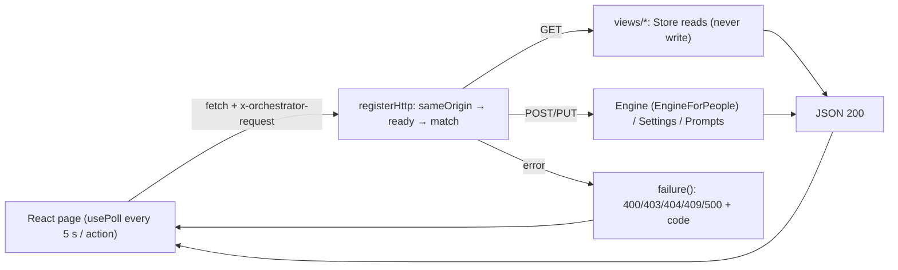

# પ્રકરણ 10 — Management panel

[← પ્રકરણ 9](09-tools-prompts-skills.md) · [અનુક્રમણિકા](../README.md) · [આગળ: પ્રકરણ 11 →](11-debugging.md)

## શીખવાનું પરિણામ અને પૂર્વજરૂરિયાત

આ પ્રકરણ પછી તમે:
- **Stop** બટનને React panel થી HTTP handler અને `Engine.stopTicket` સુધી trace કરી શકશો;
- views, settings blocks, revisions, validation, configuration reload અને error presentation સમજાવી શકશો;
- panel માં દેખાતી દરેક state ને તેની પાછળની domain હકીકત સાથે જોડી શકશો.

**Web concepts:** React component, hook (`useState`, `useRef`, `useEffect`), `fetch`, HTTP status codes (200/400/403/404/409/500), polling. **Security:** same-origin check અને CSRF protection.

**ખોલવાનો ક્રમ:** [`docs/005-panel.md`](https://github.com/deepseek-ai/dsh-superagent-prototype/blob/8c32a9dc5d72c033816c6a8110b37f40cf94fba4/docs/005-panel.md) → [`src/client/index.tsx`](https://github.com/deepseek-ai/dsh-superagent-prototype/blob/8c32a9dc5d72c033816c6a8110b37f40cf94fba4/src/client/index.tsx) → [`src/client/ticket.tsx`](https://github.com/deepseek-ai/dsh-superagent-prototype/blob/8c32a9dc5d72c033816c6a8110b37f40cf94fba4/src/client/ticket.tsx) → [`src/client/widgets.tsx`](https://github.com/deepseek-ai/dsh-superagent-prototype/blob/8c32a9dc5d72c033816c6a8110b37f40cf94fba4/src/client/widgets.tsx) → [`src/client/provider.tsx`](https://github.com/deepseek-ai/dsh-superagent-prototype/blob/8c32a9dc5d72c033816c6a8110b37f40cf94fba4/src/client/provider.tsx) → [`src/client/api.ts`](https://github.com/deepseek-ai/dsh-superagent-prototype/blob/8c32a9dc5d72c033816c6a8110b37f40cf94fba4/src/client/api.ts) → [`src/app/api.ts`](https://github.com/deepseek-ai/dsh-superagent-prototype/blob/8c32a9dc5d72c033816c6a8110b37f40cf94fba4/src/app/api.ts) → [`src/app/http.ts`](https://github.com/deepseek-ai/dsh-superagent-prototype/blob/8c32a9dc5d72c033816c6a8110b37f40cf94fba4/src/app/http.ts) → [`src/app/views/records.ts`](https://github.com/deepseek-ai/dsh-superagent-prototype/blob/8c32a9dc5d72c033816c6a8110b37f40cf94fba4/src/app/views/records.ts).

## 10.1 Panel ની ત્રણ પ્રશ્નો

`docs/005` મુજબ panel ખોલતાં ક્રમશઃ ત્રણ પ્રશ્નોના જવાબ મળવા જોઈએ: (1) અત્યારે મારી જરૂર છે? (2) system સ્વસ્થ છે? (3) એક કામનો ઇતિહાસ શું છે, Trigger થી Eval થી Ticket સુધી? Tabs: **Overview, Source, Trigger, Eval, Execution, Settings**.

## 10.2 એક ક્રિયાનો પ્રવાસ: Stop

```mermaid
sequenceDiagram
  participant U as Operator (browser)
  participant TP as ticket.tsx (TicketPage)
  participant CB as ConfirmButton + useAction
  participant API as client/api.ts api()
  participant HTTP as app/http.ts registerHttp
  participant ENG as Engine.stopTicket
  participant EX as DshExecutor.stop (afterCommit)
  U->>TP: "Stop" પર click (data.actions.stop true હોય ત્યારે જ દેખાય)
  TP->>CB: Modal: title/message → Confirm
  CB->>API: call('POST tickets/:id/stop', {id})
  API->>HTTP: fetch POST /orchestrator/api/tickets/<id>/stop, header x-orchestrator-request: 1
  HTTP->>HTTP: sameOrigin? → await ready → match route
  HTTP->>ENG: runtime.engine.stopTicket(id)
  ENG->>ENG: atomic: Tickets.end(human, stopped) + letGo + emit
  ENG->>EX: executor.stop → afterCommit cancel turn, stop jobs
  HTTP-->>API: 200 { stopped: true }
  API-->>CB: resolve → after() → reload()
  CB-->>U: Modal બંધ; page ફરી load: "Stopped by a person"
```

**તીરોનો અર્થ:** ઉપરથી નીચે સમયક્રમ છે. ડેશવાળાં તીર responses છે. Browser નું એક click server પર એક transaction (`Tickets.end`) બને છે. Worker નો turn commit **પછી** જ cancel થાય છે.

### પગલું-દર-પગલું code

1. **બટન ક્યારે દેખાય:** server view `actions: { retry: canRetry(ticket), stop: liveTicket(ticket) }` ([`views/records.ts#L123`](https://github.com/deepseek-ai/dsh-superagent-prototype/blob/8c32a9dc5d72c033816c6a8110b37f40cf94fba4/src/app/views/records.ts#L123)). એટલે UI પોતે નિયમ નક્કી કરતું નથી; domain નો predicate વાપરે છે.
2. **UI** ([`ticket.tsx#L192-L196`](https://github.com/deepseek-ai/dsh-superagent-prototype/blob/8c32a9dc5d72c033816c6a8110b37f40cf94fba4/src/client/ticket.tsx#L192-L196), real):
   ```tsx
   {data.actions.stop && <div className="dt-danger-zone">
     <ConfirmButton variant="outline" label={t('stop')} title={t('stopConfirmTitle')} message={t('stopConfirm', { title: data.title })}
       onConfirm={() => after(call('POST tickets/:id/stop', { id }))} />
   </div>}
   ```
   `docs/005` નો નિયમ: "Destructive actions require confirmation".
3. **Double click સામે રક્ષણ:** `useAction` ([`provider.tsx#L42-L56`](https://github.com/deepseek-ai/dsh-superagent-prototype/blob/8c32a9dc5d72c033816c6a8110b37f40cf94fba4/src/client/provider.tsx#L42-L56)) `running` ref વડે re-entrancy અટકાવે છે, અને error ને toast (`notify`) માં બતાવે છે. Test: "sends one stop for a double click on Confirm" ([`panel-execution.spec.tsx#L217`](https://github.com/deepseek-ai/dsh-superagent-prototype/blob/8c32a9dc5d72c033816c6a8110b37f40cf94fba4/tests/panel-execution.spec.tsx#L217)).
4. **Typed call:** `call` નો type `src/app/api.ts` ના `Api` map પરથી આવે છે (`'POST tickets/:id/stop': { response: { stopped: true } }`). Panel bundle server code import કરતું નથી, ફક્ત types (`docs/007` dependency rules).
5. **fetch** ([`client/api.ts#L33-L57`](https://github.com/deepseek-ai/dsh-superagent-prototype/blob/8c32a9dc5d72c033816c6a8110b37f40cf94fba4/src/client/api.ts#L33-L57)): `x-orchestrator-request: 1` header સાથે. Network fail થાય તો `ApiError(offline, 0, {unreachable})`. Body વગરનો 404 → "not running" (restart દરમિયાન DSH web server). Body માં `code` હોય તો તે `USER_ERRORS` નો localized message બને છે.
6. **Server** ([`http.ts#L230-L247`](https://github.com/deepseek-ai/dsh-superagent-prototype/blob/8c32a9dc5d72c033816c6a8110b37f40cf94fba4/src/app/http.ts#L230-L247)): `/orchestrator/api/` prefix → `sameOrigin` (Host `127.0.0.1:<port>`/`localhost:<port>`, custom header, Origin same અથવા absent; નહીં તો 403) → `await runtime.ready` → route match → handler ([L194](https://github.com/deepseek-ai/dsh-superagent-prototype/blob/8c32a9dc5d72c033816c6a8110b37f40cf94fba4/src/app/http.ts#L194)): `ticket(params.id)` (404 if missing) → `runtime.engine.stopTicket(id)`.
7. **Errors → status** (`failure`, [L81-L91](https://github.com/deepseek-ai/dsh-superagent-prototype/blob/8c32a9dc5d72c033816c6a8110b37f40cf94fba4/src/app/http.ts#L81-L91)): `ZodError` → 400 + `issues`; `SetupError` → 400 + `setup`; `UserError` → 404 (`missing`) અથવા 400 + `code/values`; `SettingsConflict`/`PromptConflict` → 409; બાકી → 500.

**Custom header કેમ?** બીજી website નું HTML form અથવા "simple" cross-site request custom header મોકલી શકતું નથી. Header મોકલવો હોય તો browser CORS preflight કરે છે, જેને આ server મંજૂરી આપતું નથી. આ CSRF સામેનું રક્ષણ છે. Test: "answers only a same-origin request from the panel on the loopback address".

**Running example:** alice એ Issue માં "stop" લખ્યું તે **Trigger** હતો, અને Eval વડે stop થયો (Decision `stop`). Panel નું Stop એ **command** છે: તેનો કોઈ Decision નથી, અને ticket પર `ended.by = 'human'`, `outcome = 'stopped'` નોંધાય છે. બંનેની અસર સરખી છે (Mandate withdrawn), પણ audit trail અલગ છે.

## 10.3 Views અને domain facts

| Panel પર દેખાય | પાછળની domain હકીકત | Source |
| --- | --- | --- |
| Ticket stage label ("Awaiting review", "Queued", …) | `ticketStage(ticket)` | `stage.ts` |
| Execution filters open/person/working/idle/ended | `TICKET_FILTERS` | `app/api.ts#L12` |
| "Delivered to Ticket" (Thread timeline) | `followupOwners` / disposition `fanout` | `views/records.ts` (`ownersOf`) |
| **Evaluate again** | `actions.requeue` → `engine.reevaluate` | `records.ts#L101`, `http.ts#L177` |
| Problems on Overview | Health entries + recent `unavailable` Decisions (24 h, not dismissed, still latest) | `views/overview.ts` |
| Executor load | `executor.activeCount()` + queued tickets + `maxWorkers` | `views/tickets.ts` `executorLoad` |
| Dropped messages | outbox receipts `status: 'dropped'` + reason | `store-read.ts` `droppedReplies` |
| Policy history | settings versions + diffs | `settings-history.ts` |

Principle "Honest state" (`docs/005`): "A count equals the length of the list it links to". Tests `panel-*.spec.tsx` fake API (`tests/fixtures/panel-server.ts`) વડે દરેક page ચકાસે છે.

## 10.4 Settings, revisions અને validation

**Save flow:** panel `PUT settings/<block>` `{ value, revision }` → `Settings.save(block, value, revision, 'panel')` ([`settings.ts#L148-L196`](https://github.com/deepseek-ai/dsh-superagent-prototype/blob/8c32a9dc5d72c033816c6a8110b37f40cf94fba4/src/app/settings.ts#L148-L196)):
1. **Optimistic concurrency:** `revision !== store.blockRevision(block)` હોય તો `SettingsConflict` → 409. Async checks (model availability, account CLIs) **પછી** ફરી તપાસ થાય છે.
2. Block parse (zod), merge, model resolve, `guard` (tool origin account fields બદલી શકતું નથી), `setupChanged` હોય તો `checkAccounts`.
3. કોઈ ફેરફાર નથી → કશું save થતું નથી.
4. `store.atomic`: snapshot save + settings notice (tool origin ન હોય તો) + `engine.policyChanged` (version બદલાયું હોય તો), બધું એક transaction માં.
5. `blockedCommands` બદલાયા હોય તો shims તરત ફરી લખાય છે.
6. **Configuration reload:** setup fields બદલાયા હોય, અથવા setup બાકી હોય, તો `restarting: true` અને `setup.restart()`. નહીં તો `requestPass()`.

**Client draft:** `draftReducer` ([`draft.tsx#L80`](https://github.com/deepseek-ai/dsh-superagent-prototype/blob/8c32a9dc5d72c033816c6a8110b37f40cf94fba4/src/client/draft.tsx#L80)) drafts ની phases (`clean`/editing/`saving`/`awaitingRevision`) સંભાળે છે, અને newer saved revision સાથે merge કરે છે: "keeps mine where both sides changed a key" (`tests/draft.spec.ts`). 409 આવે તો draft ખોવાતો નથી.

**Machine limits** (`promptMaxChars`, …) DSH ના configuration form થી બદલાય છે, અને restart વગર લાગુ પડે છે (`Volatile`, `docs/007` "Configuration reload").

## 10.5 Panel request flow (generic)



**તીરોનો અર્થ:** GET requests ફક્ત views વાંચે છે, અને views ક્યારેય લખતા નથી (`store.read` "These methods never write"). POST/PUT requests role-scoped interfaces (`EngineForPeople`) થી domain બદલે છે. Errors fixed codes સાથે પાછી આવે છે, અને panel તેમને પોતાની ભાષામાં બતાવે છે.

## 10.6 Exercise

```bash
pnpm vitest run tests/panel-execution.spec.tsx tests/http.spec.ts tests/draft.spec.ts
```

## 10.7 Modification (પ્રકરણ 12 નો ચોથો exercise) અને verification

**[Proposed]** Ticket page પર Stop confirmation message માં ticket નું short name (`data.directory` નો છેલ્લો segment) ઉમેરો, જેથી operator ખોટો ticket stop ન કરે. **Layer:** ફક્ત client (`ticket.tsx`) અને locales (`client/locales.ts`, બંને ભાષાઓ). Domain બદલાતું નથી. **Verify:** `tests/locales.spec.ts` બંને ભાષાઓમાં key માગે છે; `panel-execution.spec.tsx` "stops an open Ticket from its page after confirmation" પણ ચલાવો. Patch: [પરિશિષ્ટ E](../appendices/E-solutions.md#પ્રકરણ-10).

## 10.8 Debugging exercise: "panel says dsh-superagent is not answering"

**કારણો:** (a) settings save પછી restart; (b) startup configuration error. **નિદાન:** browser devtools માં request જુઓ. **Body વગરનો 404** હોય તો dsh-superagent routes mount નથી (restart ચાલુ છે), તેથી `client/api.ts` `notRunning` બતાવે છે. 403 હોય તો panel ને બીજા host (દા.ત. machine નો LAN IP) પરથી ખોલ્યું છે, તો `127.0.0.1` વાપરો. `provider.tsx` restart દરમિયાન 1 s ના અંતરે, 30 s સુધી poll કરે છે.

## Mastery પ્રશ્નો

1. Stop બટન દેખાવું જોઈએ કે નહીં, તે client કેમ નક્કી કરતું નથી?
2. Thread માં "stop" લખવું અને panel નું Stop: Decision ની દ્રષ્ટિએ શો ફરક?
3. Custom header CSRF કેવી રીતે અટકાવે છે?
4. 409 આવે ત્યારે draft કેમ ખોવાતો નથી?

ઉકેલો: [પરિશિષ્ટ E § પ્રકરણ 10](../appendices/E-solutions.md#પ્રકરણ-10)

[← પ્રકરણ 9](09-tools-prompts-skills.md) · [આગળ: પ્રકરણ 11 →](11-debugging.md)
