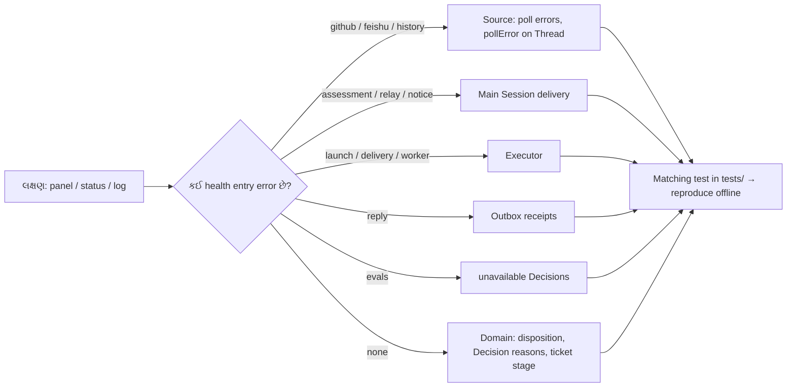

# પ્રકરણ 11 — Debugging

[← પ્રકરણ 10](10-panel.md) · [અનુક્રમણિકા](../README.md) · [આગળ: પ્રકરણ 12 →](12-customization.md)

## શીખવાનું પરિણામ અને પૂર્વજરૂરિયાત

આ પ્રકરણ પછી તમે દસ સામાન્ય failures માટે ચાર પગલાં કરી શકશો: **reproduce** (repository ના test વડે), **diagnose** (કયો state/field જોવો), **correct** (ખરું layer), અને **regression verify** (કયો test). પ્રકરણ 1–10 જરૂરી છે.

**Debugging ની સામાન્ય પદ્ધતિ (આ repository માટે):**



**તીરોનો અર્થ:** health entry ક્યા ભાગમાં જોવું તે કહે છે. દરેક entry ને એક જ owner લખે છે (`HealthBoard`), એટલે error નો ભાગ સીધો ઓળખાય છે. છેલ્લે, offline reproduce માટે સંબંધિત test શોધો.

**સાધનો:**
- `scripts/dsh-superagent status` (JSON + exit code).
- `GET /orchestrator/api/state|sources|tickets/<id>|threads/<key>`.
- State directory ની **copy** પર `sqlite3`. Live database ને ક્યારેય સીધો edit ન કરો: lock અને WAL ને કારણે નુકસાન થઈ શકે.
- `pnpm vitest run <file> -t "<name>"`.

**[Test ચલાવ્યો]** નીચેના બધા regression tests અમે અલગ-અલગ ચલાવ્યા; દરેક `1 passed` (અથવા જૂથ pass) આવ્યો ([Verification report](../appendices/F-verification-report.md)).

---

## 11.1 Duplicate events

| પગલું | વિગત |
| --- | --- |
| લક્ષણ | Worker ને એક જ comment બે વાર દેખાય છે, અથવા બે tickets બને છે |
| Reproduce | `tests/core-engine.spec.ts` "stores a trigger once and records source filtering"; `tests/sources.spec.ts` "keeps one body Trigger for an Issue that a later poll reads again"; running example `B_duplicate` |
| Diagnose | બંને Trigger ids સરખાવો. Ids અલગ હોય તો comment edit થઈ હતી (`updated_at` id નો ભાગ છે). એક Trigger માંથી બે tickets બન્યા હોય તો `decision.triggerIds` જુઓ; `Evals.decide` "accepted before" નો guard ધરાવે છે |
| Correct | Edit નવો Trigger બને તે **design** છે. Worker prompt (Communication section) કહી શકે: "an edited comment arrives again; check whether it changes the request" |
| Verify | `pnpm vitest run tests/core-engine.spec.ts -t "direct decisions"`: "accepts a Trigger once" |

## 11.2 Denied requests

| પગલું | વિગત |
| --- | --- |
| લક્ષણ | `@agent` કર્યું, પણ કંઈ થયું નહીં |
| Reproduce | `tests/policy.spec.ts` "rejects automated messages, unknown senders without a Thread, and allowed senders who did not address the agent"; running example `C_unauthorized` (`not_a_member`) |
| Diagnose | Panel → Trigger → Thread timeline. Trigger ત્યાં **ન હોય** તો Source સુધી પહોંચ્યો જ નથી: Source off છે, setup બાકી છે, mention edit થી ઉમેરાયું છે, અથવા notifications disabled છે. Trigger `filtered` હોય તો Source scope (`source_disabled`, `chat_not_allowed`). Decision `ignore` હોય તો reason code: `not_a_member` / `no_mention` / `admission_ignored` / `not_human` |
| Correct | Policy → On each Source → allowed list માં login ઉમેરો. Login નો case વાંધો નથી (`sameName`). પછી Trigger પર **Evaluate again** |
| Verify | `pnpm vitest run tests/policy.spec.ts -t "grants explicit strength"` |

## 11.3 Assessment timeouts

| પગલું | વિગત |
| --- | --- |
| લક્ષણ | `status` exit 2, `evals` error; Decision `unavailable` + `timeout` |
| Reproduce | `tests/core-engine.spec.ts` "counts an Eval's deadline from its delivery, queues its Triggers again twice when it expires, then records it unavailable"; "lets no Eval expire while processing is paused…" |
| Diagnose | Main Session એ candidate મેળવ્યો હતો (`delivered`)? `models` health માં model-budget retry છે? Main Session લાંબું shell command ચલાવતું હતું? (`noWait` guard ને `standard` preset ધરાવતા જૂના sessions માં ધ્યાન રાખો) |
| Correct | `eval.timeoutSeconds` વધારો (`LIMITS`), અથવા lighter model (`eval.model`). Panel માંથી **Evaluate again** અથવા dismiss |
| Verify | ઉપરનો deadline test; [પ્રકરણ 5](05-policy-eval.md#57-modification-અને-regression-verification) નો `REQUEUES` regression |

## 11.4 Failed workspace preparation

| પગલું | વિગત |
| --- | --- |
| લક્ષણ | Ticket `person/failed`: "The prepare command failed: …" |
| Reproduce | `tests/runtime.spec.ts` "runs the prepare command once for a new ticket, under the execution root with the ticket's environment, and fails the ticket with its output" (test `sh -c exit 3` → "fatal: no such clone" simulate કરે છે) |
| Diagnose | Ticket page → environment variables; `<root>` માં તે command હાથે ચલાવો. `PrepareFailed` retry થતું નથી ([પ્રકરણ 7](07-worker-execution.md)) |
| Correct | Execution settings માં prepare ઠીક કરો → **Retry** (directory ખાલી હોય તો prepare ફરી ચાલે છે) |
| Verify | એ જ test, અને "runs a launch that fails for a passing reason again on the launch backoff three times, then fails its ticket; a failed prepare fails at once" |

## 11.5 Provider errors

| પગલું | વિગત |
| --- | --- |
| લક્ષણ | Worker અચાનક failed: `429`/`503`/`ECONNRESET` |
| Reproduce | `tests/runtime-concurrency.spec.ts` "lets a worker go on after a passing provider failure, three times, before its ticket fails"; "starts the count of passing failures again once its turn ends as turns do" |
| Diagnose | `transient(error)` regex/status ([`dsh.ts#L44-L55`](https://github.com/deepseek-ai/dsh-superagent-prototype/blob/8c32a9dc5d72c033816c6a8110b37f40cf94fba4/src/executor/dsh.ts#L44-L55)). Error message માં ઓળખાય તેવો શબ્દ ન હોય (દા.ત. provider નો custom text), તો તે transient ગણાતી **નથી** અને તરત failed થાય છે |
| Correct | Provider limits; **Retry**. Provider નો નવો transient text દેખાય તો `PASSING` regex માં ઉમેરો (core change, test સાથે) |
| Verify | ઉપરના બે tests |

## 11.6 Failed input delivery

| પગલું | વિગત |
| --- | --- |
| લક્ષણ | Stage `person/delivery`, "Input undelivered" |
| Reproduce | `tests/core-engine.spec.ts` "retry after a failed delivery"; `tests/runtime-concurrency.spec.ts` "records on the ticket that its worker Session could not be created again"; `tests/panel-execution.spec.tsx` "says why an Input was not delivered…" |
| Diagnose | `ticket.delivery.error` (300 chars). Worker Session કોઈએ delete કર્યો? DSH preset row ખૂટે છે? (`agent-preset/not-found`, `docs/006`) |
| Correct | કારણ સુધારો → **Retry** (નવું Assignment input લઈ લે છે). Delivery ના પોતાના retries 2 s → 60 s છે |
| Verify | "starts a new Assignment for a ticket whose Input keeps failing to reach its worker, which takes the Input" |

## 11.7 Failed replies

| પગલું | વિગત |
| --- | --- |
| લક્ષણ | `reply` health error; ack અથવા result GitHub પર દેખાતું નથી |
| Reproduce | `tests/effects.spec.ts` "retries a failed effect after a delay that doubles up to its maximum, and reports the kind in error after three failures"; `tests/outbox.spec.ts`; `tests/migration.spec.ts` "keeps each message as a receipt…" |
| Diagnose | Receipt `pending`/`sent`/`dropped`? `dropped.reason` `channelGone` (deleted/locked Issue) અથવા `channelIgnored` (Source હવે તે conversation સાંભળતો નથી). `behind` ને કારણે પછીના messages અટક્યા છે? |
| Correct | Agent account ની permissions/token; Source ફરી enable કરો. Dropped message ફરી queue થતો નથી, કારણ કે id idempotent છે |
| Verify | `pnpm vitest run tests/effects.spec.ts tests/outbox.spec.ts` |

## 11.8 Concurrent follow-ups

| પગલું | વિગત |
| --- | --- |
| લક્ષણ | એક Thread પર બે tickets; follow-up કોનો છે? અથવા candidate card ની રાહ દરમિયાન નવો message આવ્યો |
| Reproduce | `tests/core-engine.spec.ts` "keeps a follow-up two tickets reached with the one that did not hand it back, and queues it once neither decides it"; `tests/runtime-concurrency.spec.ts` "evaluates a message that arrives on a thread while an earlier candidate's card waits for its link, in the thread's next Eval" |
| Diagnose | Disposition: `fanout`, `handbacks`, `acked`; `followupOwners`. Thread નું `pending` અને `evaluating` |
| Correct | Design મુજબ: દરેક owner hand back કરે ત્યારે જ message Eval માં જાય છે. Main Session ને `workerDecides` refusal મળે તે સામાન્ય છે |
| Verify | ઉપરના બે tests |

## 11.9 Interrupted workers

| પગલું | વિગત |
| --- | --- |
| લક્ષણ | Restart પછી કેટલાક tickets ફરી શરૂ થયા, અને કેટલાક નહીં |
| Reproduce | `tests/core-engine.spec.ts` "interrupted assignments" (2 tests); `tests/runtime.spec.ts` "relaunches running assignments after a restart with a recovery note", "leaves waiting and blocked assignments alone after a restart and keeps blocked workers paused"; running example `G_restart` |
| Diagnose | Assignment નો `report.state` અને `deliveredAt >= report.at` (`busy`). Settled → session રહે છે; બાકી → `hostRestarted` + recovery note |
| Correct | કંઈ નહીં, design છે. Worker એ બહારનું કામ ફરી કર્યું હોય (duplicate push/comment) તો recovery note ની અસર તપાસો; team section માં વધુ કડક નિયમ લખો |
| Verify | ઉપરના tests |

## 11.10 Incompatible stored state

| પગલું | વિગત |
| --- | --- |
| લક્ષણ | Start થતું નથી: "Unsupported orchestrator database version 12" અથવા "older than schema 10" |
| Reproduce | `tests/store.spec.ts` "refuses databases newer than this build and rolls back failed atomic work"; `tests/migration.spec.ts` "refuses a database older than schema 10 and asks for a new state directory", "changes nothing when one step fails: the database stays at schema 10 as it was" |
| Diagnose | `kv` table માં schema key. Downgrade કર્યું? Upgrade વચ્ચે migration fail થયું? (Error message "unchanged at schema 10") |
| Correct | Newer DB: upgrade પહેલાંનો **backup** વાપરો, અથવા નવું build પાછું લાવો. Older than 10: નવી state directory બનાવો |
| Verify | ઉપરના ત્રણ tests |

---

## 11.11 Independent debugging task (practice)

`examples/running-example.spec.ts` માં step I (alice stop) પહેલાં આ લાઇન ઉમેરો:

```ts
settings.policy.sources.github!.allowed = []
```

**પ્રશ્ન:** stop સફળ થશે? અનુમાન કરો, ચલાવો, અને કારણ code થી સમજાવો. (સંકેત: `settingsPolicy` દરેક call માં ફરી બને છે; ticket thread પર alice હવે unlisted છે; `observe` mode માં follow-up inferred છે; stop માટે explicit જોઈએ.) ઉકેલ: [પરિશિષ્ટ E](../appendices/E-solutions.md#પ્રકરણ-11).

## Mastery પ્રશ્નો

1. "Trigger દેખાતો જ નથી" અને "Trigger filtered છે": બંનેનાં કારણો કયા layers માં હોય છે?
2. Provider error transient છે કે નહીં, તે કયું function નક્કી કરે છે, અને તેની મર્યાદા શી છે?
3. Live SQLite database ને સીધો edit કેમ ન કરવો?
4. Dropped reply ફરી કેમ મોકલાતો નથી, અને ફરી મોકલવો હોય તો શું કરવું પડે?

ઉકેલો: [પરિશિષ્ટ E § પ્રકરણ 11](../appendices/E-solutions.md#પ્રકરણ-11)

[← પ્રકરણ 10](10-panel.md) · [આગળ: પ્રકરણ 12 →](12-customization.md)
