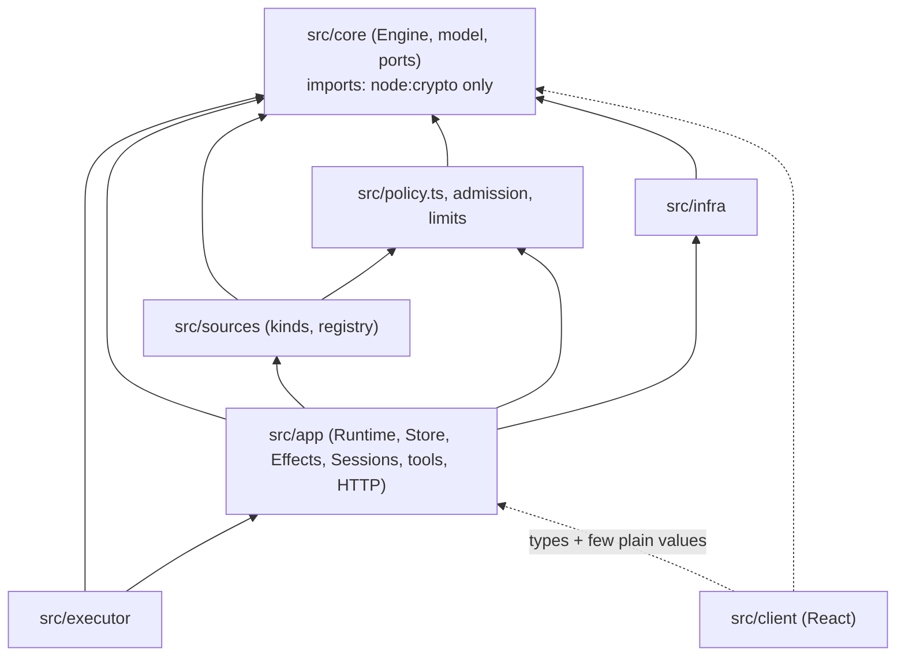

# પ્રકરણ 13 — Advanced engineering

[← પ્રકરણ 12](12-customization.md) · [અનુક્રમણિકા](../README.md) · [આગળ: પ્રકરણ 14 →](14-final-project.md)

## શીખવાનું પરિણામ અને પૂર્વજરૂરિયાત

આ પ્રકરણ પછી તમે આ repository નું આઠ દ્રષ્ટિકોણથી વિશ્લેષણ કરી શકશો: dependency direction, transactional consistency, concurrency, cancellation, recovery, observability, context size/model-call cost, અને performance. તમે એક workload નું ફેરફાર પહેલાં અને પછી માપન કરશો, અને review description સાથે એક focused contribution તૈયાર કરશો.

## 13.1 Dependency direction



**તીરોનો અર્થ:** "A → B" એટલે A, B ને import કરે છે. બધા સળંગ તીર અંદરની તરફ, `core` તરફ જાય છે. Dotted તીર ફક્ત types અને થોડી plain values દર્શાવે છે.

**[Test ચલાવ્યો / grep]** Pinned commit પર:
- `src/core/*.ts` ના બધા imports core ની અંદરના છે, ઉપરાંત ફક્ત `node:crypto` (`ids.ts` નો hash).
- `src/sources/*.ts` માંથી કોઈ `../app` import કરતું નથી.
- `src/client` host-side માંથી `app/api.ts` (types + filter lists), `setup.ts`, `sources/kind.ts`, `limits.ts`, `sources/host.ts`, `core/errors.ts`, `core/stage.ts`, `core/reasons.ts`, `navigation.ts` અને `admission.ts` import કરે છે. આ યાદી `docs/007` ની મંજૂર યાદી સાથે મેળ ખાય છે. એક અપવાદ: `core/stage.ts` docs ની plain-value યાદીમાં નથી, પણ client તેને ફક્ત type (`TicketStage`) તરીકે import કરે છે.

**Observation:** `src/executor/dsh.ts` `../app/effects.ts`, `../app/sessions.ts` વગેરે import કરે છે, એટલે executor app પર આધાર રાખે છે, અને `src/app/runtime.ts` executor ને import કરે છે. આ module-level cycle છે; runtime પર getters તેને તોડે છે. `docs/007` "Source-specific dependencies" વિભાગમાં આવા generic → specific અપવાદો પ્રામાણિકપણે નોંધે છે.

## 13.2 Transactional consistency

- **Engine command = એક transaction.** અપવાદ: `evaluateDue` દરેક Eval/ticket માટે અલગ transaction વાપરે છે, જેથી એકની failure બીજાને rollback ન કરે.
- **Effects inside, I/O outside.** Ports transaction ની અંદર ફક્ત enqueue કરે છે ([પ્રકરણ 8](08-store-effects-outbox.md)).
- **Async check પછી ફરી વાંચો.** `Settings.save` model/account checks પછી revision **ફરી** તપાસે છે, અને current settings ફરી વાંચીને merge કરે છે (lost update અટકે છે).
- **Network read transaction ની બહાર.** `orchestrator_report` પહેલાં `readPull`, પછી `atomic { claimPull; report; relay }`. SQLite transaction ને await વચ્ચે ખુલ્લો ન રખાય. `DatabaseSync` synchronous છે, અને Engine methods પણ synchronous છે; આ design ની ચાવી છે.

## 13.3 Concurrency

Node.js એક thread પર ચાલે છે, પણ `await` બિંદુઓ પર interleaving થાય છે. Repository ના ઉપાયો:

| જોખમ | ઉપાય | જગ્યા |
| --- | --- | --- |
| એક સાથે બે passes | `pumping`/`pumpAgain` coalescing | `passes.ts` |
| એક Thread પર બે Evals | `Thread.evaluating`; બાકીના `pending` | `evals.ts` |
| છેલ્લો worker slot બે વાર લેવાય | `WorkerSlots.reserve` synchronous, `await` પહેલાં | `dsh.ts` |
| Launch દરમિયાન ticket stop/retry | દરેક `await` પછી `current()` | `dsh.ts#L424-L470` |
| Delivery દરમિયાન background stop | `stopping` map, `Later` | `dsh.ts` |
| Effect ચાલતી વખતે નવો payload | `generation` | `effects.ts` |
| Stale settings save | block revision + 409 | `settings.ts` |
| એક process બીજી સાથે | directory lock | `runtime.ts` |

Tests: `tests/runtime-concurrency.spec.ts` (943 lines).

## 13.4 Cancellation

- **Lifetime:** `Runtime.stopped: AbortController`. Commands, polls અને prepare (`AbortSignal.any([lifetime, timeout])`) બધા તેને સાંભળે છે.
- **Domain end → afterCommit cancel:** rollback થાય તો worker અટકતો નથી.
- **`keepInbox`:** shutdown/restart પર `true` (input સચવાય); ticket stop પર `false`.
- **Background jobs:** handoff વખતે subagents stop થાય છે અને jobs રહે છે; Assignment પૂરું થાય ત્યારે બધું બંધ.

## 13.5 Recovery

| ઘટના | Recovery | પ્રકરણ |
| --- | --- | --- |
| Process restart | `executor.resume` → `assignmentInterrupted` → recovery note; pending launches requeue થાય | 7 |
| Effect failure | Backoff; rows SQLite માં | 8 |
| Source poll failure | Per-thread `pollError`, retries map, 24 h abandon, cursor સચવાય | 4 |
| Eval timeout | 2 requeues → unavailable | 5 |
| Provider transient | 3 retries | 7 |
| Process dead | External hourly check (Watchdog-lite) | 0A, 2 |

## 13.6 Observability

- **HealthBoard:** દરેક entry નો એક જ owner. `GET state` → `scripts/dsh-superagent status` → exit codes.
- **Structured reasons:** Decision `reason: Reason[]` with codes (`REASONS`, gate codes, Source codes). Panel તેમને બંને ભાષામાં બતાવે છે.
- **Dispositions:** દરેક Trigger નો હિસાબ.
- **Settings history** (policy diffs), **prompt versions per session**.
- **ખૂટતું:** metrics અથવા tracing (latency histograms, token counts) નથી. Logs `ctx.logger` દ્વારા DSH ને જાય છે. **[Proposed]** `DomainEvents` ના `emit` પર counter ઉમેરો: "Other events currently have no consumer" (`docs/007`).

## 13.7 Context size અને model-call cost

**Context:**
- Inline & Spill limits ([પ્રકરણ 0A](00a-superagent-article.md)): assignment 1500, trigger 600, eval window 4000/1200/400/50 chars, routing note ≤ 30 words, IM ≤ 100 words.
- `model-surface.spec.ts` દરેક role ના instructions નું size budget enforce કરે છે. Worker 1000 chars ની નજીક છે ([પ્રકરણ 9](09-tools-prompts-skills.md)).
- Policy section છેલ્લે આવે છે, જેથી prompt prefix stable રહે (prefix caching friendly).

**Model calls ની બચત:**
1. Gate deterministic છે: મોટા ભાગના messages LLM સુધી પહોંચતા નથી (bots, unlisted → ignore, Decision વગર assessment).
2. Explicit requests માટે assessment છોડી દેવાય છે; ફક્ત routing થાય છે.
3. `ignoredFromCard`: rule ને સ્પર્શ ન કરતા inferred candidates ને card પરથી જ ignore કરી શકાય.
4. Pass-through: follow-ups main Session ના decisions વગર workers ને સીધા જાય છે. લેખ (§7.1) મુજબ pass-through વગર cache-read tokens લગભગ 37% વધ્યા હતા. આ લેખનો આંકડો છે; અમે માપ્યો નથી.
5. Batching: Thread-level `pending` batch, અને main Session માં steer batching.

## 13.8 Performance: એક workload નું માપન

**Workload** ([`examples/intake-bench.ts`](../examples/intake-bench.ts)): SQLite `Store` + real `Engine`. 2000 Triggers, 200 Threads પર, `receive` કરો; પછી એક `evaluateDue` (200 Evals શરૂ થાય). Assessor/Executor/Outbox no-op fakes છે. Node 22 ના strip-only mode માં parameter properties ચાલતી નથી, એટલે `--experimental-transform-types` જરૂરી છે:

```bash
node --no-warnings --experimental-transform-types bench/intake-bench.ts 2000 FULL
```

**Change:** `PRAGMA synchronous=FULL` (repository default, [`store.ts#L64`](https://github.com/deepseek-ai/dsh-superagent-prototype/blob/8c32a9dc5d72c033816c6a8110b37f40cf94fba4/src/app/store.ts#L64)) → `NORMAL`, benchmark માં runtime પર.

**[Test ચલાવ્યો] પરિણામ** (આ environment: 4 vCPU Linux container; ત્રણ alternating runs):

| Run | synchronous | receive 2000 (ms) | ms/Trigger | evaluateDue, 200 Evals (ms) |
| --- | --- | --- | --- | --- |
| 1 | FULL | 2046 | 1.023 | 366 |
| 2 | NORMAL | 819 | 0.410 | 198 |
| 3 | FULL | 1690 | 0.845 | 267 |
| 4 | NORMAL | 1000 | 0.500 | 280 |
| 5 | FULL | 2336 | 1.168 | 442 |
| 6 | NORMAL | 895 | 0.447 | 254 |

**વિશ્લેષણ:**
- `NORMAL` આશરે **2× ઝડપી** છે (median 0.45 vs 1.02 ms/Trigger). દરેક `receive` એક transaction છે, અને `FULL` દરેક commit પર fsync કરે છે.
- **પણ** GitHub Source દર 60 s એ poll કરે છે. 1 ms/Trigger ની ઝડપે સેંકડો Triggers/minute પણ સરળતાથી સંભળાય છે. Bottleneck LLM છે (લેખ: router request 2.5–3.9 s), SQLite નહીં.
- **નિર્ણય:** `FULL` રાખો. Durability નો તર્ક [પ્રકરણ 8](08-store-effects-outbox.md#811-modification-અને-verification-synchronousnormal-પ્રયોગ) માં છે. Container ના I/O પરિણામો machine પ્રમાણે બદલાય છે; variance મોટો છે (FULL માં 1690–2336 ms).
- **બીજી તક [Proposed]:** `Intake.receive` દરેક Trigger માટે ticket rows વાંચે છે. Subscriptions ઘણી હોય ત્યારે ફરીથી માપો (workload બદલીને દરેક Thread પર એક ticket).

## 13.9 Focused contribution: review description

Patch 12.5 (quoted mentions) માટે PR description, upstream template ના અભાવે સામાન્ય ઢાંચામાં:

```markdown
## Quoted mentions do not address the agent on GitHub

**Problem.** A GitHub reply that quotes an earlier comment (`> @agent …`) is recorded as `addressed: 'mention'`, so a
listed person's "Thanks!" under a quote becomes an explicit candidate for the main Session. docs/002 says the Source
records whether a message addresses the agent, and prompts/admission.md says quoted instructions alone do not authorize work.

**Change.** `mentions()` in src/sources/github-trigger.ts looks for the mention only in the author's own words: without
`>` quoted lines, fenced code blocks and inline code (`ownWords`). The Trigger text is unchanged.

**Behaviour change.** A mention written only inside code no longer addresses the agent. Feishu is unaffected.

**Tests.** tests/quoted-mention.spec.ts (fails before the change, passes after); docs/007 test table updated.
`pnpm check`: 61 files, 1199 tests passed, build complete (with the feishu consumer test fix noted separately).
```

## 13.10 Architecture review checklist (પ્રકરણ 14 માં વપરાશે)

1. શું domain rule core માં છે, અને glue માં નથી?
2. શું દરેક state નો એક જ writer છે?
3. શું side effects enqueue થાય છે, અને transaction ની અંદર I/O તો નથી?
4. શું refusals `UserError` codes છે, અને panel/locales માં worded છે?
5. શું docs (`000–008`), tests અને `docs/007` tables એક સાથે અપડેટ થયા છે?
6. Prompt-only guarantee ક્યાં છે, અને તેનું જોખમ શું છે?

## Mastery પ્રશ્નો

1. Engine synchronous કેમ છે? Async હોત તો કઈ guarantees તૂટે?
2. `evaluateDue` એક transaction ને બદલે અનેક transactions કેમ વાપરે છે?
3. Benchmark નું 2× સુધારણું production માં કેમ મહત્વનું નથી?
4. Observability માં સૌથી મોટી ખોટ કઈ છે, અને સૌથી નાનો ઉપયોગી ફેરફાર કયો?

ઉકેલો: [પરિશિષ્ટ E § પ્રકરણ 13](../appendices/E-solutions.md#પ્રકરણ-13)

[← પ્રકરણ 12](12-customization.md) · [આગળ: પ્રકરણ 14 →](14-final-project.md)
